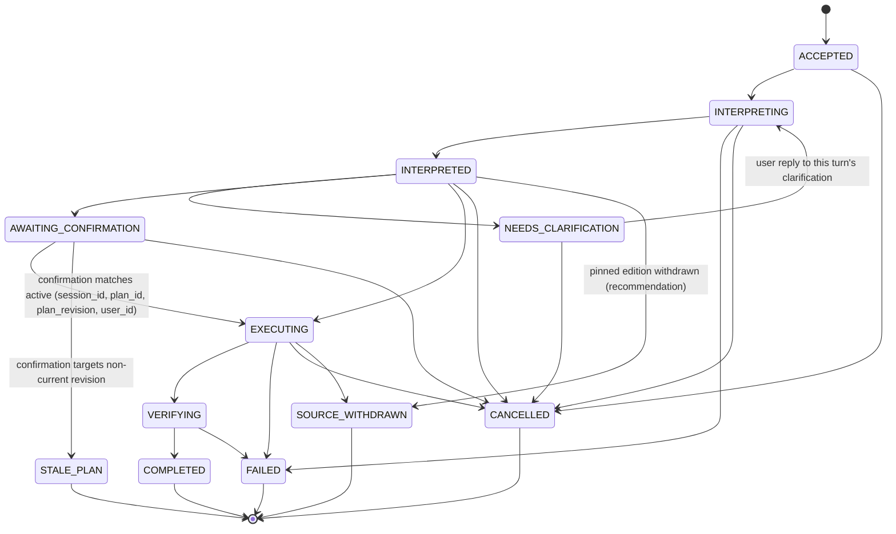
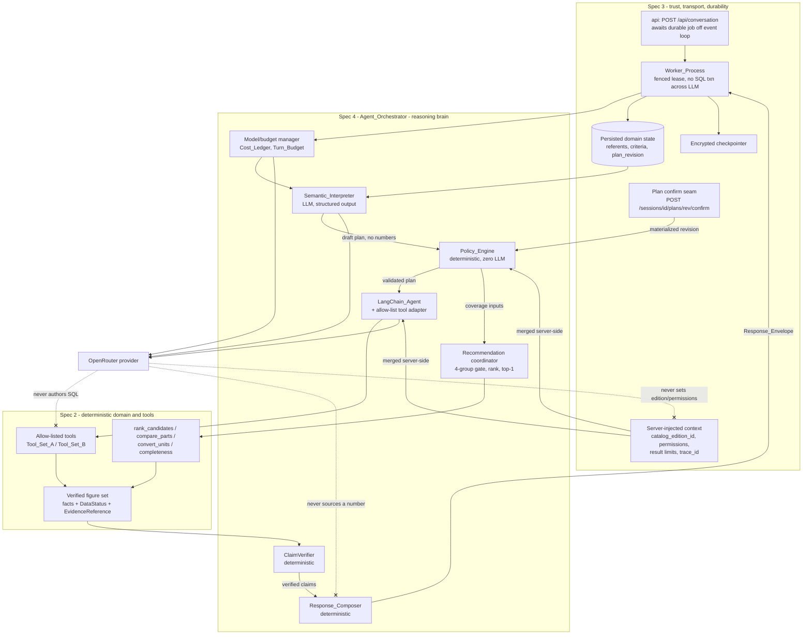

# Design Document

## Overview

This document is the design for **`agent-orchestration-response` (Spec 4 of 6)** of the *Series 76 Technical Assistant* (Konecto technical assessment). It is the **agentic orchestration and response-composition layer** — the **reasoning brain** that drives one conversation turn end to end: it interprets a bilingual user message, authors a validated plan, (optionally) asks for clarification or confirmation, selects and invokes allow-listed custom tools, verifies every claim, and composes a bilingual `answer` together with typed `content_blocks` whose every technical figure originates from the verified figure set.

This layer is the reasoning brain; it is **not** the trust, transport, durability, numeric, or presentation boundary.

### Position in the system

- **Depends on** `domain-and-tools` (Spec 2): it **calls** the pure domain operations (`get_part`, `search_parts`, `get_source_notes`), the deterministic services (`rank_candidates`, `compare_parts`, `convert_units`), the custom LangChain tools (Tool_Set_A and Tool_Set_B), the recommendation-completeness primitives (four `RequirementGroup`s, `CoverageStatus`), the `SemanticFailureCode` set, and the **verified figure set** (every number carries `DataStatus` + `EvidenceReference`). It never reimplements a repository, a ranking, a comparison, a conversion, or a number.
- **Plugs into** `backend-api-auth-jobs-crypto` (Spec 3): it mounts its agent logic inside the Spec 3 **`Worker_Process`**, and the Spec 3 **`api` sync endpoint** (`POST /api/conversation`) awaits the durable job result off the event loop. It consumes the HTTP endpoints, the typed DTOs and `Response_Envelope`, the structurally-defined `content_blocks` discriminated union, the `Job_State` set, the durable PostgreSQL job queue (leases/fencing/idempotency), the `Plan_Revision` confirmation seam (`POST /api/sessions/{id}/plans/{rev}/confirm`), and the encrypted-checkpoint surface. It never establishes identity, opens a SQL transaction, encrypts data, or owns the queue.
- **Consumed by** `android-app` (Spec 5): which renders the `Response_Envelope` this layer produces, without extracting technical figures from generated prose.
- **Evaluated by** `evaluation-and-reproducibility` (Spec 6): which resolves the empirical model-selection and tool-set A/B comparison. This design defines the **harness-ready seams, candidate configuration, and promotion gates**; it runs no benchmark and declares no winner.

### Source-of-truth reminder (binding on this design)

No number emitted by this layer in `answer`, any `content_block`, any chart series, or any highlight may be invented by the language model, inferred from a part-number substring, taken from the summary PDF, or reconstructed from generated prose. **The LLM composes prose and selects among allow-listed tools; the authoritative numbers come from the Spec 2 verified figure set** (which itself derives numbers only from `series_76_electric_data.pdf`) and are composed through typed placeholders. Precedence: `assessment-en.pdf` → verified figure set (Spec 2) over the Published Catalog (Spec 1) → backend contracts (Spec 3) → approved F2 decisions → `series_76_summary.pdf` (context only).

This design satisfies the **structural and contractual** obligations of **Requirements 1–12**.

### Status discipline

Nothing here asserts that any benchmark, A/B tool comparison, model evaluation, cost measurement, latency measurement, or live model call has been executed. Every model candidate, tool-set candidate, and budget gate is a **contract or harness seam to be exercised** by Spec 6 and F5 — never a claim that a selection, measurement, or winner has already been produced. **No model winner and no tool-set winner is declared here.**

---

## Architecture

### Where this layer sits

The Series 76 backend is a **modular monolith** (Feature-First + light hexagonal, per Spec 3). This spec owns the **reasoning portion of the `agent` module** that runs inside the Spec 3 `Worker_Process`:

- The Spec 3 `api` process accepts `POST /api/conversation`, authorizes the owner, enqueues a durable `turn_job`, and **awaits the durable result off the event loop** — never holding the event loop or a SQL transaction across the model call.
- The Spec 3 `Worker_Process` claims the job under a fenced lease and invokes **this layer's `Agent_Orchestrator`** to run exactly one turn. The orchestrator runs the agent turn **outside any SQL transaction** (consistent with Spec 3's Property 27), then hands typed results back to the worker for the persist transaction.
- Every catalog read goes through a Spec 2 typed tool; the agent **never authors SQL** and **never supplies an edition or permission**. `catalog_edition_id`, permission context, result limits, and `trace_id` are **server-injected** by Spec 3 and merged server-side; a model-supplied value for any of them is ignored.

### The turn pipeline

One turn flows deterministically through these stages. The LLM participates only in **Interpret** (structured interpretation), the **tool-selection** step of **Execute**, and prose drafting in **Compose**. Every validation, coverage, clarification/confirmation decision, ranking, claim check, and figure binding is **deterministic and LLM-free**.

1. **Interpret** — the `Semantic_Interpreter` (LLM, structured output) classifies one `Intent`, extracts referents/criteria, and authors a draft `Filter_AST`. It never emits a technical number or a physical rule.
2. **Policy validate** — the `Policy_Engine` (deterministic) validates the AST against the field allow-list, resolves permissions/edition from the validated session, evaluates recommendation coverage, and decides deterministically whether blocking clarification or confirmation is required.
3. **Branch** — the turn moves to `NEEDS_CLARIFICATION`, `AWAITING_CONFIRMATION`, or `EXECUTING`.
4. **Execute** — the `LangChain_Agent` selects among **allow-listed Spec 2 tools** under a bounded `Turn_Budget`; the tool-adapter merges server-injected context and returns sanitized typed facts treated as `Untrusted_Content`.
5. **Verify** — the `ClaimVerifier` (deterministic) checks every proposed claim (`has_more_torque`, `is_faster`, `same_frequency`, `no_result`, and non-numeric claims) against the verified figure set under compatible service/frequency/supply/unit context.
6. **Compose** — the `Response_Composer` (deterministic) assembles `answer` and typed `content_blocks` from the **same** verified figure set instance via typed placeholders.

### Turn state machine

The ordered happy path is `ACCEPTED → INTERPRETING → INTERPRETED → (NEEDS_CLARIFICATION | AWAITING_CONFIRMATION | EXECUTING) → VERIFYING → COMPLETED`; `FAILED`, `CANCELLED`, `STALE_PLAN`, and `SOURCE_WITHDRAWN` are terminal/branching outcomes. No transition outside this enumerated set is permitted (Req 4.1–4.2). The `Turn_State` values are a superset mapped onto Spec 3's `Job_State` at the worker boundary (e.g. `NEEDS_CLARIFICATION`/`AWAITING_CONFIRMATION` persist as the corresponding `Job_State`; `SOURCE_WITHDRAWN` maps to `CATALOG_WITHDRAWN`).

### Component diagram

Three invariants are visible: **the LLM never reaches SQL** (every catalog read is a Spec 2 typed tool), **the LLM never supplies edition or permissions** (server-injected only), and **the LLM never sources a number** (every figure binds to a Spec 2 fact or derivation).

### Orchestration composition (F2 §8)

The default starting point is LangChain **`create_agent` + middleware** (call/tool middleware + structured output) with the policy, confirmation, verification, and composition stages implemented as **external deterministic coordinators**, not as LLM-controlled nodes. If resumption after interruption and clarification/confirmation handling are not clean or correct with this composition, the orchestrator falls back to an **explicit `StateGraph`** that retains a LangChain node which selects and executes tools, preserving every invariant. The provider endpoint may not support **native tool-calling and structured output simultaneously**; the orchestrator verifies the exact endpoint capability and, where unsupported, separates a structured-interpretation phase from a tool-invocation phase (Req 11.3, 11.4). The specific middleware wiring and whether `create_agent` or `StateGraph` ships is a **[DELEGATED]** detail recorded in an ADR.

---

## Data Models

All shapes are described **semantically**; exact prompt wording, the precise structured-output schema, retry/backoff constants, and the exact in-memory state-store shape are **[DELEGATED]** to Kiro, preserving every invariant. The persisted shapes these read from/write to (`domain_states`, `plans`, `turn_jobs`, `encrypted_checkpoints`) are owned by Spec 3; the figure types (`MetricValue`, `DataStatus`, `EvidenceReference`, `DerivedValue`, `CompletenessResult`, `SemanticFailureCode`) are owned by Spec 2.

### `Interpreted_Plan`

The structured output of interpretation + policy validation. Semantic fields:

| Field | Semantics / invariants |
|---|---|
| `intent` | Exactly one of `EXACT_LOOKUP`, `FILTER_SEARCH`, `COMPARISON`, `RECOMMENDATION`, `DERIVED_CALCULATION`, `EXPLANATION`, `FOLLOWUP`, `OUT_OF_SCOPE` (Req 2.1) |
| `filter_ast` | Draft `Filter_AST` (Spec 2 shape) using only `AND`/`OR`/`NOT` + allow-listed predicates, typed operators, ranges, units; **never raw SQL** (Req 2.3) |
| `referents` | Each mentioned part number and each referent with **provenance** = `CURRENT_MESSAGE` or `PRIOR_TURN` (Req 2.4) |
| `criteria` | Each criterion with its `RequirementGroup`, a `CoverageStatus` (`SPECIFIED`/`NO_PREFERENCE`/`UNKNOWN`/`DELEGATED`/`UNSPECIFIED`/`CONFLICTING`), and a hard/preference flag (Req 2.5) |
| `unresolved` | Fields outside the allow-list, unresolvable PNs/referents — recorded, excluded from the AST (Req 2.10) |
| `data_status` | Carried per fact once execution resolves; never populated with a number by the interpreter (Req 2.6) |
| `catalog_edition_id` | Taken from the validated session only, never from a model argument (Req 2.7, 2.8) |
| `plan_id`, `plan_revision` | Identifiers from the Spec 3 plan surface; revision monotonic per session (Req 6.1, 6.2) |
| `presentation_intent` | Simple / list / top-1 / 2–3 table / dual comparison / comparable bar chart |
| `response_language` | ES or EN per Req 9.5 resolution rule |

The interpreter produces a draft; the `Policy_Engine` stamps the validated `catalog_edition_id`, permission context, and the clarification/confirmation decision. **No technical number ever enters this structure from the model.**

### `Turn_State` enum

`{ ACCEPTED, INTERPRETING, INTERPRETED, NEEDS_CLARIFICATION, AWAITING_CONFIRMATION, EXECUTING, VERIFYING, COMPLETED, FAILED, CANCELLED, STALE_PLAN, SOURCE_WITHDRAWN }`. Exactly one per turn; assignment of any value outside the set is rejected (Req 4.1).

### `Interpretation_Summary`

User-visible, always present without extra action. Distinct labeled elements: `intent`, `applied`, `proposed`, `delegated`, `ignored`, `expected_presentation_format`. Each listed criterion is labeled exactly one of `documented-fact`, `user-assumption`, `proposal`, `delegation` (Req 5.1, 5.3). It contains **no** tool names, prompt text, or internal parameter names (Req 5.2).

### Claim objects (verification)

A `Claim` is a verifiable assertion proposed before any visible output:

- **Numeric comparative claims:** `has_more_torque`, `is_faster` — carry the two candidate fact references and the comparison context (service, frequency, supply, unit).
- **Equality/relation claims:** `same_frequency` and similar — carry the fact references compared.
- **Existence claim:** `no_result` — asserts an empty match.
- **Non-numeric claims:** any assertion about products that contains no digits yet must still be true (Req 8.5).

Each claim **binds to Spec 2 facts** by `EvidenceReference`; the `ClaimVerifier` evaluates it deterministically only under compatible service/frequency/supply/unit context. A claim that cannot be verified is dropped by default, or yields `INSUFFICIENT_INFORMATION` when required to answer the turn (Req 8.3, 8.4).

### Content-block population mapping

This layer **populates** the Spec 3 structural discriminated union with verified figures via typed placeholders; it never defines block structure or rendering limits:

| Block kind (Spec 3) | Populated from | Figure binding |
|---|---|---|
| `text` | composed prose | no free technical number; placeholders only |
| `product_card` | `get_part` facts | each metric a typed placeholder → `MetricValue` + `EvidenceReference` |
| `comparison_table` | `compare_parts` output | each cell bound; N/A shown with explicit state, never zero |
| `matching_part_numbers` | `search_parts` (`total_matches` + page) | integer count + PN list, not fabricated |
| `bar_chart` | backend-provided verified series | each series value a placeholder → fact; absent/N/A never a zero-height bar |
| `clarification` | Policy_Engine clarification outcome | question text, no numbers |
| `plan_review` | plan + `Interpretation_Summary` | revision, criteria labels |

Every typed placeholder resolves to exactly one Spec 2 fact or deterministic derivation; an unresolved placeholder yields an explicit unavailable state rather than a number (Req 8.1, 8.2, 12.6, 12.8).

### `Model_Config`

Read from environment variables; **no model identifier hardcoded** in the shipped path (Req 11.1):

- `AGENT_MODEL` (required), `INTERPRETER_MODEL` (optional), `ANSWER_MODEL` (optional), `FALLBACK_MODEL` (optional).
- Per evaluated `Model_Function` (interpretation, tool-calling, explanation) **at least two candidate models** are configurable for Spec 6 to compare; having several configured never causes more than `max_model_calls_per_turn` calls per function per turn (Req 11.2).
- Titles, ranking, and technical numbers have **no** model function (deterministic, Req 11.9).

### `Turn_Budget`

Bounded per-turn limits with conservative configurable defaults (Req 11.6): `max_model_calls_per_turn`, `max_tool_calls_per_turn`, `max_token_budget`, `max_walltime`, `max_cost_usd`, `max_result_rows`. Reaching any limit halts further model/tool calls for the turn, indicates which limit was reached, and preserves results already produced.

### `Cost_Ledger`

Records OpenRouter `provider`, `model`, and observed usage/cost per call. Enforces the **USD 10.00 hard cap**: at most **USD 6.00** consumable for development/evaluations, at least **USD 4.00** reserved for the final demo. When cumulative dev/eval spend reaches USD 6.00, further dev/eval model calls are blocked, preserving the reserve (Req 11.7, 11.8). Exact persistence of the ledger reuses Spec 3 observability; the in-memory accumulation shape is **[DELEGATED]**.

---

## Components and Interfaces

Each component states an input→output contract, the seam it uses, and the typed outcome it emits. Defined business outcomes are typed `SemanticFailureCode`s (Spec 2) or typed turn outcomes — never undifferentiated exceptions.

### Semantic_Interpreter (LLM, bilingual, structured output)
- **Input:** the user message, the response-language context, and the persisted referents/criteria/plan-revision for resolution (from Spec 3 `domain_states`, injected by the worker). **Server-injected:** validated `catalog_edition_id`.
- **Output:** a draft `Interpreted_Plan` — one `Intent`, a draft `Filter_AST`, referents with provenance, criteria with group/status/hard-preference, `presentation_intent`, `response_language`.
- **Behavior:** interprets ES or EN and produces **equivalent** plans for semantically equivalent inputs (same intent, same criteria with identical status/classification, same referents; PN/number/unit identity byte-for-byte unchanged by language); authors `AND`/`OR`/`NOT` ASTs only; classifies ambiguous turns as `FOLLOWUP` (clarification) or `OUT_OF_SCOPE`; excludes out-of-allowlist fields and unresolvable referents into `unresolved`. **Never** creates a physical rule, certification claim, or card figure, and **never** populates a technical number.
- **Failure:** if the session supplies no `catalog_edition_id`, produces no plan and returns an edition-unavailable error with no plan retained (Req 2.8).

### Policy_Engine (deterministic, zero LLM)
- **Input:** a draft `Interpreted_Plan`, the validated session (permissions + `catalog_edition_id`), the conversation's active plan state, and Spec 2 completeness primitives.
- **Output:** a validated plan plus exactly one decision: proceed to `EXECUTING`, require clarification, or require confirmation; plus coverage/grade for recommendations.
- **Behavior:** validates the `Filter_AST` structurally and against the field allow-list before any tool execution (invalid → block all execution, emit clarification or `INVALID_FILTER`, catalog unqueried); evaluates `CoverageStatus` per `RequirementGroup` and derives `Recommendation_Grade` **solely** from the four values, reproducibly; decides clarification/confirmation need deterministically (identical inputs → identical decision); does not require recommendation coverage for a single-filter search; verifies permissions/edition resolve from the session (rejecting any model-origin value) and verifies plan revisions against the active state. **Every decision uses zero LLM invocations** (Req 3.1–3.7).

### Agent_Orchestrator / turn state machine
- **Input:** a claimed `turn_job` from the Spec 3 worker, the validated session, and the active conversation state.
- **Output:** a typed turn result (a `Response_Envelope` payload, a clarification/confirmation outcome, or a typed failure) handed back to the worker.
- **Behavior:** represents the turn with exactly one `Turn_State`; advances only along the enumerated transitions; **never holds an open SQL transaction across a model-provider call** (persists state before and after each external call in separate short transactions, consistent with Spec 3 TXN discipline); while `NEEDS_CLARIFICATION`, does not advance toward `EXECUTING` or invoke a tool until a user reply addressed to the outstanding clarification arrives; while `AWAITING_CONFIRMATION`, invokes no budget-consuming tool until an authenticated confirmation whose `(session_id, plan_id, plan_revision, user_id)` matches the active revision arrives; on cancel/conversation-delete transitions to `CANCELLED` and persists no resurrecting late result (honors Spec 3 fencing/tombstone); on withdrawn pinned edition transitions to `SOURCE_WITHDRAWN` and executes no new recommendation while keeping history; on a confirmation whose revision is stale transitions to `STALE_PLAN` and surfaces the current revision (Req 4.1–4.8).

### LangChain_Agent + allow-list tool adapter
- **Input (model-visible):** typed tool arguments the model selects. **Server-injected (never model-visible):** `catalog_edition_id`, permission context, result limits, `trace_id`.
- **Output:** sanitized typed facts from Spec 2 (each with `DataStatus` + `EvidenceReference`), treated as `Untrusted_Content`.
- **Behavior:** invokes **at least one** custom Spec 2 tabular tool for a catalog turn and satisfies catalog queries by **no path other** than an allow-listed Spec 2 tool; permits only server-allow-listed tool selections (a non-allow-listed selection is rejected unexecuted, catalog/domain state unchanged, with a rejection result); authors/emits **no SQL**; merges server-injected context and **ignores** any model-supplied `edition_id`/permission/limit; treats every tool output and catalog datum as untrusted (no embedded text executed, routed back into tool selection, or followed as an instruction); on an injection/role-escalation attempt in a tool output, catalog value, or user message, disregards it, continues under configured policy, and leaks no system prompt/tool name/credential/secret/other-owner data; enforces server-injected limits and per-turn bounds fail-closed (no partial catalog data returned as complete). Tool_Set_A and Tool_Set_B are both mountable; **no winner is chosen here** (Req 1.1–1.8, deferred A/B to Spec 6).

### Recommendation coordinator (deterministic)
- **Input:** the validated recommendation plan, the four-group `CompletenessResult` (Spec 2), candidate facts, and any user-accepted priority ordering.
- **Output:** a `verified` or `preliminary` classification, a ranked set or top-1 winner+count, or an indeterminate group / no-eligible-candidate result.
- **Behavior:** classifies `verified` **only** when all four `RequirementGroup`s are `SPECIFIED` with ≥1 catalog-backed match; otherwise `preliminary`, naming every non-`SPECIFIED` group; presents a `DELEGATED` group as a **proposed preference** without synthesizing an absent physical value; obtains ranking **only** from Spec 2 `rank_candidates` under a user-accepted priority (never a model-proposed one); on a non-comparable priority metric declares no winner, presents a distinct indeterminate group, and requests clarification/alternative priority; in top-1 mode presents the winner + integer eligible count only (no enumeration) and a winner identical to the head of the full Spec 2 ranking; uses no warranty-of-fitness/integral-compatibility language for a `preliminary` set; on no eligible candidate presents a no-eligible result and declares no winner (Req 7.1–7.9).

### Response_Composer + ClaimVerifier (deterministic)
- **Input:** the verified figure set instance, the proposed claims, the `presentation_intent`, and the response language.
- **Output:** `answer` + typed `content_blocks` built from the **same** figure-set instance via typed placeholders.
- **Behavior (ClaimVerifier):** verifies each claim (`has_more_torque`, `is_faster`, `same_frequency`, `no_result`, and non-numeric assertions) deterministically against the verified figure set under identical service/frequency/supply/unit context **before** it appears in any visible output; drops an unverifiable claim by default and returns `INSUFFICIENT_INFORMATION` when required; verifies non-numeric claims too (a false non-numeric assertion is removed even with no digits); removes any assertion with no supporting evidence.
- **Behavior (Composer):** inserts every technical/part number only through typed placeholders bound to Spec 2 facts/derivations; populates chart series only from backend-provided verified facts (never model output); presents N/A/absent fields with their explicit state (never zero, zero-height bar, or comparison winner); labels user-supplied figures as `Declared_Requirement` (never a catalog spec); presents heterogeneous-supply FLA with its supply condition and no efficiency claim; labels a `DerivedValue` as derived with formula and precision (Req 8.1–8.10, 12.1–12.8).

### Abstention / Fallback handler
- **Input:** a detected failure/abstention condition (F2 §10) or a Spec 2 `SemanticFailureCode`.
- **Output:** exactly one typed outcome with the defined business response and execution rule.
- **Behavior:** on an out-of-PDF-edition request, abstains naming the pinned source edition, with no untraceable fact; maps each F2 §10 row (invalid PN, not-listed, N/A attributes, zero matches, incomplete recommendation, ambiguous AND/OR, frequency/service without evidence, out-of-scope, withdrawn edition, tool/DB unavailable, provider 402/quota, injection/escalation, stale confirmation, delete-vs-late-job) to its business response and execution rule; treats `NO_RESULTS`/`N_A` as **successful** business results (no LLM/tool retry as if technical); retries only transient idempotent errors with bounded exponential backoff while budget remains (never a non-idempotent op or a semantic outcome); fails closed on budget exhaustion; surfaces exactly one typed code with no stack trace/system prompt/SQL/secret (Req 10.1–10.7).

### Model / budget manager
- **Input:** `Model_Config` (env), the `Turn_Budget`, and the `Cost_Ledger`.
- **Output:** a routed OpenRouter request or a fail-closed error.
- **Behavior:** reads models per function from env (≥2 candidates configurable, no hardcode); verifies endpoint capability before issuing a request and routes to the separated-phase path or fails closed when a required feature is unavailable; routes with `require_parameters=true` when a feature (structured output / tool-calling) is required and rejects rather than selects an incompatible provider; enforces the `Turn_Budget` and halts at any limit; records provider/model/usage in the `Cost_Ledger` and respects the USD 10 cap (≤6 dev/eval, ≥4 reserve), blocking dev/eval calls at USD 6.00; never invokes an LLM for titles/rankings/numbers; **declares no winning model or tool set** (deferred to Spec 6); on automatic provider fallback, never silently changes required capabilities/privacy and aborts if the fallback cannot meet them (Req 11.1–11.11).

---

## Error Handling

This layer distinguishes **semantic (business) outcomes** — typed, non-exception results — from **technical failures**, and maps the F2 §10 Fallback_Matrix to concrete turn outcomes. No output carries a stack trace, system prompt, SQL text, or secret (Req 10.6).

| Condition (F2 §10 / code) | Turn outcome | Execution rule |
|---|---|---|
| Invalid PN (`INVALID_PN`) | request correction | no lookup tool call |
| Well-formed but not listed (`PART_NOT_LISTED`) | report not listed in document | no substitution, no commercial-existence claim (Req 10.7) |
| Listed with N/A (`N_A`) | report existence + attribute absence | **success**; no zero-match, no verifiable ranking |
| Zero matches (`NO_RESULTS`) | report applied constraints, allow adjust | **success**; no LLM/tool retry (Req 10.3) |
| Incomplete recommendation | `preliminary` labeled + outstanding questions | no final-compatibility assertion |
| Ambiguous AND/OR (`INVALID_FILTER` / ambiguity) | request clarification | no silent precedence change; `AWAITING_CONFIRMATION` |
| Frequency/service without evidence | report documented scope or clarify | no extrapolation |
| Out-of-scope | abstain, name pinned edition | no external lookup / free knowledge (Req 10.1) |
| Withdrawn edition (`SOURCE_WITHDRAWN`) | alert edition withdrawn, history intact | block new recommendation |
| Tool/DB unavailable | recoverable error with correlation id | bounded idempotent retry only |
| Provider 402 / quota | clear error, no invented response | no unauthorized provider switch |
| Prompt injection / role escalation | ignore malicious instruction | apply RBAC; expose no internals |
| Stale confirmation | report plan changed, show current revision | `STALE_PLAN`; no superseded execution |
| Delete vs late job | conversation does not reappear | durable cancellation + write guard |

- **`NO_RESULTS` / `N_A` are successes** — never conflated with a technical failure or retried as one (Req 10.3).
- **Budget fail-closed** — reaching any `Turn_Budget` limit terminates the turn with a typed outcome and initiates no further reasoning/tool step (Req 10.5, 11.6).
- **Single typed code** — every failure surfaces exactly one typed code appropriate to the condition (Req 10.6).
- **Bounded idempotent retry** — transient network/provider/DB errors on idempotent operations retry at most a bounded maximum with exponential backoff while budget remains; non-idempotent operations and semantic outcomes are never retried (Req 10.4). Retry/backoff constants are **[DELEGATED]**.

---

## Correctness Properties

> *A property is a characteristic or behavior that should hold true across all valid executions of a system — a formal, machine-verifiable statement of what the system should do. Properties serve as the bridge between human-readable specifications and machine-verifiable correctness guarantees.* Each property below is derived from the prework analysis and annotated with the requirements it validates. Property-based testing is appropriate for this layer's logic-bearing invariants (routing, policy determinism, state-machine transitions, claim verification, number tracing); the status-discipline criterion (no winner declared) is covered by an example/smoke test in the Testing Strategy.

### Property 1: Catalog reads go only through allow-listed Spec 2 tools and never via SQL

*For any* catalog-bearing turn, every catalog read is performed through an allow-listed Spec 2 tool invocation and no language-model output reaches the database as SQL; a tool selection that is on the server-defined allow-list is permitted, and a selection that is not on the allow-list is rejected without execution, issues no catalog read, leaves catalog and domain state unchanged, and returns a rejection result.
**Validates: Requirements 1.1, 1.2, 1.3**

### Property 2: Server-injected edition, permissions, and limits are authoritative and not model-overridable

*For any* tool invocation and any model-supplied value for `catalog_edition_id`, permission context, or a result limit, the orchestrator uses only the server-injected value, ignores the model-supplied value, proceeds without altering the server-injected context, and never lets the model set a permission decision, an edition selection, a physical rule, or a technical number.
**Validates: Requirements 1.4, 1.5, 2.7, 3.5**

### Property 3: Tool output and catalog data are untrusted and injection-resistant

*For any* tool output, catalog datum, or user message containing text that attempts to redirect the agent, escalate privileges, or override a system rule, the orchestrator disregards the embedded instruction, does not execute or route that text back into tool selection, continues under the configured policy, and includes no system prompt, internal tool name, credential, secret, or another owner's data in the response.
**Validates: Requirements 1.6, 1.7**

### Property 4: Server limits and per-turn bounds are enforced fail-closed

*For any* tool invocation that would exceed a server-injected result limit or per-turn invocation bound, the orchestrator stops the invocation fail-closed, does not return partial catalog data as a complete result, and returns a result indicating the limit was reached.
**Validates: Requirements 1.8**

### Property 5: Interpretation yields exactly one intent and invents no number or rule

*For any* interpreted user message, the `Interpreted_Plan` contains exactly one `Intent` value from the defined set (an insufficiently confident classification resolves to `FOLLOWUP` or `OUT_OF_SCOPE`, never more than one intent), and the interpreter populates no technical number and creates no physical rule, certification claim, or card figure absent from the verified figure set.
**Validates: Requirements 2.1, 2.6, 2.9**

### Property 6: Bilingual interpretation is equivalent with identifier identity preserved

*For any* pair of semantically equivalent Spanish and English inputs, the two `Interpreted_Plan`s select the same intent, the same set of criteria with identical status and hard/preference classification, and the same set of referents, and the identity of part numbers, numeric values, and units is byte-for-byte unchanged by the input language.
**Validates: Requirements 2.2**

### Property 7: Logical filtering produces an allow-listed AST and never raw SQL

*For any* message expressing logical filtering, the draft `Filter_AST` uses only `AND`, `OR`, and `NOT` nodes with allow-listed field predicates, typed operators, ranges, and units, and emits no raw SQL.
**Validates: Requirements 2.3**

### Property 8: Referents and criteria are recorded with provenance and classification

*For any* message mentioning part numbers or referents, each is recorded with provenance identifying current-message or prior-turn origin; and *for any* recommendation criterion, it is recorded with its `RequirementGroup`, a `CoverageStatus`, and a hard/preference classification.
**Validates: Requirements 2.4, 2.5**

### Property 9: Missing session edition yields no plan, and unresolved items are excluded and recorded

*For any* interpretation where the validated session supplies no `catalog_edition_id`, no `Interpreted_Plan` is produced and an edition-unavailable error is returned with no plan state retained; and *for any* out-of-allowlist field or unresolvable part number/referent, it is excluded from the draft `Filter_AST` and recorded as unresolved in the plan.
**Validates: Requirements 2.8, 2.10**

### Property 10: AST validation precedes execution and invalid filters block the catalog

*For any* `Interpreted_Plan`, the `Policy_Engine` validates the `Filter_AST` structurally and against the field allow-list before any tool execution, and *for any* structurally invalid, out-of-allowlist, or operator/unit-incompatible AST it blocks all tool execution, produces a clarification or `INVALID_FILTER` outcome indicating which validation failed, and leaves the catalog unqueried and the conversation's active state unchanged.
**Validates: Requirements 3.1**

### Property 11: Policy and plan decisions are deterministic and performed with zero LLM invocations

*For any* identical plan, coverage, state, and revision inputs, the coverage evaluation, `Recommendation_Grade` derivation, clarification/confirmation decision, and plan-revision verification produce identical results across repeated evaluations, and every such decision is performed with zero language-model invocations.
**Validates: Requirements 3.2, 3.3, 3.6, 3.7**

### Property 12: A single-filter search does not require recommendation coverage

*For any* `Interpreted_Plan` that is a single-filter search, the `Policy_Engine` does not require recommendation-group coverage before execution.
**Validates: Requirements 3.4**

### Property 13: A turn carries exactly one valid state and advances only along enumerated transitions

*For any* turn, it carries exactly one `Turn_State` from the defined set and rejects assignment of any value outside it; and *for any* attempted transition, it succeeds if and only if it is one of the enumerated ordered-path or terminal/branching transitions.
**Validates: Requirements 4.1, 4.2**

### Property 14: No SQL transaction spans a model-provider call

*For any* turn, no open SQL transaction is held across a call to the language-model provider, and the turn state is persisted in one transaction that commits before each such external call and in a separate transaction that commits after it.
**Validates: Requirements 4.3**

### Property 15: Clarification and confirmation gates block execution and budget-consuming tools

*For any* turn in `NEEDS_CLARIFICATION`, no transition toward `EXECUTING` and no tool invocation occurs until a user reply addressed to the outstanding clarification arrives; and *for any* turn in `AWAITING_CONFIRMATION`, no budget-consuming tool is invoked until an authenticated confirmation whose `(session_id, plan_id, plan_revision, user_id)` matches the active plan revision is received.
**Validates: Requirements 4.4, 4.5**

### Property 16: Cancellation and source withdrawal terminate without resurrection or new recommendation

*For any* cancelled or deleted conversation turn, the turn transitions to `CANCELLED` and no late result is persisted that would resurrect a deleted conversation; and *for any* recommendation turn whose pinned edition has been withdrawn, the turn transitions to `SOURCE_WITHDRAWN`, executes no new recommendation against that edition, and leaves prior history unchanged.
**Validates: Requirements 4.6, 4.7**

### Property 17: The Interpretation_Summary is always visible, fully labeled, and leaks no internals

*For any* interpreted turn, the response includes a visible `Interpretation_Summary` without requiring extra user action, stating the intent, applied, proposed, delegated, and ignored criteria and the expected presentation format as distinct labeled elements, with each listed criterion labeled exactly one of documented-fact, user-assumption, proposal, or delegation, and containing no tool names, prompt text, or internal parameter names.
**Validates: Requirements 5.1, 5.2, 5.3**

### Property 18: Determinate exact or single-filter queries execute in one pass

*For any* `EXACT_LOOKUP` resolving to exactly one documented part number, or `FILTER_SEARCH` whose filter resolves to exactly one determinate value against documented data, the turn executes in a single pass with no confirmation turn; and *for any* specific part number with two or more applicable documented measurements, every measurement is presented labeled with its service and frequency in a single pass.
**Validates: Requirements 5.4, 5.6**

### Property 19: Ambiguity, conflict, material delegation, or an unaccepted proposal forces clarification or confirmation

*For any* turn containing two or more valid interpretations, a statement conflicting with another statement or a documented fact, a delegation whose outcome changes which criteria or results apply, or a proposed recommendation or priority ordering the user has not accepted, the orchestrator returns a clarification or confirmation request and does not execute the turn or access documented data until the user responds.
**Validates: Requirements 5.5**

### Property 20: Confirmation materializes only on an exact 4-tuple match and corrections invalidate prior approval

*For any* authenticated confirmation, a plan is materialized only when `(session_id, plan_id, plan_revision, user_id)` matches the conversation's active state exactly; *for any* correction, a new `Plan_Revision` with a monotonically greater identifier is created and the prior revision's approval is invalidated; and a confirmation targeting a non-current revision transitions the turn to `STALE_PLAN`, surfaces the current revision, and executes nothing nor mutates the active state.
**Validates: Requirements 6.1, 6.2, 6.4**

### Property 21: Confirmed execution occurs only after the Spec 3 seam binds the current revision, and is idempotent

*For any* confirmation, the orchestrator treats it as valid and executes only after the Spec 3 confirmation seam reports it bound to exactly the conversation's current `Plan_Revision` and never as an unrestricted LLM instruction; and *for any* repeated or duplicate confirmations of the current revision, at most one execution is triggered.
**Validates: Requirements 6.3, 6.5, 6.6**

### Property 22: A recommendation is verified if and only if all four groups are SPECIFIED with a backed match

*For any* recommendation candidate set, it is classified `verified` if and only if all four `RequirementGroup`s report `SPECIFIED` and each resolves against at least one catalog-backed match; otherwise it is classified `preliminary` and every one of the four groups whose `CoverageStatus` is not `SPECIFIED` is named, and no warranty-of-fitness or integral-compatibility language is used for a `preliminary` set.
**Validates: Requirements 7.1, 7.2, 7.8**

### Property 23: A delegated group is a proposed preference and never a synthesized physical condition

*For any* `RequirementGroup` whose coverage is `DELEGATED`, the orchestrator presents the delegation as a proposed preference and synthesizes no physical condition value absent from the source data, even when the user delegates the choice.
**Validates: Requirements 7.3**

### Property 24: Ranking uses only an accepted priority via Spec 2, and non-comparable metrics yield no winner

*For any* ranking, the ordering is obtained from the Spec 2 `rank_candidates` service under a user-accepted priority ordering and never under a model-proposed priority the user did not accept; and *for any* priority metric not comparable across the set because of differing service, frequency, supply, or unit context, no winner is declared, the affected candidates are presented as a distinct indeterminate group, and clarification or an accepted alternative priority is requested first.
**Validates: Requirements 7.4, 7.5**

### Property 25: Top-1 returns only the winner and eligible count and equals the head of the full ranking

*For any* top-1 request with at least one eligible candidate, the orchestrator presents exactly the winner together with the integer count of eligible candidates only (no enumeration of the other part numbers), and that winner is identical to the first element of the full Spec 2 ranking computed from the same candidate set and accepted priorities; and *for any* top-1 request with no eligible candidate, it presents a no-eligible-candidate result, declares no winner, and leaves the candidate set unchanged.
**Validates: Requirements 7.6, 7.7, 7.9**

### Property 26: Every visible technical figure traces to exactly one Spec 2 fact or deterministic derivation

*For any* technical number or part number visible in `answer`, any `content_block`, any chart series, or any highlight, it is bound through a typed placeholder to exactly one Spec 2 verified-figure-set fact or deterministic derivation and no visible number originates from a language model; `answer` and the `content_blocks` are built from the same verified-figure-set instance, any candidate figure not tracing to a Spec 2 fact is suppressed, and the language model is never the source of an authoritative product number.
**Validates: Requirements 8.1, 8.2, 8.10, 12.1, 12.4, 12.7**

### Property 27: Claims are verified deterministically under compatible context before display

*For any* proposed product claim (`has_more_torque`, `is_faster`, `same_frequency`, `no_result`, or a non-numeric assertion), it is verified deterministically against the verified figure set under identical service type, frequency, supply configuration, and unit of measure before appearing in any visible output; an unverifiable claim is omitted by default, yields `INSUFFICIENT_INFORMATION` when required to answer the turn, and is never presented as fact, including a false non-numeric assertion that contains no digits.
**Validates: Requirements 8.3, 8.4, 8.5**

### Property 28: User figures are labeled Declared_Requirement, charts come from backend facts, and N/A is never zero

*For any* figure originating from the user, it is labeled a `Declared_Requirement` and never presented as a catalog specification; *for any* chart, each series is populated from backend-provided verified facts and never from language-model output; *for any* field with an N/A or absent state, it is presented with its explicit state and never rendered as zero, a zero-height bar, or a comparison winner; and *for any* FLA values from heterogeneous supply configurations, each is presented with its supply condition and never as a lower-energy or efficiency claim.
**Validates: Requirements 8.6, 8.7, 8.8, 8.9**

### Property 29: Follow-up references resolve only against persisted owner-scoped state or else request clarification

*For any* follow-up referencing an ordinal, a previously mentioned model, or a prior criterion, the reference is resolved exclusively against the persisted domain conversation state of the active conversation (never re-derived from prose), and after a restart only against the restored owner-scoped state; and *for any* reference that resolves to more than one plausible referent or to none, the turn enters `NEEDS_CLARIFICATION` and no referent is guessed or silently switched until the user disambiguates.
**Validates: Requirements 9.1, 9.2, 9.3, 9.6, 9.7**

### Property 30: A conversation is pinned to one edition and the response language follows the resolution rule

*For any* conversation, it stays pinned to exactly one `catalog_edition_id` for its lifetime; and *for any* turn, the response language is the natural language of the last user turn unless the user explicitly requests a switch (independent of part-number and unit language), and a turn with no detectable natural-language content retains the response language of the immediately preceding turn.
**Validates: Requirements 9.4, 9.5**

### Property 31: Out-of-scope requests abstain naming the pinned edition with no untraceable fact, and well-formed absent PNs report not-listed

*For any* request for information not present in the pinned PDF edition, the orchestrator abstains naming the pinned source edition and includes no technical fact, figure, part attribute, or recommendation not traceable to that source; and *for any* well-formed part number absent from the pinned edition, it reports the part is not listed, asserts no commercial non-existence, and substitutes no similar part number.
**Validates: Requirements 10.1, 10.7**

### Property 32: Each fallback condition maps to only its defined response, and semantic outcomes are successes not retried

*For any* detected `Fallback_Matrix` condition, the orchestrator produces only the business response and execution rule defined for that condition; and *for any* `NO_RESULTS` or `N_A` outcome, it is presented as a successful business result and neither the language model nor any tool is retried as though a technical error occurred.
**Validates: Requirements 10.2, 10.3**

### Property 33: Retries are bounded and idempotent, budget exhaustion fails closed, and failures surface one leak-free code

*For any* transient network, provider, or database error on an idempotent operation, the orchestrator retries at most a bounded maximum with exponential backoff and only while budget remains, and never retries a non-idempotent operation or a semantic outcome; *for any* reached `Turn_Budget` limit, it terminates the turn with a typed outcome and initiates no further reasoning or tool call; and *for any* failure outcome, it surfaces exactly one typed code and exposes no stack trace, system prompt, SQL text, or secret.
**Validates: Requirements 10.4, 10.5, 10.6, 11.6**

### Property 34: Models are env-configured with multiple candidates and bounded call counts, and no LLM produces numbers

*For any* `Model_Function`, the model assignment is read from an environment variable with no hardcoded identifier in the shipped path, at least two candidate models are configurable, having several configured never causes more than `max_model_calls_per_turn` calls per function per turn, and titles, rankings, and technical numbers are produced with zero language-model invocations.
**Validates: Requirements 11.1, 11.2, 11.9**

### Property 35: Endpoint capability is verified and feature routing is strict or fails closed

*For any* request, the orchestrator verifies the exact endpoint capability before issuing it and, where native tool-calling and structured output are not both supported, separates the interpretation and tool-invocation phases; *for any* required feature unavailable on the endpoint, it routes to the separated path or fails closed with an unsupported-capability error and never silently proceeds; and *for any* feature-requiring request it routes with `require_parameters=true`, rejecting the request rather than selecting an incompatible provider when none satisfies the parameters.
**Validates: Requirements 11.3, 11.4, 11.5**

### Property 36: The cost ledger respects the cap and the demo reserve, and fallback preserves capabilities or aborts

*For any* sequence of OpenRouter usage, the orchestrator records provider, model, and observed usage in the `Cost_Ledger`, respects the USD 10.00 hard cap such that at most USD 6.00 is consumable for development and evaluations with at least USD 4.00 reserved for the demo, and blocks further development/evaluation model calls once dev/eval spend reaches USD 6.00; and *for any* automatic provider fallback, the required capabilities and privacy requirements are preserved or the request is aborted.
**Validates: Requirements 11.7, 11.8, 11.11**

### Property 37: Presented figures carry resolvable status and evidence, derived values are labeled, and gaps are explicit

*For any* presented technical figure, its `DataStatus` and `EvidenceReference` are carried through to the composed output and resolve to at least one published source cell; *for any* presented `DerivedValue`, it is labeled derived with its formula and applied precision and never as an official documented value; *for any* requested fact with no supporting verified value, an explicit unavailable or not-documented state carrying no number is presented and no value is fabricated; and *for any* figure whose evidence does not resolve to a source cell, the figure is withheld and an unavailable state surfaced.
**Validates: Requirements 12.2, 12.3, 12.6, 12.8**

### Property 38: Repeated identical queries return digit-for-digit equal figures

*For any* query of the same part, edition, service, and frequency across turns, the technical numbers presented are equal digit-for-digit at the stored precision on every repetition, providing the single figure source shared by `answer` and the structured `content_blocks`.
**Validates: Requirements 12.5**

---

## Testing Strategy

This layer is mostly **deterministic orchestration** (policy, state machine, recommendation gate, claim verification, composition, budget/fallback) with a thin **LLM-backed interpretation** seam. The deterministic parts are a strong fit for **property-based testing (PBT)** over generated inputs; the LLM seam is exercised with recorded/mocked responses so CI incurs **zero model spend**. **No live model call, A/B tool comparison, model selection, or cost/latency measurement is executed or asserted by this design** — all of that is deferred to `evaluation-and-reproducibility` (Spec 6).

### Test tooling
- **Property-based testing:** **Hypothesis** (Python). Do not hand-roll property testing. Each property test runs a **minimum of 100 iterations** and carries a comment tag `Feature: agent-orchestration-response, Property N: <text>`. Each property in the Correctness Properties section is implemented by a **single** property-based test.
- **Spec 2 as fakes:** deterministic components (policy engine, recommendation coordinator, claim verifier, composer, state machine) are tested against **Spec 2 fakes/fixtures** returning typed facts with `DataStatus` + `EvidenceReference` — **no OpenRouter calls** occur in this spec's tests.
- **LLM seam mocked:** the `Semantic_Interpreter` is tested with **recorded/mock LLM responses** and a **bilingual golden prompt set** in CI; a **call-counting fake** asserts the policy/ranking/number paths issue zero model calls and that per-turn call counts stay within `max_model_calls_per_turn`.
- **Spec 3 seams faked:** the plan-confirmation seam, the durable job/worker boundary (fencing/tombstone), and the encrypted checkpointer are exercised through **fakes** that model the Spec 3 contracts (TXN discipline, revision binding, cancellation guard).

### Property-based tests (minimum 100 iterations each)
Correctness properties are enumerated in the **Correctness Properties** section and verified with Hypothesis (min 100 iterations each). Generators cover: random tool selections in/out of the allow-list (P1, P2); adversarial instruction-like strings in user messages and fake tool outputs (P3); limit-crossing invocations (P4); recorded bilingual interpreter outputs and semantically equivalent ES/EN pairs (P5, P6, P7, P8); sessions with/without an edition and out-of-allowlist fields (P9); random valid/invalid `Filter_AST`s and coverage tuples (P10, P11, P12, P22, P23); random `(from, to)` state pairs and instrumented UoW/LLM fakes (P13, P14, P15, P16); interpreted turns for summary structure (P17); exact/single-determinate and multi-measurement plans (P18, P19); confirmation tuples, correction sequences, and duplicate confirmations (P20, P21); priority orderings with comparable/non-comparable metrics and top-1/empty-eligible sets (P24, P25); visible-figure scans with injected untraceable candidates (P26, P37); random claims incl. false non-numeric assertions (P27); user figures, chart series, N/A/absent fields, heterogeneous FLA (P28); follow-up references incl. ambiguous/unmatched and restart isolation (P29); edition-pinning and language sequences incl. numeric-only turns (P30); out-of-scope and absent-PN inputs (P31); fallback conditions and semantic outcomes (P32); transient-error injection and budget exhaustion (P33); env model configs and call counting (P34); fake endpoints with/without combined capability (P35); simulated usage against the cap and reduced-capability fallbacks (P36); repeated identical queries (P38).

### Example / adversarial tests (deterministic)
- **Injection-resistance fixtures:** crafted prompt-injection and role-escalation payloads embedded in user messages, tool outputs, and catalog values; assert no behavioral change and no internal leak (P3).
- **Fallback-matrix enumeration:** one example per F2 §10 row asserting the exact mapped business response and execution rule (P32), including the ambiguous-classification fallback (`FOLLOWUP`/`OUT_OF_SCOPE`) for Req 2.9.
- **No-winner status discipline:** assert no code path or output in this layer declares a winning model or tool set (Req 11.10).

### Deferred to Spec 6 — [EXPERIMENT]
- Live OpenRouter model wiring, the model-function A/B comparison, the Tool_Set_A vs Tool_Set_B comparison, and all cost/latency/accuracy measurement. **Not run here; no winner asserted.**

Every correctness property above is realized by exactly one Hypothesis property test, tagged as noted.

---

## Design Decisions and Trade-offs

Each decision is recorded as an ADR during implementation; any deviation from an approved invariant requires a new ADR and approval.

- **`create_agent` + middleware first, explicit `StateGraph` as fallback.** Chosen: start from LangChain `create_agent` with call/tool middleware and structured output, implementing policy, confirmation, verification, and composition as **external deterministic coordinators**. If resumption after interruption and clarification/confirmation are not clean or correct, fall back to an explicit `StateGraph` retaining a LangChain tool-selecting node (F2 §8). Trade-off: a possible later rewrite of the loop shell, accepted to keep the first iteration simple while preserving every invariant.
- **Policy, verification, ranking, and number production are deterministic and outside the LLM.** Chosen: the `Policy_Engine`, `ClaimVerifier`, `rank_candidates` (Spec 2), and figure binding never call a model (Req 3.7, 11.9, 12.1). Trade-off: the agent cannot "decide" validation/ranking, which is the point — authority over permissions, rules, and numbers never reaches the model.
- **Hybrid composition from one verified figure set.** Chosen: `answer` and `content_blocks` are rendered from the **same** Spec 2 figure-set instance via typed placeholders, with claims verified first (F2 §6). Trade-off: more composition machinery than free-form prose, justified by the guarantee that no number originates from the model.
- **Separate interpretation and tool-call phases when the provider lacks both.** Chosen: verify endpoint capability and split a structured-interpretation phase from a tool-invocation phase where native tool-calling and structured output are not both supported, routing with `require_parameters=true` (Req 11.3–11.5). Trade-off: a possible extra model call per turn on such endpoints, bounded by `max_model_calls_per_turn`.
- **At least two candidate models per function, winner deferred to Spec 6.** Chosen: configure ≥2 candidates per evaluated function via env vars and build harness-ready seams; **declare no winner** (Req 11.2, 11.10 — **[EXPERIMENT]**). Trade-off: no model is "chosen" in this layer, which is required by the status discipline.
- **Bounded `Turn_Budget` with fail-closed behavior and a respected cost cap.** Chosen: conservative configurable per-turn limits and a `Cost_Ledger` enforcing the USD 10 cap (≤6 dev/eval, ≥4 reserve), halting on any limit (Req 11.6–11.8). Trade-off: a turn may terminate early with a typed outcome rather than overspend — intentional.
- **Delegated implementation details.** Exact prompt wording, the precise structured-output schema, retry/backoff constants, the in-memory state-store shape, and whether `create_agent` or `StateGraph` ships are Kiro's to finalize during implementation while preserving every invariant — recorded in ADRs.

---

## Traceability

| Requirement | Design elements satisfying it | Properties | US / QA / AT / F2 IDs |
|---|---|---|---|
| **1** Hybrid LangChain agent, bounded autonomy | `LangChain_Agent` + allow-list tool adapter, server-injected context, untrusted-output handling, fail-closed bounds | P1, P2, P3, P4 | US-010, US-011, F2 §1, F2 §2, EN-02, AT-03 |
| **2** Bilingual semantic interpreter | `Semantic_Interpreter` (LLM, structured output), draft `Filter_AST`, referents/criteria with provenance | P5, P6, P7, P8, P9 | US-010/011/012/013/022/026, QA-02, F2 §2, F2 §3 |
| **3** Deterministic policy engine | `Policy_Engine` (zero-LLM AST/coverage/clarification/permission/plan validation) | P10, P11, P12, P2 | US-012/013/014, F2 §2, F2 §3 |
| **4** Turn state machine | `Agent_Orchestrator` state machine, TXN discipline, clarification/confirmation gates, cancel/withdrawn | P13, P14, P15, P16 | US-013, US-029, F2 §3, F2 §8 |
| **5** Interpretation transparency | `Interpretation_Summary`, single-pass determinate execution, clarification/confirmation triggers | P17, P18, P19 | US-012, AT-01, F2 §3 |
| **6** Conditional plan confirmation & revision | `Agent_Orchestrator` + Spec 3 confirm seam, monotonic revisions, idempotent execution | P20, P21 | US-013, AT-05, F2 §3 |
| **7** Recommendation completeness, preliminary vs verified, ranking | Recommendation coordinator, Spec 2 completeness + `rank_candidates`, top-1 | P22, P23, P24, P25 | US-014..018, AT-03/04/18, QA-03, F2 §4 |
| **8** Response composition & claim verification | `Response_Composer` + `ClaimVerifier`, typed placeholders, N/A handling, Declared_Requirement | P26, P27, P28 | US-019/020/034, QA-01, AT-06/07/17, F2 §6 |
| **9** Multi-turn memory & context | `Agent_Orchestrator` resolving persisted Spec 3 domain state, edition pinning, language rule | P29, P30 | US-022/023/026, F2 §7 |
| **10** Abstention, out-of-scope, fallback matrix | Abstention/Fallback handler, `SemanticFailureCode` mapping, bounded retry, fail-closed | P31, P32, P33 | US-023/025, QA-10, F2 §10, F2 §8 |
| **11** OpenRouter config & bounded budget (harness-ready) | Model/budget manager, env models, `require_parameters`, capability check, `Cost_Ledger`; **no winner** | P33, P34, P35, P36 | F2 §8, F2 §9, F2 v1.1 addendum, EN-09 — **[EXPERIMENT]** |
| **12** Verified-output invariant (cross-cutting) | Central number-tracing through `Response_Composer`, status/evidence propagation, derived labeling, reproducibility | P26, P37, P38 | US-010/016/019/020/024/034, QA-01, AT-17, F2 §6 |
