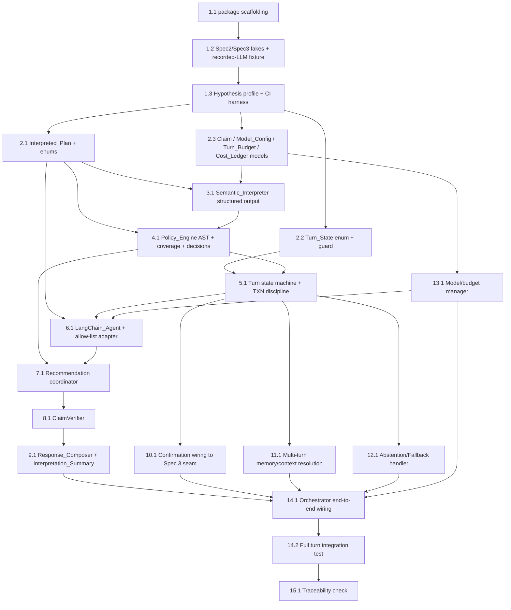

# Implementation Plan: Agent Orchestration & Response (Spec 4 of 6)

## Overview

This plan implements the **agentic orchestration and response-composition layer** of the *Series 76 Technical Assistant* in **Python**, using **LangChain** for the agent loop and **Hypothesis** for property-based testing, exactly as fixed by the design's Testing Strategy.

The plan is incremental and test-driven. It starts with the agent package scaffolding and a test harness of **fakes** (Spec 2 tools/services, Spec 3 seams, recorded-LLM fixtures, a Hypothesis profile), then builds the data models, then each component in dependency order, wiring every new piece into the prior work and ending with a full end-to-end turn integration test on fakes.

Testing discipline (binding on every task):
- **Deterministic components** (Policy_Engine, ClaimVerifier, Response_Composer, turn state machine, Recommendation coordinator, Fallback handler, Model/budget manager) are tested with **fakes/fixtures at ZERO LLM cost**.
- The **Semantic_Interpreter** is tested with **recorded/mock LLM responses** and a **bilingual golden prompt set** in CI — **no live model spend**.
- **Spec 2** tools/services and **Spec 3** seams (worker, durable queue, plan-confirm, domain-state, encrypted checkpointer, `Response_Envelope`) are **dependencies and are MOCKED** in tests.
- Property-based tests use **Hypothesis**, run a **minimum of 100 iterations**, and carry the tag `Feature: agent-orchestration-response, Property N: <text>`. Each Correctness Property is realized by exactly one property-based test.
- **No live model call, benchmark, A/B comparison, or model-selection winner is executed or asserted.** Building the harness/seams is in-scope; running the A/B is Spec 6.
- **Central invariant (QA-01):** every visible technical number traces to the Spec 2 verified figure set via a typed placeholder. No language-model-sourced number ever reaches the user.

## Task Dependency Graph



```json
{
  "waves": [
    { "id": 0, "tasks": ["1.1"] },
    { "id": 1, "tasks": ["1.2"] },
    { "id": 2, "tasks": ["1.3"] },
    { "id": 3, "tasks": ["2.1", "2.2", "2.3"] },
    { "id": 4, "tasks": ["3.1", "13.1"] },
    { "id": 5, "tasks": ["4.1"] },
    { "id": 6, "tasks": ["5.1", "7.1"] },
    { "id": 7, "tasks": ["6.1", "10.1", "11.1", "12.1"] },
    { "id": 8, "tasks": ["8.1"] },
    { "id": 9, "tasks": ["9.1"] },
    { "id": 10, "tasks": ["14.1"] },
    { "id": 11, "tasks": ["14.2"] },
    { "id": 12, "tasks": ["15.1"] }
  ]
}
```

## Tasks

- [ ] 1. Agent package scaffolding and zero-cost test harness
  - [ ] 1.1 Create the agent package structure and dependency wiring
    - Create the Python package for the reasoning layer (e.g. `agent/orchestration/`) with module stubs for interpreter, policy, state machine, langchain agent + tool adapter, recommendation coordinator, claim verifier, response composer, fallback handler, and model/budget manager
    - Pin dependencies: LangChain (`create_agent` + middleware path), Hypothesis, the test runner (pytest), and typing/validation libs; add no model identifier to the shipped path
    - Define the module boundaries so Spec 2 operations and Spec 3 seams are reached only through injected interfaces (no direct SQL, no edition/permission authorship)
    - Demo: `python -c "import agent.orchestration"` imports cleanly and the package tree lists every planned component module.
    - _Requirements: 1.3, 11.1_

  - [ ] 1.2 Build fakes for Spec 2 tools/services and Spec 3 seams, plus the recorded-LLM fixture
    - Spec 2 fakes: fake `get_part`, `search_parts`, `get_source_notes`, `rank_candidates`, `compare_parts`, `convert_units`, completeness primitives, and a verified-figure-set factory returning typed facts each carrying `DataStatus` + `EvidenceReference`; an allow-list registry fake for Tool_Set_A and Tool_Set_B
    - Spec 3 fakes: fake durable worker/job boundary (fencing/tombstone), plan-confirmation seam, persisted domain-state store (referents/criteria/plan_revision, owner-scoped), encrypted checkpointer, and a `Response_Envelope` + `content_blocks` structural builder
    - Recorded-LLM fixture: a call-counting mock provider that replays recorded structured-interpretation responses and asserts zero model calls on deterministic paths; seed a bilingual (ES/EN) golden prompt set
    - Demo: a smoke test wires a fake turn through the fakes and asserts zero live model calls and zero SQL, with the call-counting mock reporting 0 calls on deterministic helpers.
    - _Requirements: 1.1, 1.3, 11.9_

  - [ ]* 1.3 Configure the Hypothesis profile and CI test harness
    - Register a Hypothesis profile with `max_examples >= 100` and a CI profile; add a shared tagging helper so each property test can carry `Feature: agent-orchestration-response, Property N`
    - Wire pytest to run property + example tests with zero network access (fail if any live provider call is attempted)
    - Demo: the test suite runs green on an empty harness and a self-check test confirms the 100-iteration floor and the network-blocked guard.
    - _Requirements: 1.3_

- [ ] 2. Core data models
  - [ ] 2.1 Implement `Interpreted_Plan`, `Intent`, `Filter_AST` references, and `Interpretation_Summary`
    - Define `Interpreted_Plan` with `intent` (exactly one of the eight values), draft `filter_ast` (AND/OR/NOT + allow-listed predicates, never raw SQL), `referents` with provenance (`CURRENT_MESSAGE`/`PRIOR_TURN`), `criteria` with `RequirementGroup` + `CoverageStatus` + hard/preference, `unresolved`, `data_status`, `catalog_edition_id`, `plan_id`, `plan_revision`, `presentation_intent`, `response_language`
    - Define `Interpretation_Summary` with distinct labeled elements (intent, applied, proposed, delegated, ignored, expected presentation format) and a per-criterion label of exactly one of documented-fact/user-assumption/proposal/delegation; forbid tool names, prompt text, internal parameter names in its shape
    - Enforce structurally that no technical number field can be set by the interpreter
    - Demo: constructing a plan with two intents or a raw-SQL AST raises; a valid bilingual plan round-trips through the structured-output schema.
    - _Requirements: 2.1, 2.3, 2.4, 2.5, 5.1, 5.2, 5.3_

  - [ ] 2.2 Implement the `Turn_State` enum and transition guard
    - Define the 12-value `Turn_State` set and a guard that rejects any value outside the set and any transition not in the enumerated ordered-path/terminal/branching set
    - Map `Turn_State` onto Spec 3 `Job_State` at the worker boundary (e.g. `SOURCE_WITHDRAWN` → `CATALOG_WITHDRAWN`)
    - Demo: assigning an unknown state raises; the guard accepts every enumerated transition and rejects a non-enumerated one.
    - _Requirements: 4.1, 4.2_

  - [ ] 2.3 Implement `Claim`, `Model_Config`, `Turn_Budget`, and `Cost_Ledger` models
    - `Claim`: numeric comparative (`has_more_torque`, `is_faster`), equality/relation (`same_frequency`), existence (`no_result`), and non-numeric assertion variants, each binding to Spec 2 facts by `EvidenceReference` and carrying service/frequency/supply/unit context
    - `Model_Config`: reads `AGENT_MODEL` (required) + optional `INTERPRETER_MODEL`/`ANSWER_MODEL`/`FALLBACK_MODEL` from env with no hardcoded identifier; supports >=2 candidates per evaluated function
    - `Turn_Budget`: `max_model_calls_per_turn`, `max_tool_calls_per_turn`, `max_token_budget`, `max_walltime`, `max_cost_usd`, `max_result_rows` with conservative configurable defaults
    - `Cost_Ledger`: records provider/model/usage; encodes the USD 10 cap (<=6 dev/eval, >=4 demo reserve) as data
    - Demo: a config built from env exposes two candidates per function with no hardcoded model string; a ledger rejects a write that would breach the configured cap.
    - _Requirements: 11.1, 11.2, 11.6, 11.7_

- [ ] 3. Semantic_Interpreter
  - [ ] 3.1 Implement the bilingual Semantic_Interpreter (LLM, structured output)
    - Classify exactly one `Intent`; author a draft `Filter_AST` (AND/OR/NOT + allow-listed predicates only, never raw SQL); record referents with provenance and criteria with group/status/hard-preference; exclude out-of-allowlist fields and unresolvable referents into `unresolved`; resolve ambiguity to `FOLLOWUP` or `OUT_OF_SCOPE`
    - Take `catalog_edition_id` from the validated session only; produce no plan and return an edition-unavailable error when the session supplies none; populate no technical number and create no physical rule/certification/card figure
    - Set `response_language` per the Req 9.5 rule
    - Wire into the data models (Task 2.1) and the recorded-LLM fixture (Task 1.2)
    - _Requirements: 2.1, 2.2, 2.3, 2.4, 2.5, 2.6, 2.7, 2.8, 2.9, 2.10_

  - [ ]* 3.2 Property tests for the Semantic_Interpreter (recorded/mock LLM, bilingual golden set)
    - **Property 5: Interpretation yields exactly one intent and invents no number or rule** — Validates Requirements 2.1, 2.6, 2.9
    - **Property 6: Bilingual interpretation is equivalent with identifier identity preserved** — Validates Requirements 2.2 (generate semantically equivalent ES/EN pairs; assert byte-for-byte PN/number/unit identity)
    - **Property 7: Logical filtering produces an allow-listed AST and never raw SQL** — Validates Requirements 2.3
    - **Property 8: Referents and criteria are recorded with provenance and classification** — Validates Requirements 2.4, 2.5
    - **Property 9: Missing session edition yields no plan, and unresolved items are excluded and recorded** — Validates Requirements 2.8, 2.10
    - Uses recorded LLM responses only (zero live spend); min 100 iterations each; tagged per property
    - _Requirements: 2.1, 2.2, 2.3, 2.4, 2.5, 2.6, 2.8, 2.9, 2.10_

- [ ] 4. Deterministic Policy_Engine
  - [ ] 4.1 Implement the Policy_Engine (zero LLM)
    - Validate the `Filter_AST` structurally and against the field allow-list before any tool execution; on invalid/out-of-allowlist/incompatible-operator-or-unit AST, block all execution and emit a clarification or `INVALID_FILTER` outcome leaving the catalog unqueried and active state unchanged
    - Evaluate `CoverageStatus` per `RequirementGroup` via Spec 2 completeness fakes and derive `Recommendation_Grade` solely from the four values, reproducibly; do not require recommendation coverage for a single-filter search
    - Decide clarification/confirmation need deterministically (identical inputs → identical decision); verify permissions/edition resolve from the validated session (reject any model-origin value); verify plan revisions against active state; perform every decision with zero LLM invocations
    - Wire into the interpreter output (Task 3.1) and the data models (Task 2.1)
    - _Requirements: 3.1, 3.2, 3.3, 3.4, 3.5, 3.6, 3.7, 1.5, 2.7_

  - [ ]* 4.2 Property tests for the Policy_Engine (fakes, zero LLM)
    - **Property 10: AST validation precedes execution and invalid filters block the catalog** — Validates Requirements 3.1
    - **Property 11: Policy and plan decisions are deterministic and performed with zero LLM invocations** — Validates Requirements 3.2, 3.3, 3.6, 3.7 (assert via call-counting fake that LLM calls == 0)
    - **Property 12: A single-filter search does not require recommendation coverage** — Validates Requirements 3.4
    - **Property 2 (policy slice): Server-injected edition and permissions are authoritative and not model-overridable** — Validates Requirements 1.5, 2.7, 3.5
    - Min 100 iterations each; tagged per property
    - _Requirements: 3.1, 3.2, 3.3, 3.4, 3.5, 3.6, 3.7_

- [ ] 5. Turn state machine
  - [ ] 5.1 Implement the Agent_Orchestrator turn state machine and TXN discipline
    - Represent each turn with exactly one `Turn_State`; advance only along enumerated transitions using the guard (Task 2.2)
    - Never hold an open SQL transaction across a model-provider call: persist state in one transaction committing before each external call and a separate transaction committing after, via the Spec 3 worker fakes
    - Gate `NEEDS_CLARIFICATION` (no advance toward `EXECUTING`, no tool call until a reply to the outstanding clarification arrives) and `AWAITING_CONFIRMATION` (no budget-consuming tool until an authenticated confirmation whose `(session_id, plan_id, plan_revision, user_id)` matches the active revision)
    - Handle cancel/conversation-delete → `CANCELLED` with no resurrecting late result (honor fencing/tombstone fakes); withdrawn pinned edition → `SOURCE_WITHDRAWN` with no new recommendation and history intact; stale confirmation revision → `STALE_PLAN`
    - Wire into the Policy_Engine decisions (Task 4.1) and the Spec 3 worker/domain-state fakes
    - _Requirements: 4.1, 4.2, 4.3, 4.4, 4.5, 4.6, 4.7, 4.8_

  - [ ]* 5.2 Property tests for the turn state machine (instrumented UoW/LLM fakes)
    - **Property 13: A turn carries exactly one valid state and advances only along enumerated transitions** — Validates Requirements 4.1, 4.2
    - **Property 14: No SQL transaction spans a model-provider call** — Validates Requirements 4.3 (instrument the UoW fake to assert no open txn during the fake model call)
    - **Property 15: Clarification and confirmation gates block execution and budget-consuming tools** — Validates Requirements 4.4, 4.5
    - **Property 16: Cancellation and source withdrawal terminate without resurrection or new recommendation** — Validates Requirements 4.6, 4.7
    - Min 100 iterations each; tagged per property
    - _Requirements: 4.1, 4.2, 4.3, 4.4, 4.5, 4.6, 4.7_

- [ ] 6. LangChain_Agent and allow-list tool adapter
  - [ ] 6.1 Implement the LangChain_Agent + allow-list tool adapter
    - Use the LangChain `create_agent` + middleware path (with an explicit `StateGraph` fallback seam recorded in an ADR) so the agent selects among allow-listed Spec 2 tools under the `Turn_Budget`
    - Invoke at least one custom Spec 2 tabular tool for a catalog turn and satisfy catalog queries by no other path; permit only server-allow-listed selections (reject a non-allow-listed selection unexecuted, leave catalog/domain state unchanged, return a rejection result); author/emit no SQL
    - Merge server-injected `catalog_edition_id`/permissions/limits/`trace_id` server-side and ignore any model-supplied override; treat every tool output and catalog datum as `Untrusted_Content` (no embedded instruction executed, routed back into tool selection, or followed); on injection/role-escalation in a tool output/catalog value/user message, disregard it, continue under policy, and leak no system prompt/tool name/credential/secret/other-owner data
    - Enforce server-injected result limits and per-turn bounds fail-closed (no partial catalog data returned as complete); mount both Tool_Set_A and Tool_Set_B with no winner chosen
    - Wire into the state machine `EXECUTING` stage (Task 5.1), the data models (Task 2.1), and the budget manager (Task 13.1)
    - _Requirements: 1.1, 1.2, 1.3, 1.4, 1.5, 1.6, 1.7, 1.8_

  - [ ]* 6.2 Property + adversarial tests for the tool adapter (fakes, zero LLM)
    - **Property 1: Catalog reads go only through allow-listed Spec 2 tools and never via SQL** — Validates Requirements 1.1, 1.2, 1.3 (generate in/out-of-allowlist selections)
    - **Property 2: Server-injected edition, permissions, and limits are authoritative and not model-overridable** — Validates Requirements 1.4, 1.5, 2.7, 3.5
    - **Property 3: Tool output and catalog data are untrusted and injection-resistant** — Validates Requirements 1.6, 1.7 (adversarial instruction-like strings in messages and fake tool outputs; assert no behavior change, no internal leak)
    - **Property 4: Server limits and per-turn bounds are enforced fail-closed** — Validates Requirements 1.8 (limit-crossing invocations)
    - Min 100 iterations each; tagged per property
    - _Requirements: 1.1, 1.2, 1.3, 1.4, 1.5, 1.6, 1.7, 1.8_

- [ ] 7. Recommendation coordinator
  - [ ] 7.1 Implement the Recommendation coordinator (deterministic)
    - Classify `verified` only when all four `RequirementGroup`s are `SPECIFIED` with >=1 catalog-backed match (Spec 2 completeness fakes); otherwise `preliminary`, naming every non-`SPECIFIED` group; use no warranty-of-fitness/integral-compatibility language for a `preliminary` set
    - Present a `DELEGATED` group as a proposed preference without synthesizing an absent physical value
    - Obtain ranking only from Spec 2 `rank_candidates` under a user-accepted priority (never a model-proposed one); on a non-comparable priority metric (differing service/frequency/supply/unit) declare no winner, present a distinct indeterminate group, and request clarification/alternative priority first
    - In top-1 mode present the winner + integer eligible count only (no enumeration) and a winner identical to the head of the full Spec 2 ranking; on no eligible candidate present a no-eligible result and declare no winner, leaving the set unchanged
    - Wire into the Policy_Engine coverage output (Task 4.1) and the state machine (Task 5.1)
    - _Requirements: 7.1, 7.2, 7.3, 7.4, 7.5, 7.6, 7.7, 7.8, 7.9_

  - [ ]* 7.2 Property tests for the Recommendation coordinator (fakes, zero LLM)
    - **Property 22: A recommendation is verified iff all four groups are SPECIFIED with a backed match** — Validates Requirements 7.1, 7.2, 7.8
    - **Property 23: A delegated group is a proposed preference and never a synthesized physical condition** — Validates Requirements 7.3
    - **Property 24: Ranking uses only an accepted priority via Spec 2, and non-comparable metrics yield no winner** — Validates Requirements 7.4, 7.5
    - **Property 25: Top-1 returns only the winner and eligible count and equals the head of the full ranking** — Validates Requirements 7.6, 7.7, 7.9
    - Min 100 iterations each; tagged per property
    - _Requirements: 7.1, 7.2, 7.3, 7.4, 7.5, 7.6, 7.7, 7.8, 7.9_

- [ ] 8. ClaimVerifier
  - [ ] 8.1 Implement the ClaimVerifier (deterministic)
    - Verify each claim (`has_more_torque`, `is_faster`, `same_frequency`, `no_result`, and non-numeric assertions) against the verified figure set under identical service/frequency/supply/unit context before it appears in any visible output
    - Drop an unverifiable claim by default; return `INSUFFICIENT_INFORMATION` when the claim is required to answer the turn; verify non-numeric claims too (remove a false non-numeric assertion even with no digits); remove any assertion with no supporting evidence
    - Wire into the recommendation output (Task 7.1) and consume the verified figure set from the Spec 2 fakes
    - _Requirements: 8.3, 8.4, 8.5, 8.10_

  - [ ]* 8.2 Property tests for the ClaimVerifier (fakes, zero LLM)
    - **Property 27: Claims are verified deterministically under compatible context before display** — Validates Requirements 8.3, 8.4, 8.5 (generate random claims including false non-numeric assertions)
    - Min 100 iterations; tagged per property
    - _Requirements: 8.3, 8.4, 8.5_

- [ ] 9. Response_Composer and Interpretation_Summary rendering
  - [ ] 9.1 Implement the Response_Composer (deterministic)
    - Build `answer` and typed `content_blocks` from the same verified-figure-set instance via typed placeholders; insert every technical/part number only through placeholders bound to Spec 2 facts/derivations; suppress any candidate figure not tracing to a Spec 2 fact
    - Populate chart series only from backend-provided verified facts (never model output); present N/A/absent fields with their explicit state (never zero, zero-height bar, or comparison winner); label user-supplied figures as `Declared_Requirement`; present heterogeneous-supply FLA with its supply condition and no efficiency/lower-energy claim; label a `DerivedValue` as derived with formula and precision
    - Emit the always-visible `Interpretation_Summary` (Task 2.1) with distinct labeled elements and per-criterion labels, leaking no tool names/prompt/internal parameters; carry `DataStatus` + `EvidenceReference` through each presented figure and withhold a figure whose evidence does not resolve to a source cell
    - Wire into the ClaimVerifier output (Task 8.1), the recommendation coordinator (Task 7.1), and the Spec 3 `Response_Envelope`/`content_blocks` builder fakes
    - _Requirements: 8.1, 8.2, 8.6, 8.7, 8.8, 8.9, 5.1, 5.2, 5.3, 12.1, 12.2, 12.3, 12.6, 12.8_

  - [ ]* 9.2 Property tests for the Response_Composer and summary (fakes, zero LLM)
    - **Property 26: Every visible technical figure traces to exactly one Spec 2 fact or deterministic derivation** — Validates Requirements 8.1, 8.2, 8.10, 12.1, 12.4, 12.7 (inject untraceable candidate figures; assert suppression)
    - **Property 28: User figures are Declared_Requirement, charts come from backend facts, and N/A is never zero** — Validates Requirements 8.6, 8.7, 8.8, 8.9
    - **Property 17: The Interpretation_Summary is always visible, fully labeled, and leaks no internals** — Validates Requirements 5.1, 5.2, 5.3
    - **Property 37: Presented figures carry resolvable status and evidence, derived values are labeled, and gaps are explicit** — Validates Requirements 12.2, 12.3, 12.6, 12.8
    - Min 100 iterations each; tagged per property
    - _Requirements: 8.1, 8.2, 8.6, 8.7, 8.8, 8.9, 5.1, 5.2, 5.3, 12.1, 12.2, 12.3, 12.6, 12.7, 12.8_

- [ ] 10. Conditional plan confirmation and revision wiring
  - [ ] 10.1 Wire conditional confirmation to the Spec 3 plan-confirm seam
    - On an authenticated confirmation, compare the `(session_id, plan_id, plan_revision, user_id)` tuple against the conversation's active state and materialize a plan only on an exact four-element match
    - On a user correction, create a new `Plan_Revision` with a monotonically greater identifier and invalidate the prior revision's approval; on a confirmation targeting a non-current revision, transition to `STALE_PLAN`, surface the current revision, and execute nothing nor mutate active state
    - Treat a confirmation as valid only after the Spec 3 confirmation seam reports it bound to the current revision (never as an unrestricted LLM instruction); treat repeated/duplicate confirmations of the current revision idempotently (at most one execution)
    - Wire into the state machine `AWAITING_CONFIRMATION` gate (Task 5.1) and the Spec 3 plan-confirm fake
    - _Requirements: 6.1, 6.2, 6.3, 6.4, 6.5, 6.6_

  - [ ]* 10.2 Property tests for confirmation and revision (fakes, zero LLM)
    - **Property 20: Confirmation materializes only on an exact 4-tuple match and corrections invalidate prior approval** — Validates Requirements 6.1, 6.2, 6.4
    - **Property 21: Confirmed execution occurs only after the Spec 3 seam binds the current revision, and is idempotent** — Validates Requirements 6.3, 6.5, 6.6 (generate confirmation tuples, correction sequences, duplicate confirmations)
    - Min 100 iterations each; tagged per property
    - _Requirements: 6.1, 6.2, 6.3, 6.4, 6.5, 6.6_

- [ ] 11. Multi-turn memory and context resolution
  - [ ] 11.1 Implement context resolution against persisted domain state
    - Resolve a follow-up's ordinal ("the second one"), previously mentioned model, or prior criterion exclusively against the persisted Spec 3 domain conversation state (never re-derived from prose); after a restart resolve only against the restored owner-scoped state belonging to that conversation and owner
    - On a reference resolving to more than one plausible referent or to none, place the turn in `NEEDS_CLARIFICATION`, request disambiguation, and guess or silently switch no referent/model until the user replies
    - Keep the conversation pinned to exactly one `catalog_edition_id` for its lifetime; set the response language to the last user turn's natural language unless an explicit switch is requested (independent of PN/unit language), retaining the prior turn's language when a turn has no detectable natural-language content
    - Wire into the state machine (Task 5.1) and the Spec 3 domain-state fake
    - _Requirements: 9.1, 9.2, 9.3, 9.4, 9.5, 9.6, 9.7_

  - [ ]* 11.2 Property tests for memory and context (fakes, zero LLM)
    - **Property 29: Follow-up references resolve only against persisted owner-scoped state or else request clarification** — Validates Requirements 9.1, 9.2, 9.3, 9.6, 9.7 (ambiguous/unmatched references and restart isolation)
    - **Property 30: A conversation is pinned to one edition and the response language follows the resolution rule** — Validates Requirements 9.4, 9.5 (language sequences including numeric-only turns)
    - Min 100 iterations each; tagged per property
    - _Requirements: 9.1, 9.2, 9.3, 9.4, 9.5, 9.6, 9.7_

- [ ] 12. Abstention and Fallback handler
  - [ ] 12.1 Implement the Abstention/Fallback handler (F2 §10 matrix)
    - On an out-of-PDF-edition request, abstain naming the pinned source edition with no untraceable fact; map each F2 §10 row (invalid PN, well-formed-not-listed, N/A attributes, zero matches, incomplete recommendation, ambiguous AND/OR, frequency/service without evidence, out-of-scope, withdrawn edition, tool/DB unavailable, provider 402/quota, injection/escalation, stale confirmation, delete-vs-late-job) to exactly its defined business response and execution rule
    - Treat `NO_RESULTS`/`N_A` as successful business results (no LLM/tool retry as if technical); on a well-formed absent PN report not-listed, assert no commercial non-existence, and substitute no similar PN
    - Retry only transient idempotent errors with bounded exponential backoff while budget remains (never a non-idempotent op or a semantic outcome); fail closed on budget exhaustion; surface exactly one typed code with no stack trace/system prompt/SQL/secret
    - Wire into the state machine terminal/branching outcomes (Task 5.1) and the Spec 2 `SemanticFailureCode` + Spec 3 seams
    - _Requirements: 10.1, 10.2, 10.3, 10.4, 10.5, 10.6, 10.7_

  - [ ]* 12.2 Property + example tests for the Fallback handler (fakes, zero LLM)
    - **Property 31: Out-of-scope requests abstain naming the pinned edition with no untraceable fact, and well-formed absent PNs report not-listed** — Validates Requirements 10.1, 10.7
    - **Property 32: Each fallback condition maps to only its defined response, and semantic outcomes are successes not retried** — Validates Requirements 10.2, 10.3 (one example per F2 §10 row asserting the exact mapping, incl. the `FOLLOWUP`/`OUT_OF_SCOPE` ambiguity fallback for Req 2.9)
    - **Property 33: Retries are bounded and idempotent, budget exhaustion fails closed, and failures surface one leak-free code** — Validates Requirements 10.4, 10.5, 10.6, 11.6
    - Min 100 iterations each; tagged per property
    - _Requirements: 10.1, 10.2, 10.3, 10.4, 10.5, 10.6, 10.7_

- [ ] 13. Model and budget manager (harness-ready, no winner)
  - [ ] 13.1 Implement the Model/budget manager
    - Read models per function from env with no hardcoded identifier; support >=2 candidates per evaluated function; never exceed `max_model_calls_per_turn` per function per turn regardless of how many are configured; invoke no LLM for titles/rankings/numbers
    - Verify the exact endpoint capability before issuing a request and separate the structured-interpretation phase from the tool-invocation phase where native tool-calling and structured output are not both supported; route with `require_parameters=true` when a feature is required and reject (never silently proceed) when no provider satisfies it or capability is unavailable
    - Enforce the `Turn_Budget` fail-closed (halt at any limit, indicate which, preserve produced results); record provider/model/usage in the `Cost_Ledger` and respect the USD 10 cap (<=6 dev/eval, >=4 reserve), blocking dev/eval calls at USD 6.00; on automatic provider fallback preserve required capabilities/privacy or abort; declare no winning model or tool set
    - Wire into the data models (Task 2.3) and expose the seam consumed by the LangChain agent (Task 6.1)
    - _Requirements: 11.1, 11.2, 11.3, 11.4, 11.5, 11.6, 11.7, 11.8, 11.9, 11.10, 11.11_

  - [ ]* 13.2 Property + example tests for the Model/budget manager (fakes, zero LLM)
    - **Property 34: Models are env-configured with multiple candidates and bounded call counts, and no LLM produces numbers** — Validates Requirements 11.1, 11.2, 11.9 (env configs + call counting)
    - **Property 35: Endpoint capability is verified and feature routing is strict or fails closed** — Validates Requirements 11.3, 11.4, 11.5 (fake endpoints with/without combined capability)
    - **Property 36: The cost ledger respects the cap and the demo reserve, and fallback preserves capabilities or aborts** — Validates Requirements 11.7, 11.8, 11.11 (simulated usage against the cap; reduced-capability fallback)
    - No-winner status-discipline example test asserting no code path declares a winning model or tool set — Validates Requirements 11.10 (no live call executed)
    - Min 100 iterations each property; tagged per property
    - _Requirements: 11.1, 11.2, 11.3, 11.4, 11.5, 11.7, 11.8, 11.9, 11.10, 11.11_

- [ ] 14. End-to-end wiring and integration
  - [ ] 14.1 Wire the Agent_Orchestrator turn pipeline end to end
    - Compose the full turn pipeline Interpret → Policy validate → Branch → Execute → Verify → Compose through all components built above, enforcing the verified-output invariant centrally: every visible figure traces to exactly one Spec 2 fact/derivation, carries `DataStatus` + `EvidenceReference`, is digit-for-digit equal on repeated identical queries, and no LLM-sourced number reaches the user
    - Hand typed results back through the Spec 3 worker/`Response_Envelope` fakes; ensure `answer` and `content_blocks` draw from the same verified-figure-set instance
    - _Requirements: 12.1, 12.4, 12.5, 12.6, 12.7, 12.8_

  - [ ] 14.2 Write a full turn integration test with fakes (zero LLM cost)
    - Drive representative turns end to end on fakes: an `EXACT_LOOKUP` single-pass, a multi-measurement part, a `FILTER_SEARCH`, a `preliminary` and a `verified` recommendation, a top-1, a comparison with an N/A field, an out-of-scope abstention, a stale-confirmation, and a bilingual follow-up with ordinal resolution
    - **Property 18: Determinate exact or single-filter queries execute in one pass** — Validates Requirements 5.4, 5.6
    - **Property 19: Ambiguity, conflict, material delegation, or an unaccepted proposal forces clarification or confirmation** — Validates Requirements 5.5
    - **Property 38: Repeated identical queries return digit-for-digit equal figures** — Validates Requirements 12.5
    - Assert no live model call and no SQL occur anywhere in the integration path; min 100 iterations for the property-bearing cases, tagged per property
    - _Requirements: 5.4, 5.5, 5.6, 12.1, 12.5_

- [ ] 15. Traceability and final checkpoint
  - [ ]* 15.1 Add a traceability check mapping every Requirement and Property to a task/test
    - Add an automated check (test or script) asserting that each Requirement 1–12 clause and each Correctness Property 1–38 is referenced by at least one implemented test, and that every property test carries its `Feature: agent-orchestration-response, Property N` tag
    - Ensure all tests pass with zero LLM spend and zero network access; ask the user if questions arise
    - _Requirements: all (traceability)_

## Notes

- Tasks marked with `*` are optional test sub-tasks and can be skipped for a faster MVP; core implementation sub-tasks are never marked optional. Per the workflow, optional sub-tasks are not auto-implemented.
- Every task references specific Requirement numbers; property-bearing tasks also cite the design's Property numbers.
- All deterministic components are tested with Spec 2/Spec 3 fakes at **zero LLM cost**; the Semantic_Interpreter uses recorded/mock responses with a bilingual golden set.
- **No live model call, benchmark, A/B comparison, or model-selection winner is executed or asserted** — the harness/seams are built here; the A/B runs in Spec 6.
- The verified-output invariant (QA-01) is central: every visible number traces to the Spec 2 verified figure set via typed placeholders.
- `.config.kiro` is left untouched.

## Task Dependency Graph

```json
{
  "waves": [
    { "id": 0, "tasks": ["1.1"] },
    { "id": 1, "tasks": ["1.2"] },
    { "id": 2, "tasks": ["1.3"] },
    { "id": 3, "tasks": ["2.1", "2.2", "2.3"] },
    { "id": 4, "tasks": ["3.1", "3.2", "13.1", "13.2"] },
    { "id": 5, "tasks": ["4.1", "4.2"] },
    { "id": 6, "tasks": ["5.1", "5.2", "7.1", "7.2"] },
    { "id": 7, "tasks": ["6.1", "6.2", "10.1", "10.2", "11.1", "11.2", "12.1", "12.2"] },
    { "id": 8, "tasks": ["8.1", "8.2"] },
    { "id": 9, "tasks": ["9.1", "9.2"] },
    { "id": 10, "tasks": ["14.1"] },
    { "id": 11, "tasks": ["14.2"] },
    { "id": 12, "tasks": ["15.1"] }
  ]
}
```
