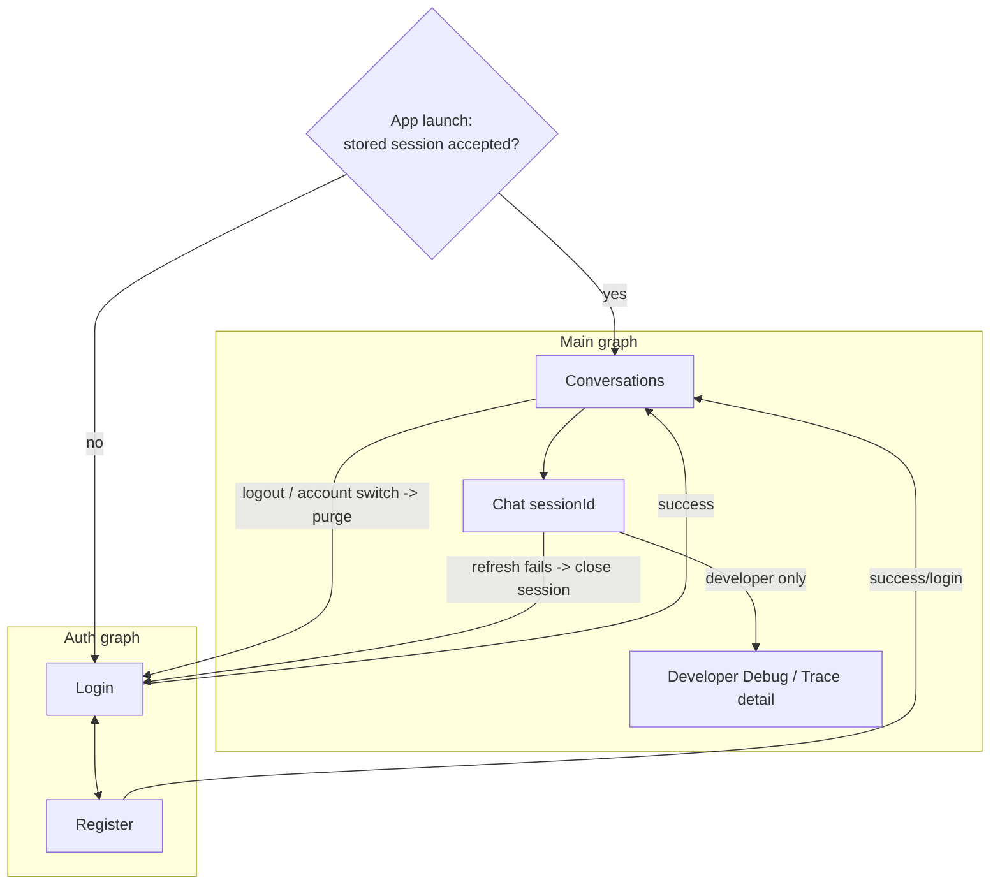
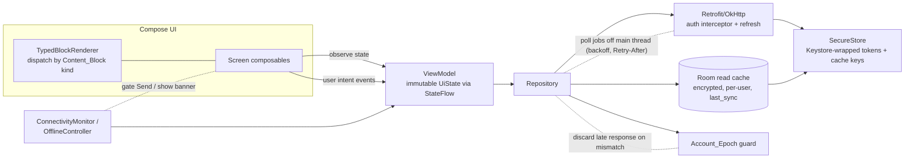

# Design Document

## Overview

This document is the design for **`android-app` (Spec 5 of 6)** of the *Series 76 Technical Assistant* (Konecto technical assessment). It is the **native Android client**: a single-module Kotlin + Jetpack Compose application with five navigable destinations (Login, Register, Conversations, Chat, Developer Debug), an MVVM + unidirectional-data-flow (UDF) presentation, a read-only Room cache, a Retrofit/OkHttp network stack, Keystore-backed secure storage, and an explicit offline experience.

This layer is a **pure consumer and renderer**. It:

- **consumes** the HTTP contracts, the typed `Response_Envelope` (always carrying `session_id` + `answer`), the auth and refresh-rotation flow, the durable-job polling protocol, the `Plan_Revision` confirmation semantics, the idempotency contract via `Client_Request_Id`, and the `Error_Envelope` with stable codes — all established by `backend-api-auth-jobs-crypto` (Spec 3);
- **renders** the typed `content_blocks` and `interpretation_summary` composed by `agent-orchestration-response` (Spec 4);
- **presents** what the backend returns. It never establishes identity, opens a server transaction, encrypts server-side data, owns the queue, interprets intent, authors a plan, re-ranks candidates, or composes a technical figure.

### Position in the system

- **Depends on** `backend-api-auth-jobs-crypto` (Spec 3): the endpoints (`POST /api/conversation`, `POST /api/conversation/jobs`, `GET /api/jobs/{id}`, `POST /api/jobs/{id}/cancel`, the auth endpoints, `GET /api/sessions` and related conversation endpoints, `POST /api/sessions/{id}/plans/{rev}/confirm`, `DELETE /api/sessions/{id}`, the trace endpoint, `GET /api/health`/`GET /api/ready`), the typed `Response_Envelope`, the `Content_Block` discriminated union defined structurally, the `Job_State` set, opaque-token auth + refresh rotation, `Client_Request_Id` idempotency, `Plan_Revision` confirmation with `409` on stale, and the `Error_Envelope` with bilingual user messages. This client **plugs into** these seams; it never defines them.
- **Depends on** `agent-orchestration-response` (Spec 4): the population of typed `content_blocks` with verified figures and the `interpretation_summary`. Every technical figure the client displays originates from a Spec 2/4 verified figure already present in a typed block.
- **Evaluated by** `evaluation-and-reproducibility` (Spec 6): which validates reproducibility, accessibility, and UI-behavior conformance. This spec defines the behaviors and acceptance tests **to be exercised**; it runs no benchmark and asserts no executed test result.

### The never-parse-from-prose invariant is central

The client **renders typed blocks and NEVER parses, extracts, derives, re-ranks, or computes a technical number from prose.** Every technical figure shown in any card, table, bar, or highlight is read from a **typed field** of a `Content_Block` that the backend supplied, carrying its unit, service, frequency context, availability, and provenance. `Answer_Text` is displayed verbatim as user-safe prose and is never scanned for a figure. If a typed field required to render an element is absent or malformed, the client renders an explicit **unavailable** fallback rather than fabricating or inferring a value. This is treated as a first-class correctness property (Property 1).

### Offline behavior is a first-class contract

While the device has no usable connectivity the client shows a persistent **Offline_Banner** on Conversations and Chat, **disables Send** (keeping the composer and preserving the encrypted Draft), issues **no POST and no local enqueue**, and **never auto-sends** on reconnect — the user must press Send again. A server/auth failure with working transport (e.g., `503`, invalid token, upstream down) is presented as a **distinct** error, never attributed to a lack of internet. This adopts F4 v1.1 addendum option A and is treated as a set of first-class properties.

### Source-of-truth reminder

The backend is the single source of truth for users, permissions, conversations, messages, plans, rankings, job states, and all technical values. The client caches **read** copies of the owner's own data for display, never treats the cache as authoritative, and never locally infers, derives, re-ranks, or recomputes any of these. This design satisfies the **structural and behavioral** obligations of **Requirements 1–11**.

### Requirement-class legend (reference)

Requirement classes in `requirements.md` — **[ASSESS]** (mandatory from the assessment: the three evaluable screens, rendering figures without parsing prose, bilingual ES/EN, loading/error states, reproducibility), **[APPROVED]** (ratified F0–F6 / F4 decisions: auth screens, F4-D01/D02/D03, the v1.1 offline addendum, MVVM+UDF/Room/Retrofit defaults), **[DELEGATED]** (Kiro may concretize exact composable structure, navigation route types, Room schema, DI wiring, polling constants, DTO field names while preserving approved invariants), and **[EXPERIMENT]** (requires a real emulator run/benchmark, resolved by Spec 6) — govern which design elements are contractual versus which require a real run.

### Status discipline

Nothing here asserts that any emulator has started, any Gradle build has produced an APK, any Compose or instrumentation test has executed, any device has been exercised, or any accessibility audit has completed. Every contract below is **to be verified** by later implementation and by `evaluation-and-reproducibility` (Spec 6) and F5. Delegated details (exact composable tree, Room schema, nav route types, DI graph, exact localized copy strings, and specific polling constants within the stated bounds) are Kiro's to finalize during implementation.

---

## Architecture

### Style — Feature-First + MVVM/UDF, single Gradle module, light hexagonal edges

The client is a **native Kotlin + Jetpack Compose** application organized **Feature-First** within a **single Gradle module** (Req 1.1), presented with **MVVM + unidirectional data flow** (Req 1.2), navigated with **type-safe Navigation Compose** (Req 1.3), and composed through a **manual/light dependency-injection** mechanism without a heavyweight DI container (Req 1.6). Modularization is deferred until there is real evidence of compile-time or ownership pressure (F4 §7).

Layering per feature:

- **`ui` (Compose screens)** — stateless composables that observe immutable state and dispatch intent as events; never mutate rendered state directly (Req 1.2). Houses the `TypedBlockRenderer`.
- **`presentation` (ViewModel + state)** — one `ViewModel` per screen exposing an immutable `UiState` via `StateFlow`; receives unidirectional events; renders an error state rather than crashing on load failure (Req 1.2).
- **`data` (Repository)** — the single seam the ViewModels depend on; mediates network and cache, applies the `Account_Epoch` guard, and is the only place that decides source-of-truth precedence (server over cache).
- **`network` (Retrofit + OkHttp)** — typed API interfaces over the Spec 3 contracts; an auth interceptor attaches the current access token and runs the single-rotation refresh flow on `401` (Req 1.4, 1.8).
- **`cache` (Room)** — read-only store of the owner's conversation list and message history, payload-encrypted, keyed per user, carrying `last_sync` (Req 1.5, 9.4).
- **`security` (Keystore)** — `SecureStore` wrapping tokens and cache keys under Android Keystore; backup-excluded (Req 3.9, 9.4, 9.5).
- **`settings` (DataStore)** — non-sensitive settings only; never tokens or sensitive payloads in plaintext (Req 1.5).

All network, database, and cryptography work runs **off the main thread** on coroutines/Dispatchers, with polling and in-flight work cancelled per lifecycle so the main thread is never blocked beyond 5s and no ANR arises (Req 10.6).

### Navigation diagram (five destinations)



Launch routing: if a stored access/refresh token exists, is unexpired, and the backend accepts it, route to Conversations; otherwise route to Login (Req 2.3). The Developer Debug destination is present in the release build but its navigation entry is revealed only when `GET /api/auth/me` reports role `developer`; the reveal is a UI convenience and the backend re-verifies role + ownership on every trace call (Req 2.4, 2.5, 8.1).

### UDF data-flow and cross-cutting guards



State flows **down** (immutable `UiState` observed by composables); events flow **up** (user intents dispatched to the ViewModel). The ViewModel never calls the network directly — it goes through the Repository, which chooses server-over-cache, applies the `Account_Epoch` guard so a late response after logout/switch is discarded, and polls jobs off the main thread with exponential backoff honoring `Retry-After`. The `TypedBlockRenderer` dispatches by `Content_Block` kind and reads figures only from typed fields. The `ConnectivityMonitor` feeds an offline flag into every screen state so the banner shows and Send is gated.

### Turn lifecycle (Chat over sync + async job)

```mermaid
sequenceDiagram
    participant U as User
    participant VM as ChatViewModel
    participant R as ChatRepository
    participant API as Spec 3 Backend

    U->>VM: send(query)  [draft -> submitting]
    Note over VM,R: generate Client_Request_Id once per intent
    R->>API: POST /api/conversation/jobs {session_id?, query, Client-Request-Id}
    API-->>R: 202 {job_id, session_id, status=QUEUED}
    Note over VM: persist session_id, associate job_id,\nremove provisional draft -> exactly one turn record
    loop poll off main thread (backoff 1s..30s, honor Retry-After 1..300s)
      R->>API: GET /api/jobs/{job_id}
      API-->>R: {Job_State, Retry-After?, Response_Envelope? on COMPLETED}
    end
    Note over VM: Turn_State tracks QUEUED/RUNNING/NEEDS_CLARIFICATION/AWAITING_CONFIRMATION
    API-->>R: COMPLETED + Response_Envelope {session_id, answer, content_blocks,...}
    VM-->>U: render typed blocks; Turn_State = completed
    Note over VM,R: acceptance lost? retry with SAME Client_Request_Id (idempotent)
```

The client determines job state only from job-endpoint responses, never from elapsed time, and retains the `Client_Request_Id` until the acceptance outcome is resolved, reusing it on transport retries so no duplicate turn is created (Req 6.3, 6.5).

---

## Data Models

All shapes are described **semantically**. Exact composable tree, Room schema, navigation route types, DI graph, localized copy strings, and polling constants within the stated bounds are **[DELEGATED]** to Kiro, preserving every invariant.

### Per-screen UiState (sealed)

- **Conversations `UiState`** — a sealed set: `FirstLoad`, `Refreshing`, `Empty`, `Loaded(list, cursor)`, `OfflineCache(list, lastSync)`, `RecoverableError(message, retry)`, `Deleting(id)`, `Deleted(id)`, `SessionExpired` (Req 4.4). The list element carries title, last-activity timestamp, and a pending-job indicator shown iff ≥1 outstanding job for that conversation (Req 4.1).
- **Chat `UiState`** — message list (ordered), composer/Draft, `interpretation_summary` (compact + expandable), optional plan-confirmation panel, per-turn `Turn_State`, offline flag, and screen-level loading/empty/error (Req 5, 10.5).
- **Auth `UiState`** — `Idle`, `Submitting`, `Error(generic)` for Login/Register; never distinguishes unknown-email from wrong-password (Req 3.3).
- **Debug `UiState`** — `Loading`, `Loaded(turns, toolCalls)`, `Denied`, `Unavailable` (Req 8).

### `Turn_State` enum (Req 6.2)

Exactly one of `draft`, `submitting`, `queued`, `running`, `needs_clarification`, `awaiting_confirmation`, `completed`, `failed`, `cancelled`, `disconnected_reconciling`. A turn never holds two Turn_States simultaneously. Terminal mapping: `COMPLETED→completed`, `FAILED→failed`, `CANCELLED→cancelled` (Req 6.6). `Turn_State` is a **client UI** concept distinct from the server-authoritative `Job_State`.

### `Job_State` (observed, Spec 3)

`QUEUED`, `RUNNING`, `NEEDS_CLARIFICATION`, `AWAITING_CONFIRMATION`, `COMPLETED`, `FAILED`, `CANCELLED`, `STALE_PLAN`, `CATALOG_WITHDRAWN` — observed by polling, never derived from elapsed time (Req 6.3).

### Client DTOs mirroring Spec 3 `Response_Envelope`

- **Required:** `session_id` (non-empty), `answer` (user-safe prose, displayed verbatim).
- **Optional:** `content_blocks` (list), `status`, `interpretation_summary`, `plan` (id, revision, confirmation-needed), `warnings`, `request_id`, `catalog_edition_id`, `message_id`, `turn_id`.
- **`content_blocks`** is a **discriminated union** parsed by `kind`, **defined by Spec 3 and populated by Spec 4; this client only reads it**: `text`, `product_card`, `comparison_table`, `matching_part_numbers`, `bar_chart`, `clarification`, `plan_review`. Each block carries a `schema_version` and its typed fields. **An unknown kind (or a missing/malformed required typed field) degrades to a safe `text` / explicit-unavailable fallback** (Req 5.1, 1.11). The client never populates a block; it only reads one.

### Content_Block vocabulary (canonical, owned by Spec 3)

The wire `kind` set is the **canonical Spec 3 discriminated union** (`text`, `product_card`, `comparison_table`, `matching_part_numbers`, `bar_chart`, `clarification`, `plan_review`) — the same vocabulary emitted by Spec 4. Spec 5 renders finer presentation distinctions as **rendering variants WITHIN a canonical kind, never as new wire kinds**. The client never invents a wire kind and never sends one; it only reads and dispatches on the canonical set.

| Rendering need (client) | Canonical wire kind | Rendering treatment |
|---|---|---|
| compact card / expanded card | `product_card` | display mode toggle; max 3 full cards; dual-of-two selector when ≥2 |
| comparable metric bars | `bar_chart` | bars only for backend `comparable=true` metrics, each with a textual alternative |
| zero matches / partial candidates | `matching_part_numbers` | integer count + PN list; zero or partial is still this kind, never a fabricated card |
| requirements / coverage summary | `plan_review` | criteria + coverage labels (no numbers invented) |
| source notes / disclaimers | `text` | prose-only block, no free technical number |
| error presentation | (not a content block) | carried by the `Error_Envelope`; mapped to a UI treatment, never a content_blocks kind |

An unknown or unmapped `kind` still degrades to the safe `text` fallback.

### `Error_Envelope` DTO (Spec 3)

`{ error: { code, user_message }, request_id, retryable, details }` with `code` drawn from the stable set (`VALIDATION_ERROR`, `AUTH_REQUIRED`, `FORBIDDEN`, `NOT_FOUND`, `CONFLICT`, `STALE_PLAN`, `CATALOG_WITHDRAWN`, `JOB_CANCELLED`, `RATE_LIMITED`, `UPSTREAM_UNAVAILABLE`, `BUDGET_EXCEEDED`, `INTERNAL_ERROR`); `user_message` localized ES/EN; `details` sanitized (never SQL/prompt/secret/stack trace). The client maps each code to a UI treatment (see Error Handling) and never shows a stack trace or internal detail (Req 10.5).

### Local technical-value view model (rendered from typed fields only)

For each displayed technical value: `metric_code`, `display_label`, `value` (decimal of backend origin), `unit`, `availability` (e.g., `N/A`, `UNKNOWN`, present — distinguished), `service`, `frequency_context` (50/60 Hz where provided), `provenance_ref`, `comparison_direction`, `comparable` (bool), `note_ref?`. Every field is populated **only** from a typed `Content_Block` field — never parsed from `Answer_Text` or any prose (Req 1.10, 5.1, 5.8). `N/A`/absent is rendered with its explicit state, never as zero, a zero-height bar, or a comparison winner (Req 5.7).

### Read cache (Room entities)

- **`cached_conversations`** — per-user: owner key, conversation id, **encrypted title payload**, last-activity timestamp, pending-job flag, `last_sync`. No plaintext title index persisted (Req 9.4).
- **`cached_messages`** — per-user: conversation id, message id, role, **encrypted content/blocks payload**, created_at, `last_sync`. Ordered by `(created_at asc, message_id asc)` on read (Req 8.6).
- Cache is keyed/partitioned per user so no account can read another account's entries; excluded from Android backup (Req 9.1, 9.5). A `last_sync` drives the `Last_Sync_Label`.

### `Account_Epoch`

A per-login monotonic generation value held in memory and attached to in-flight requests and cache writes. On logout/account switch the epoch advances; any response or cache write whose epoch ≠ current epoch is discarded, so a late response from a prior account cannot render or write the wrong user's cache (Req 3.8, 9.7).

### `Draft`

Locally preserved, encrypted, unsent composer text per conversation/new-chat intent. Survives backgrounding, termination, and restart; is never auto-sent; remains unchanged after connectivity returns until the user presses Send again (Req 7.2, 7.4).

---

## Components and Interfaces

Each component states an input→output contract and the Spec 3 endpoint(s) it calls. Spec 4 owns block population and interpretation; this client only renders them.

### Navigation host + typed routes (Req 2)
- **Contract:** a single `NavHost` with an auth graph (Login ↔ Register) and a main graph (Conversations → Chat(sessionId) → DebugTrace(messageId)), passing only lightweight identifiers — never full messages/conversations (Req 1.3, 2.2). Launch routing selects Conversations vs Login by stored-session acceptance (Req 2.3). Debug entry revealed only on `developer` role; fail-closed if `/me` lookup fails (Req 2.4, 2.5, 2.6).

### AuthViewModel / AuthRepository (Req 2, 3)
- **Endpoints:** `POST /api/auth/register`, `/login`, `/refresh`, `/logout`, `GET /api/auth/me`.
- **Input/Output:** email+password → session established (no role field ever sent, so backend assigns `user`) (Req 3.1); login mismatch → generic auth-failed, password not retained beyond the attempt (Req 3.3); `401` on an authenticated call → single synchronized refresh rotation (exactly one rotation consumed, no replay), and on refresh failure closes the session, routes to Login, and hides cached content (Req 3.4, 3.5, 2.8, 9.6); logout clears tokens, calls `/logout`, makes cache inaccessible, and still clears locally if the backend call fails/times out (Req 3.6, 3.7); account switch purges the prior cache + wrapped residual key before rendering, via the `Account_Epoch` guard (Req 3.8). Tokens stored via `SecureStore` only (Req 3.9).

### ConversationsViewModel / ConversationsRepository (Req 4)
- **Endpoints:** `GET /api/sessions` (list + title-only search + pagination cursor), `POST`/`PATCH`/`DELETE` session endpoints.
- **Input/Output:** loads only the token owner's conversations with title/last-activity/pending indicator (Req 4.1); case-insensitive **title-only** search (≤200 chars) against the listing endpoint, never message bodies; offline falls back to cache filter labeled partial (Req 4.2); create/open/rename (1–200 chars) and delete-with-confirmation (confirm/cancel) with account identity + logout on screen (Req 4.3); exposes the sealed state set with a retry affordance in recoverable-error (Req 4.4); cursor pagination honoring backend ordering (Req 4.5); delete is final only after backend confirmation, invalidates that conversation's cache, and is held unconfirmed if not confirmed within 30s (Req 4.6); connectivity loss before confirm → indeterminate, reconciled against backend on reconnect, never resurrecting a backend-deleted conversation and never rebuilding server state from cache (Req 4.7); a gone conversation is purged from cache and never re-uploaded (Req 4.8, 9.8).

### ChatViewModel / ChatRepository (Req 5, 6)
- **Endpoints:** `POST /api/conversation` (sync) and `POST /api/conversation/jobs` + `GET /api/jobs/{id}` + `POST /api/jobs/{id}/cancel` (async); `POST /api/sessions/{id}/plans/{rev}/confirm`.
- **Input/Output:** new conversation sends the first query with **no** `session_id`; on the returned `session_id` it persists it, associates the `job_id`, and removes the provisional draft so exactly one turn record remains (Req 6.1); each turn holds exactly one `Turn_State` (Req 6.2); job state comes only from the job endpoint, `Client_Request_Id` retained until acceptance resolves (Req 6.3); on `202` it polls off the main thread with exponential backoff (1s→30s) honoring `Retry-After` clamped to 1–300s, never blocking the main thread (Req 6.4, 10.6); a lost/unknown acceptance is retried with the **same** `Client_Request_Id` (new key only on a genuinely new intent) (Req 6.5); terminal `Job_State` stops polling and sets the terminal `Turn_State` (Req 6.6). Plan panel sends `Plan_Revision` on confirm; a `409`/stale reloads the current plan and asks for a fresh confirmation, never re-executing the superseded plan (Req 5.4, 5.5).

### TypedBlockRenderer (Req 1.10, 1.11, 5)
- **Input:** a `Response_Envelope` (DTO).
- **Output:** composed UI dispatched by the canonical `Content_Block` kind (`text`, `product_card`, `comparison_table`, `matching_part_numbers`, `bar_chart`, `clarification`, `plan_review`); unknown kind → safe `text` fallback (Req 5.1). Reads every technical figure from typed fields, never from `Answer_Text` or prose (Req 1.10, 5.1); displays `answer` verbatim and shows no tool name/token/prompt/SQL/internal parameter (Req 5.2); renders `interpretation_summary` compact-and-expandable with backend-provided categories only (Req 5.3); renders at most three full `product_card` blocks in compact/expanded variants and, when ≥2 are shown, a dual-of-two comparison selector; renders `bar_chart` blocks (bars only for backend-`comparable` metrics, each with a textual alternative) (Req 5.6, 10.4); `N/A`/absent shown with explicit state, never zero/zero-bar/winner (Req 5.7); shows unit + service + 50/60 Hz context where provided, and heterogeneous-supply FLA with its supply condition without a lower-energy claim (Req 5.8); renders `matching_part_numbers` showing the match count + full list of matching part-number names (covering zero and partial cases) while capping full cards at three (Req 5.9); top-1 mode shows the winner plus the integer count of eligible candidates only, not enumerating others (Req 5.10); a missing/malformed typed field renders an explicit unavailable fallback (Req 1.11).

### OfflineController / ConnectivityMonitor (Req 7)
- **Input:** connectivity signal + request outcomes.
- **Output:** an offline flag feeding screen state. While offline: a non-dismissible `Offline_Banner` on Conversations and Chat with localized ES/EN copy (Req 7.1); Send disabled with an accessible, TalkBack-announced disabled state while the composer stays and the encrypted Draft is preserved across background/terminate/restart (Req 7.2); **no POST, no local enqueue, no sent/queued/completed marker, no server confirmation** (Req 7.3); on reconnect the Draft is **not** auto-sent and remains unchanged until the user presses Send (Req 7.4); cached history shown with a `Last_Sync_Label`, never presented as exhaustive/current (Req 7.5); a `503`/invalid-token/upstream-down condition (with working transport) is presented as a **distinct** server/auth error, never attributed to lack of internet (Req 7.6); in-flight connectivity loss → indeterminate, reconciled on reconnect to a single sent/not-sent outcome via `Client_Request_Id`/`job_id`, retry reusing the same key (Req 7.7); on recovery the session and pending jobs are revalidated/reconciled before Send is re-enabled, with no pending Draft transmitted without an explicit Send (Req 7.8).

### DebugViewModel / DebugRepository (Req 8)
- **Endpoint:** `GET /api/sessions/{id}/messages/{mid}/trace`.
- **Input/Output:** navigable only while `/me` reports `developer`, with the backend re-verifying role + ownership per call (Req 8.1); renders per turn and per tool call the tool name, sanitized arguments, sanitized results, any error, duration, `trace_id`, timestamp, plus cost/tokens when provided (Req 8.2); distinguishes a tool-attempt from the overall turn execution (Req 8.3); identifies turns that invoked no tool and presents non-negative durations (Req 8.4); never displays a token/password/secret header/KEK/DEK/internal prompt (Req 8.5); a denied request surfaces a `401`/`403`/`404` without disclosing existence or ownership (Req 8.6); reflects that a deleted conversation's traces are unavailable (Req 8.7); never shows developer A another developer's trace (Req 8.8).

### SecureStore (Req 3.9, 9.4, 9.5, 9.9)
- **Contract:** stores access/refresh tokens and cache-encryption keys wrapped under the Android Keystore; never persists a token/password/key in plaintext; excludes cache and tokens from Android backup; if a required Keystore key is unavailable, the cache is treated as empty and no ciphertext or partial plaintext is exposed (Req 9.9).

### Localization / Accessibility providers (Req 10)
- **Contract:** localized ES/EN strings and number/date formats with default-language fallback, never translating part numbers/units/technical identifiers (Req 10.1); language switch changes only UI, never a numeric value/unit/source (Req 10.2); TalkBack content descriptions, large-text scaling to 2.0×, dark/light themes (Req 10.3); comparison tables with accessible headers + horizontal scroll and a textual alternative for every chart (Req 10.4); loading/empty/error states on every screen with an actionable retry and no stack trace (Req 10.5).

---

## Error Handling

The client consumes the Spec 3 `Error_Envelope` and maps `error.code` to a UI treatment. No stack trace or internal detail is ever surfaced; only the localized `user_message` and sanitized affordances are shown (Req 10.5).

| `error.code` / condition | HTTP | UI treatment |
|---|---|---|
| `VALIDATION_ERROR` | 400/422 | Inline field error on the offending input; stay on screen; no local session created on register (Req 3.2, 4.3) |
| `AUTH_REQUIRED` | 401 | Attempt one refresh rotation; if it fails, close session, hide cache, route to Login (Req 2.8, 3.5) |
| `FORBIDDEN` | 403 | Generic denial; for Debug, no existence/ownership disclosed (Req 8.6) |
| `NOT_FOUND` | 404 | Generic denial indistinguishable from not-owned; purge from cache if a known conversation is now gone (Req 4.8, 8.6) |
| `CONFLICT` / `STALE_PLAN` | 409 | Reload the current plan and request a fresh confirmation; never re-execute the superseded plan (Req 5.5) |
| `CATALOG_WITHDRAWN` | 410 | Clear, localized state explaining the edition/resource is withdrawn |
| `JOB_CANCELLED` | 410 | Set Turn_State `cancelled`, stop polling (Req 6.6) |
| `RATE_LIMITED` | 429 | Respect backoff/`Retry-After`; present a localized try-later message without duplicating the turn |
| `UPSTREAM_UNAVAILABLE` / `BUDGET_EXCEEDED` | 503 | **Server error distinct from the Offline_Banner**; never attributed to lack of internet (Req 7.6) |
| `INTERNAL_ERROR` | 500 | Generic localized failure with a retry affordance; no internal detail |
| No usable connectivity | — | `Offline_Banner`, Send disabled, Draft preserved, no POST/enqueue/autosend (Req 7.1–7.4) |

Cross-cutting rules: a refresh failure closes the session and hides cache (Req 3.5); offline (no transport/no response within connect timeout) is always shown as the banner, visually and textually distinct from a server/auth error with working transport (Req 7.6); every screen renders loading/empty/error with an actionable retry and no stack trace (Req 10.5); denials never enumerate (Req 8.6).

---

## Correctness Properties

> *A property is a characteristic or behavior that should hold true across all valid executions of a system — a formal, machine-verifiable statement of what the system should do. Properties serve as the bridge between human-readable specifications and machine-verifiable correctness guarantees.* Each property below is derived from the prework analysis and annotated with the requirements it validates. Property-based testing is appropriate for this client's **pure state and rendering logic** (block dispatch, N/A handling, Turn_State transitions, idempotency-key reuse, Account_Epoch discarding, offline gating); emulator/build/instrumentation criteria are covered by instrumented and reproducibility tests in the Testing Strategy.

### Property 1: Technical figures are read only from typed fields, never parsed from prose

*For any* `Response_Envelope` whose `content_blocks` carry typed technical values and whose `answer` prose may contain different or misleading numbers, every technical figure the client renders equals a typed `Content_Block` field value, no figure is extracted or computed from `Answer_Text` or any prose string, and the `answer` is displayed verbatim as user-safe prose.
**Validates: Requirements 1.9, 1.10, 5.1, 5.2**

### Property 2: Unknown or malformed blocks degrade to a safe fallback and never fabricate

*For any* `Content_Block` of an unknown kind, and *for any* block missing or malformed in a required typed field, the client renders a safe text / explicit-unavailable fallback for that element and never fabricates, infers, or substitutes a value.
**Validates: Requirements 1.11, 5.1**

### Property 3: N/A and absent values are never zero, a zero-bar, or a winner

*For any* technical field in an `N/A` or absent state, the client renders it with its explicit state (distinguishing `N/A` from `UNKNOWN`), and never renders it as zero, as a zero-height bar, or as a comparison winner.
**Validates: Requirements 5.7**

### Property 4: Card cap, dual-of-two selector, and comparable-only bars with textual alternatives

*For any* result set, the client renders at most three full product cards; a dual-of-two comparison selector is present if and only if at least two cards are displayed; `bar_chart` blocks are rendered only for metrics the backend marks `comparable`; and every rendered bar is accompanied by a textual alternative value.
**Validates: Requirements 5.6, 10.4**

### Property 5: List mode shows count and full PN list; top-1 mode shows winner and count only

*For any* result set with matches, the client displays the match count and the full list of matching part-number names while rendering at most three full cards; and *for any* single-recommendation (top-1) turn, the client presents the winning candidate with the integer count of eligible candidates only and does not enumerate the other eligible part numbers.
**Validates: Requirements 5.9, 5.10**

### Property 6: Technical values carry unit, service, and frequency context without an energy claim

*For any* technical value the backend supplies with a unit, service, or 50/60 Hz frequency context, the client renders those alongside the value; and *for any* FLA value from a heterogeneous supply configuration, the client shows its supply condition and never renders a lower-energy-consumption claim.
**Validates: Requirements 5.8**

### Property 7: Interpretation summary is compact-and-expandable with backend categories only

*For any* `interpretation_summary`, the client renders it in a compact, always-visible, expandable form and labels each listed criterion only with its backend-provided category, inventing no category.
**Validates: Requirements 5.3**

### Property 8: ViewModel load failure yields an error state, not a crash

*For any* screen whose ViewModel fails to load its state, the resulting `UiState` is an error state and the client does not crash.
**Validates: Requirements 1.2**

### Property 9: Registration never sends a role and invalid registration creates no session

*For any* registration submission — including any attempt to inject a role or privilege value through the UI — the outgoing request body contains no role or privilege field; and *for any* backend rejection of registration, the client remains on the Register screen, shows an error, and creates no local authenticated session.
**Validates: Requirements 3.1, 3.2**

### Property 10: Login failure is generic and the password is not retained

*For any* login attempt that does not match an account, the client presents a single generic authentication-failed message that does not distinguish an unknown email from a wrong password, and does not retain the entered password in memory or storage beyond the submission attempt.
**Validates: Requirements 3.3**

### Property 11: Refresh rotation is single-winner under concurrency with no replay

*For any* set of concurrent requests that each receive a `401`, exactly one refresh rotation executes, all other requests reuse the rotated token, and no previously rotated token is replayed on a subsequent request.
**Validates: Requirements 3.4, 2.8, 9.6**

### Property 12: Refresh failure closes the session and hides the cache

*For any* token refresh that fails, the client closes the authenticated session, hides all cached content so none is displayed without a fresh session, and routes to Login.
**Validates: Requirements 3.5**

### Property 13: Logout clears local state even when the backend logout fails

*For any* logout, including one where `POST /api/auth/logout` fails or times out, the client clears the stored tokens and makes the cache inaccessible so logged-out state displays no prior cached content.
**Validates: Requirements 3.6, 3.7**

### Property 14: Account switch purges the prior account and discards its late responses

*For any* account switch from A to B, the client purges A's cache and any wrapped residual key to completion before rendering any B content, such that zero residual A entries or wrapped keys remain readable and not a single frame of A's content is shown; and *for any* response or cache write carrying A's `Account_Epoch` that arrives after the switch, the client discards it on epoch mismatch so it cannot write B's or A's cache incorrectly.
**Validates: Requirements 3.8, 9.3, 9.7**

### Property 15: Tokens and cache are Keystore-wrapped, never plaintext, and backup-excluded

*For any* persisted token, cached title, or cached message, the stored bytes are ciphertext wrapped under an Android Keystore-backed key, no plaintext index of titles or messages is persisted, and the cache and tokens are excluded from Android backup and never written to any log or trace in plaintext.
**Validates: Requirements 3.9, 9.4, 9.5**

### Property 16: An unavailable Keystore key yields an empty cache with no leakage

*For any* cache read when the Keystore-backed key required to decrypt it is unavailable, the client treats the cache as empty and exposes neither ciphertext nor partial plaintext.
**Validates: Requirements 9.9**

### Property 17: The Conversations list is owner-only with a correct pending indicator

*For any* session-listing response, the client displays only the authenticated token owner's conversations and never another owner's, and shows the pending-job indicator for a conversation if and only if at least one job for that conversation is outstanding.
**Validates: Requirements 4.1, 9.1**

### Property 18: Search is title-only and offline results are labeled partial

*For any* search query (1–200 characters), the client issues a case-insensitive title-only query against the session-listing endpoint and never searches message bodies; and *for any* query executed with no connectivity, the client applies the same filter to the local cache and labels the result as a partial offline result rather than an exhaustive backend result.
**Validates: Requirements 4.2**

### Property 19: Deletion is final only after backend confirmation, reconciles safely, and never resurrects

*For any* confirmed deletion, the client treats it as final only after the backend confirms it, invalidates that conversation's cache on confirmation, and holds it unconfirmed if not confirmed within 30 seconds; *for any* connectivity loss before confirmation, the client holds an indeterminate state and on reconnect reconciles the conversation's presence to the backend result without rebuilding server state from cache; and *for any* conversation the backend reports as gone, the client purges it from cache and never re-uploads cached data to recreate it.
**Validates: Requirements 4.6, 4.7, 4.8, 9.8**

### Property 20: Pagination honors backend ordering and cursor

*For any* paged load, the client requests the next page using the backend-supplied cursor and stable ordering and does not override that ordering with a locally derived one.
**Validates: Requirements 4.5**

### Property 21: Plan confirmation sends the revision and a stale plan reloads without auto re-execution

*For any* plan confirmation, the client sends the `Plan_Revision` with the confirmation; and *for any* confirmation that returns a `409` stale-plan response, the client reloads the current plan, presents it for a fresh confirmation, and never automatically re-executes the superseded plan.
**Validates: Requirements 5.4, 5.5**

### Property 22: A new conversation omits session_id and collapses to a single turn record

*For any* new-conversation first turn, the submit contains no `session_id` field; and when the backend returns a `session_id` (even while the turn runs as an asynchronous job), the client persists that `session_id`, associates the ongoing `job_id`, and removes any provisional draft placeholder so exactly one turn record remains.
**Validates: Requirements 6.1**

### Property 23: A turn holds exactly one Turn_State with correct terminal mapping

*For any* sequence of observed job states, the chat turn holds exactly one `Turn_State` at a time and never two simultaneously, and a terminal `Job_State` maps to the terminal `Turn_State` `completed` for `COMPLETED`, `failed` for `FAILED`, and `cancelled` for `CANCELLED`.
**Validates: Requirements 6.2, 6.6**

### Property 24: Job state comes only from responses and polling respects bounds off the main thread

*For any* polling sequence, the client changes job state only from job-endpoint responses and never from elapsed time alone, polls off the main thread with exponential backoff starting at 1 second and doubling to a maximum of 30 seconds, waits at least any supplied `Retry-After` clamped to 1–300 seconds, and never blocks the main thread while a poll is in progress.
**Validates: Requirements 6.3, 6.4, 10.6**

### Property 25: Idempotent retry reuses the same key and reconciles without duplication

*For any* job submission whose acceptance outcome is lost or unknown, the client retries using the same `Client_Request_Id` so the backend treats it idempotently and no duplicate turn is created, generating a new idempotency key only for a genuinely new user intent; and *for any* connectivity loss during an in-flight request, the client reconciles on reconnect to a single sent / not-sent outcome via the `Client_Request_Id` or `job_id` with no duplicate message.
**Validates: Requirements 6.5, 7.7**

### Property 26: Offline disables Send, preserves the Draft, and never sends or enqueues

*For any* interval with no usable connectivity, the client shows a non-dismissible `Offline_Banner` on both the Conversations and Chat screens with localized ES/EN copy, disables Send with an accessible TalkBack-announced disabled state while keeping the composer and preserving the encrypted Draft across backgrounding/termination/restart, issues no `POST` and performs no local enqueue, marks nothing as sent/queued/completed, and on reconnection does not auto-send the Draft, keeping it unchanged until the user explicitly presses Send.
**Validates: Requirements 7.1, 7.2, 7.3, 7.4, 7.8**

### Property 27: Offline cache is owner-only, labeled stale, and not presented as current

*For any* offline display of cached history, the client shows only the authenticated owner's previously authorized content with a `Last_Sync_Label` stating the most recent successful synchronization, and never presents the cached content as an exhaustive or current backend result.
**Validates: Requirements 7.5**

### Property 28: Offline is never conflated with a server or authentication error

*For any* condition where no network transport is available or no response arrives within the connect timeout, the client presents the `Offline_Banner`; and *for any* condition where transport works but the backend returns `503`, rejects the token as invalid, or reports an upstream dependency as unavailable, the client presents a server or authentication error that is visually and textually distinct from the `Offline_Banner` and never attributed to a lack of internet.
**Validates: Requirements 7.6**

### Property 29: The Developer Debug entry is revealed only to a developer and fails closed

*For any* result of the `GET /api/auth/me` role lookup, the client reveals the Developer Debug navigation entry if and only if the reported role is `developer`, and hides it when the lookup fails or is unavailable; and no client path exposes trace content when the backend denies the underlying request.
**Validates: Requirements 2.4, 2.5, 2.6, 8.1**

### Property 30: Debug traces show required sanitized fields and distinguish attempts from the turn

*For any* displayed trace, the client presents per turn and per tool call the tool name, sanitized arguments, sanitized results, any error, a non-negative duration, the `trace_id`, and the timestamp (plus cost/token counts when the backend provides them), distinguishes a tool-attempt entry from the turn's overall execution, and identifies turns that invoked no tool.
**Validates: Requirements 8.2, 8.3, 8.4**

### Property 31: Debug exposes no secrets, denies without enumeration, and isolates developers

*For any* trace render, the client displays no token, password, secret request header, KEK, DEK, or internal prompt; *for any* denied trace request, the client surfaces a `401`, `403`, or `404` without disclosing whether the targeted resource exists or who owns it; and *for any* developer A requesting developer B's trace, no trace content of B is displayed.
**Validates: Requirements 8.5, 8.6, 8.8, 10.5**

### Property 32: A language switch changes only the UI, never a technical value

*For any* language switch between Spanish and English over the same `Response_Envelope`, every part number, unit, numeric technical value, and figure source is unchanged, and only user-interface strings and number/date formats change; missing strings fall back to a default language.
**Validates: Requirements 10.1, 10.2**

### Property 33: Launch routing follows stored-session acceptance

*For any* stored-session state at launch, the client routes to Conversations if and only if a stored access or refresh token exists whose expiry has not passed and which the backend accepts, and routes to Login otherwise.
**Validates: Requirements 2.3**

---

## Testing Strategy

This client mixes **pure state and rendering logic** (block dispatch, N/A handling, `Turn_State` transitions, idempotency-key lifecycle, `Account_Epoch` discarding, offline gating, refresh synchronization) that is a strong fit for property-style tests at the unit layer, with **UI, accessibility, and reproducibility criteria** (emulator build/deploy, TalkBack, large text, network-security config) that require instrumented/device verification. **No emulator start, Gradle build, Compose or instrumentation test run, device exercise, or accessibility audit is asserted to have happened** — these are contracts for implementation and for `evaluation-and-reproducibility` (Spec 6) and F5 to verify.

### Test tooling and layering
- **Unit (JVM, zero network):** JUnit + `kotlinx-coroutines-test` with a `TestDispatcher` exercise ViewModels, state reducers, and repositories against a **fake Spec 3 API** (in-memory, no real backend or model). This layer verifies every pure-logic correctness property above.
- **Property-style tests (min 100 cases each):** where a property quantifies over generated inputs, implement it with a Kotlin property-testing approach (e.g., table-driven/parameterized generators, or a Kotlin property library such as Kotest property testing) running a **minimum of 100 generated cases** and tagged with a comment `Feature: android-app, Property N: <text>`. Each correctness property is realized by a **single** such test. Generators cover: envelopes with adversarial prose numbers vs typed fields (Property 1); unknown/malformed blocks (Property 2); mixed-availability metrics (Property 3); candidate sets of varying size and `comparable` flags (Property 4, 5, 6); interpretation category sets (Property 7); registration payloads with injected roles (Property 9); concurrent `401` request sets (Property 11); account-switch interleavings with late responses (Property 14); random tokens/titles/messages for the no-plaintext scan (Property 15); delete outcome sequences (Property 19); `Job_State`/`Retry-After` sequences on a test dispatcher (Property 23, 24); retry/new-intent sequences (Property 25); offline-interval + action sequences (Property 26, 27, 28); role-lookup outcomes (Property 29); trace contents incl. secrets and cross-developer cases (Property 30, 31); and the same envelope rendered under ES and EN (Property 32).
- **Compose UI tests (semantics, JVM/Robolectric where feasible):** assert typed-block rendering, the offline banner on both screens, the disabled-Send state and its accessible description, N/A rendering, max-three-cards + dual-of-two, chart textual alternatives, and loading/empty/error states via the Compose semantics tree.
- **Instrumented emulator tests (to be run; not asserted executed):** end-to-end auth/conversations/chat/debug flows, the F5-OFF offline cases (F5-OFF-01..07), large-text 2.0× and TalkBack accessibility checks (Req 10.3), network-security-config cleartext enforcement (Req 11.4), and the clean-checkout build+deploy reproducibility check (Req 11.1). These are defined here and executed by Spec 6 / F5.

### Mapping of test type to criteria
- **PROPERTY (unit):** Requirements 1.2, 1.9–1.11, 2.3, 2.8, 3.1–3.9, 4.1, 4.2, 4.5–4.8, 5.1–5.10, 6.1–6.6, 7.1–7.8, 8.1–8.8, 9.1, 9.3–9.9, 10.1, 10.2, 10.4, 10.6 — realized by the correctness properties above.
- **INTEGRATION (instrumented):** Requirement 10.3 (TalkBack, large text, themes) — semantics/accessibility checks on the emulator.
- **SMOKE (reproducibility/config):** Requirements 11.1, 11.3, 11.4, 11.5, 11.6 — clean-checkout build+deploy, host-to-emulator networking docs, release cleartext policy, no embedded secrets, and setup/demo-account documentation.

Every correctness property in the **Correctness Properties** section is realized by exactly one property-style test, tagged as noted; see that section for the authoritative list.

---

## Design Decisions and Trade-offs

Each decision is recorded as an ADR during implementation; any deviation from an approved invariant requires a new ADR and approval.

- **F4-D01 — Compact, always-visible interpretation (adopted A).** A compact criteria chip/card below each answer, expandable to detail, with a prominent confirmation panel only when confirmation is required. Benefit: less screen friction on simple turns while interpretation stays always visible. Trade-off vs a fixed full panel (B): slightly less information at a glance on simple turns, accepted for mobile space.
- **F4-D02 — Table primary with optional comparable bars (adopted A).** The comparison table is the primary surface of values and context; `bar_chart` blocks are optional derived representations shown only for `comparable=true` metrics over 2–3 products with homogeneous unit/context, each with a textual alternative. No pie/arbitrary histograms. Trade-off vs tables-only (B): more rendering logic, accepted for comparative value.
- **F4-D03 — Room read cache, no background sync (adopted A).** Room caches the owner's own list/messages for immediate read; revalidation happens on open and on reconnect; only in-flight jobs are polled. Trade-off vs WorkManager periodic sync (B): data can be staler between opens (mitigated by `Last_Sync_Label`), accepted to avoid background leakage/account-switch risk and unneeded complexity.
- **MVVM + UDF over scattered local state.** Immutable `UiState` via `StateFlow` with unidirectional events makes state testable and prevents composables from mutating rendered state. Trade-off: boilerplate per screen, accepted for testability (Req 1.2).
- **Type-safe Navigation Compose passing IDs only.** Routes carry lightweight identifiers, never full messages/conversations, bounding navigation payloads (Req 1.3).
- **Manual / light DI over Hilt.** A light composition root keeps the single-module MVP simple; Hilt is deferred until lifecycle complexity across features justifies it (Req 1.6).
- **Polling with backoff over push.** Job progress is polled with exponential backoff honoring `Retry-After`; no WebSocket/FCM dependency (Req 1.7, 6.4). Trade-off: latency vs operational simplicity, accepted for the assessment scope.
- **Payload-level cache encryption over full-DB encryption.** Titles/messages are encrypted at the payload level under Keystore-backed keys, avoiding an abandoned full-DB-encryption dependency and keeping title-only search possible by decrypting after auth without a plaintext index. A vetted full-DB encryption remains an alternative recorded via ADR (Req 9.4). Trade-off: per-field crypto handling, accepted to avoid unproven claims against a cache dump.
- **Offline: disable-Send + preserve-Draft + no-autosend (adopted A; F4 v1.1).** Chosen over enqueue-and-send-later (B, rejected: adds sync/conflict and can spend tokens against user expectations) and allow-Send-then-error (C, rejected: worse feedback, implies the operation might be accepted). Trade-off: the user must re-press Send on reconnect, accepted to avoid false confirmations and unwanted late messages (Req 7).
- **Delegated implementation details.** Exact composable tree, Room schema, navigation route types, DI graph, localized copy strings, and specific polling constants within the stated bounds (backoff 1s→30s, `Retry-After` clamp 1–300s) are Kiro's to finalize during implementation while preserving every invariant — recorded in ADRs.

---

## Traceability

| Requirement | Design elements satisfying it | Properties | US / QA / AT / F4 IDs |
|---|---|---|---|
| **1** Platform & client architecture | Feature-First + MVVM/UDF single module, type-safe nav, Retrofit/OkHttp + auth interceptor, Room read cache, DataStore settings, light DI, polling backoff, never-parse-from-prose + fallback | P1, P2, P8, P24 | US-027, F4 §1, §7, F4-D03, EN-08 |
| **2** Five navigable destinations | NavHost auth/main graphs, launch routing, developer-only Debug reveal fail-closed | P29, P33 | US-003, US-027, F4 §3, F4-AT12 |
| **3** Auth screens, logout, account switch | AuthViewModel/Repository: user-only register, generic login, single-rotation refresh, logout fail-closed, Account_Epoch purge, Keystore tokens | P9, P10, P11, P12, P13, P14, P15 | US-001, US-033, US-036, F4-AT01..04 |
| **4** Conversations screen | ConversationsViewModel/Repository: owner-only list + pending indicator, title-only search, create/rename/delete-confirm, sealed states + retry, pagination, reconcile, purge-on-gone | P17, P18, P19, P20 | US-004..009, US-027, US-028, AT-10, AT-11 |
| **5** Chat typed-block rendering | TypedBlockRenderer: kind dispatch + fallback, N/A-not-zero, max-3 + dual-of-2, comparable bars + textual alt, units/freq, count + PN list, top-1 winner+count, plan confirm + 409 reload | P1, P2, P3, P4, P5, P6, P7, P21 | US-012, US-018..021, US-034, AT-06, AT-07, F4-D01, F4-D02 |
| **6** Turn lifecycle & async jobs | ChatViewModel/Repository: no-session_id first turn, single turn record, one Turn_State, poll off main thread w/ backoff, idempotent retry | P22, P23, P24, P25 | US-029, US-034, F4-AT06, F4-AT07, F4-AT08 |
| **7** Offline experience | OfflineController/ConnectivityMonitor: banner both screens, Send disabled, Draft preserved, no POST/enqueue/autosend, stale label, 503-vs-offline, in-flight reconcile | P25, P26, P27, P28 | US-028, F4 v1.1 §1–8, F5-OFF-01..07 |
| **8** Developer Debug screen | DebugViewModel/Repository: role-gated nav re-verified server-side, sanitized trace fields, attempt vs turn, no secrets, non-enumerating denial, dev isolation | P29, P30, P31 | US-003, US-030, AT-10, F4-AT12, F4-AT13 |
| **9** Local cache & session security | Room per-user encrypted cache, SecureStore Keystore-wrapped + backup-excluded, Account_Epoch late-discard, Keystore-unavailable empty cache, no resurrection | P14, P15, P16, P17, P19, P25 | US-028, US-033, AT-11, AT-16, F4-AT04, F4-AT16 |
| **10** Accessibility, i18n & UI states | Localization/Accessibility providers: ES/EN strings + formats, UI-only language switch, TalkBack/large-text/themes, accessible tables + chart text alt, loading/empty/error + retry, off-main-thread | P31, P32, P4, P8, P24 | US-025, US-026, US-027, QA-09, F4-AT17..19 |
| **11** Reproducibility of the app | Clean-checkout build+deploy, host-to-emulator networking docs, release cleartext policy (loopback only), no embedded secrets, setup/demo-account docs | Smoke/Integration: build+deploy, cleartext policy, secret scan, docs presence | US-032, QA reproducibility, F4-AT19 |
