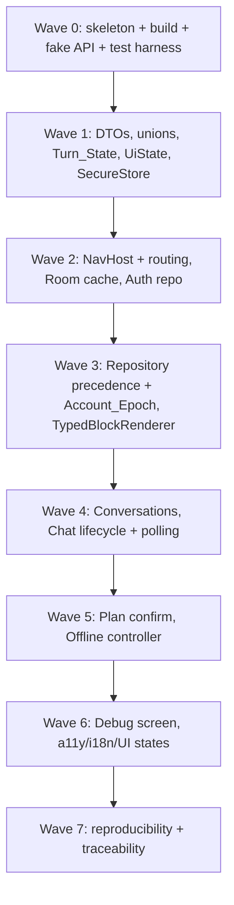

# Implementation Plan: Android App (Spec 5 of 6)

## Overview

This plan converts the `android-app` design into a series of incremental, test-driven coding steps for a native **Kotlin + Jetpack Compose** single-module client. Each step builds on prior work and wires into it, leaving no orphaned code. The client is a **pure consumer and renderer**: it consumes the Spec 3 HTTP contracts and renders the Spec 4 typed `content_blocks`; it never parses a technical figure from prose, never authors a plan, never re-ranks.

Two invariants are kept central throughout:

- **Never-parse-from-prose.** Every technical figure rendered is read from a typed `Content_Block` field; `Answer_Text` is displayed verbatim and never scanned. Absent/`N/A` is rendered with its explicit state, never zero/zero-bar/winner. (Property 1, 2, 3)
- **Offline = disable-Send + preserve-Draft + no-autosend.** No `POST`, no local enqueue, no false confirmation; the user must press Send again on reconnect. A `503`/invalid-token/upstream-down condition with working transport is a **distinct** error, never attributed to lack of internet. (Property 26, 28)

Testing approach per the design's Testing Strategy:

- **Unit (JVM, zero network):** JUnit + `kotlinx-coroutines-test` with a `TestDispatcher` against a **fake Spec 3 API** (in-memory). Spec 3 backend and Spec 4 output are faked; no real backend or model is used.
- **Property-style (min 100 cases):** parameterized/table-driven generators or a Kotlin property library; each correctness property realized by exactly one test tagged `Feature: android-app, Property N: <text>`.
- **Compose UI tests:** assert via the Compose semantics tree (Robolectric where feasible).
- **Instrumented / emulator end-to-end + F5-OFF offline cases:** written but **noted as to-be-run on an emulator — NOT asserted executed**. No emulator start, Gradle build, or test run is asserted here.

## Task Dependency Graph



```json
{
  "waves": [
    { "id": 0, "tasks": ["1.1", "1.2", "1.3"] },
    { "id": 1, "tasks": ["2.1", "2.2", "2.3", "4.1", "4.2"] },
    { "id": 2, "tasks": ["5.1", "5.2", "6.1", "6.2", "7.1"] },
    { "id": 3, "tasks": ["7.2", "8.1", "8.2", "8.3", "8.4"] },
    { "id": 4, "tasks": ["9.1", "9.2", "10.1", "10.2"] },
    { "id": 5, "tasks": ["10.3", "11.1", "11.2", "12.1", "12.2"] },
    { "id": 6, "tasks": ["13.1", "13.2", "14.2"] },
    { "id": 7, "tasks": ["15.1", "16.1", "16.2", "17.1"] }
  ]
}
```

## Tasks

- [ ] 1. App skeleton, build configuration, fake Spec 3 API, and test harness
  - [ ] 1.1 Create the single-module Kotlin + Compose app skeleton and build config
    - Create one Gradle module with Compose, Navigation Compose, Retrofit/OkHttp, Room, DataStore, and coroutine dependencies pinned to exact versions
    - Lay out Feature-First package structure (`auth`, `conversations`, `chat`, `debug`, plus `network`, `cache`, `security`, `settings`, `navigation`) with `ui` / `presentation` / `data` layers per feature
    - Add a manual/light DI composition root (no heavyweight DI container)
    - Add a base Application + single Activity hosting the Compose tree, with off-main-thread dispatcher providers
    - Demo: the module's package tree and composition root exist and expose a wiring entry point (shown by reading the source tree).
    - _Requirements: 1.1, 1.2, 1.3, 1.4, 1.5, 1.6_

  - [ ] 1.2 Build the in-memory fake Spec 3 API and test fixtures
    - Implement a fake API surface covering the Spec 3 endpoints the client calls (auth, sessions list/CRUD, conversation sync + jobs, job poll/cancel, plan confirm, trace, `/me`, health/ready)
    - Model configurable responses: `202` acceptance, `Job_State` progressions with optional `Retry-After`, `Response_Envelope` on `COMPLETED`, `Error_Envelope` with stable codes, `401`/`409` triggers, and idempotency keyed by `Client_Request_Id`
    - Provide builders for `Response_Envelope`, `Content_Block` variants (including unknown-kind and malformed-field cases), and `Error_Envelope`
    - Demo: a unit test drives the fake through a QUEUED→RUNNING→COMPLETED sequence and a `409` path with zero real network.
    - _Requirements: 1.4, 1.7, 1.8_

  - [ ]* 1.3 Set up the test harness and property-style helper
    - Wire JUnit + `kotlinx-coroutines-test` `TestDispatcher`, Compose UI test (semantics), and a property-style runner (parameterized/table-driven or a Kotlin property library) with a shared min-100-cases helper and the `Feature: android-app, Property N` tagging convention
    - Add a reusable fake-API test rule and generators seed
    - Demo: a trivial property-style test runs 100 generated cases and reports the tag (noted as a harness smoke test, not asserted executed on an emulator).
    - _Requirements: 1.2_

- [ ] 2. Client DTOs, discriminated unions, and state types
  - [ ] 2.1 Define Response_Envelope / Error_Envelope / content_blocks DTOs and the metric view model
    - Implement DTOs mirroring Spec 3: `Response_Envelope` (required `session_id`, `answer`; optional `content_blocks`, `status`, `interpretation_summary`, `plan`, `warnings`, `request_id`, `catalog_edition_id`, `message_id`, `turn_id`) and `Error_Envelope` (`code`, `user_message`, `request_id`, `retryable`, sanitized `details`)
    - Implement the `Content_Block` discriminated union parsed by `kind` (`text`, `product_card`, `comparison_table`, `matching_part_numbers`, `bar_chart`, `clarification`, `plan_review`) with `schema_version`; unknown kind decodes to a safe `text` fallback
    - Implement the local technical-value view model (`metric_code`, `display_label`, `value`, `unit`, `availability` distinguishing `N/A`/`UNKNOWN`/present, `service`, `frequency_context`, `provenance_ref`, `comparison_direction`, `comparable`, `note_ref?`) populated only from typed fields
    - Demo: a unit test decodes an envelope whose `answer` prose contains misleading numbers and confirms figures come only from typed fields and unknown kinds degrade to text.
    - _Requirements: 1.9, 1.10, 1.11, 5.1_
    - _Properties: Property 1, Property 2_

  - [ ]* 2.2 Write property tests for envelope decoding and block dispatch
    - Property test over envelopes with adversarial prose numbers vs typed fields; assert rendered-figure source is always a typed field and `answer` is verbatim
    - Property test over unknown/malformed blocks; assert safe fallback and no fabricated value
    - Property test over mixed-availability metrics; assert `N/A`/absent never maps to zero/zero-bar/winner
    - Tag each `Feature: android-app, Property N`; min 100 cases
    - Demo: three property tests run 100+ cases each over generated envelopes.
    - _Requirements: 1.9, 1.10, 1.11, 5.1, 5.7_
    - _Properties: Property 1, Property 2, Property 3_

  - [ ] 2.3 Define Turn_State, Job_State, and per-screen sealed UiState types
    - Implement `Turn_State` enum (`draft`, `submitting`, `queued`, `running`, `needs_clarification`, `awaiting_confirmation`, `completed`, `failed`, `cancelled`, `disconnected_reconciling`) and the observed `Job_State` set, with the terminal mapping `COMPLETED→completed`, `FAILED→failed`, `CANCELLED→cancelled`
    - Implement sealed `UiState` for Conversations (`FirstLoad`, `Refreshing`, `Empty`, `Loaded`, `OfflineCache`, `RecoverableError`, `Deleting`, `Deleted`, `SessionExpired`), Chat, Auth (`Idle`/`Submitting`/`Error(generic)`), and Debug (`Loading`/`Loaded`/`Denied`/`Unavailable`)
    - Demo: a unit test asserts a turn holds exactly one Turn_State and terminal Job_States map correctly.
    - _Requirements: 6.2, 6.6, 4.4_
    - _Properties: Property 23_

- [ ] 4. Secure storage (Keystore-backed SecureStore)
  - [ ] 4.1 Implement SecureStore over the Android Keystore
    - Store access/refresh tokens and cache-encryption keys wrapped under Keystore-backed keys; never persist token/password/key in plaintext
    - Exclude cache and tokens from Android backup; never write key material to logs/traces
    - When a required Keystore key is unavailable, treat the cache as empty and expose neither ciphertext nor partial plaintext
    - Demo: a unit test (JVM-faked Keystore) writes a token, scans stored bytes for plaintext (none found), and simulates key-unavailable yielding an empty cache.
    - _Requirements: 3.9, 9.4, 9.5, 9.9_
    - _Properties: Property 15, Property 16_

  - [ ]* 4.2 Write property tests for secure storage and Keystore-unavailable
    - Property test over random tokens/titles/messages: no plaintext index persisted, all stored bytes are ciphertext, backup-excluded
    - Property test over key-available vs key-unavailable: unavailable yields empty cache, no leakage
    - Tag `Feature: android-app, Property 15` / `Property 16`; min 100 cases
    - Demo: both property tests run 100+ cases each.
    - _Requirements: 9.4, 9.5, 9.9_
    - _Properties: Property 15, Property 16_

- [ ] 5. Navigation host and five typed destinations
  - [ ] 5.1 Implement NavHost, typed routes, and launch routing
    - Build a single `NavHost` with an auth graph (Login ↔ Register) and a main graph (Conversations → Chat(sessionId) → DebugTrace(messageId)), passing only lightweight identifiers — never full messages/conversations
    - Implement launch routing: route to Conversations iff a stored access/refresh token is unexpired and the backend accepts it, else Login
    - Reveal the Developer Debug navigation entry only when `/me` reports role `developer`; fail closed if the lookup fails or is unavailable
    - Demo: a unit test over stored-session states asserts Conversations-vs-Login routing and developer-only Debug reveal.
    - _Requirements: 1.3, 2.1, 2.2, 2.3, 2.4, 2.5, 2.6_
    - _Properties: Property 29, Property 33_

  - [ ]* 5.2 Write property tests for launch routing and Debug reveal
    - Property test over stored-session acceptance states → correct Conversations/Login routing
    - Property test over `/me` role-lookup outcomes → Debug entry revealed iff `developer`, fail-closed otherwise
    - Tag `Feature: android-app, Property 29` / `Property 33`; min 100 cases
    - Demo: both property tests run 100+ cases each.
    - _Requirements: 2.3, 2.4, 2.5, 2.6_
    - _Properties: Property 29, Property 33_

- [ ] 6. Authentication: register, login, refresh, logout, account switch
  - [ ] 6.1 Implement AuthRepository / AuthViewModel over the fake Spec 3 API
    - Register sends only email+password with no role/privilege field (backend assigns `user`); invalid/duplicate registration stays on Register with an error and creates no local session
    - Login presents a generic auth-failed message (no unknown-email vs wrong-password distinction) and does not retain the password beyond the attempt
    - On `401`, run a single synchronized refresh rotation (exactly one rotation consumed, no replay); on refresh failure close the session, hide cache, route to Login
    - Logout clears tokens, calls `/logout`, and makes the cache inaccessible even if the backend call fails/times out
    - Account switch purges the prior account's cache + wrapped residual key before rendering, guarded by `Account_Epoch`; store tokens via SecureStore only
    - Demo: unit tests against the fake drive register-user-only, generic login failure, concurrent-401 single rotation, logout-with-backend-failure, and A→B account switch.
    - _Requirements: 3.1, 3.2, 3.3, 3.4, 3.5, 3.6, 3.7, 3.8, 3.9, 2.8, 9.6_
    - _Properties: Property 9, Property 10, Property 11, Property 12, Property 13, Property 14_

  - [ ]* 6.2 Write property tests for auth flows and refresh synchronization
    - Property tests: registration payloads with injected roles never send a role (P9); login failure generic + password not retained (P10); concurrent `401` sets → exactly one rotation, no replay (P11); refresh failure closes session + hides cache (P12); logout clears locally even on backend failure (P13); account-switch interleavings with late responses discarded on epoch mismatch (P14)
    - Tag each `Feature: android-app, Property N`; min 100 cases
    - Demo: six property tests run 100+ cases each.
    - _Requirements: 3.1, 3.2, 3.3, 3.4, 3.5, 3.6, 3.7, 3.8, 2.8, 9.3, 9.6, 9.7_
    - _Properties: Property 9, Property 10, Property 11, Property 12, Property 13, Property 14_

- [ ] 7. Room read cache and repository source-of-truth precedence
  - [ ] 7.1 Implement the encrypted per-user Room read cache
    - Define `cached_conversations` (owner key, conversation id, encrypted title payload, last-activity, pending-job flag, `last_sync`) and `cached_messages` (conversation id, message id, role, encrypted content/blocks payload, created_at, `last_sync`) ordered by `(created_at asc, message_id asc)`
    - Encrypt titles/messages at the payload level under Keystore-backed keys via SecureStore; persist no plaintext index; partition per user so no account reads another's entries; exclude from backup
    - Demo: a unit test writes two users' cache entries and confirms isolation and absence of a plaintext title index.
    - _Requirements: 1.5, 9.1, 9.4, 9.5_
    - _Properties: Property 15, Property 17_

  - [ ] 7.2 Implement repository source-of-truth precedence and the Account_Epoch guard
    - Make the Repository the only seam choosing server-over-cache; attach the current `Account_Epoch` to in-flight requests and cache writes; advance the epoch on logout/account switch and discard any response/write whose epoch ≠ current
    - Never rebuild server state from cache; never resurrect a backend-deleted conversation; purge a gone conversation from cache
    - Demo: a unit test interleaves a late prior-epoch response after a switch and confirms it is discarded and never written.
    - _Requirements: 1.9, 3.8, 9.3, 9.7, 9.8, 4.8_
    - _Properties: Property 14, Property 19_

- [ ] 8. Conversations screen and TypedBlockRenderer
  - [ ] 8.1 Implement ConversationsViewModel / ConversationsRepository
    - Load only the token owner's conversations with title, last-activity, and a pending-job indicator shown iff ≥1 outstanding job
    - Case-insensitive title-only search (≤200 chars) against the listing endpoint, never message bodies; offline falls back to a cache filter labeled a partial offline result
    - Support create, open, rename (1–200 chars), and delete-with-confirmation (confirm/cancel); show account identity + logout
    - Expose the sealed state set with a retry affordance in recoverable-error; cursor pagination honoring backend ordering
    - Delete is final only after backend confirmation, invalidates that conversation's cache, held unconfirmed if not confirmed within 30s; connectivity loss before confirm → indeterminate, reconciled against the backend on reconnect without resurrecting a deleted conversation
    - Demo: unit tests drive owner-only listing, title-only search with offline partial label, delete-confirm reconcile, and pagination cursor usage.
    - _Requirements: 4.1, 4.2, 4.3, 4.4, 4.5, 4.6, 4.7, 4.8, 9.1_
    - _Properties: Property 17, Property 18, Property 19, Property 20_

  - [ ]* 8.2 Write property tests for Conversations logic
    - Property tests: owner-only list + pending indicator (P17); title-only search + offline partial label (P18); delete reconcile + no resurrection (P19); pagination honors backend cursor/order (P20)
    - Tag each `Feature: android-app, Property N`; min 100 cases
    - Demo: four property tests run 100+ cases each.
    - _Requirements: 4.1, 4.2, 4.5, 4.6, 4.7, 4.8_
    - _Properties: Property 17, Property 18, Property 19, Property 20_

  - [ ] 8.3 Implement the TypedBlockRenderer
    - Dispatch by `Content_Block` kind; unknown kind → safe text fallback; read every figure from typed fields; display `answer` verbatim; show no tool name/token/prompt/SQL/internal parameter
    - Render `interpretation_summary` compact-and-expandable with backend-provided categories only; render at most three full product cards and, when ≥2 shown, a dual-of-two comparison selector; render `bar_chart` only for `comparable` metrics, each with a textual alternative value
    - Render `N/A`/absent with its explicit state (never zero/zero-bar/winner); show unit + service + 50/60 Hz context where provided; show heterogeneous-supply FLA with its supply condition and no lower-energy claim
    - Show match count + full list of matching part-number names while capping full cards at three; top-1 mode shows winner + integer eligible count only; a missing/malformed typed field renders an explicit unavailable fallback
    - Demo: a Compose semantics-tree test renders each block kind, an unknown kind fallback, an N/A field, max-three cards + dual-of-two, and comparable-only bars with textual alternatives.
    - _Requirements: 1.10, 1.11, 5.1, 5.2, 5.3, 5.6, 5.7, 5.8, 5.9, 5.10, 10.4_
    - _Properties: Property 1, Property 2, Property 3, Property 4, Property 5, Property 6, Property 7_

  - [ ]* 8.4 Write property tests for renderer pure logic
    - Property tests: card cap + dual-of-two iff ≥2 + comparable-only bars with textual alt (P4); list count + full PN list vs top-1 winner+count only (P5); unit/service/frequency context + heterogeneous FLA no energy claim (P6); interpretation compact-expandable with backend categories only (P7)
    - Tag each `Feature: android-app, Property N`; min 100 cases
    - Demo: four property tests run 100+ cases each.
    - _Requirements: 5.3, 5.6, 5.8, 5.9, 5.10, 10.4_
    - _Properties: Property 4, Property 5, Property 6, Property 7_

- [ ] 9. Chat screen, turn lifecycle, and asynchronous job polling
  - [ ] 9.1 Implement ChatViewModel / ChatRepository turn lifecycle and polling
    - New conversation sends the first query with no `session_id`; on the returned `session_id` persist it, associate the `job_id`, and remove the provisional draft so exactly one turn record remains
    - Each turn holds exactly one `Turn_State`; determine job state only from job-endpoint responses, never from elapsed time; retain `Client_Request_Id` until acceptance resolves
    - On `202`, poll off the main thread with exponential backoff (1s→30s) honoring `Retry-After` clamped to 1–300s, never blocking the main thread; terminal `Job_State` stops polling and sets the terminal `Turn_State`
    - Retry a lost/unknown acceptance with the same `Client_Request_Id` (new key only for a genuinely new intent)
    - Demo: unit tests on a `TestDispatcher` drive no-session-id first turn → single record, a QUEUED→RUNNING→COMPLETED poll with `Retry-After`, and an idempotent retry.
    - _Requirements: 6.1, 6.2, 6.3, 6.4, 6.5, 6.6, 10.6_
    - _Properties: Property 22, Property 23, Property 24, Property 25_

  - [ ]* 9.2 Write property tests for turn lifecycle, polling, and idempotency
    - Property tests: no-session-id first turn collapses to one record (P22); exactly one Turn_State + terminal mapping (P23); job state only from responses + backoff/`Retry-After` bounds off main thread (P24); idempotent retry + in-flight reconcile without duplication (P25)
    - Tag each `Feature: android-app, Property N`; min 100 cases
    - Demo: four property tests run 100+ cases each over generated Job_State/Retry-After sequences.
    - _Requirements: 6.1, 6.2, 6.3, 6.4, 6.5, 6.6, 7.7_
    - _Properties: Property 22, Property 23, Property 24, Property 25_

- [ ] 10. Plan confirmation and 409 stale-plan handling
  - [ ] 10.1 Implement the plan-confirmation panel and revision handling
    - When the envelope carries a plan awaiting confirmation, present a panel showing proposed criteria and ranking with Confirm and Edit; send the `Plan_Revision` with the confirmation
    - On a `409` stale-plan response, reload the current plan, present it for a fresh confirmation, and never auto re-execute the superseded plan
    - Demo: a unit test confirms the revision is sent and a `409` triggers reload + fresh confirmation without re-execution.
    - _Requirements: 5.4, 5.5_
    - _Properties: Property 21_

  - [ ]* 10.2 Write property test for plan confirmation and stale reload
    - Property test over confirmation/stale sequences: revision always sent, `409` reloads and never auto re-executes
    - Tag `Feature: android-app, Property 21`; min 100 cases
    - Demo: the property test runs 100+ cases.
    - _Requirements: 5.4, 5.5_
    - _Properties: Property 21_

  - [ ] 10.3 Wire plan confirmation into the Chat screen
    - Render the plan panel inside the Chat `UiState` and route Confirm/Edit events through the ChatViewModel into the repository confirmation call
    - Demo: a Compose semantics-tree test shows the panel appears on an awaiting-confirmation turn and dispatches Confirm.
    - _Requirements: 5.4_

- [ ] 11. Offline controller
  - [ ] 11.1 Implement OfflineController / ConnectivityMonitor
    - Expose an offline flag feeding every screen state; while offline show a non-dismissible `Offline_Banner` on Conversations and Chat with localized ES/EN copy
    - Disable Send with an accessible TalkBack-announced disabled state while keeping the composer and preserving the encrypted Draft across backgrounding/termination/restart; issue no `POST`, no local enqueue, and mark nothing sent/queued/completed
    - On reconnect do not auto-send the Draft and keep it unchanged until the user presses Send; present cached history with a `Last_Sync_Label`, never as exhaustive/current
    - Present a `503`/invalid-token/upstream-down condition (working transport) as a distinct server/auth error, never attributed to lack of internet; in-flight connectivity loss → indeterminate, reconciled on reconnect to a single sent/not-sent outcome via `Client_Request_Id`/`job_id`; revalidate session + pending jobs before re-enabling Send
    - Demo: unit tests drive offline → no POST + preserved Draft, reconnect → no autosend, and a `503` presented distinctly from the banner.
    - _Requirements: 7.1, 7.2, 7.3, 7.4, 7.5, 7.6, 7.7, 7.8_
    - _Properties: Property 25, Property 26, Property 27, Property 28_

  - [ ]* 11.2 Write property tests for offline behavior
    - Property tests: offline disables Send + preserves Draft + no POST/enqueue/autosend (P26); offline cache owner-only + labeled stale + not current (P27); offline never conflated with `503`/auth error (P28)
    - Tag each `Feature: android-app, Property N`; min 100 cases
    - Demo: three property tests run 100+ cases each over offline-interval + action sequences.
    - _Requirements: 7.1, 7.2, 7.3, 7.4, 7.5, 7.6_
    - _Properties: Property 26, Property 27, Property 28_

- [ ] 12. Developer Debug screen
  - [ ] 12.1 Implement DebugViewModel / DebugRepository
    - Navigable only while `/me` reports `developer`, with the backend re-verifying role + ownership per call
    - Render per turn and per tool call the tool name, sanitized arguments, sanitized results, any error, a non-negative duration, `trace_id`, and timestamp, plus cost/token counts when provided; distinguish a tool-attempt from the overall turn; identify turns that invoked no tool
    - Never display a token/password/secret header/KEK/DEK/internal prompt; a denied request surfaces `401`/`403`/`404` without disclosing existence or ownership; reflect that a deleted conversation's traces are unavailable; never show developer A another developer's trace
    - Demo: unit tests against the fake drive sanitized trace rendering, a no-tool turn, a non-enumerating denial, and dev-A-cannot-see-dev-B.
    - _Requirements: 8.1, 8.2, 8.3, 8.4, 8.5, 8.6, 8.7, 8.8_
    - _Properties: Property 29, Property 30, Property 31_

  - [ ]* 12.2 Write property tests for Debug trace rendering and isolation
    - Property tests: required sanitized fields + attempt-vs-turn + no-tool identification (P30); no secrets + non-enumerating denial + developer isolation (P31)
    - Tag each `Feature: android-app, Property N`; min 100 cases
    - Demo: two property tests run 100+ cases each over generated trace contents including secrets and cross-developer cases.
    - _Requirements: 8.2, 8.3, 8.4, 8.5, 8.6, 8.8, 10.5_
    - _Properties: Property 30, Property 31_

- [ ] 13. Accessibility, internationalization, and UI states
  - [ ] 13.1 Implement localization, accessibility, and UI-state providers
    - Provide localized ES/EN strings and number/date formats with default-language fallback; never translate part numbers, units, or technical identifiers; a language switch changes only UI strings/formats, never a numeric value/unit/source
    - Provide TalkBack content descriptions, large-text scaling to 2.0×, and dark/light themes; render comparison tables with accessible headers + horizontal scroll and a textual alternative for every chart
    - Render loading/empty/error states on every screen with an actionable retry and no stack trace; run network/DB/crypto off the main thread with lifecycle-scoped cancellation so no ANR arises
    - Demo: a Compose semantics-tree test asserts accessible headers, a chart textual alternative, and loading/empty/error states with retry.
    - _Requirements: 10.1, 10.2, 10.3, 10.4, 10.5, 10.6_
    - _Properties: Property 32, Property 8_

  - [ ]* 13.2 Write property tests for i18n invariance and load-failure safety
    - Property test over the same envelope rendered under ES and EN: technical values/units/sources unchanged, only UI strings/formats change, missing strings fall back (P32)
    - Property test over ViewModel load failures: resulting `UiState` is an error state, no crash (P8)
    - Tag each `Feature: android-app, Property N`; min 100 cases
    - Demo: two property tests run 100+ cases each.
    - _Requirements: 10.1, 10.2, 1.2_
    - _Properties: Property 32, Property 8_

- [ ] 14. Checkpoint and reproducibility
  - [ ] 14.1 Checkpoint — ensure all unit, property, and Compose tests pass
    - Ensure all tests pass, ask the user if questions arise.
    - Demo: the unit/property/Compose test suite runs green locally (instrumented/emulator cases remain to-be-run, not asserted executed).
    - _Requirements: 1.2_

  - [ ] 14.2 Implement reproducibility: release networking, secret hygiene, and docs
    - Add a network-security config that disallows global cleartext and permits cleartext only for the single documented local emulator loopback host `10.0.2.2`, rejecting cleartext for all other hosts
    - Ensure no real secret/token/password/key is embedded in source, resources, or build output; use non-functional placeholder/configuration values for endpoints and credential inputs
    - Write documentation for a clean-checkout build in Android Studio, emulator setup, the `10.0.2.2` host-to-emulator mapping, the navigation path to the Developer Debug screen, and the demo `user`/`developer` accounts (no real credentials committed)
    - Demo: the network-security config and docs exist and a source scan finds no embedded secret (clean build + emulator deploy remain to-be-run, not asserted executed).
    - _Requirements: 11.1, 11.2, 11.3, 11.4, 11.5, 11.6_

- [ ] 15. Instrumented / emulator end-to-end and F5-OFF offline tests (written, to-be-run)
  - [ ] 15.1 Author instrumented end-to-end and F5-OFF offline test suites
    - Write instrumented tests for auth/conversations/chat/debug flows, the F5-OFF offline cases (F5-OFF-01..07), large-text 2.0× and TalkBack accessibility checks, network-security cleartext enforcement, and the clean-checkout build+deploy reproducibility check
    - Mark the suite clearly as to-be-run on an emulator by Spec 6 / F5; do not assert execution here
    - Demo: the instrumented test sources exist and are annotated as emulator-only, to-be-run.
    - _Requirements: 10.3, 11.1, 11.3, 11.4, 7.1, 7.2, 7.3, 7.4, 7.8_
    - _Properties: Property 26, Property 27, Property 28_

- [ ] 16. Final wiring and traceability
  - [ ] 16.1 Wire all features into the composition root and NavHost
    - Connect Auth, Conversations, Chat (with TypedBlockRenderer, plan panel, offline controller), and Debug through the manual DI composition root and the single `NavHost`, ensuring no orphaned component and that every ViewModel resolves its repository, SecureStore, and cache dependencies
    - Demo: a unit/Compose test launches the app graph and navigates Login→Conversations→Chat→Debug with faked dependencies.
    - _Requirements: 1.1, 1.3, 2.1, 2.2_

  - [ ]* 16.2 Write an integration-style test over the wired graph (faked backend)
    - End-to-end-in-JVM test against the fake Spec 3 API: register-user → list conversations → send a turn → render typed blocks → confirm a plan → go offline → reconnect, all on a `TestDispatcher`
    - Demo: the integration test runs green against the fake with zero real network.
    - _Requirements: 1.4, 6.1, 5.1, 7.1_
    - _Properties: Property 1, Property 22, Property 26_

  - [ ] 17.1 Traceability check: every Requirement and Property maps to a task
    - Verify each Requirement (1.1–11.6) and each design Property (1–33) is referenced by at least one task's `Requirements:`/`Properties:` line; record any gap and add a covering task
    - Demo: a short coverage note lists each Requirement and Property against the task(s) covering it, with no gaps.
    - _Requirements: 1.1, 2.1, 3.1, 4.1, 5.1, 6.1, 7.1, 8.1, 9.1, 10.1, 11.1_

## Notes

- Tasks marked with `*` are optional test sub-tasks and can be skipped for a faster MVP; core implementation sub-tasks must be implemented.
- Each task references specific requirements and, where relevant, the design's Property numbers for traceability.
- Checkpoints ensure incremental validation; property tests validate universal correctness properties (min 100 generated cases, tagged `Feature: android-app, Property N`).
- Spec 3 backend and Spec 4 output are faked/mocked throughout the unit/property/Compose layers; no real backend or model is required.
- Instrumented/emulator end-to-end and F5-OFF offline tests are written but **to-be-run on an emulator by Spec 6 / F5** — this plan asserts no emulator start, Gradle build, or test execution as having happened.
- The never-parse-from-prose invariant (Property 1–3) and the offline disable-Send / preserve-Draft / no-autosend behavior (Property 26, 28) are kept central across the renderer, chat, and offline tasks.
