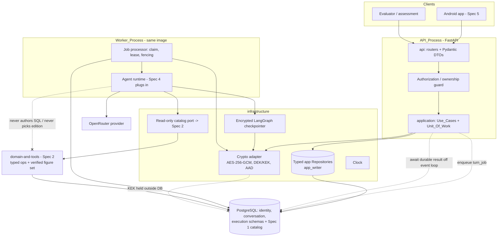

# Design Document

## Overview

This document is the design for **`backend-api-auth-jobs-crypto` (Spec 3 of 6)** of the *Series 76 Technical Assistant* (Konecto technical assessment). It is the **FastAPI backend**: the HTTP contracts, authentication, authorization and ownership isolation, persistence of conversations and jobs, the durable PostgreSQL-backed job queue with leasing and fencing, the application-layer AES-256-GCM cryptography and key lifecycle, and the separate worker process.

This layer is the **trust, transport, and durability boundary** that wraps the deterministic domain layer and hosts the agent runtime. It:

- **establishes identity and trust** — Argon2id passwords, opaque server-revocable tokens, owner/role authorization enforced before any decryption or any dispatch to a model or tool;
- **persists and protects** conversation data — titles, messages, domain state, plans, sensitive traces, and agent checkpoints encrypted *before* they reach PostgreSQL, under per-conversation keys held outside the database;
- **serializes turns durably per session** — a durable `turn_jobs` queue with transactional acceptance ordering (`accepted_seq`), time-bounded leases, monotonic fencing, and `UNIQUE(owner_id, client_request_id)` idempotency;
- **shapes the response envelope** — the typed `Response_Envelope` the agent and the Android app depend on, always carrying `session_id` and `answer`.

### Position in the system

- **Depends on** `data-and-ingestion` (Spec 1): the published `Catalog_Store` surface, the least-privilege `runtime_catalog_reader` PostgreSQL role, the immutable `Catalog_Edition` facts, and edition-withdrawal semantics.
- **Depends on** `domain-and-tools` (Spec 2): the pure domain operations (`get_part`, `search_parts`, `get_source_notes`), the deterministic services (`rank_candidates`, `compare_parts`, `convert_units`), the custom LangChain tools, the `SemanticFailureCode` set, and the **verified figure set** that the final `answer` and the structured `content_blocks` share.
- **Consumed by** `agent-orchestration-response` (Spec 4): which plugs its agent logic, interpretation, plan versioning, and response composition into the endpoints, DTOs, job states, and the encrypted checkpoint surface defined here.
- **Consumed by** `android-app` (Spec 5): which consumes these HTTP contracts, the typed envelope, auth flows, and polling protocol.

### The mandatory contract is inviolable

`POST /api/conversation` accepts an **optional `session_id`** plus a **required `query`** and **always** returns a final response containing a **non-empty `session_id`** and a **non-empty `answer`**. Nothing in the asynchronous job queue — its presence, behavior, timing, or outcome — may alter, replace, or invalidate this contract. The async endpoints are additive. This invariant is treated as a first-class correctness property (Property 11).

### Source-of-truth reminder

This backend **invents no technical numbers**. Every number in any `answer`, `content_block`, or chart is relayed from the deterministic, evidence-backed **verified figure set** produced by Spec 2 and composed by Spec 4. The backend injects an authorized edition and permission context and invokes typed, already-authorized domain operations; it never computes, infers, or lets a language model author SQL, pick an edition, or dictate a number. Public catalog technical figures and the minimal structural index fields may remain cleartext; everything sensitive is encrypted before it is persisted.

### Requirement-class legend (reference)

The requirement classes in `requirements.md` — **[ASSESS]** (mandatory from the assessment), **[APPROVED]** (ratified F0–F6 handoff decision, including F3-ARCH-01 option A and F3-D01..D12), **[DELEGATED]** (Kiro may concretize exact types, library choices, index microstructure, DTO field names, HTTP nuances while preserving approved invariants), and **[EXPERIMENT]** (requires real execution/benchmark/measurement) — govern which design elements are contractual versus which require a real run. This design satisfies the **structural and contractual** obligations of **Requirements 1–12**.

### Status discipline

Nothing here asserts that any migration has run, any server has started, any test has executed, any encryption has been validated against a live database, or any latency/cost has been measured. Every contract below is **to be verified** by later implementation and by `evaluation-and-reproducibility` (Spec 6) and F5. Delegated details (exact column names, cursor encoding, token binary form, and the specific lease/retry durations within the stated bounds) are Kiro's to finalize during implementation.

---

## Architecture

### Style — modular monolith, Feature-First + light hexagonal (F3-ARCH-01 option A)

The backend is a **modular monolith** organized **Feature-First** with a **light hexagonal (ports & adapters)** boundary at external edges, ratified as F3-ARCH-01 option A. Four boundaries:

- **`api`** — FastAPI routers and Pydantic DTOs; resolves identity/owner; enforces rate limits and idempotency keys; maps outcomes to HTTP. Never executes model-generated SQL.
- **`application`** — Use_Cases/Services that authorize owner+role, control the transaction boundary (Unit_Of_Work), and orchestrate conversations, plans, jobs, and response assembly.
- **`domain`** — pure rules. Imports **none** of FastAPI, SQLAlchemy, LangChain, or any provider SDK (Req 1.1). The Series 76 technical domain itself is owned by Spec 2; this layer's domain concepts are the auth/session/job/plan/crypto invariants.
- **`infrastructure`** — SQLAlchemy async repositories, the crypto adapter, the OpenRouter client, migrations, the worker, clock, and tracing. Houses the single place application SQL is authored (parameterized, typed) and the read-only catalog port into Spec 2.

Patterns ratified by F3: **Repository** + **DTO** (distinct from domain and ORM models) + **Unit_Of_Work** controlled by the Use_Case (no repository commits on its own, Req 1.2) + **light Dependency Injection** via FastAPI `Depends` at a bootstrap/composition root (no extra DI container, Req 1.8) + **Adapter** at external edges + **State Machine** for jobs and plans + **Command/Idempotency** for turns. **No** redundant DAO alongside a Repository over the same table (Req 1.3), no event bus, no CQRS/event sourcing.

### Process and deployment model

`API_Process` and `Worker_Process` are **two separate processes built from the same image and codebase** (Req 1.4), with no external message broker. Docker Compose defines `db` (PostgreSQL + persistent volume), `api` (FastAPI), and `worker` (same image, job-processor entrypoint) (Req 12.1). Per-service PostgreSQL roles enforce least privilege: `app_writer` for application data, `runtime_catalog_reader` for catalog reads (Spec 1), `ingest_publisher` reserved for ingestion (Req 1.5). The application data path holds no ingestion-staging privileges; the catalog read path holds no application-write privileges. While the worker runs an agent task, the API continues to accept and answer HTTP requests without blocking (Req 1.9) — the sync endpoint awaits a durable job result off the event loop (via async polling of persisted state), never holding the loop or a SQL transaction across the model call.

### Component diagram



Two invariants are visible: the agent never authors SQL nor supplies an edition (every catalog read goes through the Spec 2 typed port), and the KEK is never stored in PostgreSQL.

### Turn lifecycle (sync endpoint over the durable queue)

```mermaid
sequenceDiagram
    participant C as Client
    participant API as API_Process
    participant DB as PostgreSQL
    participant W as Worker_Process
    participant LLM as OpenRouter

    C->>API: POST /api/conversation {session_id?, query, Client-Request-Id}
    Note over API,DB: TXN 1 (short, <=1s): authorize owner,<br/>create conversation if no session_id,<br/>UNIQUE(owner_id, client_request_id),<br/>assign accepted_seq, enqueue turn_job QUEUED
    API->>DB: commit TXN 1
    API-->>C: (sync) awaits durable result off the event loop

    W->>DB: claim reclaimable job (SKIP LOCKED), verify no RUNNING in this conversation
    Note over W,DB: TXN 2 (short, no external call): set lease_expires_at 30-120s,<br/>monotonic fencing_token, attempt_count++
    W->>DB: commit TXN 2
    W->>DB: decrypt context (only after owner/edition checks)
    W->>LLM: run agent turn (OUTSIDE any SQL transaction)
    LLM-->>W: agent result (uses Spec 2 verified figures)
    Note over W,DB: TXN 3 (short): persist result iff fence==current AND lease valid<br/>AND owner matches AND conversation not tombstoned;<br/>encrypt message/state/plan/checkpoint before write
    W->>DB: commit TXN 3 -> job COMPLETED

    API->>DB: poll persisted job/result
    API-->>C: 200 Response_Envelope {session_id, answer, ...}  (always session_id + answer)

    Note over C,API: Async variant: POST /api/conversation/jobs -> 202 {job_id, session_id, status=QUEUED};<br/>GET /api/jobs/{id} polls same state, returns same envelope on COMPLETED
```

The sync path and the async path share the **same** durable job and the **same** `Response_Envelope`. The sync endpoint awaits the job result without blocking the event loop and without holding a transaction across the LLM call; if a timeout is reached it communicates job state honestly while preserving the durable job, and an idempotent retry does not duplicate (Req 4.7, 5.10, 6.6).

---

## Data Models

All shapes below are described **semantically**; exact column names, index microstructure, cursor encoding, and the binary/hex/base64url form of token secrets are **[DELEGATED]** to Kiro, preserving every invariant. Schemas are versioned via **Alembic** migrations (Req 12.2). Conceptual PostgreSQL schemas: `identity`, `conversation`, `execution` (plus Spec 1's `catalog`/`provenance`). Every owned aggregate carries an authoritative `owner_id` FK and, where edition-scoped, a `catalog_edition_id` FK (never inferred from a bare `session_id`).

### Application entities

| Entity | Key fields (semantic) | FKs | Encrypted (before persist) | Cleartext |
|---|---|---|---|---|
| `users` | `id`, `email` (canonical, unique), `password_verifier` (Argon2id), `role ∈ {user, developer}`, `email_verified=false`, `created_at` | — | — | id, email, role, timestamps; `password_verifier` is a one-way Argon2id hash (not reversible ciphertext) |
| `auth_sessions` | `auth_session_id`, `created_at`, `revoked_at?`, device label? | `owner_id→users` | — | all (session metadata, no secrets) |
| `token_verifiers` | `id`, `token_type ∈ {access, refresh}`, `verifier = SHA-256(secret)`, `refresh_family_id`, `prev_token_id?`, `rotated_at?`, `revoked_at?`, `expires_at` | `auth_session_id→auth_sessions`, `owner_id→users` | — | verifier (one-way hash), family/rotation metadata; raw secret **never** stored |
| `conversations` | `session_id`, `title_ciphertext`, `created_at`, `updated_at`, `deleted_at?` (tombstone), `tombstone_fence?` | `owner_id→users`, `catalog_edition_id→catalog` | **title** | owner_id, edition, timestamps, deleted_at, fence |
| `messages` | `message_id`, `role`, `content_ciphertext`, `blocks_ciphertext?`, `created_at` | `session_id→conversations`, `owner_id→users` | **content**, **typed blocks** | message_id, role, created_at, owner_id |
| `domain_states` | `id`, `state_ciphertext`, `revision`, `updated_at` | `session_id→conversations`, `owner_id→users` | **domain state** | id, revision, timestamp, owner_id |
| `plans` | `plan_id`, `plan_revision` (strictly increasing per conversation), `is_current`, `plan_ciphertext`, `confirmed_at?`, `executed_at?` | `session_id→conversations`, `owner_id→users` | **plan content** | plan_revision, is_current, confirmation/execution markers |
| `turn_jobs` | `job_id`, `job_state` (enum), `accepted_seq` (per-conversation, strictly increasing), `client_request_id`, `lease_expires_at?`, `fencing_token`, `attempt_count`, `next_retry_at?`, `created_at`, `updated_at` | `session_id→conversations`, `owner_id→users`; `UNIQUE(owner_id, client_request_id)` | input payload ciphertext | job_state, accepted_seq, lease/fence/attempt, timestamps, owner_id |
| `job_attempts` | `id`, `started_at`, `ended_at?`, `outcome`, `fencing_token` | `job_id→turn_jobs`, `owner_id→users` | sensitive attempt detail if any | timing, outcome code, fence |
| `encrypted_checkpoints` | `id`, `thread_id` (derived post-auth), `checkpoint_ciphertext`, `pending_writes_ciphertext`, `cipher_version`, `created_at` | `session_id→conversations`, `owner_id→users` | **checkpoint blob incl. pending writes** | thread_id, cipher_version, timestamp, owner_id |
| `tool_traces` | `id`, `trace_ciphertext` (sanitized before encryption), `timings` | `message_id→messages`, `session_id→conversations`, `owner_id→users` | **sanitized trace content** | timings (non-negative), ids, owner_id |
| `key_metadata` | `key_id`, `cipher_version`, `wrapped_dek` (DEK ciphertext under KEK), `created_at`, `shredded_at?` | `session_id→conversations`, `owner_id→users` | the DEK is stored **only** wrapped | key_id, cipher_version, timestamps; **KEK never stored here or anywhere in PG** |
| `audit_events_minimal` | `id`, `event_type`, `at`, `request_id` | `owner_id→users?` | — | minimal, content-free event records |

**Encrypted vs cleartext summary (Req 9.2):** encrypted = titles, message content, typed blocks, domain state, plans, sensitive tool traces, and checkpoints (including pending writes). Cleartext = `owner_id`, `catalog_edition_id`, timestamps, job/plan/conversation **states**, `accepted_seq`, lease/fence/attempt metadata, `key_metadata` (`key_id`, `cipher_version`, wrapped DEK), and the public catalog figures/index fields owned by Spec 1. No sensitive field is ever searchable by `ILIKE`/substring over ciphertext.

### `Job_State` enum (Req 5.6)

`QUEUED`, `RUNNING`, `NEEDS_CLARIFICATION`, `AWAITING_CONFIRMATION`, `COMPLETED`, `FAILED`, `CANCELLED`, `STALE_PLAN`, `CATALOG_WITHDRAWN`. Each `turn_job` carries exactly one. Conversation state and plan state (revision/current/confirmed) are modeled as values **distinct from and independent of** `Job_State`.

### `Response_Envelope` (Req 4.1, 4.3; F3 §5)

- **Required (always present):** `session_id`, `answer` (user-safe text, no unverified number).
- **Optional typed fields:** `content_blocks`, `status ∈ {COMPLETED, NEEDS_CLARIFICATION, AWAITING_CONFIRMATION, clarification, confirmation}`, `interpretation_summary`, `plan` (id, revision, confirmation-needed), `warnings`, `request_id`, `catalog_edition_id`, `turn_id`, `message_id`.
- **`content_blocks`** is a **discriminated union** defined **structurally here**: `text`, `product_card`, `comparison_table`, `matching_part_numbers` (total + list/pagination), `bar_chart`, `clarification`, `plan_review`. An unknown kind degrades to a safe `text` fallback. **Population** of blocks with verified figures is owned by Spec 2/4 (Req 4.8). No `model` name, tool name, prompt, call parameters, stack trace, or token-usage ever appears in the envelope.

### `Error_Envelope` (Req 11.1, 11.3; F3 §5)

`{ error: { code, user_message }, request_id, retryable, details }` where:
- `code` ∈ the stable set `VALIDATION_ERROR`, `AUTH_REQUIRED`, `FORBIDDEN`, `NOT_FOUND`, `CONFLICT`, `STALE_PLAN`, `CATALOG_WITHDRAWN`, `JOB_CANCELLED`, `RATE_LIMITED`, `UPSTREAM_UNAVAILABLE`, `BUDGET_EXCEEDED`, `INTERNAL_ERROR`;
- `user_message` is localized ES/EN to the caller's language;
- `request_id` is unique per request and correlates to server logs;
- `retryable` is consistent for a given `code`;
- `details` is sanitized only — never SQL, prompts, secrets, stack traces, or PII.
- `NO_RESULTS` is modeled as a **successful business outcome** (not an error code), kept distinct from the `UPSTREAM_UNAVAILABLE` failure.

### Token and crypto record shapes

- **Opaque token.** A high-entropy CSPRNG secret (≥128 bits, preferring 256) presented as `Authorization: Bearer <public_id.secret>`. The server stores only `verifier = SHA-256(secret)` and compares in **constant time**. The raw secret is never persisted or logged.
- **Refresh family.** Rotating refresh tokens chained by `refresh_family_id`/`prev_token_id`; reuse of a rotated token revokes the entire family.
- **DEK/KEK.** A per-conversation **DEK** encrypts that conversation's sensitive data with AES-256-GCM (96-bit unique nonce, contextual AAD = purpose‖owner‖conversation‖record-id‖format-version). The DEK is stored **only** wrapped by a **KEK** held outside the database, alongside `key_metadata(key_id, cipher_version)`. Crypto-shredding deletes the DEK on conversation delete.

---

## Components and Interfaces

Each component states an input→output contract and the error codes it emits. Spec 4 **plugs its agent logic, interpretation, plan authoring, and block population into** the Jobs/Worker and Conversation use cases defined here; this spec owns only the endpoints, DTOs, job states, persistence, authorization, crypto, and the encrypted-checkpoint surface.

### AuthService (Req 2)
- **Endpoints:** `POST /api/auth/register`, `/login`, `/refresh`, `/logout`, `GET /api/auth/me`.
- **Input/Output:** email+password DTO → created `user` (role forced server-side) / token pair / rotated token / revocation / identity+role.
- **Behavior:** Argon2id password hashing with ≥128-bit random salt (never a bare/unsalted fast hash); opaque access+refresh tokens with SHA-256 verifiers and constant-time comparison; atomic refresh rotation with family-wide reuse detection; logout revokes the current session's refresh family and associated access tokens within ≤1s, leaving other devices unaffected; `/me` returns identity+role and never hashes/secrets/verifiers; registration always assigns role `user` and ignores/rejects any client-supplied role; `developer` accounts only via CLI/seed.
- **Errors:** `VALIDATION_ERROR`, `AUTH_REQUIRED`, `RATE_LIMITED` (login lockout: 5 failures / 15-min window), `CONFLICT` (surfaced generically to avoid account enumeration).

### Authorization / ownership guard (Req 3)
- **Input:** validated session token + target resource reference.
- **Output:** an authoritative `Owner_User_Id` resolved **from the session**, used to scope every read/mutation.
- **Behavior:** never derives ownership from body, query, or header; a conflicting supplied owner id is ignored; cross-user access returns an indistinguishable `404` with no field/metadata/count leaked; **the ownership check completes before any decryption** of a title/message/plan/trace; the `developer` role is a Debug-enabling capability over the developer's **own** resources only (not a superuser), denied with the same `404` for other owners; endpoint ownership/role authorization is evaluated **before dispatching to any model or tool**, so no model output or tool call can cause a denied return/mutation.
- **Errors:** `NOT_FOUND` (for owned-or-nonexistent), `FORBIDDEN` (role denial), `AUTH_REQUIRED`.

### Conversation use cases (Req 4, 8)
- **`POST /api/conversation` (mandatory, sync):** optional `session_id` + required `query` (1–4000 chars) → `Response_Envelope` always carrying `session_id` + `answer`. Creates a conversation when `session_id` is omitted; idempotent on repeated `Client_Request_Id`; resumes persisted multi-turn history (owner-scoped) after restart; clarification/confirmation returns a non-empty conversational `answer` plus `status`, with no unverified technical number. Rejects invalid/empty/>4000 query and nonexistent/not-owned `session_id` without creating or modifying any conversation/turn.
- **`GET /api/sessions`:** owner's conversations with titles/dates; **title-only** search that fetches at most the caller's own ciphertext titles (capped 1000/request) and decrypts **after** authorization — never `ILIKE`/substring over ciphertext, never message-body search, never another owner's data.
- **`GET /api/sessions/{id}/messages`:** owner's persisted messages and typed blocks ordered by `(created_at asc, message_id asc)`; excludes debug traces.
- **`PATCH /api/sessions/{id}`:** rename title (1–200 chars) → persists encrypted title; invalid length rejected leaving title unchanged; non-owner rejected.
- **`DELETE /api/sessions/{id}`:** cancels pending/active jobs, writes a tombstone/write-guard, purges messages/domain state/checkpoints/sensitive traces and the DEK (crypto-shred) from active storage, returns `204` within 5s; non-owner/nonexistent → `404`, previously deleted → `410`, all indistinguishable with no attributes leaked.
- **Errors:** `VALIDATION_ERROR`, `NOT_FOUND`, `CONFLICT` (gone→`410`), `CATALOG_WITHDRAWN`, `UPSTREAM_UNAVAILABLE`.

### Jobs use cases + Worker_Process (Req 5, 6)
- **`POST /api/conversation/jobs`:** valid authorized request → `202 Accepted` with `job_id`, `session_id` (creating conversation if omitted), `status=QUEUED`. Enforces configurable pending-job caps per user and per session (default 5, range 1–100); over cap → `RATE_LIMITED`, state unchanged.
- **`GET /api/jobs/{id}`:** owner → current `Job_State`; when `COMPLETED`, additionally returns the **same** `Response_Envelope` (session_id+answer). Sets `Cache-Control: no-store` always; for non-terminal states adds `Retry-After` (integer 1–60).
- **`POST /api/jobs/{id}/cancel`:** owner, cancelable states → cancellation-accepted; repeated cancel is idempotent (same status, no extra effect). Non-owner GET/cancel → indistinguishable denial.
- **Worker behavior:** claims a reclaimable job with `SKIP LOCKED`, verifies no other `RUNNING` in that conversation, sets lease (30–120s), assigns a strictly monotonic fencing token, and increments `attempt_count` in a short (≤1s) transaction containing **no external call**; runs the agent turn **outside** any SQL transaction; persists the result in a separate short transaction **only if** fence==current, lease valid, owner matches, and the conversation is not tombstoned; on expired-lease reclaim it checks for an existing result before re-sending to the model and rejects any write carrying a stale fencing token. DB effects are idempotent; external billing is acknowledged as **at-least-once** (no exactly-once claim).
- **Errors:** `VALIDATION_ERROR`, `AUTH_REQUIRED`, `NOT_FOUND`, `RATE_LIMITED`, `JOB_CANCELLED`, `STALE_PLAN`, `CATALOG_WITHDRAWN`, `UPSTREAM_UNAVAILABLE`.

### Plan confirmation (Req 7)
- **`POST /api/sessions/{id}/plans/{rev}/confirm`:** owner + `rev == current Plan_Revision` → records a confirmation bound to exactly that revision and triggers at most one execution. Plan revisions are strictly increasing per conversation; a correction creates a greater revision and marks the prior not-current. Confirming a non-current revision → `409 CONFLICT (STALE_PLAN)`, not executed, state unchanged. Repeated confirmation of the current revision is idempotent (one confirmation, one execution). Unauthenticated → `401`; non-owner → indistinguishable denial; unknown revision → `404`.
- **Errors:** `AUTH_REQUIRED`, `FORBIDDEN`/`NOT_FOUND`, `CONFLICT`/`STALE_PLAN`.

### Crypto module (Req 9)
- **Input:** plaintext + AAD context (purpose, owner, conversation, record id, format version) + conversation key handle.
- **Output:** AES-256-GCM ciphertext with a 96-bit unique nonce; decryption returns plaintext only on tag verification success.
- **Behavior:** encrypts **before** persistence; per-conversation DEK wrapped by an external KEK (KEK never in PG/repo); stores only the wrapped DEK + `key_metadata`; **fails closed** on tag-verification failure, on legacy plaintext where ciphertext is required, and on KEK-unavailable/DEK-unwrap failure (no data, no key material returned); never logs tokens/passwords/secret headers/KEK/DEK; performs crypto-shredding on delete. Provides an **encrypted LangGraph checkpointer** serializing checkpoints (incl. pending writes) with **AES-256-GCM first**, fail-closed, compatible with recovery; where the framework makes GCM infeasible for the checkpoint blob, a **pre-authorized AES-EAX fallback** may be used **for the checkpoint blob only**, recorded via an **ADR**, never relaxing GCM for titles/messages/domain state/plans/traces.

### Debug trace endpoint (Req 10)
- **`GET /api/sessions/{id}/messages/{mid}/trace`:** caller holding role `developer` **and** owning the conversation → sanitized trace (sanitized tool args/results + non-negative timings only). Any other case (non-developer, non-owner, nonexistent, developer A vs developer B, deleted) → **byte-for-byte identical** denial disclosing nothing. Never includes credentials, tokens, headers, KEK, DEK, system prompt, or provider secrets.
- **Errors:** identical denial (modeled as `NOT_FOUND`).

### Error, health, and readiness (Req 11)
- **Error mapping:** every error returns the `Error_Envelope` with the mapped HTTP status (see Error Handling). `NO_RESULTS` is a success outcome distinct from `UPSTREAM_UNAVAILABLE`.
- **`GET /api/health`:** liveness without sensitive info.
- **`GET /api/ready`:** readiness distinguishing database availability from other critical-dependency availability (e.g., provider reachability); reflects degraded dependencies rather than crashing.
- **Transport:** HTTPS required in production, with a documented, narrowly scoped local emulator HTTP-loopback exception for development only.

### Reproducibility (Req 12)
- Docker Compose (`db`/`api`/`worker`); explicit Alembic migration step that must complete before serving (failure stops serving and surfaces the error); `.env.example` with placeholder-only values for `DATABASE_URL`, `OPENROUTER_API_KEY`, `AGENT_MODEL`, `INTERPRETER_MODEL`, `ANSWER_MODEL`, `ENCRYPTION_KEK` (or path), `AUTH_TOKEN_POLICY`, `GEMINI_API_KEY` (ingestion-only), and time/queue/cost limits; a seed CLI creating demo `user` and `developer` accounts without repo credentials; processes start even when the provider is unreachable (with `/ready` degraded); no `.env`/KEK/secret baked into the image.

---

## Error Handling

The backend returns a single stable `Error_Envelope`. The `error.code` → HTTP status mapping is consistent across the API (Req 11.4):

| HTTP | Used for | Representative `error.code` |
|---|---|---|
| `200` | successful response (incl. `NO_RESULTS` business outcome) | — / `NO_RESULTS` (success) |
| `201` | registration | — |
| `202` | accepted async job | — |
| `204` | successful delete | — |
| `400` | malformed request | `VALIDATION_ERROR` |
| `422` | semantically invalid input | `VALIDATION_ERROR` |
| `401` | authentication required/failed | `AUTH_REQUIRED` |
| `403` | role denial | `FORBIDDEN` |
| `404` | owned-or-nonexistent resource (enumeration-safe) | `NOT_FOUND` |
| `409` | conflict / stale plan | `CONFLICT`, `STALE_PLAN` |
| `410` | explicitly withdrawn/cancelled/deleted resource | `CATALOG_WITHDRAWN`, `JOB_CANCELLED` |
| `429` | rate limiting / pending-job cap | `RATE_LIMITED` |
| `500` | internal failure | `INTERNAL_ERROR` |
| `503` | unavailable upstream dependency | `UPSTREAM_UNAVAILABLE`, `BUDGET_EXCEEDED` |

Rules enforced on every error:

- **`NO_RESULTS` (success) vs `UPSTREAM_UNAVAILABLE` (failure)** are never conflated: zero matches is a `200` business result; a provider failure is a `503` (Req 11.2).
- **No secrets/SQL/prompts/stack traces/PII** in any response; only sanitized `details` (Req 11.3).
- **Fail-closed crypto:** a GCM tag mismatch, legacy plaintext in a ciphertext column, or an unavailable KEK/unwrappable DEK produces a key-unavailable/decryption error and returns no content and no key material (Req 9.4, 9.5).
- **Stale plan** confirmation → `409 STALE_PLAN`, no execution (Req 7.3).
- **Deletion:** not-owned/nonexistent → `404`; previously deleted → `410`; both indistinguishable with no attributes (Req 8.2, 8.4).
- **Authorization denial** returns `404` (not `403`) for resource IDOR attempts to reduce enumeration, reserving `403` for pure role denial where existence is not implied.

---

## Correctness Properties

> *A property is a characteristic or behavior that should hold true across all valid executions of a system — a formal, machine-verifiable statement of what the system should do. Properties serve as the bridge between human-readable specifications and machine-verifiable correctness guarantees.* Each property below is derived from the prework analysis and annotated with the requirements it validates. Property-based testing is appropriate for this layer's logic-bearing invariants (auth token/crypto invariants, idempotency, ordering, fencing, authorization, envelope shape); infrastructure/config criteria are covered by integration/smoke tests in the Testing Strategy.

### Property 1: Passwords are stored irreversibly with Argon2id

*For any* password, the stored verifier is an Argon2id hash with a per-password random salt of at least 128 bits, the stored value is never equal to a bare or unsalted fast hash of the password, two accounts with identical passwords produce different stored verifiers, and verification succeeds only for the correct password.
**Validates: Requirements 2.1**

### Property 2: Opaque token verifiers are SHA-256 and compared in constant time

*For any* issued access or refresh token, the database stores only the SHA-256 verifier of the secret and never the raw secret, presenting the correct secret authorizes while any near-miss does not, and the comparison uses a constant-time primitive whose duration does not vary with the number of matching leading characters.
**Validates: Requirements 2.2**

### Property 3: Registration always creates role `user` and never elevates

*For any* registration payload, including one supplying `role=developer` or any privilege field, the created account has role `user` assigned server-side and is never a `developer`, and no public endpoint path yields a `developer` account.
**Validates: Requirements 2.3, 2.4, 2.11**

### Property 4: Invalid registration creates no account and does not enumerate

*For any* invalid registration payload (already-registered email, out-of-range email/password length, failed strength policy, or elevation attempt), no account is persisted, no `developer` is created, and the response does not reveal whether any unrelated account exists.
**Validates: Requirements 2.4**

### Property 5: Login failure is indistinguishable and rate-limited

*For any* unknown-email attempt and *for any* wrong-password attempt, the backend returns a generic `401` whose body does not distinguish the two cases, and after 5 consecutive failures within a 15-minute window further attempts from that source are rejected until the window elapses.
**Validates: Requirements 2.5**

### Property 6: Refresh rotation is atomic and single-winner under concurrency

*For any* refresh token presented concurrently more than once, at most one presentation succeeds and rotates the token within the same refresh family, and every other concurrent presentation of the same token is rejected.
**Validates: Requirements 2.6**

### Property 7: Refresh reuse revokes the entire family

*For any* refresh family, presenting a previously rotated or revoked refresh token is detected as reuse and revokes the entire family, after which no token in that family authorizes any subsequent request.
**Validates: Requirements 2.7**

### Property 8: Logout revokes only the current session family

*For any* user holding multiple login sessions, logging out one session revokes that session's refresh family and associated access tokens within at most 1 second, and leaves every other session's tokens authorizing normally unless the caller explicitly requests otherwise.
**Validates: Requirements 2.8**

### Property 9: `/me` never discloses secret material

*For any* valid access token, `GET /api/auth/me` returns the caller's identity and role and contains no field equal to any stored password hash, token secret, or token verifier.
**Validates: Requirements 2.9**

### Property 10: Ownership is session-authoritative and cross-user access is an indistinguishable 404

*For any* request on any conversation, job, plan, message, or trace, the operation is scoped by the `Owner_User_Id` resolved from the validated session and never from a body/query/header value (a conflicting supplied owner id is ignored); and *for any* resource whose stored owner differs from the caller's session owner — including a `developer` accessing another owner's resource — the backend returns a `404` identical to that for a nonexistent resource, leaking no field, metadata, or count.
**Validates: Requirements 3.1, 3.2, 3.3, 3.5, 4.10, 5.4, 7.7**

### Property 11: The mandatory POST contract is inviolable

*For any* valid `POST /api/conversation` request (with or without `session_id`, resulting in completion or in clarification/confirmation) and *for any* state or outcome of the asynchronous job queue, the final response contains a non-empty `session_id` and a non-empty `answer`, and the `202` job acceptance is never substituted for this final response.
**Validates: Requirements 4.1, 4.3, 4.7, 5.10**

### Property 12: Omitting `session_id` creates a caller-owned conversation with a stable id

*For any* `POST /api/conversation` request without a `session_id`, the backend creates a new conversation owned by the caller, associates the first turn, and returns a stable `session_id` that resolves to that conversation on subsequent access.
**Validates: Requirements 4.2**

### Property 13: Clarification/confirmation carries status and only verified numbers

*For any* turn that requires clarification or confirmation, the response carries a non-empty conversational `answer` together with a `status` of `clarification` or `confirmation`, and contains no technical number that is not part of the verified figure set supplied by Spec 2/4.
**Validates: Requirements 4.4**

### Property 14: Multi-turn history persists across restart, owner-scoped

*For any* conversation with persisted turns, resuming after an API or worker restart returns that conversation's persisted multi-turn history and confirmed context scoped exclusively to the owning caller, including no turn, message, or context of any other owner.
**Validates: Requirements 4.5**

### Property 15: A repeated client request id yields exactly one turn effect

*For any* `POST /api/conversation` or `POST /api/conversation/jobs` retried with the same `Client_Request_Id` for the same owner, enforced by `UNIQUE(owner_id, client_request_id)`, exactly one conversation/turn effect is persisted and the final response produced for the original request is returned.
**Validates: Requirements 4.6, 6.7**

### Property 16: Invalid query is rejected with no persistence effect

*For any* `POST /api/conversation` request whose `query` is missing, empty, whitespace-only, or exceeds 4000 characters, the backend rejects it with a `VALIDATION_ERROR` and creates no conversation or turn.
**Validates: Requirements 4.9**

### Property 17: Job acceptance returns 202 with a QUEUED state

*For any* valid authorized `POST /api/conversation/jobs` request, the backend returns `202 Accepted` carrying `job_id`, a `session_id` (creating the conversation if omitted), and a `status` whose value is exactly `QUEUED`; and *for any* request failing validation or authorization, no job or conversation is created or modified.
**Validates: Requirements 5.1, 5.2**

### Property 18: Polling returns a valid state and the shared envelope on completion

*For any* job polled by its owner via `GET /api/jobs/{id}`, the response carries exactly one `Job_State` value, and when that state is `COMPLETED` it additionally returns the same `Response_Envelope` as the mandatory endpoint, always including `session_id` and `answer`.
**Validates: Requirements 5.3, 5.6**

### Property 19: Cancellation is idempotent

*For any* job in a cancelable state (`QUEUED`, `RUNNING`, `NEEDS_CLARIFICATION`, `AWAITING_CONFIRMATION`) cancelled by its owner, the backend returns a cancellation-accepted status, and repeating the cancel request returns the same status with no additional cancellation effect.
**Validates: Requirements 5.5**

### Property 20: Polling headers are correct per state

*For any* `GET /api/jobs/{id}` response, `Cache-Control: no-store` is set; and *for any* non-terminal state (`QUEUED`, `RUNNING`, `NEEDS_CLARIFICATION`, `AWAITING_CONFIRMATION`) a `Retry-After` header is present expressing a non-negative integer between 1 and 60 inclusive.
**Validates: Requirements 5.7**

### Property 21: Exceeding the pending-job cap rejects without side effects

*For any* user or session already at its configured pending-job limit (default 5, configured range 1–100), accepting a new job is rejected with a `RATE_LIMITED` outcome and existing jobs and conversation state are left unchanged.
**Validates: Requirements 5.8, 5.9**

### Property 22: Accepted jobs are durable across restart

*For any* accepted job, after an API or worker restart the job remains retrievable with its `Job_State` unchanged.
**Validates: Requirements 6.1**

### Property 23: At most one RUNNING per conversation, distinct conversations parallel

*For any* set of jobs across conversations under any interleaving of worker claims, no two jobs of the same conversation are `RUNNING` simultaneously, while jobs of distinct conversations may run in parallel with no serialization between them.
**Validates: Requirements 6.2**

### Property 24: Accepted_seq is transactional, strictly increasing, and not claim-order

*For any* turns accepted in a conversation, each `Accepted_Seq` is assigned within the acceptance transaction as a strictly increasing per-conversation sequence defining turn order, independent of the queue claim order.
**Validates: Requirements 6.3**

### Property 25: Claim establishes a single fenced lease holder

*For any* worker claim of a job, within a transaction containing no external call the backend sets `lease_expires_at` between 30 and 120 seconds ahead, assigns a strictly monotonic `Fencing_Token`, and increments `attempt_count` by one, such that exactly one lease holder is authorized to persist that job's result.
**Validates: Requirements 6.4**

### Property 26: Stale fencing writes are rejected and no duplication occurs

*For any* reclaimed job whose lease expired, the worker verifies whether a result already exists before re-sending the turn to the model, and any attempt to persist a result carrying a `Fencing_Token` older than the current one is rejected.
**Validates: Requirements 6.5**

### Property 27: No SQL transaction spans the model call

*For any* turn processed by the worker, no SQL transaction is open across the call to the language-model provider; state is persisted before and after the external call in separate transactions, each short-lived.
**Validates: Requirements 6.6**

### Property 28: Plan revisions are strictly increasing and only the current revision confirms

*For any* conversation, plan revisions are strictly increasing integers such that any later revision exceeds every earlier one; confirming the current revision (by the authenticated owner) records a confirmation bound to exactly that revision; and confirming any non-current revision is rejected with `409 STALE_PLAN` without executing the plan and without changing the current revision or its confirmation state.
**Validates: Requirements 7.1, 7.2, 7.3, 7.4**

### Property 29: Plan confirmation is idempotent for the current revision

*For any* current plan revision confirmed two or more times by its owner, the backend records at most one confirmation and triggers at most one execution, returning a success response for each repeated confirmation without additional side effects.
**Validates: Requirements 7.5**

### Property 30: Unauthenticated plan confirmation performs no effect

*For any* unauthenticated `POST /api/sessions/{id}/plans/{rev}/confirm`, the backend returns `401`, records no confirmation, and executes no plan.
**Validates: Requirements 7.6**

### Property 31: Deletion cancels, tombstones, purges, and crypto-shreds

*For any* existing conversation deleted by its owner, the backend cancels its pending and active jobs, writes a tombstone/write-guard, purges from active storage the messages, domain state, checkpoints, and sensitive traces, deletes the conversation's DEK so its sensitive ciphertext becomes unrecoverable from active storage, returns `204`, and retains no deleted sensitive content in queue, retry, or trace tables.
**Validates: Requirements 8.1, 8.8, 9.7**

### Property 32: No resurrection of a deleted conversation

*For any* worker write attempted for a deleted conversation whose `Fencing_Token` is less than or equal to the token recorded in the tombstone, the write is blocked, and the conversation and its messages, checkpoints, and traces are not recreated.
**Validates: Requirements 8.3**

### Property 33: Non-owner deletion has no effect

*For any* `DELETE /api/sessions/{id}` by a caller who is not the owner of an existing conversation, the backend returns `404` and does not cancel jobs, write a tombstone, or purge any content.
**Validates: Requirements 8.9**

### Property 34: Deleted and not-owned references are indistinguishable

*For any* reference to a deleted conversation or a conversation not owned by the caller, the response is indistinguishable (same `404`/`410` status and no resource-specific body) regardless of whether the target exists, confirming no existence and returning no attribute.
**Validates: Requirements 8.2, 8.4**

### Property 35: Session listing and title search are owner-scoped and decrypt-after-authorize

*For any* caller, `GET /api/sessions` returns only the caller's conversations, and title-only search fetches at most the caller's own ciphertext titles (capped at 1000 per request) and decrypts after authorization, never searching message bodies, never performing `ILIKE` or substring matching over ciphertext, and never returning another user's conversations.
**Validates: Requirements 8.5**

### Property 36: Message history has a deterministic total order and excludes traces

*For any* conversation read by its owner, `GET /api/sessions/{id}/messages` returns the persisted messages and typed blocks ordered by ascending creation timestamp with ties broken by ascending message identifier, and includes no debug traces.
**Validates: Requirements 8.6**

### Property 37: Rename enforces length and ownership and persists ciphertext

*For any* `PATCH /api/sessions/{id}` by the owner with a title of 1–200 characters, the backend persists the new encrypted title; for a title that is empty or exceeds 200 characters it rejects the request and leaves the existing title unchanged; and for a non-owner it rejects the rename and leaves the existing title unchanged.
**Validates: Requirements 8.7**

### Property 38: Encryption round-trips and binds AAD, with unique nonces

*For any* sensitive payload, AES-256-GCM encryption followed by decryption under the correct key and AAD returns the original plaintext, each encryption uses a 96-bit nonce unique per key across all operations, and decryption under a different AAD (purpose, owner, conversation, record id, or format version) fails rather than returning plaintext.
**Validates: Requirements 9.1**

### Property 39: Sensitive data is ciphertext at rest; only the allowlist is cleartext

*For any* persisted conversation title, message content, domain state, plan, sensitive trace, or checkpoint, the stored bytes do not contain the plaintext, and the only cleartext fields are public catalog technical figures and the non-sensitive index fields required for lookup, ordering, or foreign keys.
**Validates: Requirements 9.2**

### Property 40: Each DEK is stored only wrapped and the KEK is never in the database

*For any* conversation, the data encryption key is persisted only as ciphertext wrapped by the KEK, together with `key_metadata` (`key_id`, `cipher_version`), and the KEK appears in no PostgreSQL column and in no repository artifact.
**Validates: Requirements 9.3**

### Property 41: Decryption fails closed on tamper, legacy plaintext, or key unavailability

*For any* ciphertext whose AES-256-GCM authentication tag fails to verify, *for any* record encountered as legacy plaintext where ciphertext is required, and *for any* condition where the KEK is unavailable or a DEK cannot be unwrapped, the backend refuses to return the data, surfaces an error, and exposes no key material.
**Validates: Requirements 9.4, 9.5**

### Property 42: Authorization precedes decryption

*For any* request that fails the ownership check, the comparison of the caller's session owner against the stored owner completes before any decryption of a title, message, plan, or trace, and no decryption operation is performed on the target resource.
**Validates: Requirements 3.4**

### Property 43: Endpoint authorization precedes any model or tool dispatch

*For any* request denied by endpoint-level ownership or role authorization, no language model is dispatched and no custom tool is invoked, so no model output or tool call can cause the backend to return or mutate the denied resource.
**Validates: Requirements 3.6**

### Property 44: Secrets never appear in logs or traces

*For any* request and any returned trace, no token, password, secret-bearing request header, KEK, DEK, system prompt, or provider secret appears in any log, trace, or observability output, whether encrypted or not.
**Validates: Requirements 9.6, 10.4**

### Property 45: Checkpoints are GCM-serialized, fail-closed, and recoverable

*For any* LangGraph checkpoint blob (including pending writes), serialization uses AES-256-GCM, decryption fails closed on tag-verification failure, and the round-trip preserves the checkpoint and pending writes so recovery succeeds.
**Validates: Requirements 9.8**

### Property 46: Trace access returns sanitized content to the developer-owner or an identical denial

*For any* `GET /api/sessions/{id}/messages/{mid}/trace` by a caller holding role `developer` who owns the conversation, the sanitized trace is returned containing only sanitized tool arguments, sanitized tool results, and non-negative timing durations; and *for any* other case — non-developer, non-owner, developer A requesting developer B's trace, nonexistent, or deleted conversation — the response is a byte-for-byte identical denial disclosing nothing about existence and no trace content.
**Validates: Requirements 10.2, 10.3, 10.5, 10.6**

### Property 47: The error envelope is stable and status mapping is consistent

*For any* error outcome, the backend returns an `Error_Envelope` whose `error.code` is drawn from the stable set, whose `error.user_message` is localized to the caller's language (ES or EN), whose `request_id` is unique and correlates to server logs, and whose `retryable` flag is consistent for that code, mapped to the HTTP status specified for that outcome, and containing no SQL, prompt, secret, stack trace, or sensitive PII.
**Validates: Requirements 11.1, 11.3, 11.4**

### Property 48: NO_RESULTS and UPSTREAM_UNAVAILABLE are never conflated

*For any* turn that yields zero matches, the backend returns a `NO_RESULTS` successful business result, and *for any* turn in which the provider fails, it returns an `UPSTREAM_UNAVAILABLE` failure, such that a zero-match outcome and a provider failure are never represented identically.
**Validates: Requirements 11.2**

### Property 49: Readiness distinguishes database from other critical dependencies

*For any* readiness query, `GET /api/ready` returns a result that distinguishes database availability from other critical-dependency availability (for example a degraded provider), and `GET /api/health` returns liveness without sensitive information.
**Validates: Requirements 11.6**

---

## Testing Strategy

This layer mixes **logic-bearing invariants** (auth token/crypto invariants, idempotency, ordering, fencing, authorization, envelope shape) that are a strong fit for **property-based testing** with **infrastructure/config criteria** (Docker Compose, DB roles, HTTPS, migrations, image hygiene) that are covered by integration/smoke/example tests. **No migration, server start, test run, live encryption validation, or latency/cost measurement is asserted to have happened** — these are contracts for implementation and Spec 6/F5 to verify.

### Test tooling
- **Property-based testing:** **Hypothesis** (Python). Do not hand-roll property testing. Each property test runs a **minimum of 100 iterations** and carries a comment tag `Feature: backend-api-auth-jobs-crypto, Property N: <text>`. Each property in the Correctness Properties section is implemented by a **single** property-based test.
- **Contract/API tests:** FastAPI **TestClient** / **httpx** async client exercise the HTTP contracts, DTO validation, status codes, headers (`Cache-Control`, `Retry-After`), and the inviolable `POST /api/conversation` envelope.
- **Real-PostgreSQL integration:** run against a **real PostgreSQL container** (Testcontainers/Docker) so Alembic migrations, per-service role grants (`app_writer`, `runtime_catalog_reader`, `ingest_publisher`), `UNIQUE(owner_id, client_request_id)` idempotency, and the concurrency protocol are exercised by the real engine — not mocked.
- **LLM provider is mocked/faked in CI** (zero spend). Live model wiring and cost/accuracy are validated in **Spec 6**.

### Property-based tests (minimum 100 iterations each)
Correctness properties are enumerated in the **Correctness Properties** section and verified with Hypothesis. Generators cover: random passwords and registration payloads (incl. injected `role`); random token secrets and refresh families; random owner/resource ownership matrices (for Property 10, 42, 43); random queries and queue states (Property 11, 13, 16); random `Client_Request_Id` retry sets; random job/conversation sets under claim interleavings (Property 23, 24, 25, 26); plan revision sequences and confirmations; delete scenarios with late fenced writes; random sensitive payloads and AAD tuples for crypto round-trips; tampered ciphertext and legacy-plaintext bytes for fail-closed; and instruction-like/secret-like strings to assert sanitization.

### Concurrency and durability integration (real PostgreSQL)
- Two concurrent `POST`s to the **same session** → correct per-session ordering via `accepted_seq`; **cross-session** submissions run in parallel (Property 23, 24).
- **Worker kill mid-LLM** simulated with a **fake clock** → lease expires, reclaim checks for an existing result, stale-fenced write rejected (Property 26, 32).
- **Stale-lease write** attempt rejected; **delete-during-job** blocks resurrection (Property 32); **refresh-race** yields at most one winner (Property 6).
- Durability: persist a job, restart the process, confirm unchanged state (Property 22).

### Crypto tests
- **Round-trip + AAD binding** over random payloads (Property 38); **byte-level DB-dump-no-plaintext** scan asserting stored sensitive columns contain no plaintext substring (Property 39); **tampered-ciphertext fail-closed** by flipping bytes (Property 41); **DEK-wrapped / KEK-absent-from-DB** check (Property 40); **checkpoint GCM** round-trip with pending-writes recovery (Property 45), and the **EAX fallback path if used** exercised only for the checkpoint blob with the deviation recorded in an **ADR** (Req 9.9); crypto-shred after delete renders ciphertext undecryptable (Property 31).

### Auth / IDOR adversarial
- Registration elevation attempts always yield `user` (Property 3); login enumeration/timing indistinguishability (Property 5); cross-user and developer-vs-developer IDOR → identical `404`/denial (Property 10, 46); logout family revocation scoped to one session (Property 8); secret-absence in logs/traces/`/me` (Property 9, 44).

### Integration / smoke (config and infrastructure)
- Compose defines `db`/`api`/`worker` from one image (Req 1.4, 12.1); domain import boundary has no FastAPI/SQLAlchemy/LangChain/provider imports (Req 1.1); migration precedes serving and a failed migration stops serving (Req 12.2); `.env.example` and the built image contain only placeholders and no secrets/KEK (Req 12.3, 12.6); provider-unreachable startup with degraded `/ready` (Req 12.5); HTTPS enforced in release config (Req 11.5); seed CLI provisions demo accounts from env (Req 12.4).

Every correctness property above is realized by exactly one Hypothesis property test, tagged as noted.

---

## Design Decisions and Trade-offs

Each decision is recorded as an ADR during implementation; any deviation from an approved invariant requires a new ADR and approval.

- **F3-D01 — Opaque tokens over JWT.** Chosen: opaque access+refresh tokens with SHA-256 verifiers stored in PostgreSQL and constant-time comparison. Benefit: immediate server-side revocation and centralized owner/role checks, without a JWT denylist. Trade-off: a per-request DB verifier lookup, accepted for this monolith.
- **F3-D02 — Mandatory sync endpoint + additional async jobs (both).** Chosen: keep `POST /api/conversation` as the inviolable synchronous final-response contract and add `POST /api/conversation/jobs` + polling for the mobile client. Trade-off: extra endpoints and tests; the sync path awaits the same durable job off the event loop.
- **F3-D05/D06 — Durable PostgreSQL queue with leases, fencing, and transactional acceptance.** Chosen: a durable `turn_jobs` table, one active `RUNNING` per conversation, time-bounded leases, monotonic fencing, and an `accepted_seq` assigned in the acceptance transaction. Explicit trade-off: **claim order via `SKIP LOCKED` is not assumed FIFO** — turn order is defined solely by the transactional `accepted_seq`. Benefit: survives restarts, no SQL transaction across the model call, no two-worker race.
- **F3-D07/D08 — Application-layer AES-256-GCM with per-conversation DEK wrapped by an external KEK.** Chosen: encrypt sensitive content before persistence, keep the KEK outside the database, and enable crypto-shredding. Trade-off: constrains search to title-only decrypt-after-authorize and adds key management, accepted for defense against a stolen database copy.
- **Checkpoint GCM-first with a pre-authorized EAX fallback for the checkpoint blob only.** Chosen: serialize LangGraph checkpoints with AES-256-GCM; where the framework makes GCM infeasible for the checkpoint blob, fall back to AES-EAX **for that blob only**, recorded via an ADR, never relaxing GCM for titles/messages/domain state/plans/traces.
- **404-to-reduce-enumeration.** Chosen: resource IDOR attempts and deleted/not-owned references return an indistinguishable `404` (gone→`410`) rather than `403`, so existence is never confirmed to a non-owner. Trade-off: `403` is reserved for pure role denial that does not imply existence.
- **No redundant DAO layer.** Chosen: typed Repositories over SQLAlchemy with Unit_Of_Work controlled by the Use_Case; no separate DAO over the same table. Benefit: less duplication; the ORM adapter is the single concrete access layer.
- **Delegated implementation details.** Exact column/field names, pagination cursor encoding, the binary/hex/base64url token form, and the specific lease/retry durations within the stated bounds (lease 30–120s, `Retry-After` 1–60s) are Kiro's to finalize during implementation while preserving every invariant — recorded in ADRs.

---

## Traceability

| Requirement | Design elements satisfying it | Properties | US / QA / AT IDs |
|---|---|---|---|
| **1** Architecture & process model | Feature-First + light hexagonal layers, two processes/one image, Repository+UoW, Pydantic DTOs, FastAPI DI, no LLM SQL, per-service roles | P43 (authz-before-dispatch); Smoke: import boundary, compose, DI; Integration: role least-privilege, non-blocking | F3-ARCH-01, F3-D03/D04/D09, QA reproducibility |
| **2** Authentication (opaque tokens) | AuthService: Argon2id, opaque tokens+SHA-256 verifier, rotation+reuse detection, logout scope, `/me` | P1, P2, P3, P4, P5, P6, P7, P8, P9 | US-001, US-033, US-036, QA-07, F3-AT01, F3-AT02 |
| **3** Authorization & ownership isolation | Authorization/ownership guard, owner-from-session, 404 denial, authorize-before-decrypt, authz-before-dispatch, developer-not-superuser | P10, P42, P43 | US-002, US-003, QA-06, AT-10, F3-AT03 |
| **4** Mandatory sync endpoint | Conversation use cases, inviolable envelope, idempotency, resume, clarification/confirmation, structural content_blocks | P10, P11, P12, P13, P14, P15, P16 | US-004, US-006, US-034, F3-AT04, F3-D02 |
| **5** Async jobs & polling | Jobs use cases, 202 accept, poll+envelope, cancel idempotent, state enum, headers, pending caps | P11, P17, P18, P19, P20, P21 | US-029, F3-D02, F3-AT05 |
| **6** Durable queue, leases, fencing, idempotency | Worker claim protocol, accepted_seq, lease/fencing, no-txn-across-LLM, UNIQUE idempotency | P15, P22, P23, P24, P25, P26, P27 | US-029, US-035, QA-04, F3-D05, F3-D06, F3-AT05, F3-AT06, F3-AT07 |
| **7** Plan confirmation & revision | Plan confirmation use case, monotonic revisions, 409 STALE_PLAN, idempotent confirm, auth/owner guards | P28, P29, P30, P10 | US-013, AT-05 |
| **8** Deletion & no resurrection | Delete use case: cancel+tombstone+purge+crypto-shred, fencing guard, title-search scope, message ordering, rename | P31, P32, P33, P34, P35, P36, P37 | US-005, US-007, US-008, US-035, QA-04, AT-13, AT-14, F3-AT08 |
| **9** AES-256-GCM crypto & key lifecycle | Crypto module: encrypt-before-persist, DEK/KEK, AAD, fail-closed, crypto-shred, encrypted checkpointer (GCM-first, EAX fallback via ADR) | P38, P39, P40, P41, P44, P45, P31 | US-007, US-008, EN-05, QA-08, AT-16, F3-D07, F3-D08, F3-AT09 |
| **10** Debug trace endpoint | Debug trace endpoint: role+owner, sanitized, identical denial, purge-on-delete | P44, P46 | US-003, US-030, QA-11, AT-10, F3-AT03 |
| **11** Error envelope, status, transport | Error_Envelope, status mapping, NO_RESULTS vs UPSTREAM_UNAVAILABLE, HTTPS, health/ready | P47, P48, P49; Smoke: HTTPS enforcement | US-025, QA-06, F3-D10, F3-D11 |
| **12** Reproducibility | Docker Compose, Alembic migrations, `.env.example`, seed CLI, provider-unreachable startup, image hygiene | Smoke/Integration: compose, migration-before-serve, placeholders, degraded `/ready`, no baked secrets | US-032, QA reproducibility, F3-AT12 |
