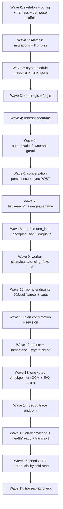

# Implementation Plan: Backend API, Auth, Jobs & Crypto (Spec 3 of 6)

## Overview

This plan converts the approved design of `backend-api-auth-jobs-crypto` into an incremental, test-driven sequence of **Python** coding tasks (FastAPI + SQLAlchemy async + Alembic + Hypothesis). Each task builds on the previous ones and wires into the composition root so there is no orphaned code. The mandatory `POST /api/conversation` contract (always returns non-empty `session_id` and `answer`) is treated as inviolable across every job-related task.

**Scope reminder.** This spec provides the trust/transport/durability boundary and the seams that Spec 4 (agent runtime) plugs into. The **LLM provider and the Spec 4 agent runtime are mocked/faked in CI (zero spend)**; the Spec 2 domain/tool interfaces are **depended upon and mocked** in tests. No agent reasoning, no domain SQL, no Android, no ingestion, no eval/benchmark execution is implemented here. No task below asserts that any migration, server, test, or benchmark has actually been run — these are contracts for implementation and Spec 6/F5 to verify.

**Testing conventions.**
- Property-based tests use **Hypothesis**, a minimum of **100 iterations** each, one test per Correctness Property, tagged `Feature: backend-api-auth-jobs-crypto, Property N: <text>`.
- Contract/API tests use **FastAPI TestClient / httpx** async client.
- Integration tests run against a **real PostgreSQL container** (Testcontainers/Docker), exercising Alembic migrations, per-service role grants, `UNIQUE(owner_id, client_request_id)`, and the concurrency protocol.
- Sub-tasks marked with `*` are optional (tests) and may be skipped for a faster MVP; core implementation sub-tasks are never optional.

## Task Dependency Graph



```json
{
  "waves": [
    { "id": 0, "tasks": ["1.1", "1.2", "1.3"] },
    { "id": 1, "tasks": ["2.1", "2.2"] },
    { "id": 2, "tasks": ["3.1", "3.2", "3.3", "3.4"] },
    { "id": 3, "tasks": ["4.1", "4.2", "4.3"] },
    { "id": 4, "tasks": ["5.1", "5.2", "5.3", "5.4"] },
    { "id": 5, "tasks": ["6.1", "6.2", "6.3"] },
    { "id": 6, "tasks": ["7.1", "7.2", "7.3", "7.4"] },
    { "id": 7, "tasks": ["8.1", "8.2", "8.3"] },
    { "id": 8, "tasks": ["9.1", "9.2"] },
    { "id": 9, "tasks": ["10.1", "10.2"] },
    { "id": 10, "tasks": ["11.1", "11.2", "11.3"] },
    { "id": 11, "tasks": ["12.1", "12.2"] },
    { "id": 12, "tasks": ["13.1", "13.2"] },
    { "id": 13, "tasks": ["14.1", "14.2"] },
    { "id": 14, "tasks": ["15.1", "15.2"] },
    { "id": 15, "tasks": ["16.1", "16.2", "16.3"] },
    { "id": 16, "tasks": ["17.1", "17.2"] },
    { "id": 17, "tasks": ["18.1"] }
  ]
}
```

## Tasks

- [ ] 1. App skeleton, config, and test harness
  - [ ] 1.1 Create the Feature-First + light-hexagonal package skeleton and composition root
    - Create `api`, `application`, `domain`, `infrastructure` packages; wire a FastAPI app factory and a bootstrap/composition root using only FastAPI `Depends` (no extra DI container)
    - Keep `domain` free of FastAPI/SQLAlchemy/LangChain/provider imports; add a settings module reading env (no secrets committed) and an async SQLAlchemy engine/session provider in `infrastructure`
    - Demo: `uvicorn` app imports cleanly; a trivial route returns 200 via the app factory; an import-boundary test shows `domain` imports none of the forbidden libraries
    - Requirements: 1.1, 1.2, 1.3, 1.8
    - Properties: (foundation for P43)
  - [ ] 1.2 Scaffold Docker Compose and `.env.example`
    - Add `docker-compose.yml` defining `db` (PostgreSQL + persistent volume), `api` (FastAPI), `worker` (same image, job-processor entrypoint); add a single `Dockerfile`/image used by both `api` and `worker`
    - Add `.env.example` with placeholder-only values for `DATABASE_URL`, `OPENROUTER_API_KEY`, `AGENT_MODEL`, `INTERPRETER_MODEL`, `ANSWER_MODEL`, `ENCRYPTION_KEK` (or path), `AUTH_TOKEN_POLICY`, `GEMINI_API_KEY`, and time/queue/cost limits; ensure no `.env`/KEK/secret is baked into the image
    - Demo: `docker compose config` resolves all three services from one image; `.env.example` contains only placeholders
    - Requirements: 1.4, 12.1, 12.3, 12.6
  - [ ]* 1.3 Stand up the test harness
    - Configure pytest with a FastAPI TestClient/httpx async fixture and a real-PostgreSQL container fixture (Testcontainers); add Hypothesis as a dependency with a shared settings profile (≥100 iterations)
    - Demo: a smoke test boots the app against a throwaway PostgreSQL container and hits the trivial route
    - Requirements: 1.4
    - Properties: harness for all property/contract/integration tests

- [ ] 2. Alembic migrations and per-service DB roles
  - [ ] 2.1 Author migrations for `identity`, `conversation`, and `execution` schemas
    - Create versioned Alembic migrations for `users`, `auth_sessions`, `token_verifiers`, `conversations`, `messages`, `domain_states`, `plans`, `turn_jobs` (with `UNIQUE(owner_id, client_request_id)`), `job_attempts`, `encrypted_checkpoints`, `tool_traces`, `key_metadata`, `audit_events_minimal`; model ciphertext columns for sensitive fields and cleartext columns for owner_id/edition/timestamps/states/seq/lease/fence per the Data Models table
    - Wire the migration step so it must complete before `api`/`worker` serve; a failed migration stops serving and surfaces the error
    - Demo: `alembic upgrade head` against the test container creates all tables and the unique constraint
    - Requirements: 1.5, 12.2
  - [ ]* 2.2 Integration test for migrations and per-service roles
    - Create `app_writer`, `runtime_catalog_reader`, `ingest_publisher` roles with least-privilege grants (app path has no ingestion-staging privilege; catalog read path has no app-write privilege); verify grants and migration-before-serve on the real container
    - Demo: role-privilege integration test shows denied cross-privilege operations and a failed-migration path that blocks serving
    - Requirements: 1.5, 12.2

- [ ] 3. Crypto module (AES-256-GCM, DEK/KEK, AAD, fail-closed)
  - [ ] 3.1 Implement the AES-256-GCM encrypt/decrypt primitive with contextual AAD
    - Encrypt before persistence with a 96-bit nonce unique per key; bind AAD = purpose‖owner‖conversation‖record-id‖format-version; decryption returns plaintext only on tag-verify success
    - Demo: encrypt→decrypt round-trips under correct key+AAD; a different AAD fails
    - Requirements: 9.1
    - Properties: P38
  - [ ] 3.2 Implement DEK/KEK lifecycle and `key_metadata` persistence
    - Generate a per-conversation DEK, wrap it with an external KEK (never stored in PG/repo), persist only the wrapped DEK ciphertext plus `key_metadata` (`key_id`, `cipher_version`); expose a key handle resolver for use cases
    - Demo: a conversation key is created, wrapped, persisted, and unwrapped for use; the KEK is absent from every persisted artifact
    - Requirements: 9.3
    - Properties: P40
  - [ ] 3.3 Implement fail-closed behavior and crypto-shredding
    - Fail closed on GCM tag mismatch, on legacy plaintext where ciphertext is required, and on KEK-unavailable/DEK-unwrap failure (return no data, no key material); implement crypto-shred (delete DEK) to render ciphertext unrecoverable from active storage; never log tokens/passwords/secret headers/KEK/DEK
    - Demo: tampered ciphertext and a key-unavailable path both raise a key-unavailable/decryption error returning nothing; shredding a DEK makes prior ciphertext undecryptable
    - Requirements: 9.2, 9.4, 9.5, 9.6, 9.7
    - Properties: P39, P41, P44
  - [ ]* 3.4 Property tests for the crypto module
    - **Property 38: Encryption round-trips and binds AAD, with unique nonces** — Validates: Requirements 9.1
    - **Property 39: Sensitive data is ciphertext at rest; only the allowlist is cleartext** — Validates: Requirements 9.2
    - **Property 40: Each DEK is stored only wrapped and the KEK is never in the database** — Validates: Requirements 9.3
    - **Property 41: Decryption fails closed on tamper, legacy plaintext, or key unavailability** — Validates: Requirements 9.4, 9.5
    - Demo: Hypothesis suites over random payloads/AAD tuples, tampered bytes, and legacy-plaintext bytes
    - Requirements: 9.1, 9.2, 9.3, 9.4, 9.5
    - Properties: P38, P39, P40, P41

- [ ] 4. Authentication — register and login
  - [ ] 4.1 Implement Argon2id password hashing and opaque-token verifiers
    - Hash passwords with Argon2id (≥128-bit random salt; never a bare/unsalted fast hash); generate opaque access+refresh secrets from a CSPRNG (≥128 bits, prefer 256); store only `SHA-256(secret)` verifiers and compare in constant time
    - Demo: identical passwords yield distinct verifiers; a stored verifier never equals a bare hash; token verification uses a constant-time compare
    - Requirements: 2.1, 2.2
    - Properties: P1, P2
  - [ ] 4.2 Implement `POST /api/auth/register` and `POST /api/auth/login`
    - Register validates email (3–254) and password (12–128, strength policy), assigns role `user` server-side, ignores/rejects any client-supplied role, rejects duplicates/invalid without enumerating; login returns a generic `401` on mismatch with indistinguishable body/timing, and locks out after 5 failures per 15-minute window
    - Demo: a `role=developer` registration payload still yields a `user`; unknown-email and wrong-password logins are indistinguishable; the 6th failure in the window is rate-limited
    - Requirements: 2.3, 2.4, 2.5, 2.11
    - Properties: P3, P4, P5
  - [ ]* 4.3 Property + contract tests for register/login
    - **Property 1: Passwords are stored irreversibly with Argon2id** — Validates: Requirements 2.1
    - **Property 2: Opaque token verifiers are SHA-256 and compared in constant time** — Validates: Requirements 2.2
    - **Property 3: Registration always creates role `user` and never elevates** — Validates: Requirements 2.3, 2.4, 2.11
    - **Property 4: Invalid registration creates no account and does not enumerate** — Validates: Requirements 2.4
    - **Property 5: Login failure is indistinguishable and rate-limited** — Validates: Requirements 2.5
    - Demo: Hypothesis suites over random passwords and registration payloads (incl. injected `role`), plus TestClient enumeration/timing checks
    - Requirements: 2.1, 2.2, 2.3, 2.4, 2.5, 2.11
    - Properties: P1, P2, P3, P4, P5

- [ ] 5. Authentication — refresh, logout, me
  - [ ] 5.1 Implement atomic refresh rotation with family reuse detection
    - Rotate the presented refresh token atomically within its `Refresh_Family`, invalidating the old token; detect reuse of a rotated/revoked token and revoke the entire family; guarantee single-winner under concurrent presentation of the same token
    - Demo: concurrent refreshes of the same token yield at most one winner; presenting a rotated token revokes the whole family
    - Requirements: 2.6, 2.7
    - Properties: P6, P7
  - [ ] 5.2 Implement `POST /api/auth/logout` and `GET /api/auth/me`
    - Logout revokes the current session's refresh family and associated access tokens within ≤1s, leaving other sessions authorizing; `/me` returns identity+role with no password hash, token secret, or verifier
    - Demo: a logged-out session's tokens stop authorizing within 1s while another device still works; `/me` omits all secret material
    - Requirements: 2.8, 2.9
    - Properties: P8, P9
  - [ ] 5.3 Provide the developer-account seed/CLI path (no public elevation)
    - Add a CLI/seed procedure that provisions `developer` accounts; ensure no public endpoint can create or elevate a `developer`; keep demo credentials out of the repo (placeholder/seed config only)
    - Demo: the CLI creates a `developer`; no HTTP path produces one
    - Requirements: 2.10, 2.11
    - Properties: P3
  - [ ]* 5.4 Property + contract tests for refresh/logout/me
    - **Property 6: Refresh rotation is atomic and single-winner under concurrency** — Validates: Requirements 2.6
    - **Property 7: Refresh reuse revokes the entire family** — Validates: Requirements 2.7
    - **Property 8: Logout revokes only the current session family** — Validates: Requirements 2.8
    - **Property 9: `/me` never discloses secret material** — Validates: Requirements 2.9
    - Demo: Hypothesis suites over random refresh families + a concurrency integration test on the real container; TestClient checks for `/me` secret-absence
    - Requirements: 2.6, 2.7, 2.8, 2.9
    - Properties: P6, P7, P8, P9

- [ ] 6. Authorization / ownership guard
  - [ ] 6.1 Implement session-authoritative ownership resolution and 404 denial
    - Resolve `Owner_User_Id` from the validated session only; ignore any owner id in body/query/header; return an indistinguishable `404` for cross-user access leaking no field/metadata/count
    - Demo: a conflicting body owner id is ignored; accessing another owner's resource returns the same `404` as a nonexistent one
    - Requirements: 3.1, 3.2, 3.3
    - Properties: P10
  - [ ] 6.2 Enforce authorize-before-decrypt and authorize-before-dispatch
    - Complete the ownership check before any decryption of a title/message/plan/trace; evaluate endpoint ownership/role authorization before dispatching to any model or tool; model role `developer` as a Debug capability over its own resources only (not a superuser), denied with the same `404` for other owners
    - Demo: a failing ownership check performs no decryption and dispatches no model/tool; a developer is denied another owner's resource identically
    - Requirements: 3.4, 3.5, 3.6
    - Properties: P42, P43, P10
  - [ ]* 6.3 Property tests for authorization
    - **Property 10: Ownership is session-authoritative and cross-user access is an indistinguishable 404** — Validates: Requirements 3.1, 3.2, 3.3, 3.5, 4.10, 5.4, 7.7
    - **Property 42: Authorization precedes decryption** — Validates: Requirements 3.4
    - **Property 43: Endpoint authorization precedes any model or tool dispatch** — Validates: Requirements 3.6
    - Demo: Hypothesis suites over random owner/resource ownership matrices asserting identical denials and no decryption/dispatch on denial
    - Requirements: 3.1, 3.2, 3.3, 3.4, 3.5, 3.6
    - Properties: P10, P42, P43

- [ ] 7. Conversation persistence and mandatory sync `POST /api/conversation`
  - [ ] 7.1 Implement conversation/message/domain-state repositories and Unit_Of_Work
    - Add typed Repositories (over `app_writer`) and a Use_Case-controlled Unit_Of_Work (no repository self-commit); encrypt title/content/domain-state/blocks before persistence via the crypto module; define the structural `content_blocks` discriminated union (`text`, `product_card`, `comparison_table`, `matching_part_numbers`, `bar_chart`, `clarification`, `plan_review`) with an unknown-kind→`text` fallback
    - Demo: a conversation + message round-trips through the UoW with ciphertext at rest and a typed envelope shape
    - Requirements: 1.2, 4.8, 9.2
    - Properties: P39
  - [ ] 7.2 Implement the mandatory sync `POST /api/conversation`
    - Accept optional `session_id` + required `query` (1–4000); always return a `Response_Envelope` with non-empty `session_id` and `answer`; create a caller-owned conversation when `session_id` is omitted and return a stable id; return clarification/confirmation with a non-empty `answer` + `status` carrying no unverified number; use a **faked agent/LLM seam** so the envelope is produced without real spend
    - Demo: requests with and without `session_id`, and clarification/confirmation turns, all return non-empty `session_id`+`answer` with the queue behavior never substituting the final response
    - Requirements: 4.1, 4.2, 4.3, 4.4, 4.7
    - Properties: P11, P12, P13
  - [ ] 7.3 Implement idempotency, resume-after-restart, and query validation
    - Enforce idempotent `Client_Request_Id` (one turn effect, original response returned); resume persisted multi-turn history owner-scoped after restart; reject missing/empty/whitespace/>4000 query and nonexistent/not-owned `session_id` without creating or modifying anything
    - Demo: a repeated `Client_Request_Id` creates exactly one turn; a restart returns the owner's history only; invalid query/session are rejected with no persistence
    - Requirements: 4.5, 4.6, 4.9, 4.10
    - Properties: P14, P15, P16, P10
  - [ ]* 7.4 Property + contract tests for the sync endpoint
    - **Property 11: The mandatory POST contract is inviolable** — Validates: Requirements 4.1, 4.3, 4.7, 5.10
    - **Property 12: Omitting `session_id` creates a caller-owned conversation with a stable id** — Validates: Requirements 4.2
    - **Property 13: Clarification/confirmation carries status and only verified numbers** — Validates: Requirements 4.4
    - **Property 14: Multi-turn history persists across restart, owner-scoped** — Validates: Requirements 4.5
    - **Property 15: A repeated client request id yields exactly one turn effect** — Validates: Requirements 4.6, 6.7
    - **Property 16: Invalid query is rejected with no persistence effect** — Validates: Requirements 4.9
    - Demo: Hypothesis + TestClient suites over random queries, retry sets, and queue states; a restart integration test on the real container
    - Requirements: 4.1, 4.2, 4.3, 4.4, 4.5, 4.6, 4.7, 4.9, 4.10
    - Properties: P11, P12, P13, P14, P15, P16

- [ ] 8. Session listing, title-only search, messages, rename
  - [ ] 8.1 Implement `GET /api/sessions` with decrypt-after-authorize title search
    - Return only the caller's conversations with titles/dates; title-only search fetches at most the caller's own ciphertext titles (capped at 1000/request) and decrypts after authorization; never `ILIKE`/substring over ciphertext, never message-body search, never another owner's data
    - Demo: a search returns only the caller's matching titles with no ciphertext substring query issued
    - Requirements: 8.5
    - Properties: P35
  - [ ] 8.2 Implement `GET /api/sessions/{id}/messages` and `PATCH /api/sessions/{id}`
    - Return the owner's persisted messages and typed blocks ordered by `(created_at asc, message_id asc)` excluding debug traces; rename persists an encrypted title (1–200), rejects invalid length leaving the title unchanged, and rejects non-owner rename
    - Demo: message history is deterministically ordered and trace-free; a valid rename persists ciphertext while an out-of-range title is rejected unchanged
    - Requirements: 8.6, 8.7
    - Properties: P36, P37
  - [ ]* 8.3 Property + contract tests for listing/messages/rename
    - **Property 35: Session listing and title search are owner-scoped and decrypt-after-authorize** — Validates: Requirements 8.5
    - **Property 36: Message history has a deterministic total order and excludes traces** — Validates: Requirements 8.6
    - **Property 37: Rename enforces length and ownership and persists ciphertext** — Validates: Requirements 8.7
    - Demo: Hypothesis suites over random title sets and message orderings + TestClient ownership checks
    - Requirements: 8.5, 8.6, 8.7
    - Properties: P35, P36, P37

- [ ] 9. Durable `turn_jobs`, `accepted_seq`, and enqueue
  - [ ] 9.1 Implement the durable job repository and transactional acceptance
    - Persist `turn_jobs` durably; within the acceptance transaction assign a strictly increasing per-conversation `Accepted_Seq`, enforce `UNIQUE(owner_id, client_request_id)` idempotency, and set initial state `QUEUED`; do not assume `SKIP LOCKED` claim order is FIFO
    - Demo: two accepted turns in a conversation get strictly increasing `accepted_seq`; a duplicate `client_request_id` is rejected as one effect; a restart leaves job state unchanged
    - Requirements: 6.1, 6.3, 6.7
    - Properties: P22, P24, P15
  - [ ]* 9.2 Property + integration tests for durability and ordering
    - **Property 22: Accepted jobs are durable across restart** — Validates: Requirements 6.1
    - **Property 24: Accepted_seq is transactional, strictly increasing, and not claim-order** — Validates: Requirements 6.3
    - **Property 15: A repeated client request id yields exactly one turn effect** — Validates: Requirements 4.6, 6.7
    - Demo: Hypothesis suites over acceptance interleavings + a real-container restart durability test
    - Requirements: 6.1, 6.3, 6.7
    - Properties: P22, P24, P15

- [ ] 10. Worker claim, lease, fencing, no-txn-across-LLM
  - [ ] 10.1 Implement the Worker_Process claim/lease/fencing protocol
    - Claim a reclaimable job with `SKIP LOCKED`, verify no other `RUNNING` in that conversation, and in a short (≤1s, no external call) transaction set `lease_expires_at` 30–120s ahead, assign a strictly monotonic `Fencing_Token`, and increment `attempt_count`; run the agent turn **outside** any SQL transaction against a **faked LLM/agent**; persist the result in a separate short transaction only if fence==current, lease valid, owner matches, and the conversation is not tombstoned; on expired-lease reclaim check for an existing result before re-sending and reject stale-fenced writes
    - Demo: at most one `RUNNING` per conversation while distinct conversations run in parallel; no SQL transaction spans the faked model call; a stale-fenced write is rejected with no duplication
    - Requirements: 6.2, 6.4, 6.5, 6.6, 6.8
    - Properties: P23, P25, P26, P27
  - [ ]* 10.2 Property + integration tests for the worker protocol
    - **Property 23: At most one RUNNING per conversation, distinct conversations parallel** — Validates: Requirements 6.2
    - **Property 25: Claim establishes a single fenced lease holder** — Validates: Requirements 6.4
    - **Property 26: Stale fencing writes are rejected and no duplication occurs** — Validates: Requirements 6.5
    - **Property 27: No SQL transaction spans the model call** — Validates: Requirements 6.6
    - Demo: Hypothesis suites over claim interleavings + a fake-clock worker-kill-mid-LLM integration test on the real container
    - Requirements: 6.2, 6.4, 6.5, 6.6, 6.8
    - Properties: P23, P25, P26, P27

- [ ] 11. Async endpoints (202/poll/cancel), headers, and pending-job caps
  - [ ] 11.1 Implement `POST /api/conversation/jobs` with pending-job caps
    - Return `202 Accepted` with `job_id`, `session_id` (creating the conversation if omitted), and `status=QUEUED`; enforce configurable per-user and per-session pending-job caps (default 5, range 1–100); over cap → `RATE_LIMITED` with state unchanged; reject invalid/unauthorized without enqueuing; never substitute the 202 for the mandatory sync final response
    - Demo: a valid enqueue returns `202`/`QUEUED`; the 6th pending job is `RATE_LIMITED` with no state change; the sync contract remains intact
    - Requirements: 5.1, 5.2, 5.8, 5.9, 5.10
    - Properties: P17, P21, P11
  - [ ] 11.2 Implement `GET /api/jobs/{id}` and `POST /api/jobs/{id}/cancel`
    - Owner polling returns exactly one `Job_State` and, when `COMPLETED`, the same `Response_Envelope` (session_id+answer); set `Cache-Control: no-store` always and add `Retry-After` (integer 1–60) for non-terminal states; cancel is idempotent (same accepted status, no extra effect) for cancelable states; non-owner GET/cancel returns an indistinguishable denial without disclosing existence
    - Demo: a completed job returns the shared envelope; non-terminal responses carry a 1–60 `Retry-After`; repeated cancels are idempotent; a non-owner sees an indistinguishable denial
    - Requirements: 5.3, 5.4, 5.5, 5.6, 5.7
    - Properties: P18, P19, P20, P10
  - [ ]* 11.3 Property + contract tests for async endpoints
    - **Property 17: Job acceptance returns 202 with a QUEUED state** — Validates: Requirements 5.1, 5.2
    - **Property 18: Polling returns a valid state and the shared envelope on completion** — Validates: Requirements 5.3, 5.6
    - **Property 19: Cancellation is idempotent** — Validates: Requirements 5.5
    - **Property 20: Polling headers are correct per state** — Validates: Requirements 5.7
    - **Property 21: Exceeding the pending-job cap rejects without side effects** — Validates: Requirements 5.8, 5.9
    - Demo: Hypothesis + TestClient suites over random job states, cap limits, and cancel repetitions
    - Requirements: 5.1, 5.2, 5.3, 5.4, 5.5, 5.6, 5.7, 5.8, 5.9
    - Properties: P17, P18, P19, P20, P21

- [ ] 12. Plan confirmation and revision
  - [ ] 12.1 Implement `POST /api/sessions/{id}/plans/{rev}/confirm`
    - Assign strictly increasing per-conversation `Plan_Revision`; a correction creates a greater revision and marks the prior not-current; confirming the current revision (authenticated owner) records one confirmation and triggers at most one execution; confirming a non-current revision → `409 CONFLICT (STALE_PLAN)` with no execution and unchanged state; repeated confirmation of the current revision is idempotent; unauthenticated → `401`; non-owner → indistinguishable denial; unknown revision → `404`
    - Demo: confirming the current revision executes once; a stale revision yields `409 STALE_PLAN` with no execution; repeated confirms are idempotent; unauthenticated is `401`
    - Requirements: 7.1, 7.2, 7.3, 7.4, 7.5, 7.6, 7.7, 7.8
    - Properties: P28, P29, P30, P10
  - [ ]* 12.2 Property + contract tests for plan confirmation
    - **Property 28: Plan revisions are strictly increasing and only the current revision confirms** — Validates: Requirements 7.1, 7.2, 7.3, 7.4
    - **Property 29: Plan confirmation is idempotent for the current revision** — Validates: Requirements 7.5
    - **Property 30: Unauthenticated plan confirmation performs no effect** — Validates: Requirements 7.6
    - Demo: Hypothesis suites over random plan-revision sequences and confirmations + TestClient auth/owner checks
    - Requirements: 7.1, 7.2, 7.3, 7.4, 7.5, 7.6, 7.7, 7.8
    - Properties: P28, P29, P30

- [ ] 13. Deletion, tombstone, crypto-shred, no resurrection
  - [ ] 13.1 Implement `DELETE /api/sessions/{id}` with tombstone and crypto-shred
    - For an owner deleting an existing, not-previously-deleted conversation: cancel pending/active jobs, write a tombstone/write-guard recording a fencing token, purge messages/domain-state/checkpoints/sensitive-traces, crypto-shred the DEK, return `204` within 5s; not-owned/nonexistent → `404`, previously deleted → `410`, all indistinguishable with no attributes; block any worker write whose fencing token ≤ the tombstone token (no resurrection); retain no deleted sensitive content in queue/retry/trace tables; document finite-retention backups (≤30 days)
    - Demo: a delete purges and crypto-shreds within 5s; a late fenced worker write is blocked; non-owner/deleted references are indistinguishable `404`/`410`
    - Requirements: 8.1, 8.2, 8.3, 8.4, 8.8, 8.9, 9.7
    - Properties: P31, P32, P33, P34
  - [ ]* 13.2 Property + integration tests for deletion
    - **Property 31: Deletion cancels, tombstones, purges, and crypto-shreds** — Validates: Requirements 8.1, 8.8, 9.7
    - **Property 32: No resurrection of a deleted conversation** — Validates: Requirements 8.3
    - **Property 33: Non-owner deletion has no effect** — Validates: Requirements 8.9
    - **Property 34: Deleted and not-owned references are indistinguishable** — Validates: Requirements 8.2, 8.4
    - Demo: Hypothesis suites over delete scenarios with late fenced writes + a real-container delete-during-job resurrection-block test
    - Requirements: 8.1, 8.2, 8.3, 8.4, 8.8, 8.9, 9.7
    - Properties: P31, P32, P33, P34

- [ ] 14. Encrypted LangGraph checkpointer (GCM-first, EAX-blob fallback)
  - [ ] 14.1 Implement the AES-256-GCM encrypted checkpointer
    - Serialize LangGraph checkpoints (including pending writes) with AES-256-GCM via the crypto module, fail closed on tag-verification failure, and preserve the checkpoint + pending writes so recovery succeeds; persist to `encrypted_checkpoints` with owner/thread scoping derived post-authorization
    - Demo: a checkpoint + pending writes round-trips and recovers; a tampered blob fails closed
    - Requirements: 9.8
    - Properties: P45
  - [ ]* 14.2 Implement and test the ADR'd EAX-blob fallback path
    - Where the framework makes GCM infeasible for the checkpoint blob only, use a pre-authorized AES-EAX fallback for that blob and record it via an ADR; never relax GCM for titles/messages/domain-state/plans/traces; add a property test for checkpoint round-trip/recovery
    - **Property 45: Checkpoints are GCM-serialized, fail-closed, and recoverable** — Validates: Requirements 9.8
    - Demo: Hypothesis suite over checkpoint blobs + an exercised EAX fallback path with the ADR recorded
    - Requirements: 9.8, 9.9
    - Properties: P45

- [ ] 15. Debug trace endpoint
  - [ ] 15.1 Implement `GET /api/sessions/{id}/messages/{mid}/trace`
    - Return a sanitized trace (sanitized tool args/results + non-negative timing durations only) when the caller holds role `developer` AND owns the conversation; for every other case (non-developer, non-owner, developer A vs developer B, nonexistent, deleted) return a byte-for-byte identical denial disclosing nothing; never include credentials/tokens/headers/KEK/DEK/system prompt/provider secrets; purge traces on conversation delete
    - Demo: a developer-owner gets a sanitized trace; all other callers get an identical denial; a deleted conversation's trace request returns the same denial
    - Requirements: 10.1, 10.2, 10.3, 10.4, 10.5, 10.6
    - Properties: P46, P44
  - [ ]* 15.2 Property + contract tests for the trace endpoint
    - **Property 46: Trace access returns sanitized content to the developer-owner or an identical denial** — Validates: Requirements 10.2, 10.3, 10.5, 10.6
    - **Property 44: Secrets never appear in logs or traces** — Validates: Requirements 9.6, 10.4
    - Demo: Hypothesis suites over instruction-like/secret-like strings asserting sanitization + TestClient identical-denial checks
    - Requirements: 10.1, 10.2, 10.3, 10.4, 10.5, 10.6
    - Properties: P46, P44

- [ ] 16. Error envelope, HTTP mapping, health/ready, transport
  - [ ] 16.1 Implement the stable `Error_Envelope` and HTTP status mapping
    - Return `{ error: { code, user_message }, request_id, retryable, details }` with `code` from the stable set, localized `user_message` (ES/EN), a unique correlating `request_id`, a `retryable` flag consistent per code, sanitized `details` only (no SQL/prompt/secret/stack-trace/PII); map outcomes to HTTP statuses per the Error Handling table; keep `NO_RESULTS` a `200` success distinct from `UPSTREAM_UNAVAILABLE` `503`
    - Demo: representative errors produce the envelope with correct codes/status; a zero-match turn is `200 NO_RESULTS` while a provider failure is `503`
    - Requirements: 11.1, 11.2, 11.3, 11.4
    - Properties: P47, P48
  - [ ] 16.2 Implement `GET /api/health`, `GET /api/ready`, and transport policy
    - Health returns liveness without sensitive info; ready distinguishes database availability from other critical-dependency availability and reflects degradation rather than crashing; require HTTPS in production with a documented, narrowly scoped local HTTP-loopback exception for development only
    - Demo: `/ready` reports a degraded provider while the DB is up; HTTPS is enforced in the release config
    - Requirements: 11.5, 11.6
    - Properties: P49
  - [ ]* 16.3 Property + contract tests for errors and readiness
    - **Property 47: The error envelope is stable and status mapping is consistent** — Validates: Requirements 11.1, 11.3, 11.4
    - **Property 48: NO_RESULTS and UPSTREAM_UNAVAILABLE are never conflated** — Validates: Requirements 11.2
    - **Property 49: Readiness distinguishes database from other critical dependencies** — Validates: Requirements 11.6
    - Demo: Hypothesis + TestClient suites over random error outcomes and readiness states
    - Requirements: 11.1, 11.2, 11.3, 11.4, 11.6
    - Properties: P47, P48, P49

- [ ] 17. Seed CLI and reproducibility cold-start wiring
  - [ ] 17.1 Implement the seed CLI for demo accounts
    - Add a seed CLI that creates demo `user` and `developer` accounts from env/placeholder config without placing real credentials in the repo or image
    - Demo: running the seed CLI provisions both demo accounts from env values
    - Requirements: 12.4
  - [ ] 17.2 Wire cold-start reproducibility and provider-unreachable startup
    - Ensure migration runs and completes before `api`/`worker` serve (failure stops serving and surfaces); start both processes even when the provider is unreachable with `/ready` reflecting the degraded dependency; keep no secrets baked into the image
    - Demo: a clean cold start migrates then serves; with the provider unreachable the processes still start and `/ready` is degraded
    - Requirements: 12.2, 12.5, 12.6
  - [ ]* 17.3 Integration/smoke tests for reproducibility
    - Verify compose resolves `db`/`api`/`worker` from one image, a failed migration blocks serving, `.env.example`/image contain only placeholders, provider-unreachable startup yields a degraded `/ready`, and the seed CLI provisions demo accounts
    - Demo: a cold-start smoke suite on the real container exercises migrate-before-serve and degraded readiness
    - Requirements: 12.1, 12.2, 12.3, 12.4, 12.5, 12.6

- [ ] 18. Traceability and final wiring check
  - [ ] 18.1 Verify requirement/property coverage and wire the composition root end-to-end
    - Produce a coverage check confirming every Requirement (1–12, all criteria) and every Correctness Property (P1–P49) maps to at least one implementation/test task; confirm all routers, use cases, repositories, the worker entrypoint, and the crypto/checkpointer adapters are registered at the composition root with no orphaned code; confirm the mandatory `POST /api/conversation` contract holds across all job paths
    - Demo: a traceability table/report shows full Requirement↔Property↔task coverage and the app + worker boot from the single composition root
    - Requirements: 1.1, 1.2, 1.4, 1.6, 1.7, 1.9
    - Properties: P43, P11

## Notes

- Sub-tasks marked with `*` are optional (tests) and can be skipped for a faster MVP; core implementation sub-tasks are never optional and must be implemented.
- Each property in the design's Correctness Properties section is realized by exactly one Hypothesis property test (≥100 iterations), tagged `Feature: backend-api-auth-jobs-crypto, Property N`.
- The LLM provider and the Spec 4 agent runtime are faked/mocked in CI (zero spend); Spec 2 domain/tool interfaces are depended upon and mocked in tests. This spec provides only the seams the agent plugs into.
- Requirements 1.6 and 1.7 (no LLM-generated SQL) are structural constraints satisfied by the architecture and the catalog port; they are verified by the import-boundary and composition-root checks in tasks 1.1 and 18.1 rather than a dedicated runtime path.
- No task asserts that any migration, server start, test run, live encryption validation, or latency/cost measurement has actually happened — these remain contracts for implementation and Spec 6/F5 to verify.
- The mandatory `POST /api/conversation` contract (always non-empty `session_id` + `answer`) remains inviolable across every async/job task.
