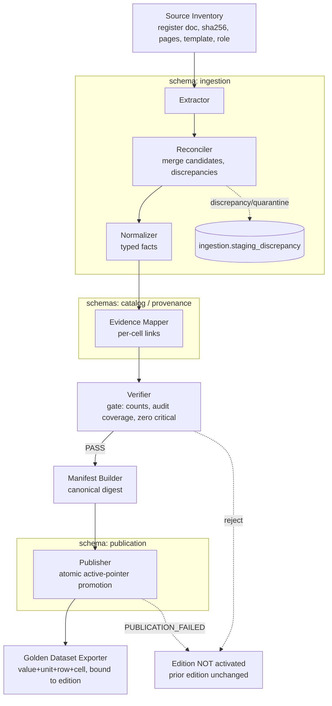
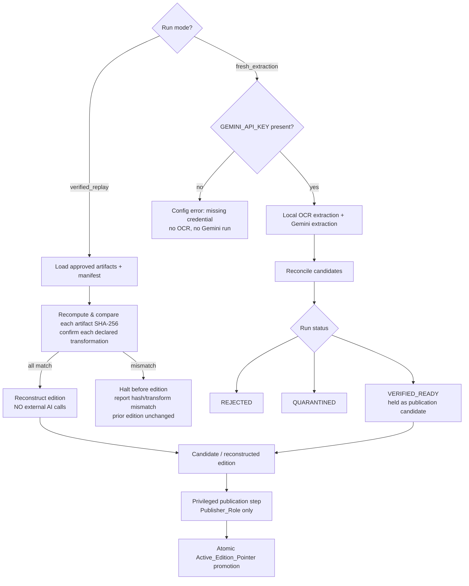

# Design Document

## Overview

This document is the design for **`data-and-ingestion` (Spec 1 of 6)** of the *Series 76 Technical Assistant* (Konecto technical assessment). It is the **dependency root** of the remaining five specs (`domain-and-tools`, `backend-api-auth-jobs-crypto`, `agent-orchestration-response`, `android-app`, `evaluation-and-reproducibility`), which read the published catalog and consume the golden dataset but never re-derive technical numbers.

This design realizes **Requirements 1–11** of `requirements.md` and honors the approved **F1 Data Architecture Handoff v1.1**. It defines four concrete deliverables:

1. A **PostgreSQL schema** (across logical schemas `catalog`, `provenance`, `ingestion`, `publication`) with Alembic versioned migrations.
2. An **ingestion pipeline** supporting both `verified_replay` and `fresh_extraction` modes.
3. The **manual-audit artifacts** (correction records, verification manifest) for the initial edition.
4. The **golden dataset artifact** bound to a single published edition.

### Source-of-Truth Precedence (binding on this design)

1. `assessment-en.pdf` — authoritative for external obligations.
2. `series_76_electric_data.pdf` — **the only** permitted source of technical numbers and conditions (pages 1–4, seven tables).
3. Approved F0–F6 handoff decisions and addenda.
4. `series_76_summary.pdf` — business/narrative **context only**, never a source of technical values.

No number may be invented, inferred from part-number substrings, sourced from the summary PDF, or produced by an LLM as authority.

### Requirement-Class Legend (reference)

The requirement classes used throughout `requirements.md` — **[ASSESS]** (mandatory from the assessment), **[APPROVED]** (ratified handoff decision), **[DELEGATED]** (Kiro may concretize while preserving invariants), **[EXPERIMENT]** (requires real execution/audit/measurement) — govern which design elements are implementation-guiding versus which require a real run to satisfy. This design satisfies the **structural and contractual** obligations of every requirement; it makes **no claim** that any extraction, audit, benchmark, or ingestion run has been executed.

### Status Discipline

Nothing here asserts executed work. The counts **7 tables / 68 rows / 4 N/A in T03** are an **expected audit oracle to be confirmed by the manual audit**, never a pre-verified fact. All acceptance is "to be met during implementation."

---

## Architecture

### Architectural Style: Pipe-and-Filter ETL with staging/published separation

The pipeline is a **Pipe-and-Filter** chain of independent, individually testable filters. Data flows one direction; each filter has a typed input/output contract and emits classified errors rather than silently completing. Three separations are enforced:

1. **Logical-schema separation** — `ingestion` (staging) is physically distinct from `catalog`/`provenance` (facts + evidence) and `publication` (active pointer + events). The runtime reader never sees `ingestion`.
2. **Candidate-vs-published separation** — OCR/Gemini candidates and reconciliation output live in `ingestion`; only verified, audited facts are promoted to `catalog`.
3. **Role/trust separation** — ingest-editor, publisher, and runtime-reader are distinct DB roles with least privilege (Req 7).

Pipeline stages: **Extraction → Reconciliation → Normalization → Evidence Mapping → Verification → Publication**, with a **ManifestBuilder** and **GoldenDatasetExporter** at the end.

### Two Ingestion Modes

`verified_replay` is the **reproducible default**: it reconstructs an edition from approved, versioned artifacts and the canonical manifest, verifies every artifact hash and declared transformation, and makes **zero** external AI/OCR/LLM calls. `fresh_extraction` re-derives candidates from the PDF using local OCR + Gemini and **requires** an evaluator-provided `GEMINI_API_KEY`; its output is never published directly.

### Atomic Publication / Active-Edition-Pointer Promotion

Publication is an all-or-nothing transaction. The validation gate runs inside the transaction; only on full success does the single-row `catalog_current` pointer flip to the new edition. A concurrent reader observes either exactly the prior edition or exactly the new one — never a partial state. Any failure rolls back, emits `PUBLICATION_FAILED`, and leaves the prior pointer intact (Req 7.6, 8.2, 8.3).

---

## Data Models

This section covers the PostgreSQL schema and data models for the spec.

PostgreSQL, organized under logical schemas `catalog`, `provenance`, `ingestion`, `publication` (Req 7.1). All migrations are **Alembic versioned migrations** (one deliverable of this spec). Column names, exact index microstructure, and `NUMERIC(p,s)` precision are **[DELEGATED]** — Kiro finalizes them during implementation while preserving every invariant below.

### Cross-cutting encodings (apply to all fact tables)

- **Value + status pairs via CHECK.** Every documented technical metric is a pair `(value, status)` where `status` is an enum `availability_status ∈ {AVAILABLE, NOT_APPLICABLE, NOT_DOCUMENTED, NOT_VERIFIED}`. A `CHECK` enforces: `status = 'AVAILABLE' ⇒ value IS NOT NULL` and `status <> 'AVAILABLE' ⇒ value IS NULL`. This makes **N/A ≠ 0** and **absence distinct from a documented zero**: `NOT_APPLICABLE` (printed N/A), `NOT_DOCUMENTED` (no printed value) and a documented numeric zero (`AVAILABLE`, value `0`) are three distinguishable states by direct query (Req 5.1, 5.2).
- **Reason-of-absence.** The `status` enum itself carries the reason; distinct absence reasons are never collapsed into one undifferentiated NULL (Req 5.3).
- **NUMERIC without silent coercion.** All measured quantities are `NUMERIC` with no implicit rounding/coercion; the printed text is preserved verbatim in evidence (Req 4.1, 4.8).
- **Dual torque independence.** `torque_inlbs` and `torque_nm` are two independent `NUMERIC` columns, each with its own status; neither is derived from the other, and conversion never overwrites a printed figure (Req 4.1).
- **EXPLICIT ↔ frequency_hz invariant.** `CHECK (frequency_state = 'EXPLICIT') = (frequency_hz IS NOT NULL)` and `CHECK (frequency_state <> 'EXPLICIT' OR frequency_hz > 0)` (Req 4.4, 4.5).

### PK type — [DELEGATED] recommendation

Recommend **`BIGINT` generated-identity** internal PKs for catalog/provenance tables (compact, index-friendly, natural for the small 68-row scale and composite FKs) and **UUID** only where an identifier must be stable across systems (e.g., `edition_id`, `manifest_digest` is a hash not a PK). Composite FKs use `(edition_id, parent_id)` to prevent cross-edition references. Final choice recorded in an ADR.

### `catalog` schema

| Table | Purpose | Key columns | Key constraints / invariants |
|---|---|---|---|
| `catalog_edition` | One immutable published/candidate edition | `edition_id` PK, `manifest_digest`, `state`, `created_at`, `prev_edition_id` | `manifest_digest` UNIQUE; state enum (`candidate`/`published`/`retired`); facts immutable once published (Req 8.1); only promotable after gate success |
| `part_number` | One canonical PN per edition | `part_id` PK, `edition_id` FK, `canonical_pn`, `printed_pn` | **`UNIQUE(edition_id, canonical_pn)`** (Req 11.4, 11.5); aux unique `(edition_id, part_id)` for composite FKs; printed PN kept, never decoded for meaning |
| `supply_profile` | Reusable nominal supply profile (voltage/phase) + canonical mode set | `profile_id` PK, `voltage_v` NUMERIC, `phase_state`, `phase_count` | semantic uniqueness of profile; phase documented or explicit state |
| `supply_profile_mode` | Admitted AC/DC modes for a profile | `(profile_id, mode)` | `mode ∈ {AC, DC}`; non-empty set when source documents modes; no synthetic AC/DC differences |
| `electrical_configuration` | PN × documented configuration | `configuration_id` PK, `edition_id`, `part_id`, `profile_id` FK, `enclosure`, `motor_power_w`+`motor_power_status`, `availability` | composite FK `(edition_id, part_id)`; `motor_power_w` governed by its status CHECK; T04 On/Off 24V AC/DC and T05 Modulating 24V DC stored as **distinct** configurations, never merged (Req 4.6) |
| `service_performance` | Performance attributed to a service type | `edition_id`, `configuration_id` FK, `service_type`, `torque_inlbs`+status, `torque_nm`+status, `duty_s4_pct`+status, `cycles_per_hour`+status, `starts_per_hour`+status | one record per distinct printed `service_type` for a config (Req 4.2); each metric is a value+status pair; bound to one edition (Req 11.1) |
| `unqualified_performance` | Performance with **no** service attribution (T03) | `edition_id`, `configuration_id` FK, same typed metric families | **no** `service_type`; never split by On/Off/Modulating absent evidence; `cycles_per_hour`/`starts_per_hour` stored as two separate fields (Req 4.3) |
| `operating_condition` | A frequency context per configuration | `condition_id` PK, `edition_id`, `configuration_id` FK, `frequency_state`, `frequency_hz` | `frequency_state ∈ {EXPLICIT, NOT_SPECIFIED, NOT_APPLICABLE}`; EXPLICIT↔`frequency_hz` CHECK; `frequency_hz > 0` when EXPLICIT (Req 4.4, 4.5) |
| `electrical_measurement` | One measurement block per operating condition | `edition_id`, `condition_id` FK, `operating_speed_sec`+status, `fla_a`+status, `lra_a`+status | one row per `operating_condition`; values bound to exactly one condition; bound to one edition (Req 11.1); no 0-for-absence |

### `provenance` schema

| Table | Purpose | Key columns | Key constraints / invariants |
|---|---|---|---|
| `source_document` | A unique source PDF | `document_id` PK, `sha256`, `filename`, `byte_size`, `page_count`, `template`, `authority_role` | `sha256` recorded per doc (Req 1.3); `authority_role ∈ {authorized-technical-source, context-only}`; hash does not imply authenticity |
| `source_section` | A table within a document/edition (T01–T07) | `section_id` PK, `edition_id`, `document_id` FK, `page`, `table_code`, `header_path` | `UNIQUE(edition_id, table_code)` for initial edition |
| `source_row` | A visual row | `row_id` PK, `edition_id`, `section_id` FK, `ordinal`, `documentary_state` | `UNIQUE(section_id, ordinal)`; preserves the 4 N/A rows |
| `source_cell_evidence` | An original visual cell | `cell_id` PK, `edition_id`, `section_id`, `anchor_row`, `header_path`, `printed_text`, `unit`, `bbox`, `span` | original cell stored once; location + hierarchical header retained; printed text faithful |
| `source_cell_row_coverage` | Cell ↔ covered row link | `(cell_id, row_id)` PK | real FKs, same section/edition; **merged-cell coverage is one explicit link per covered row — never forward-fill** (Req 5.4) |
| `source_note` | A literal note / asterisk | `note_id` PK, `section_id`, `marker`, `note_type`, `printed_text`, `scope` | notes and asterisk markers preserved verbatim; no inferred certifications (Req 4.7) |
| `source_note_row_scope` | Row affected by a note | `(note_id, row_id)` PK | real FKs; scope limited to covered rows, no forward-fill extension (Req 4.7) |
| `service_field_evidence` | Typed field ↔ cell for service_performance | `service_perf_id` FK, `field_code`, `cell_id` FK, `edition_id` | **typed bridge table, real FKs**; `field_code` validated per family; **no** generic `entity_type`/`entity_id` (Req 6.2) |
| `unqualified_field_evidence` | Typed field ↔ cell for unqualified_performance | `unq_perf_id` FK, `field_code`, `cell_id` FK, `edition_id` | typed bridge, real FKs |
| `measurement_field_evidence` | Typed field ↔ cell for electrical_measurement | `measurement_id` FK, `field_code`, `cell_id` FK, `edition_id` | typed bridge, real FKs |
| `configuration_field_evidence` | Typed field ↔ cell for electrical_configuration | `configuration_id` FK, `field_code`, `cell_id` FK, `edition_id` | typed bridge, real FKs |

A separate family of bridge tables per fact type (rather than one polymorphic table) is deliberate: it lets PostgreSQL **enforce** referential integrity on both sides. A typed FK proves entity and cell exist; the verification gate still confirms text/number/unit/section/row/scope match.

### `ingestion` schema (staging — runtime reader has NO access)

| Table | Purpose | Key columns | Key constraints / invariants |
|---|---|---|---|
| `ingestion_run` | One execution attempt | `run_id` PK, `mode`, input SHA-256 set, engine/model versions, `started_at`, `duration`, `status`, failures | `mode ∈ {fresh_extraction, verified_replay}`; records inputs + digests even when no new edition (Req 1.5, 8.7); fresh-run `status ∈ {REJECTED, QUARANTINED, VERIFIED_READY}` (Req 2.6) |
| `staging_extraction_candidate` | One extractor's hypothesis per cell/field | `candidate_id` PK, `run_id` FK, `extractor` (OCR/Gemini), `raw_value`, `structure`, `bbox`, `confidence`, `model_version` | confidence never treated as truth; absence of candidate ≠ zero |
| `staging_discrepancy` | A disagreement or failed rule | `discrepancy_id` PK, `run_id` FK, origin, location, `type`, OCR value, Gemini value, failed rule, resolution | unresolved discrepancy blocks publication (Req 6.4, 9.6) |
| `verification_record` | A human review/correction by evidence | `record_id` PK, `prior_value`, `verified_value`, `justification`, `reviewer`, `source_cell_id`, `source_document_hash`, `manifest_id`, `state` | records reviewer, prior/verified value, justification, cell, doc hash (Req 3.4); `CORRECTION_STALE` if doc hash differs (Req 3.5) |

### `publication` schema

| Table | Purpose | Key columns | Key constraints / invariants |
|---|---|---|---|
| `verification_manifest` | Deterministic package of authorized data | `manifest_id` PK, `manifest_digest`, source SHAs, normalization/rules versions, canonical facts, corrections, verification report | digest stable + reproducible from approved artifacts (Req 1.5, 2.2, 10.4) |
| `catalog_current` | Single active-edition pointer | single-row table, `edition_id` FK | exactly one active edition; **atomic** transactional flip (Req 8.2); only `Publisher_Role` may change it (Req 7.5) |
| `catalog_publication_event` | Publication / retirement event log | `event_id` PK, `prev_edition_id`, `new_edition_id`, `actor`, `occurred_at`, `reason`, `result`, `manifest_digest` | append-only history; retirement blocks new recs, retains history (Req 8.4, 8.6) |

### Golden Dataset Artifact (versioned, bound to one edition)

Produced on publication (Req 10). Enumerates, for 100% of published technical values, four non-null attributes: **printed value, unit, source row reference, source cell reference**. N/A and absence are stored as two distinct explicit markers, never zero/empty (Req 10.3). Bound to exactly one edition via `edition_id` + `manifest_digest` (Req 10.4). Monotonically increasing version id unique within the edition (Req 10.1). Stored as a versioned file artifact plus a manifest-digest binding; exact serialization format is [DELEGATED].

### Database roles and grants (Req 7.2, 7.3)

| Role | Grants | Restrictions |
|---|---|---|
| `Ingest_Editor_Role` | INSERT/UPDATE on `ingestion.*`, INSERT into staging/verification | no activation of editions |
| `Publisher_Role` | the only role that may write `publication.catalog_current` (activate/retire) | validates gate + session context before flip |
| `Runtime_Reader_Role` | SELECT only, on published surface of `catalog`/`provenance` filtered to active edition | **no UPDATE/DELETE on catalog; no read/write on `ingestion`** (Req 7.3). Enforced in DB (defense in depth) even if Python logic forgets a filter |

Runtime reads are served only through **parameterized, typed SQL** (views/functions filtered to the published edition plus typed repositories). **No SQL generated freely by an LLM** (Req 7.4).

---

## Components and Interfaces

Each filter is a component with an explicit input→output contract. Errors are emitted as taxonomy codes (see Error Handling), never swallowed.

### SourceInventory
- **Input:** one or more source PDFs + declared template/role.
- **Output:** `source_document` rows with SHA-256, unique id, page count, declared template, documentary role (Req 1.3). Only `series_76_electric_data.pdf` is `authorized-technical-source`; summary PDF is `context-only` and may never supply technical numbers (Req 1.1, 1.2).
- **Errors:** `INPUT_UNREADABLE`, `HASH_MISMATCH`, `TEMPLATE_UNKNOWN`.

### Extractor
- **verified_replay:** reads approved, versioned artifacts + manifest; recomputes and compares each artifact SHA-256 and confirms each declared transformation **before** reconstruction; makes **zero** external AI/OCR/LLM network calls (Req 2.1, 2.2). On any mismatch, halts before producing an edition (Req 2.3).
- **fresh_extraction:** requires non-empty `GEMINI_API_KEY` from the process environment (Req 2.4); if absent, reports a configuration error and performs **no** OCR/Gemini (Req 2.5). Runs local OCR (library choice PaddleOCR vs Docling is **[DELEGATED]**) + Gemini, emitting `staging_extraction_candidate` rows with coordinates, headers, extractor id.
- **Output:** candidates (fresh) or reconstructed facts (replay).

### Reconciler
- **Input:** extraction candidates (fresh) per cell/field.
- **Output:** merged candidates + `staging_discrepancy` rows; conflicting/uncertain facts quarantined, not published.
- **Errors:** `EXTRACTOR_DISAGREEMENT` (differing normalized values — never resolved by confidence alone, Req 6.4), `SOURCE_CONFLICT` (unresolved cross-source conflict → quarantine, Req 9.6).

### Normalizer
- **Input:** reconciled candidates / replay facts.
- **Output:** typed facts honoring all technical semantics: dual torque (`torque_inlbs`, `torque_nm` independent); **service_performance per printed service type** vs **unqualified_performance for T03** (no fabricated service, cycles/starts as two fields); per-frequency binding (50/60 Hz exactly as printed, never cross-bound); not-specified/not-applicable frequency without inventing Hz; **T04 vs T05 distinct configurations**; N/A → `NOT_APPLICABLE`, no value → `NOT_DOCUMENTED`; notes/asterisks scoped to exactly their covered rows (Req 4.2–4.7, 5.1–5.3).
- **Errors:** `UNSUPPORTED_UNIT` (no coercion; retain printed value+unit for human resolution, Req 4.8).

### EvidenceMapper
- **Input:** normalized facts + source cells/rows.
- **Output:** per-cell evidence links for 100% of published technical facts, each identifying the source cell(s), every covered row, and associated notes, via **typed bridge tables** (Req 6.1, 6.2). Merged-cell coverage is one explicit link per covered row (Req 5.4).
- **Errors:** `EVIDENCE_MISSING` (unlinked fact → reject publication, Req 6.3), `CELL_COORDINATE_AMBIGUOUS` (ambiguous row scope → assign to no row, record coordinates + candidate rows, Req 5.5).

### Verifier (transactional gate)
- **Input:** normalized facts + evidence + audit records.
- **Checks:** confirm the **7 tables / 68 rows / 4 N/A** oracle (report `ROW_COUNT_MISMATCH` or `SECTION_MISSING` on divergence, record for human resolution, never auto-resolve, Req 3.3); **100% manual-audit coverage** with zero unverified relevant cells (Req 3.1, 3.6); dual-unit torque present where printed; 50/60 Hz conditions; AC/DC modes; merged-cell coverage; conflicts resolved; evidence links present; manifest/hash consistency. **PASS only if zero open critical discrepancies** (Req 3.6, 8.5).
- **Output:** `verification_report`; on fail the edition is **not** activated and the active edition is unchanged.
- **Errors:** `ROW_COUNT_MISMATCH`, `SECTION_MISSING`, `DUPLICATE_IDENTITY` (Req 9.5), `EVIDENCE_MISSING`, `CORRECTION_STALE`.

### Publisher
- **Input:** a `VERIFIED_READY` candidate + verification manifest.
- **Behavior:** only `Publisher_Role` (Req 7.5); runs the gate inside a transaction; on success performs the **atomic** `catalog_current` promotion (Req 8.2); on any failure emits `PUBLICATION_FAILED` and leaves the prior edition + pointer intact (Req 7.6, 8.3). **Retirement** blocks new recommendations from an edition while retaining its facts and event history for pinned sessions and audit (Req 8.4, 8.6). An identical re-run (same fingerprints + manifest) records the run but creates **no** duplicate edition (Req 1.5, 8.7).

### ManifestBuilder
- **Output:** `verification_manifest` with source hashes, engine/rule/extractor versions, canonical facts, corrections, verification report, and a **stable canonical digest** that identifies the edition and enables verified_replay reproduction and non-duplication (Req 1.5, 2.2, 10.4).

### GoldenDatasetExporter
- **Output:** exactly one versioned `Golden_Dataset_Artifact` per published edition (Req 10.1), with printed value + unit + source row reference + source cell reference for 100% of published values (Req 10.2), N/A and absence as distinct markers (Req 10.3), bound to `edition_id` + `manifest_digest` (Req 10.4).
- **Round-trip property:** a verified_replay reconstruction from approved artifacts yields a value set **equal** to the golden set (same count, printed value, unit, row ref, cell ref); any difference rejects the reconstruction, reports a round-trip mismatch identifying differing values, and does **not** alter/republish the existing artifact (Req 10.5, 10.6).

### Human Manual-Audit Workflow
For the initial edition, a reviewer verifies 100% of relevant cells, notes, and N/A against the Electric_Data_PDF (Req 3.1). Each confirmed/corrected fact produces a `verification_record` capturing **reviewer identity, prior value, verified value, justification, source cell reference, source document hash** (Req 3.4). If a correction references a document hash differing from the current source hash, the pipeline reports `CORRECTION_STALE`, does not apply it automatically, and leaves the edition unchanged (Req 3.5). The edition is ineligible for publication until coverage is 100% with zero open critical discrepancies (Req 3.6).

---

## Error Handling

The pipeline classifies every failure with **exactly one** code from the 13-code taxonomy (Req 9.1, 9.2); it never discards, suppresses, or marks a failed unit as successful. Diagnostics record error code, affected unit, and trigger condition **without secrets** (Req 2.8, 9.8).

| Code | Raising stage | Semantics |
|---|---|---|
| `INPUT_UNREADABLE` | SourceInventory | halt processing of that document; prior edition unchanged (Req 9.3) |
| `HASH_MISMATCH` | SourceInventory / Extractor(replay) | halt publication for the run; prior edition unchanged (Req 1.6, 2.3) |
| `TEMPLATE_UNKNOWN` | SourceInventory | declared template not in recognized set → halt that document (Req 9.4) |
| `SECTION_MISSING` | Verifier | expected table/section absent vs oracle; record for human resolution (Req 3.3) |
| `ROW_COUNT_MISMATCH` | Verifier | audited counts differ from 7/68/4 oracle; no auto-resolve (Req 3.3) |
| `CELL_COORDINATE_AMBIGUOUS` | EvidenceMapper | row scope undeterminable → assign to no row; record coordinates + candidates (Req 5.5) |
| `EXTRACTOR_DISAGREEMENT` | Reconciler | differing normalized values; no verified state/publish on confidence alone (Req 6.4) |
| `UNSUPPORTED_UNIT` | Normalizer | no coercion/convert; retain printed value+unit for human resolution (Req 4.8) |
| `DUPLICATE_IDENTITY` | Verifier / DB | two PNs resolve to same identity in an edition → reject edition build (Req 9.5) |
| `SOURCE_CONFLICT` | Reconciler | unresolved cross-source conflict → quarantine, not publish (Req 9.6) |
| `EVIDENCE_MISSING` | EvidenceMapper / Verifier | published fact lacks evidence link → reject publication (Req 6.3) |
| `CORRECTION_STALE` | Audit / Verifier | correction references stale document hash → not applied automatically (Req 3.5) |
| `PUBLICATION_FAILED` | Publisher | activation not atomic/failed → prior active edition + pointer intact (Req 8.3, 9.7) |

Halt / quarantine / reject behavior is per the semantics column: `INPUT_UNREADABLE`/`TEMPLATE_UNKNOWN`/`HASH_MISMATCH` **halt**; `SOURCE_CONFLICT`/`EXTRACTOR_DISAGREEMENT` **quarantine**; `EVIDENCE_MISSING`/`DUPLICATE_IDENTITY`/gate failures **reject** the edition while leaving the active edition unchanged.

---

## Testing Strategy

This spec is data-centric: much of its correctness is expressed as **data invariants** that hold for all inputs. Those invariants are a good fit for **property-based testing (PBT)**; concrete source facts, schema structure, role permissions, and external wiring are covered by example, integration, and smoke tests instead. No benchmark, OCR accuracy, or audit-coverage result is claimed by this design — tests marked **[EXPERIMENT]** require the real PDF audit to execute.

### Test tooling
- **Property-based testing:** use **Hypothesis** (Python). Do not hand-roll property testing. Each property test runs a **minimum of 100 iterations** and carries a comment tag `Feature: data-and-ingestion, Property N: <text>`.
- **DB integration:** run against a **real PostgreSQL container** (e.g., Testcontainers/docker) so constraints, enums, CHECKs, UNIQUE, roles, and transactional atomicity are exercised by the actual engine — not mocked.
- **Documental verification:** diff the golden dataset against the audited source with 100% field coverage.

### Documental verification tests — [EXPERIMENT]
- Golden-dataset-vs-PDF diff with 100% field coverage (value, unit, row ref, cell ref) for the initial edition.
- Confirm the 7 tables / 68 rows / 4 N/A oracle against the real audited edition (Req 1.4, 3.1–3.3). Requires the real manual audit; not satisfiable by design and **not claimed as executed**.

### Unit / example tests (deterministic)
- fresh_extraction with no `GEMINI_API_KEY` → configuration error, no extraction (Req 2.5).
- Schema introspection: typed evidence bridge tables declare real FKs; no polymorphic `entity_type`/`entity_id` columns exist (Req 6.2).
- Repository layer exposes only parameterized/typed queries; no code path executes free-form model-generated SQL (Req 7.4).

### Integration / smoke tests (real PostgreSQL)
- Four logical schemas exist post-migration (Req 7.1 — smoke).
- Three distinct DB roles exist (Req 7.2 — smoke).
- Runtime reader is denied UPDATE/DELETE on catalog and denied SELECT on `ingestion` (Req 7.3).
- verified_replay run with network blocked makes zero external AI/OCR/LLM calls (Req 2.1).
- fresh_extraction reaches exactly one of `REJECTED` / `QUARANTINED` / `VERIFIED_READY` on fixtures (Req 2.6).
- Atomic publication, rollback-on-gate-failure, and retirement behavior under a real transaction (Req 7.6, 8.2, 8.3, 8.4).

### Property-based tests (minimum 100 iterations each)

Correctness properties are enumerated in the Correctness Properties section and verified with Hypothesis (min 100 iterations each).

---

## Correctness Properties

> *A property is a characteristic that should hold true across all valid executions of the system — a formal, machine-verifiable statement of what the system must do.* Each property below is derived from the prework analysis and annotated with the requirements it validates.

### Property 1: Every published technical value traces to an authorized-source cell
*For any* candidate edition, publication succeeds only if every published technical value has at least one evidence link to a cell of an `authorized-technical-source` document; any value lacking such a link causes rejection.
**Validates: Requirements 1.1, 6.1, 6.3**

### Property 2: Identical re-run creates no duplicate edition (idempotence)
*For any* already-published edition, re-running ingestion with identical source fingerprints and manifest creates no additional edition, leaves the active pointer unchanged, and records exactly one new auditable run record.
**Validates: Requirements 1.5, 8.7**

### Property 3: Hash mismatch halts and preserves the prior edition
*For any* registered document or replay artifact whose recomputed SHA-256 differs from its recorded digest, the pipeline reports `HASH_MISMATCH`, halts before producing an edition, and leaves the prior active edition and pointer unchanged.
**Validates: Requirements 1.6, 2.3**

### Property 4: Audit-coverage gate
*For any* edition, it is eligible for publication if and only if manual-audit coverage is 100% and there are zero open critical discrepancies.
**Validates: Requirements 3.1, 3.6, 8.5**

### Property 5: Count divergence from the oracle is flagged, never auto-resolved
*For any* audited count tuple that differs from (7 tables, 68 rows, 4 N/A), the pipeline reports `ROW_COUNT_MISMATCH` or `SECTION_MISSING` and records the discrepancy for human resolution without auto-resolving it.
**Validates: Requirements 3.3**

### Property 6: Stale corrections are not applied
*For any* correction whose referenced source document hash differs from the current source document hash, the pipeline reports `CORRECTION_STALE`, does not apply the correction, and leaves the affected edition unchanged.
**Validates: Requirements 3.5**

### Property 7: Dual torque figures are stored independently
*For any* part with printed in-lbs and Nm torque, both figures are stored verbatim in two separate fields and neither is overwritten, rounded, or replaced by a value derived from converting the other.
**Validates: Requirements 4.1**

### Property 8: Service attribution matches printed service types
*For any* part number, the set of `service_performance` records equals exactly the set of distinct service types printed for it, each keyed by its service type.
**Validates: Requirements 4.2**

### Property 9: Unqualified (T03) performance carries no fabricated service attribution
*For any* performance whose source does not attribute it to a service type, it is stored as an `unqualified_performance` record with cycles-per-hour and starts-per-hour as two separate retrievable fields, with zero `service_performance` records created and no split by On/Off or Modulating.
**Validates: Requirements 4.3**

### Property 10: Frequency binding is faithful and the EXPLICIT↔Hz invariant holds
*For any* speed/FLA/LRA value, it is bound to exactly one operating condition whose frequency state matches the printed frequency; a value printed under one frequency is never bound to the other; `frequency_hz` is present and positive if and only if the frequency state is EXPLICIT.
**Validates: Requirements 4.4, 4.5**

### Property 11: On/Off (T04) and Modulating (T05) configurations stay distinct
*For any* On/Off 24V AC/DC configuration and Modulating 24V DC configuration, the two are stored as distinct configuration records and are never merged, deduplicated, or substituted for one another.
**Validates: Requirements 4.6**

### Property 12: Note and asterisk scope equals printed coverage (no forward-fill)
*For any* certification note or asterisk marker, its covered-row set equals exactly the rows it covers in the source, with its printed text unchanged and no extension to uncovered rows.
**Validates: Requirements 4.7**

### Property 13: Unrecognized units are reported, not coerced
*For any* value carrying a unit the pipeline does not recognize, it reports `UNSUPPORTED_UNIT` and retains the printed value and unit unchanged rather than coercing or converting it.
**Validates: Requirements 4.8**

### Property 14: Zero, N/A, and absence are three distinguishable states
*For any* technical field, a documented numeric zero, a not-applicable (N/A) state, and an absence state are pairwise distinguishable by direct query of the stored status, and distinct absence reasons are never collapsed into a single undifferentiated null — including as recorded in the golden dataset.
**Validates: Requirements 5.1, 5.2, 5.3, 10.3**

### Property 15: Merged-cell coverage is explicit per row (no forward-fill)
*For any* merged source cell covering a set of rows, there is exactly one coverage link per covered row and no coverage link to any row outside that set.
**Validates: Requirements 5.4**

### Property 16: Ambiguous cell scope assigns no row
*For any* cell whose row scope cannot be determined unambiguously, the pipeline reports `CELL_COORDINATE_AMBIGUOUS`, assigns the value to no row, and records the cell coordinates and candidate rows.
**Validates: Requirements 5.5**

### Property 17: Extractor disagreement is never resolved by confidence
*For any* field where two extractors produce differing normalized values in fresh_extraction, the pipeline reports `EXTRACTOR_DISAGREEMENT` and does not assign a verified state or publish the value on the basis of extractor confidence alone.
**Validates: Requirements 6.4**

### Property 18: Only the Publisher role activates an edition
*For any* role other than Publisher_Role attempting to activate an edition, the operation is rejected and the active-edition pointer is unchanged.
**Validates: Requirements 7.5**

### Property 19: Edition activation is atomic (all-or-nothing)
*For any* publication whose validation gate fails, the activation rolls back entirely so no partial edition remains; and for any concurrent reader during a successful promotion, the observed state is exactly the prior edition or exactly the new edition, never a partial, mixed, or absent pointer.
**Validates: Requirements 7.6, 8.2**

### Property 20: Published facts are immutable
*For any* published fact, any attempt to modify, delete, or overwrite it is prevented, and any subsequent correction requires the creation of a new edition.
**Validates: Requirements 8.1**

### Property 21: Failed publication leaves the prior edition intact
*For any* publication that fails for any reason, the pipeline reports `PUBLICATION_FAILED`, the prior active edition and its pointer remain unchanged, and no fact from the failed edition becomes active or queryable.
**Validates: Requirements 8.3, 9.7**

### Property 22: Retirement blocks new recommendations but preserves history
*For any* retired edition, generation of new recommendations from it is blocked while its facts and event history remain unchanged and readable for already-pinned sessions and audit.
**Validates: Requirements 8.4, 8.6**

### Property 23: Exactly one taxonomy code per failure, never silently succeeding
*For any* ingestion failure, exactly one code from the 13-code taxonomy is assigned and the affected unit is never discarded, suppressed, or completed as successful.
**Validates: Requirements 9.1, 9.2**

### Property 24: One versioned golden artifact per edition with complete attributes
*For any* published edition, exactly one golden dataset artifact is produced with a monotonically increasing version unique within the edition, and for 100% of its published values the four attributes printed value, unit, source row reference, and source cell reference are all non-null.
**Validates: Requirements 10.1, 10.2**

### Property 25: Golden artifact is bound to exactly one edition
*For any* golden dataset artifact, it records exactly one `edition_id` and that edition's `manifest_digest`.
**Validates: Requirements 10.4**

### Property 26: Golden-dataset round-trip equivalence under verified_replay
*For any* published edition, reconstructing it through verified_replay from approved artifacts yields a value set equal to the golden dataset set — identical value count with no additions or omissions and, for every value, identical printed value, unit, source row reference, and source cell reference; any difference causes the reconstruction to be rejected with a round-trip mismatch report and leaves the existing golden artifact unchanged.
**Validates: Requirements 10.5, 10.6**

### Property 27: Edition and condition isolation across assembled values
*For any* assembled published value set with a single target edition, every included measurement belongs to that edition and, for electrical measurements, to an operating condition of that same edition; any record whose edition or condition differs is excluded and an edition/condition-mismatch error is recorded.
**Validates: Requirements 11.1, 11.2, 11.3**

### Property 28: Canonical part number is unique per edition
*For any* edition, each canonical part number is unique; an insert or update that would create a duplicate `(edition_id, canonical_pn)` pair is rejected and the previously stored canonical part number is preserved.
**Validates: Requirements 11.4, 11.5, 9.5**

---

## Design Decisions and Trade-offs

Each decision below will be recorded as an ADR during implementation; any deviation from an approved invariant requires a new ADR and approval.

- **Pipe-and-Filter vs monolithic ETL.** Chosen: Pipe-and-Filter. Each stage has an isolated input/output contract, is independently testable, and emits classified errors — matching the requirement that failures be classified and never silently swallowed (Req 9). Trade-off: more inter-stage plumbing than a single pass, acceptable at 68-row scale and essential for auditability.
- **Staging vs published separation.** Chosen: physically separate `ingestion` schema from `catalog`/`provenance`, enforced by role grants. Guarantees the runtime reader can never observe candidates or drafts even if application logic forgets a filter (defense in depth, Req 7.3). Trade-off: cross-schema moves at publication time; justified by the trust-separation requirement.
- **Typed evidence bridge tables vs generic polymorphic FK.** Chosen: typed per-fact bridge tables with real FKs. A generic `entity_type`/`entity_id` table cannot have the database enforce referential integrity on the referenced entity, which Req 6.2 forbids. Trade-off: more tables, but integrity is guaranteed by the engine.
- **verified_replay as the reproducible default vs requiring Gemini.** Chosen: verified_replay needs no external API and reconstructs from approved artifacts with hash + transformation verification; fresh_extraction (Gemini + OCR) is opt-in and never publishes directly. This lets an evaluator rebuild the catalog cleanly without secrets (Req 2.1, 2.5). Trade-off: replay demonstrates reproducible reconstruction, not that a new visual inference would reproduce the same observations — documented explicitly.
- **Per-cell evidence cost.** Chosen: record evidence for 100% of published facts. Trade-off: additional rows and audit effort, but it is the backbone of traceability (Req 6.1) and the golden-dataset guarantees (Req 10).
- **PK type (BIGINT vs UUID).** Recommended BIGINT identity for internal catalog/provenance PKs with composite `(edition_id, parent_id)` FKs; UUID reserved for externally stable identifiers. **[DELEGATED]** — final width recorded in an ADR.
- **Delegated implementation details.** Exact index microstructure, `NUMERIC(p,s)` precision per metric, column naming, and the local OCR library (PaddleOCR vs Docling) are Kiro's to finalize during implementation while preserving every invariant in this design.

---

## Traceability

| Requirement | Design elements satisfying it | Properties / tests | US / QA / AT IDs |
|---|---|---|---|
| **1** Reproducible pipeline from the PDF | SourceInventory, Extractor, `source_document.sha256`, ManifestBuilder, `ingestion_run` | P1, P2, P3; [EXPERIMENT] 7/68/4 | US-031, QA-12, QA-14, F1 §6.7 |
| **2** Two ingestion modes | Extractor (both modes), two-mode diagram, `ingestion_run.status`, `.env.example` | P2, P3; Int: replay no-calls, status set; Ex: missing key | US-031, QA-12, F1 §4, §9.3 |
| **3** 100% manual audit of initial edition | Manual-Audit workflow, `verification_record`, Verifier gate | P4, P5, P6; [EXPERIMENT] coverage | US-031, QA-01, QA-14 |
| **4** Faithful technical semantics | Normalizer, `service_performance`, `unqualified_performance`, `operating_condition`, `electrical_configuration`, dual torque columns, `source_note` | P7, P8, P9, P10, P11, P12, P13 | US-010, US-011, US-016, US-024, AT-12 |
| **5** N/A, NULL, merged-cell integrity | `availability_status` enum + CHECK, `source_cell_row_coverage`, EvidenceMapper | P14, P15, P16 | AT-07, US-024, QA-01 |
| **6** Per-cell evidence for every fact | EvidenceMapper, typed `*_field_evidence` bridges | P1, P17; Ex: schema introspection | US-031, QA-01, QA-15 |
| **7** PostgreSQL schemas, roles, SQL safety | Four logical schemas, three DB roles + grants, parameterized repositories, atomic rollback | P18, P19; Smoke: schemas/roles; Int: runtime denials; Ex: no free SQL | US-031, QA-15, F1 §2, §3 |
| **8** Immutable editions, atomic publish, retirement | Publisher, `catalog_current`, `catalog_publication_event`, immutability constraints | P19, P20, P21, P22, P2 | US-031, QA-14, F1 §3, §6.7, §6.8 |
| **9** Reconciliation & error taxonomy | Error Handling taxonomy table, Reconciler, Verifier | P23, P28 (DUPLICATE_IDENTITY), P3 | US-031, QA-15, F1 §9.4, §9.2 |
| **10** Golden dataset artifact | GoldenDatasetExporter, edition binding, round-trip | P24, P25, P26, P14 | US-010, US-011, US-016, US-024, QA-01, QA-12 |
| **11** Edition isolation across values | `UNIQUE(edition_id, canonical_pn)`, composite FKs, assembly filter | P27, P28 | US-010, US-016, F1 §6.10 |
