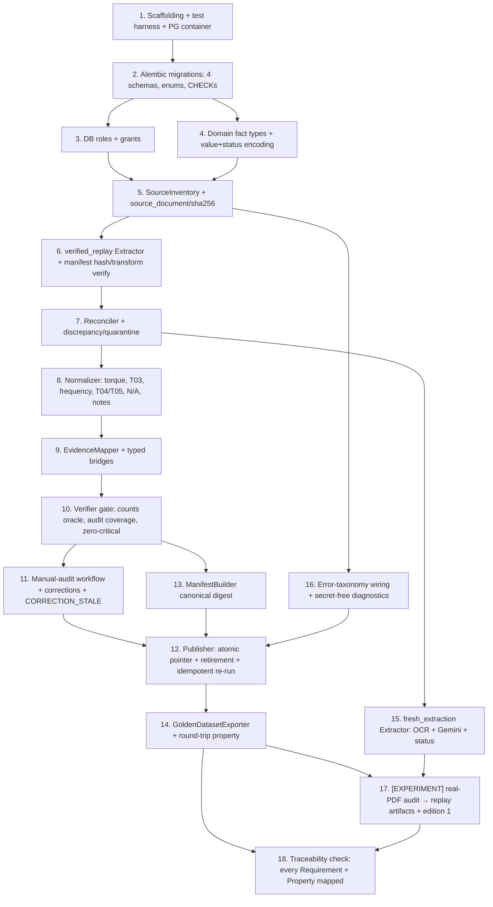

# Implementation Plan: data-and-ingestion (Spec 1 of 6)

## Overview

This plan implements the **foundational data slice** of the *Series 76 Technical Assistant*: a PostgreSQL four-schema model (`catalog`, `provenance`, `ingestion`, `publication`) with Alembic migrations and three least-privilege DB roles, a Pipe-and-Filter ingestion pipeline (SourceInventory → Extractor → Reconciler → Normalizer → EvidenceMapper → Verifier → Publisher, plus ManifestBuilder and GoldenDatasetExporter), both `verified_replay` and `fresh_extraction` modes, the human manual-audit workflow with correction records, the 13-code error taxonomy, and the versioned golden dataset artifact.

Language and tooling are fixed by the design: **Python**, property tests with **Hypothesis** (minimum 100 iterations each, tagged `Feature: data-and-ingestion, Property N: <text>`), DB tests against a **real PostgreSQL container** (Testcontainers/docker), schema migrations via **Alembic**.

Each task builds on prior tasks (no orphan code), carries its own tests, and ends with a `Demo:` line plus `Requirements:` / `Properties:` traceability. Tasks or sub-steps that require the real PDF manual audit are marked **[EXPERIMENT]** and **cannot be marked complete by code alone** — no audit, benchmark, or ingestion-run result is asserted as done by this plan.

> **Status discipline:** The counts **7 tables / 68 rows / 4 N/A in T03** are an expected audit oracle to be confirmed by the manual audit, never a pre-verified fact.

## Task Dependency Graph



```json
{
  "waves": [
    { "id": 0, "tasks": ["1"] },
    { "id": 1, "tasks": ["2.1"] },
    { "id": 2, "tasks": ["2.2", "2.3", "2.4"] },
    { "id": 3, "tasks": ["2.5", "3", "4.1"] },
    { "id": 4, "tasks": ["3.1", "4.2", "4.3", "5"] },
    { "id": 5, "tasks": ["5.1", "6"] },
    { "id": 6, "tasks": ["6.1", "7", "16"] },
    { "id": 7, "tasks": ["7.1", "8.1", "16.1", "17"] },
    { "id": 8, "tasks": ["8.2", "17.1"] },
    { "id": 9, "tasks": ["8.3", "9"] },
    { "id": 10, "tasks": ["9.1", "10"] },
    { "id": 11, "tasks": ["10.1", "11"] },
    { "id": 12, "tasks": ["11.1", "14"] },
    { "id": 13, "tasks": ["14.1", "12"] },
    { "id": 14, "tasks": ["12.1", "15"] },
    { "id": 15, "tasks": ["15.1", "19.1"] },
    { "id": 16, "tasks": ["19.2"] },
    { "id": 17, "tasks": ["20"] }
  ]
}
```

## Tasks

- [ ] 1. Scaffold the ingestion/data package and test harness
  - Create the Python package layout for the ingestion/data layer (e.g., `series76_data/` with `pipeline/`, `models/`, `db/`, `errors/`, `audit/`, `golden/` sub-packages) and a `tests/` tree mirroring it.
  - Add project metadata and pinned dependencies (SQLAlchemy, Alembic, psycopg, Hypothesis, pytest, Testcontainers) at exact/pinned versions; add `pytest` config and a `conftest.py`.
  - Provide a PostgreSQL Testcontainers fixture that starts a real PostgreSQL container, exposes a connection URL, and tears down per session; add a smoke test that connects and runs `SELECT 1`.
  - Add `.env.example` listing required variable names (including `GEMINI_API_KEY`) with placeholder values and no real secrets.
  - Demo: `pytest` boots a real PostgreSQL container and the connectivity smoke test passes; repo scaffolding imports cleanly.
  - Requirements: 2.8
  - Properties: (harness only)

- [ ] 2. Author Alembic migrations for the four-schema model
  - [ ] 2.1 Create logical schemas and shared enums
    - Alembic migration creating schemas `catalog`, `provenance`, `ingestion`, `publication`.
    - Define enums: `availability_status {AVAILABLE, NOT_APPLICABLE, NOT_DOCUMENTED, NOT_VERIFIED}`, `frequency_state {EXPLICIT, NOT_SPECIFIED, NOT_APPLICABLE}`, edition `state {candidate, published, retired}`, `authority_role {authorized-technical-source, context-only}`, supply `mode {AC, DC}`, and the 13-code ingestion error taxonomy as an enum/lookup.
    - _Requirements: 7.1, 9.1_
  - [ ] 2.2 Create `catalog` schema tables with constraints and CHECKs
    - Tables: `catalog_edition`, `part_number`, `supply_profile`, `supply_profile_mode`, `electrical_configuration`, `service_performance`, `unqualified_performance`, `operating_condition`, `electrical_measurement`.
    - Enforce: `catalog_edition.manifest_digest` UNIQUE; `part_number` `UNIQUE(edition_id, canonical_pn)` and aux `UNIQUE(edition_id, part_id)`; value+status CHECKs (`status='AVAILABLE' ⇒ value NOT NULL`, else `value IS NULL`) on every metric pair; dual torque columns independent; `operating_condition` CHECK `(frequency_state='EXPLICIT') = (frequency_hz IS NOT NULL)` and `frequency_hz > 0` when EXPLICIT; composite FKs `(edition_id, part_id)` to prevent cross-edition references.
    - _Requirements: 4.1, 4.4, 4.5, 5.1, 5.2, 5.3, 7.1, 8.1, 11.1, 11.4, 11.5_
  - [ ] 2.3 Create `provenance` schema tables and typed evidence bridges
    - Tables: `source_document`, `source_section`, `source_row`, `source_cell_evidence`, `source_cell_row_coverage`, `source_note`, `source_note_row_scope`, and the typed field-evidence bridges `service_field_evidence`, `unqualified_field_evidence`, `measurement_field_evidence`, `configuration_field_evidence`.
    - Enforce real FKs on both sides of every bridge (no generic `entity_type`/`entity_id`); `UNIQUE(edition_id, table_code)` on sections; `UNIQUE(section_id, ordinal)` on rows; coverage and note-scope as explicit per-row link tables.
    - _Requirements: 1.3, 4.7, 5.4, 6.1, 6.2_
  - [ ] 2.4 Create `ingestion` and `publication` schema tables
    - `ingestion`: `ingestion_run` (`mode`, input SHA-256 set, status with fresh-run CHECK `status ∈ {REJECTED, QUARANTINED, VERIFIED_READY}`), `staging_extraction_candidate`, `staging_discrepancy`, `verification_record` (reviewer, prior/verified value, justification, source cell, source document hash, manifest, state).
    - `publication`: `verification_manifest` (`manifest_digest` + versions + canonical facts), `catalog_current` single-row active pointer, `catalog_publication_event` append-only log.
    - _Requirements: 1.5, 2.6, 3.4, 8.2, 8.4, 10.4_
  - [ ]* 2.5 Integration tests for migrations against real PostgreSQL
    - Apply all migrations up then down against the container; assert the four schemas exist, every enum/CHECK/UNIQUE is present via catalog introspection, and no bridge table exposes `entity_type`/`entity_id` columns.
    - Assert value+status CHECK rejects `AVAILABLE` with NULL value and non-`AVAILABLE` with a non-null value; assert `UNIQUE(edition_id, canonical_pn)` rejects duplicates.
    - _Requirements: 5.1, 5.2, 6.2, 7.1, 11.4, 11.5_

- [ ] 3. Define the three database roles and least-privilege grants
  - Migration creating `Ingest_Editor_Role`, `Publisher_Role`, `Runtime_Reader_Role` as distinct roles with grants: ingest-editor writes `ingestion.*`; publisher is the only writer of `publication.catalog_current`; runtime-reader has SELECT only on the published surface of `catalog`/`provenance`, no UPDATE/DELETE on catalog, and no access to `ingestion`.
  - _Requirements: 7.2, 7.3, 7.5_
  - [ ]* 3.1 Integration tests for role enforcement (real PostgreSQL)
    - As `Runtime_Reader_Role`, assert UPDATE/DELETE on catalog are denied and SELECT on `ingestion` is denied; as a non-publisher role, assert activating an edition (writing `catalog_current`) is rejected and the pointer is unchanged.
    - **Property 18: Only the Publisher role activates an edition** — min 100 iterations, tagged `Feature: data-and-ingestion, Property 18`.
    - _Requirements: 7.3, 7.5_
    - Properties: 18

- [ ] 4. Implement domain fact types and the value+status encoding
  - [ ] 4.1 Define typed domain models and the value+status pair abstraction
    - Python types/dataclasses + SQLAlchemy mappings for editions, part numbers, configurations, service/unqualified performance, operating conditions, electrical measurements, and the `(value, status)` metric pair that mirrors the DB CHECK (three distinguishable states: documented zero, N/A, absence; reason carried by status).
    - Repository layer exposing only parameterized/typed queries filtered to an edition; no free-form SQL execution path.
    - _Requirements: 4.1, 5.1, 5.2, 5.3, 7.4, 11.1_
  - [ ]* 4.2 Property tests for the value+status encoding
    - **Property 14: Zero, N/A, and absence are three distinguishable states** — min 100 iterations, tagged `Feature: data-and-ingestion, Property 14`.
    - **Property 7: Dual torque figures are stored independently** — min 100 iterations, tagged `Feature: data-and-ingestion, Property 7`.
    - _Requirements: 4.1, 5.1, 5.2, 5.3, 10.3_
    - Properties: 7, 14
  - [ ]* 4.3 Unit test: repository layer forbids free-form SQL
    - Assert the repository exposes only parameterized/typed queries and no code path executes model-generated SQL.
    - _Requirements: 7.4_

- [ ] 5. Implement SourceInventory and source-document registration
  - Register one or more source PDFs, recording SHA-256, unique document id, page count, declared template, and documentary role; mark `series_76_electric_data.pdf` as `authorized-technical-source` and `series_76_summary.pdf` as `context-only`; reject any technical value not tracing to an authorized-source cell.
  - Wire into the `provenance.source_document` table via the repository from task 4.
  - Raise `INPUT_UNREADABLE`, `HASH_MISMATCH`, `TEMPLATE_UNKNOWN` as appropriate (halt that document; leave any prior edition unchanged).
  - _Requirements: 1.1, 1.2, 1.3, 1.6, 9.3, 9.4_
  - [ ]* 5.1 Tests for SourceInventory
    - Unit/example: unreadable input → `INPUT_UNREADABLE`; unknown template → `TEMPLATE_UNKNOWN`; summary PDF cannot be used as a technical source.
    - **Property 3: Hash mismatch halts and preserves the prior edition** — min 100 iterations, tagged `Feature: data-and-ingestion, Property 3`.
    - _Requirements: 1.6, 9.3, 9.4_
    - Properties: 3

- [ ] 6. Implement the verified_replay Extractor with hash/transformation verification
  - Load approved, versioned artifacts and the canonical manifest; recompute and compare each artifact SHA-256 and confirm each declared transformation **before** reconstruction; make zero external AI/OCR/LLM network calls.
  - On any hash or transformation mismatch, halt before producing an edition and report the mismatch, leaving any prior edition unchanged; on success, emit reconstructed facts into staging.
  - _Requirements: 2.1, 2.2, 2.3_
  - [ ]* 6.1 Tests for verified_replay
    - Integration (network blocked): a replay run makes zero external AI/OCR/LLM calls.
    - **Property 3** reused for replay-artifact hash mismatch — min 100 iterations, tagged `Feature: data-and-ingestion, Property 3`.
    - _Requirements: 2.1, 2.3_
    - Properties: 3

- [ ] 7. Implement the Reconciler with discrepancy capture and quarantine
  - Merge extraction candidates per cell/field; write `staging_discrepancy` rows; quarantine conflicting/uncertain facts rather than publishing them; never resolve by extractor confidence alone.
  - Raise `EXTRACTOR_DISAGREEMENT` for differing normalized values and `SOURCE_CONFLICT` for unresolved cross-source conflicts (quarantine).
  - _Requirements: 6.4, 9.6_
  - [ ]* 7.1 Property tests for reconciliation
    - **Property 17: Extractor disagreement is never resolved by confidence** — min 100 iterations, tagged `Feature: data-and-ingestion, Property 17`.
    - Example test: unresolved cross-source conflict → `SOURCE_CONFLICT` + quarantine, not published.
    - _Requirements: 6.4, 9.6_
    - Properties: 17

- [ ] 8. Implement the Normalizer (technical semantics preservation)
  - [ ] 8.1 Normalize torque, service vs unqualified performance, frequency, and configurations
    - Dual torque stored as two independent fields (no conversion overwrite); one `service_performance` per distinct printed service type; T03 → `unqualified_performance` with cycles/starts as two separate fields, no fabricated service, no On/Off/Modulating split; bind speed/FLA/LRA to exactly one operating condition per printed frequency (50/60 Hz never cross-bound); not-specified/not-applicable frequency without inventing Hz; T04 On/Off 24V AC/DC and T05 Modulating 24V DC as distinct configurations.
    - Map N/A → `NOT_APPLICABLE`, no printed value → `NOT_DOCUMENTED`.
    - Raise `UNSUPPORTED_UNIT` (retain printed value+unit, no coercion).
    - _Requirements: 4.1, 4.2, 4.3, 4.4, 4.5, 4.6, 4.8_
  - [ ] 8.2 Normalize notes and asterisk markers with exact row scope
    - Preserve each note/asterisk printed text verbatim; associate each with exactly the source rows it covers, with no forward-fill to uncovered rows.
    - _Requirements: 4.7_
  - [ ]* 8.3 Property tests for the Normalizer
    - **Property 8: Service attribution matches printed service types** — tagged `Feature: data-and-ingestion, Property 8`.
    - **Property 9: Unqualified (T03) performance carries no fabricated service** — tagged `Property 9`.
    - **Property 10: Frequency binding faithful + EXPLICIT↔Hz invariant** — tagged `Property 10`.
    - **Property 11: T04 and T05 stay distinct** — tagged `Property 11`.
    - **Property 12: Note/asterisk scope equals printed coverage (no forward-fill)** — tagged `Property 12`.
    - **Property 13: Unrecognized units reported, not coerced** — tagged `Property 13`.
    - Each min 100 iterations, each tagged `Feature: data-and-ingestion, Property N`.
    - _Requirements: 4.2, 4.3, 4.4, 4.5, 4.6, 4.7, 4.8_
    - Properties: 8, 9, 10, 11, 12, 13

- [ ] 9. Implement the EvidenceMapper and typed evidence bridges
  - Create per-cell evidence links for 100% of normalized technical facts via the typed `*_field_evidence` bridges, each identifying the source cell(s), every covered row, and associated notes; record merged-cell coverage as one explicit link per covered row (no forward-fill).
  - Raise `EVIDENCE_MISSING` for any unlinked fact (reject publication) and `CELL_COORDINATE_AMBIGUOUS` when row scope is undeterminable (assign to no row; record coordinates + candidate rows).
  - _Requirements: 5.4, 5.5, 6.1, 6.2, 6.3_
  - [ ]* 9.1 Property tests for evidence mapping
    - **Property 1: Every published value traces to an authorized-source cell** — tagged `Feature: data-and-ingestion, Property 1`.
    - **Property 15: Merged-cell coverage is explicit per row (no forward-fill)** — tagged `Property 15`.
    - **Property 16: Ambiguous cell scope assigns no row** — tagged `Property 16`.
    - Each min 100 iterations.
    - _Requirements: 1.1, 5.4, 5.5, 6.1, 6.3_
    - Properties: 1, 15, 16

- [ ] 10. Implement the Verifier transactional gate
  - Confirm the 7 tables / 68 rows / 4 N/A oracle and report `ROW_COUNT_MISMATCH` or `SECTION_MISSING` on divergence (record for human resolution, never auto-resolve); require 100% manual-audit coverage with zero unverified relevant cells; verify dual-unit torque where printed, 50/60 Hz conditions, AC/DC modes, merged-cell coverage, resolved conflicts, evidence links present, and manifest/hash consistency; PASS only if zero open critical discrepancies.
  - Raise `DUPLICATE_IDENTITY` when two PNs resolve to the same identity in an edition (reject edition build).
  - On fail, do not activate the edition and leave the active edition unchanged.
  - _Requirements: 3.1, 3.3, 3.6, 6.3, 8.5, 9.5_
  - [ ]* 10.1 Property/example tests for the gate
    - **Property 4: Audit-coverage gate (eligible iff 100% coverage and zero critical)** — tagged `Property 4`.
    - **Property 5: Count divergence flagged, never auto-resolved** — tagged `Property 5`.
    - **Property 28: Canonical part number unique per edition / DUPLICATE_IDENTITY** — tagged `Property 28`.
    - Each min 100 iterations.
    - _Requirements: 3.1, 3.3, 3.6, 8.5, 9.5, 11.4, 11.5_
    - Properties: 4, 5, 28

- [ ] 11. Implement the human manual-audit workflow and correction records
  - Provide the workflow and `verification_record` writes capturing reviewer identity, prior value, verified value, justification, source cell reference, and source document hash for each confirmed/corrected fact; record audited counts as audit-confirmed results and mark the edition audit-complete.
  - Raise `CORRECTION_STALE` when a correction references a document hash differing from the current source hash (do not apply automatically; leave the edition unchanged).
  - Note: executing the audit against the real PDF is **[EXPERIMENT]** and belongs to task 17; this task delivers the workflow + records + staleness logic only.
  - _Requirements: 3.2, 3.4, 3.5_
  - [ ]* 11.1 Property tests for corrections
    - **Property 6: Stale corrections are not applied** — min 100 iterations, tagged `Feature: data-and-ingestion, Property 6`.
    - _Requirements: 3.5_
    - Properties: 6

- [ ] 12. Implement the Publisher (atomic promotion, retirement, idempotent re-run)
  - Run the Verifier gate inside a transaction; on success perform the atomic `catalog_current` promotion as a single all-or-nothing transition; on any failure emit `PUBLICATION_FAILED` and leave the prior edition and pointer intact; restrict activation to `Publisher_Role`.
  - Implement edition immutability (new edition required for corrections), retirement that blocks new recommendations while retaining facts and event history for pinned sessions, and idempotent re-run (identical fingerprints + manifest records the run but creates no duplicate edition).
  - _Requirements: 1.5, 7.5, 7.6, 8.1, 8.2, 8.3, 8.4, 8.6, 8.7, 9.7_
  - [ ]* 12.1 Property/integration tests for publication (real PostgreSQL transactions)
    - **Property 2: Identical re-run creates no duplicate edition** — tagged `Property 2`.
    - **Property 19: Edition activation is atomic (all-or-nothing)** — tagged `Property 19`.
    - **Property 20: Published facts are immutable** — tagged `Property 20`.
    - **Property 21: Failed publication leaves prior edition intact** — tagged `Property 21`.
    - **Property 22: Retirement blocks new recommendations but preserves history** — tagged `Property 22`.
    - **Property 27: Edition and condition isolation across assembled values** — tagged `Property 27`.
    - Each min 100 iterations; atomicity/rollback exercised under real transactions.
    - _Requirements: 8.1, 8.2, 8.3, 8.4, 8.6, 9.7, 11.1, 11.2, 11.3_
    - Properties: 2, 19, 20, 21, 22, 27

- [ ] 13. Checkpoint - ensure all tests pass
  - Ensure all tests pass, ask the user if questions arise.

- [ ] 14. Implement the ManifestBuilder (stable canonical digest)
  - Build `verification_manifest` with source hashes, engine/rule/extractor versions, canonical facts, corrections, and verification report; compute a stable canonical digest that identifies the edition and enables verified_replay reproduction and non-duplication; wire the digest into the Publisher (task 12) and verified_replay Extractor (task 6).
  - _Requirements: 1.5, 2.2, 10.4_
  - [ ]* 14.1 Tests for manifest digest stability
    - Property/example: identical approved artifacts produce an identical canonical digest; any artifact change changes the digest. Min 100 iterations where parameterized.
    - _Requirements: 1.5, 2.2_

- [ ] 15. Implement the GoldenDatasetExporter and round-trip verification
  - Produce exactly one versioned `Golden_Dataset_Artifact` per published edition with a monotonically increasing version unique within the edition; record for 100% of published values the four non-null attributes (printed value, unit, source row reference, source cell reference); store N/A and absence as two distinct explicit markers (never zero/empty); bind the artifact to exactly one `edition_id` + `manifest_digest`.
  - Implement round-trip verification: a verified_replay reconstruction yields a value set equal to the golden set (count + printed value + unit + row ref + cell ref); any difference is rejected with a round-trip mismatch report and leaves the existing artifact unchanged.
  - _Requirements: 10.1, 10.2, 10.3, 10.4, 10.5, 10.6_
  - [ ]* 15.1 Property tests for the golden dataset
    - **Property 24: One versioned golden artifact per edition with complete attributes** — tagged `Property 24`.
    - **Property 25: Golden artifact bound to exactly one edition** — tagged `Property 25`.
    - **Property 26: Golden-dataset round-trip equivalence under verified_replay** — tagged `Property 26`.
    - **Property 14** re-exercised for N/A/absence markers in the golden set — tagged `Property 14`.
    - Each min 100 iterations.
    - _Requirements: 10.1, 10.2, 10.3, 10.4, 10.5, 10.6_
    - Properties: 14, 24, 25, 26

- [ ] 16. Implement the fresh_extraction Extractor (local OCR + Gemini)
  - Require a non-empty `GEMINI_API_KEY` from the process environment; if absent, report a configuration error and perform no OCR/Gemini. Run local OCR (library choice PaddleOCR vs Docling is delegated) plus Gemini extraction, emitting `staging_extraction_candidate` rows with coordinates, headers, and extractor id, then hand candidates to the Reconciler (task 7).
  - Assign each completed fresh run exactly one status from {`REJECTED`, `QUARANTINED`, `VERIFIED_READY`}; never publish OCR/LLM candidates directly; a `VERIFIED_READY` run is held as a publication candidate activated only via the Publisher.
  - Exclude all secrets from every artifact, manifest, and diagnostic log.
  - _Requirements: 2.4, 2.5, 2.6, 2.7, 2.8_
  - [ ]* 16.1 Tests for fresh_extraction
    - Unit/example: missing `GEMINI_API_KEY` → configuration error, no OCR/Gemini performed.
    - Integration (fixtures): a fresh run reaches exactly one of `REJECTED` / `QUARANTINED` / `VERIFIED_READY`; assert no secret appears in produced artifacts/logs.
    - _Requirements: 2.5, 2.6, 2.8_

- [ ] 17. Wire the error taxonomy end-to-end with secret-free diagnostics
  - Ensure every pipeline stage classifies failures with exactly one of the 13 taxonomy codes and never discards, suppresses, or completes a failed unit as successful; record diagnostic detail (error code, affected unit, trigger condition) with no secrets; verify halt/quarantine/reject semantics match the Error Handling table.
  - _Requirements: 2.8, 9.1, 9.2, 9.8_
  - [ ]* 17.1 Property tests for the taxonomy
    - **Property 23: Exactly one taxonomy code per failure, never silently succeeding** — min 100 iterations, tagged `Feature: data-and-ingestion, Property 23`.
    - Assert diagnostics contain no secret values across all error paths.
    - _Requirements: 9.1, 9.2, 9.8_
    - Properties: 23

- [ ] 18. Checkpoint - ensure all tests pass
  - Ensure all tests pass, ask the user if questions arise.

- [ ] 19. [EXPERIMENT] Produce approved artifacts and publish edition 1 from the real PDF
  - [ ] 19.1 [EXPERIMENT] Execute the 100% manual audit of `series_76_electric_data.pdf`
    - A human reviewer verifies 100% of relevant cells, notes, and N/A against the Electric_Data_PDF; confirm the 7 tables / 68 rows / 4 N/A oracle (or record discrepancies via `ROW_COUNT_MISMATCH`/`SECTION_MISSING` for human resolution); write `verification_record` rows and mark the edition audit-complete.
    - **This sub-step cannot be marked complete by code alone** — it requires the real manual audit; no audit result is asserted as done here.
    - _Requirements: 1.4, 3.1, 3.2, 3.3_
  - [ ] 19.2 [EXPERIMENT] Build approved replay artifacts, golden dataset, and publish edition 1
    - From the audited facts, build the approved versioned artifacts + canonical manifest, export the golden dataset, and publish edition 1 via verified_replay through the Publisher; confirm the round-trip property holds against the golden set.
    - **Depends on a successful 19.1 and cannot be completed by code alone.**
    - _Requirements: 1.4, 1.5, 2.1, 2.2, 3.2, 10.5_

- [ ] 20. Traceability check: every Requirement and Property maps to a task
  - Add an automated traceability test/script asserting that each Requirement (1.1–11.5) and each Correctness Property (1–28) is referenced by at least one task in this plan, and that each property test carries the `Feature: data-and-ingestion, Property N` tag with min 100 iterations.
  - Demo: the traceability test passes, proving complete Requirement↔task and Property↔test coverage.
  - _Requirements: all (1–11)_
  - Properties: 1–28

## Demo per task

- Task 1 — Demo: `pytest` starts a real PostgreSQL container and the connectivity smoke test passes.
- Task 2 — Demo: `alembic upgrade head` creates the four schemas with all enums, CHECKs, UNIQUE constraints, and typed bridges; downgrade reverts cleanly.
- Task 3 — Demo: the three roles exist; a runtime-reader session is denied catalog writes and `ingestion` reads; non-publishers cannot flip the active pointer.
- Task 4 — Demo: domain facts round-trip through typed repositories; documented zero, N/A, and absence are queryably distinct.
- Task 5 — Demo: registering the two PDFs records SHA-256/pages/template/role; the summary PDF is rejected as a technical source and unreadable/unknown-template inputs raise taxonomy codes.
- Task 6 — Demo: a verified_replay run reconstructs facts from approved artifacts with hash + transformation verification and zero external calls; a tampered artifact halts before an edition.
- Task 7 — Demo: conflicting candidates are quarantined with `staging_discrepancy` rows and never resolved by confidence.
- Task 8 — Demo: the Normalizer emits dual torque, T03 unqualified records, per-frequency bindings, distinct T04/T05 configs, correct N/A/absence states, and verbatim note scopes.
- Task 9 — Demo: every normalized fact has typed per-cell evidence; merged cells link one row each; unlinked or ambiguous facts raise the right codes.
- Task 10 — Demo: the gate passes only with 100% audit coverage and zero critical discrepancies and flags oracle divergence without auto-resolving.
- Task 11 — Demo: corrections record full provenance and stale-hash corrections are refused.
- Task 12 — Demo: publication flips the pointer atomically, rolls back on gate failure, blocks retired editions from new recs, and ignores idempotent re-runs.
- Task 14 — Demo: identical approved artifacts yield an identical canonical digest wired into Publisher and replay.
- Task 15 — Demo: publishing an edition emits one versioned golden artifact bound to that edition; a mismatched replay is rejected via the round-trip report.
- Task 16 — Demo: fresh_extraction requires `GEMINI_API_KEY`, reaches exactly one run status, never publishes directly, and leaks no secrets.
- Task 17 — Demo: every failure path yields exactly one taxonomy code with secret-free diagnostics.
- Task 19 — Demo: **[EXPERIMENT]** once the real audit is executed, edition 1 publishes via verified_replay with a matching golden dataset (not claimed as done by this plan).
- Task 20 — Demo: the traceability test confirms every Requirement and Property maps to a task/test.

## Notes

- Sub-tasks marked with `*` are optional tests and can be skipped for a faster MVP; core implementation and migration tasks are never optional.
- Tasks marked **[EXPERIMENT]** require the real PDF manual audit and cannot be completed by code alone; no audit, benchmark, or ingestion-run result is asserted as done.
- Every property test uses Hypothesis with a minimum of 100 iterations and the tag `Feature: data-and-ingestion, Property N: <text>`; DB tests run against a real PostgreSQL container.
- Each task references specific Requirement numbers and, where relevant, Property numbers for traceability.
- Checkpoints (tasks 13, 18) ensure incremental validation.
