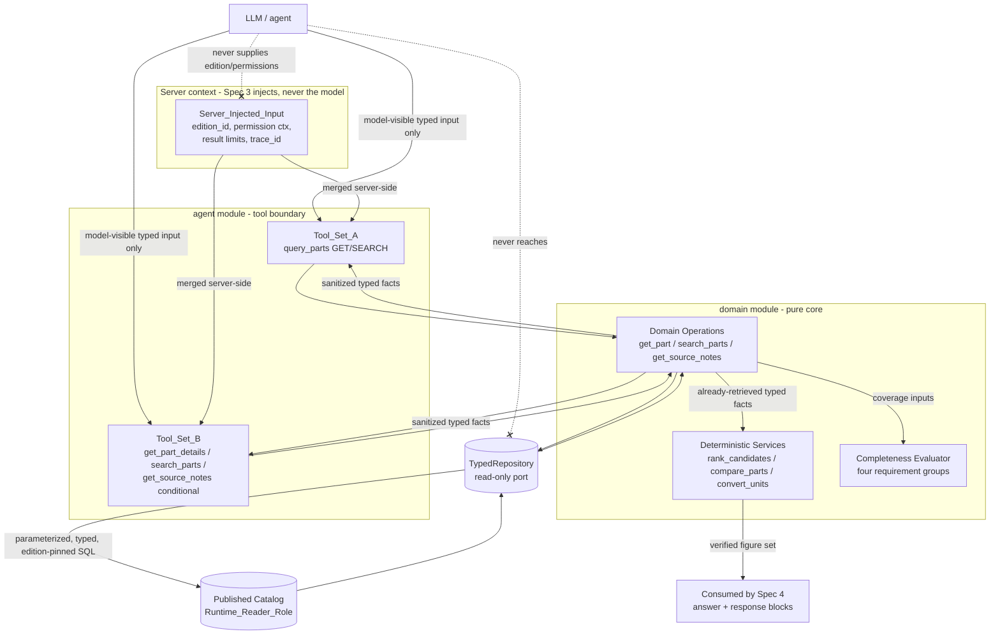

# Design Document

## Overview

This document is the design for **`domain-and-tools` (Spec 2 of 6)** of the *Series 76 Technical Assistant* (Konecto technical assessment). It is the **deterministic domain and tools layer** that sits directly on top of the published catalog produced by **`data-and-ingestion` (Spec 1)** and exposes the "same verified figures" contract that every downstream spec shares.

This layer:

- reads **only** the published surface of Spec 1 (the active/historical immutable `Catalog_Edition` facts in the `catalog`/`provenance` schemas, their per-cell evidence, and the golden dataset) through the least-privilege `Runtime_Reader_Role`;
- exposes **pure domain model types**, **read-only typed repositories**, three **domain operations** (`get_part`, `search_parts`, `get_source_notes`), three **deterministic services** (`rank_candidates`, `compare_parts`, `convert_units`), a **completeness evaluator** over the four physical requirement groups, and the **custom LangChain tools** (candidate set B and baseline set A) that make tabular catalog data queryable by an agent — **without the agent ever generating SQL or dictating a technical number**.

Everything this layer returns is read from the published catalog or produced by a deterministic derivation over published values. **This layer never invents a number.** It is the authoritative source of the verified figure set that the final `answer` and the structured response blocks of `agent-orchestration-response` (Spec 4) will share.

### Position in the system

- **Depends on** `data-and-ingestion` (Spec 1): the published `Catalog_Store` surface, `Runtime_Reader_Role`, immutable `Catalog_Edition` facts, per-cell evidence links, `availability_status`, `operating_condition`, typed evidence bridges, and the `Golden_Dataset_Artifact`.
- **Consumed by** `backend-api-auth-jobs-crypto` (Spec 3), which wraps these operations in HTTP/auth/jobs and **injects** the authorized edition, permission context, result limits, and `trace_id`.
- **Consumed by** `agent-orchestration-response` (Spec 4), which drives the agent, interpretation, confirmation, and response composition and consumes the verified figure set.
- **Evaluated by** `evaluation-and-reproducibility` (Spec 6), which resolves the empirical tool-set A/B comparison.

### Source-of-Truth Precedence (binding on this design)

1. `assessment-en.pdf` — authoritative for external obligations (mandatory custom LangChain tool, PostgreSQL, no free text-to-SQL).
2. **Published Catalog (Spec 1)** — the single source of technical numbers and conditions, which itself derives numbers only from `series_76_electric_data.pdf`.
3. Approved F0–F6 handoff decisions and canonical addenda (F2 §4 AST, §5 tools, §6 verification of visible output).
4. `series_76_summary.pdf` — business/narrative **context only**, never a source of technical values.

No number returned by this layer may be invented, inferred from part-number substrings, sourced from the summary PDF, or produced by an LLM.

### Requirement-Class Legend (reference)

The requirement classes used throughout `requirements.md` — **[ASSESS]** (mandatory from the assessment), **[APPROVED]** (ratified handoff decision), **[DELEGATED]** (Kiro may concretize while preserving invariants), **[EXPERIMENT]** (requires real execution/benchmark/measurement) — govern which design elements are implementation-guiding versus which require a real run to satisfy. This design satisfies the **structural and contractual** obligations of **Requirements 1–10**; it makes **no claim** that any benchmark, A/B tool comparison, model evaluation, or empirical measurement has been executed.

### Status Discipline

Nothing here declares a winner between Tool_Set_A and Tool_Set_B, nor asserts any executed evaluation. The A/B comparison is an **[EXPERIMENT]** resolved by Spec 6. This design builds **both** tool assemblies over the same underlying domain operations so that Spec 6 can measure them fairly.

---

## Architecture

### Position in the backend (modular monolith, Feature-First + light hexagonal)

The Series 76 backend is a **modular monolith** organized **Feature-First** with a **light hexagonal (ports & adapters)** boundary at external edges. This spec owns the **`domain`** module and the **tool-adapter portion of the `agent`** module:

- The **domain core** (domain model types, domain operations, deterministic services, completeness evaluator) is pure and has **no knowledge of HTTP, auth, the agent, or the LLM**.
- The only **port** this layer defines outward is the **read-only catalog port** (the `TypedRepository` interface). Its **adapter** is a PostgreSQL implementation bound to the `Runtime_Reader_Role`. This is the single place SQL is authored; it is parameterized and typed, never model-generated.
- The **tool adapters** (set A and set B) are a thin boundary that the `agent` module mounts. They validate model-visible input, merge **server-injected** inputs, call domain operations, and return sanitized typed facts.

Spec 3 supplies identity/trust and injects `edition_id`, permission context, result limits, and `trace_id`. Spec 4 supplies interpretation and the validated request. **This layer only executes a typed, already-validated request and returns typed facts.**

### Data flow

Two invariants are visible in the diagram:

1. **The LLM never reaches SQL.** Every path from a tool to the database passes through `TypedRepository`, which only executes parameterized typed SQL.
2. **The LLM never supplies edition or permissions.** `edition_id`, permission context, result limits, and `trace_id` enter only through the server-injected channel; a model-supplied value for any of them is ignored.

### Tool Set A vs Tool Set B — two assemblies over the same core

Tool_Set_A (generic `query_parts` with a discriminated GET/SEARCH payload) and Tool_Set_B (`get_part_details`, `search_parts`, conditional `get_source_notes`) are **two thin assemblies over the identical domain operations**. They differ only in how the model-visible surface is shaped — not in the facts returned, the repository used, or the verification applied. This keeps the Spec 6 A/B comparison a fair test of *tool ergonomics for the agent*, holding the deterministic core constant. **No winner is declared here.**

### Deterministic services operate on already-retrieved facts

`rank_candidates`, `compare_parts`, and `convert_units` are **pure functions over facts already retrieved** by domain operations. They touch no database and hold no I/O. They are the figure-producing core of the verified figure set and are **not required to be exposed as LLM tools** (Req 9.10).

---

## Data Models

All types below are **pure, in-memory domain types** with no persistence or transport concerns. Exact field names, DTO/JSON serialization shapes, Pydantic specifics, and pagination cursor encoding are **[DELEGATED]** — Kiro finalizes them during implementation while preserving every invariant stated here. The persisted shapes these read from are owned by Spec 1 (`catalog`/`provenance` schemas, `availability_status`, `operating_condition`, typed evidence bridges).

### Core enums

- **`DataStatus`** = `{ AVAILABLE, NOT_APPLICABLE, NOT_DOCUMENTED, NOT_LISTED, UNVERIFIED }`. The documented state of a technical fact. `AVAILABLE` carries a value; `NOT_APPLICABLE` is a printed N/A; `NOT_DOCUMENTED` is an absent printed value; `NOT_LISTED` applies to a whole part/entity absent from the edition; `UNVERIFIED` is a fact present but not audit-confirmed. These five are pairwise distinguishable by direct inspection of the returned type (Req 1.7).
- **`CoverageStatus`** = `{ SPECIFIED, NO_PREFERENCE, UNKNOWN, DELEGATED, UNSPECIFIED, CONFLICTING }`. Per-group recommendation-completeness state (Req 7.1).
- **`RequirementGroup`** = `{ ENVIRONMENT_ENCLOSURE, POWER_SUPPLY, SERVICE_TYPE, REQUIRED_TORQUE }`. The four physical requirement groups (Req 7.1).
- **`SemanticFailureCode`** = `{ INVALID_PN, PART_NOT_LISTED, N_A, NO_RESULTS, NOT_COMPARABLE, SOURCE_WITHDRAWN, INVALID_FILTER }`. Typed non-exception business outcomes (Req 9.9).

### `MetricValue` — the (value, status) pair

Every documented technical metric is a pair `MetricValue { value: Decimal | null, status: DataStatus, unit: Unit | null }` mirroring Spec 1's `(value, status)` CHECK encoding:

- `status = AVAILABLE ⇒ value IS NOT NULL`; `status ≠ AVAILABLE ⇒ value IS NULL`.
- A documented numeric **zero** (`AVAILABLE`, value `0`), an **N/A** (`NOT_APPLICABLE`), and an **absence** (`NOT_DOCUMENTED`) are three distinguishable states; no code path coerces N/A or absence to zero or a default (Req 1.7, 2.6, 2.7, 3.4).

### `EvidenceReference`

`EvidenceReference { cell_refs: [CellRef], row_refs: [RowRef], note_refs: [NoteRef]? }` — a non-empty reference linking a returned fact to its source cell(s) and covered row(s) in the published catalog (Spec 1 `source_cell_evidence` / `source_cell_row_coverage`). Every returned technical number resolves to at least one source cell with no unresolved reference (Req 10.2).

### `DerivedValue`

`DerivedValue { value: Decimal, unit: Unit, formula: string, precision_decimals: int, input_evidence: [EvidenceReference] }` — a value produced by a deterministic computation (e.g., a unit conversion) over documented values, labeled as derived with its formula and applied rounding precision as a fixed number of decimal places. Never substituted for an official documented figure (Req 6.1, 6.3, 10.3).

### Pure domain types (read from Spec 1 published facts)

| Type | Fields (semantic) | Invariants |
|---|---|---|
| `PartNumber` | `canonical_pn`, `printed_pn`, `edition_id` | unique canonical PN per edition; printed PN kept, never decoded for meaning |
| `Configuration` | `configuration_id`, `enclosure`, `supply_profile` (voltage, phase, AC/DC mode set), `motor_power: MetricValue`, `availability: DataStatus` | T04 On/Off 24V AC/DC and T05 Modulating 24V DC are **distinct** configurations, never merged |
| `ServicePerformance` | `service_type`, `torque_inlbs: MetricValue`, `torque_nm: MetricValue`, `duty_s4: MetricValue`, `cycles_per_hour: MetricValue`, `starts_per_hour: MetricValue` | one record per distinct printed service type; dual torque independent |
| `UnqualifiedPerformance` | same metric families, **no** `service_type` | T03 rows; never split by On/Off or Modulating; cycles/starts as two separate fields |
| `OperatingCondition` | `condition_id`, `frequency_state ∈ {EXPLICIT, NOT_SPECIFIED, NOT_APPLICABLE}`, `frequency_hz: Decimal?` | `frequency_hz` present & positive **iff** `EXPLICIT` |
| `ElectricalMeasurement` | `condition_id`, `operating_speed: MetricValue`, `fla: MetricValue`, `lra: MetricValue` | each value bound to exactly one operating condition; never cross-bound across 50/60 Hz |
| `Note` | `marker`, `note_type`, `printed_text`, `covered_rows: [RowRef]`, `data_status` | literal text unchanged; covered scope = exactly the rows covered in source; no forward-fill |
| `Part` (aggregate) | `PartNumber` + `[Configuration]` + `[ServicePerformance]` + `[UnqualifiedPerformance]` + `[OperatingCondition]` + `[ElectricalMeasurement]` + `[Note]`, each carrying `DataStatus` + `EvidenceReference` | all facts belong to one pinned edition |

### `Filter_AST` (F2 §4)

A typed, validated filter expression. **Raw SQL is never accepted.**

- **Node kinds:** `And(children: [Node])`, `Or(children: [Node])`, `Not(child: Node)` (NOT over a bounded domain), and `Predicate`.
- **`Predicate` { field: AllowlistField, operator: Operator, value: TypedValue, unit: Unit? }`.
- **Field allowlist:** exact PN, enclosure, nominal voltage, current mode (AC/DC), documented phase, service, torque-by-service, duty S4, cycles/hour, starts/hour, speed/FLA/LRA by frequency, power, notes/certification. A field may act as hard filter, preference, or response field.
- **Operators:** typed equality, ordered comparisons, range with **inclusive/exclusive** bounds, set membership. Each operator validated for compatibility with its field's type and unit.
- **Ranges:** inclusive bound satisfied when candidate equals the bound; exclusive bound not satisfied at equality (Req 3.2).
- **Validation:** structural validity, field in allowlist, operator/unit compatibility. An invalid AST yields `INVALID_FILTER` and is never executed (Req 3.8).

### Tool input/output DTOs (model-visible vs server-injected)

The **server-injected** inputs — authorized `edition_id`, permission context, result limits, `trace_id` — are identical across all tools and are **never** part of the model-visible payload (Req 9.6). A model-supplied value for any of them is ignored.

| Tool | Model-visible input | Server-injected input | Output (typed) | Semantic failures |
|---|---|---|---|---|
| `get_part_details` (B) | `part_number`, `service?`, `frequency?`, `requested_fields?` | edition, permissions, limits, `trace_id` | `PART_FOUND` + configurations, service/unqualified performance, condition-bound measurements, notes — each with `DataStatus` + `EvidenceReference` | `INVALID_PN`, `PART_NOT_LISTED`, `N_A`, `SOURCE_WITHDRAWN` |
| `search_parts` (B) | `filter_ast`, `requested_fields?`, `sort_hint?` (non-authoritative), `page/cursor?` | edition, max-per-page, limits, `trace_id` | `total_matches`, `matched_pns_page`, `next_cursor`, verified set + preliminary/indeterminate set, facts + evidence | `INVALID_FILTER`, `NO_RESULTS`, `NOT_COMPARABLE`, `SOURCE_WITHDRAWN` |
| `get_source_notes` (B, conditional) | PN / configuration / fact / section + note type | edition, permissions, bounds, `trace_id` | literal notes with exact covered scope + evidence | `NOT_DOCUMENTED` (as `DataStatus`) |
| `query_parts` (A, baseline) | discriminated `{ op: GET, ...get fields } \| { op: SEARCH, ...search fields }` | same server-injected set | GET → same as `get_part_details`; SEARCH → same as `search_parts` | union of GET/SEARCH codes |

`sort_hint` is explicitly **non-authoritative**: the backend determines ranking and never accepts it as a confirmed priority (Req 4.7).

### Completeness and failure outputs

- **`GroupCoverage { group: RequirementGroup, status: CoverageStatus }`** — one per group.
- **`CompletenessResult { per_group: [GroupCoverage], classification ∈ {verified, preliminary}, unmet_groups: [RequirementGroup] }`** — `verified` iff all four groups are `SPECIFIED` with a non-empty catalog-backed match; otherwise `preliminary` with the unmet set (Req 7.2–7.6).
- **`SemanticFailure { code: SemanticFailureCode, offending_input?: ref, applied_filters?: ... }`** — typed, carries no secrets, no SQL, no stack trace.

---
## Components and Interfaces

Each component has an explicit input→output contract and emits typed semantic failures (never undifferentiated exceptions for defined business outcomes). The database is reached only through the read-only port.

### TypedRepository (read-only catalog port + PostgreSQL adapter)
- **Input:** a typed, parameterized query request bound to exactly one `Pinned_Edition` resolved from the caller's validated session.
- **Output:** typed rows mapped to pure domain types, each fact carrying `DataStatus` + `EvidenceReference`.
- **Behavior:** connects with `Runtime_Reader_Role` (no UPDATE/DELETE on catalog; no read/write on `ingestion.*`); executes only parameterized typed SQL; rejects any SQL string originating from a model; never combines facts across editions; rejects an unresolvable, withdrawn, or non-published edition.
- **Failures:** disallowed-SQL violation (typed), unresolved/unavailable-edition error, edition-mixing rejection. Never returns facts on these.

### DomainOperation: `get_part`
- **Input (model-visible):** `part_number`, optional `service`, optional `frequency`, optional `requested_fields`. **(Server-injected):** edition, permissions, limits, `trace_id`.
- **Output:** `PART_FOUND` with configurations, service/unqualified performance, condition-bound measurements, notes — each with `DataStatus` + `EvidenceReference`; explicit service/frequency facts labeled; multiple applicable measurements all returned labeled (no silent selection).
- **Failures:** `INVALID_PN` (malformed), `PART_NOT_LISTED` (well-formed but absent — no substitution, no existence claim), field-level `NOT_APPLICABLE` / `NOT_DOCUMENTED`, `SOURCE_WITHDRAWN`.

### DomainOperation: `search_parts`
- **Input (model-visible):** `filter_ast`, optional `requested_fields`, optional non-authoritative `sort_hint`, optional `page/cursor`. **(Server-injected):** edition, max-per-page, limits, `trace_id`.
- **Output:** exact `total_matches`, a page of matched PNs, `next_cursor`, a **verified set** (all hard constraints satisfied) and a **preliminary/indeterminate set** (missing/N/A/non-comparable fields), facts + evidence. Full set exposed with **no** card limit.
- **Failures:** `INVALID_FILTER` (no execution, no totals), `NO_RESULTS` (success, total 0, applied filters reported), `SOURCE_WITHDRAWN`.

### DomainOperation: `get_source_notes`
- **Input (model-visible):** PN / configuration / fact / section + note type. **(Server-injected):** edition, permissions, bounds, `trace_id`.
- **Output:** each applicable note as a separate item with literal text unchanged, its `EvidenceReference`, and covered scope equal to exactly the covered source rows (no merge, no forward-fill).
- **Failures:** `NOT_DOCUMENTED` (distinct from `UNVERIFIED`).

### DeterministicService: `rank_candidates`
- **Input:** eligible candidate set + explicit, confirmed priority ordering (with comparison directions); optional top-1 mode.
- **Output:** candidates ordered lexicographically by priority, Base-PN ascending tiebreak, reproducible; N/A/absent values excluded from comparison and placed after comparables; a distinct indeterminate group for non-comparable metrics; top-1 returns only winner + eligible count, winner == head of the full ranking.
- **Failures:** non-exception indication of unmet precondition for empty set or missing confirmed priority (input unmodified). Never ranks by a non-comparable metric; ignores model `sort_hint`.

### DeterministicService: `compare_parts`
- **Input:** 2–3 distinct listed PNs of the same edition.
- **Output:** side-by-side documented facts with operating condition, service context, and unit exposed; each pair flagged comparable or `NOT_COMPARABLE` (with condition-mismatch warning); heterogeneous-supply FLA labeled per supply condition with no efficiency claim; repeated calls identical.
- **Failures:** edition-mismatch rejection (>1 edition); typed failure for <2 / >3 / duplicate / unlisted PN (no partial set). No winner for a `NOT_COMPARABLE` pair or an N/A field.

### DeterministicService: `convert_units`
- **Input:** a documented source value + compatible target unit.
- **Output:** a `DerivedValue` computed with Decimal arithmetic, labeled with its formula and fixed decimal precision; both officially documented figures preserved; never substituted for an official documented value.
- **Failures:** explicit conversion error for incompatible pair / missing / non-numeric / out-of-domain magnitude (no value returned; source unchanged).

### CompletenessEvaluator (four requirement groups)
- **Input:** a request describing the four `RequirementGroup`s and their resolved constraints over the pinned edition.
- **Output:** a `CompletenessResult` reporting exactly one `CoverageStatus` per group; `verified` **iff** all four are `SPECIFIED` with a non-empty catalog-backed match, else `preliminary` with the unmet-group set; a `DELEGATED` group is treated as a preference with no synthesized physical condition.
- **Boundary:** deterministic primitives only; the final recommendation decision is owned by Spec 4 (Req 7.7).

### ToolAdapters (Set A and Set B)
- **Behavior:** validate every model-visible input against its declared typed schema **before** execution; merge **server-injected** inputs server-side (a model-supplied `edition_id`/permissions/limits/`trace_id` is ignored); call the shared domain operations; return sanitized typed facts carrying `DataStatus` + `EvidenceReference`; treat all output as untrusted content (no text executed/followed as an instruction; no SQL dumps or executable instructions embedded).
- **Set A:** single generic `query_parts` with discriminated GET/SEARCH payload. **Set B:** `get_part_details`, `search_parts`, conditional `get_source_notes`. Both are assemblies over the **same** domain operations.
- **Failures:** typed validation failure (no catalog query) on non-conforming input; exactly one `SemanticFailureCode` per defined non-success outcome.

### Verified figure set contract (consumed by Spec 4)
The facts and `DerivedValue`s emitted by the domain operations and deterministic services are the **single verified figure set**: identical for repeated identical queries, each number resolving to a source cell or derivation inputs. Spec 4 renders both `answer` and structured blocks from this one set; it never extracts a technical number from LLM-generated prose.

---

## Error Handling

This layer distinguishes **semantic (business) outcomes** — typed, non-exception results drawn from `SemanticFailureCode` — from **guard errors** at the repository boundary. No error carries secrets, SQL text, or stack traces; diagnostics record the code, the offending input reference, and (for search) the applied filters only.

| Code / error | Raised by | Semantics |
|---|---|---|
| `INVALID_PN` | `get_part` / tools | PN not conforming to the edition's canonical format; identifies offending input; no facts for any other PN (Req 2.4) |
| `PART_NOT_LISTED` | `get_part` / tools | well-formed PN absent from the pinned edition; no commercial-existence claim; no substitution (Req 2.5) |
| `N_A` | tools / operations | a requested field/entity is in a documented N/A state (surfaced as `NOT_APPLICABLE` on the fact) (Req 9.9) |
| `NO_RESULTS` | `search_parts` | **successful** business result: zero matches, applied filters reported, `total_matches = 0`; **distinct from any technical failure** (Req 3.7) |
| `NOT_COMPARABLE` | `compare_parts` / `search_parts` | a metric pair/candidate cannot be compared under compatible service/frequency/supply/unit context; no winner declared (Req 5.3, 5.6) |
| `SOURCE_WITHDRAWN` | operations / tools | a new recommendation is requested against a withdrawn edition; pinned reads of previously recorded facts still permitted (Req 10.6) |
| `INVALID_FILTER` | `search_parts` | structurally invalid AST, field outside allowlist, or incompatible unit/operator; search not executed; no totals, no PNs (Req 3.8) |
| disallowed-SQL violation (guard) | `TypedRepository` | a non-parameterized or model-originated SQL string; rejected unexecuted; catalog unchanged (Req 1.2) |
| unresolved/unavailable-edition (guard) | `TypedRepository` | no single resolvable pinned edition, or a withdrawn/non-published edition; no facts returned (Req 1.5) |
| edition-mixing rejection (guard) | `TypedRepository` | a read would combine facts from >1 edition; rejected; no mixed value set (Req 1.6) |
| conversion error | `convert_units` | incompatible unit pair / missing / non-numeric / out-of-domain; no value; source unchanged (Req 6.4) |
| typed validation failure | ToolAdapters | model-visible input not conforming to schema; no catalog query (Req 9.5) |
| ranking-precondition indication | `rank_candidates` | empty eligible set or no confirmed priority; no ranking/winner; input unmodified (Req 4.8) |
| comparison-input failure | `compare_parts` | <2/>3/duplicate/unlisted PN or >1 edition; no partial set (Req 5.2, 5.7) |

`NO_RESULTS` is the one code that is a **success** signal; every other code above denotes a rejected or indeterminate outcome, and for each the stated "no facts / no value / unchanged source" guarantee holds.

---

## Correctness Properties

> *A property is a characteristic or behavior that should hold true across all valid executions of a system — a formal, machine-verifiable statement of what the system should do. Properties serve as the bridge between human-readable specifications and machine-verifiable correctness guarantees.* Each property below is derived from the prework analysis and annotated with the requirements it validates.

### Property 1: Edition scoping is server-authoritative and single

*For any* domain operation invocation and any model-supplied `edition_id` value, every read of that invocation is scoped to exactly the one pinned edition resolved from the validated session, the model-supplied edition is ignored, and no returned value set mixes facts from more than one edition.
**Validates: Requirements 1.4, 1.6, 9.6**

### Property 2: Unresolvable, withdrawn, or non-published editions return no facts

*For any* operation invoked without exactly one resolvable pinned edition or referencing a withdrawn or non-published edition, the layer returns a typed unavailable/unresolved-edition error and returns zero catalog facts.
**Validates: Requirements 1.5, 1.8**

### Property 3: Every returned fact carries a distinguishable status and resolvable evidence

*For any* returned technical fact, it carries exactly one `DataStatus` from `{AVAILABLE, NOT_APPLICABLE, NOT_DOCUMENTED, NOT_LISTED, UNVERIFIED}` and a non-empty `EvidenceReference` that resolves to at least one published source cell, such that a documented value (including a documented zero), an N/A state, and an absent state are pairwise distinguishable by direct inspection, and `NOT_DOCUMENTED` is never collapsed into `NOT_APPLICABLE`.
**Validates: Requirements 1.7, 2.7, 8.4, 10.2**

### Property 4: `get_part` never silently substitutes and classifies absence precisely

*For any* input to `get_part`, a malformed part number yields `INVALID_PN` identifying the input, a well-formed part number absent from the edition yields `PART_NOT_LISTED` with no suggested or substituted part number and no commercial-existence claim, and a present part number yields `PART_FOUND` with every documented fact carrying its status and evidence.
**Validates: Requirements 2.1, 2.4, 2.5**

### Property 5: `get_part` labels bound facts and never silently selects one measurement

*For any* `get_part` invocation, facts requested under an explicit service or frequency are the facts bound to that service or operating condition and are labeled accordingly, and when no service or frequency is given and multiple measurements remain applicable, every applicable measurement is returned labeled with its service and frequency with none silently selected.
**Validates: Requirements 2.2, 2.3**

### Property 6: Boolean AST evaluation equals its grounded grouping

*For any* valid `Filter_AST` and any set of candidate parts, the search result set equals exactly the set of parts satisfying the fully parenthesized boolean expression (each `AND`/`OR`/`NOT` applied strictly by explicit grouping, each `NOT` excluding exactly its negated subexpression), with no implicit re-association or precedence substitution.
**Validates: Requirements 3.1**

### Property 7: Adding an AND constraint never grows the matched set (monotonicity)

*For any* `Filter_AST` and any additional hard constraint conjoined with `AND`, the matched set of the conjoined expression is a subset of the matched set of the original expression.
**Validates: Requirements 3.1**

### Property 8: Reordering AND operands does not change the matched set

*For any* conjunction of predicates, evaluating the predicates in any order yields the identical matched set and identical `total_matches`.
**Validates: Requirements 3.1**

### Property 9: Range bounds apply inclusive/exclusive semantics exactly at equality

*For any* range predicate and any candidate value equal to a bound, an inclusive bound is satisfied at equality and an exclusive bound is not satisfied at equality, applying each bound exactly as typed.
**Validates: Requirements 3.2**

### Property 10: N/A and absent values never satisfy a numeric predicate and are never coerced

*For any* numeric predicate and any candidate field whose value is N/A or not documented, the field does not satisfy the predicate, is never coerced to zero or any default, is never treated as a ranking value, is never a comparison winner, and keeps its N/A state distinguishable from its absent state throughout filtering, ranking, and comparison.
**Validates: Requirements 2.6, 3.4, 4.3, 5.5**

### Property 11: Unit-qualified matching only under convertible units

*For any* predicate carrying a unit and any candidate field, the candidate matches only when its documented unit is convertible to the predicate's declared unit; a non-convertible unit causes rejection of the comparison rather than a match.
**Validates: Requirements 3.3**

### Property 12: Full enumeration via the transport equals `total_matches`

*For any* `Filter_AST`, backing data, and page size, iterating the cursor- or page-based transport to exhaustion enumerates exactly the set of matching part numbers, with none omitted and none fabricated, and the count equals the reported `total_matches`.
**Validates: Requirements 3.5**

### Property 13: Verified and indeterminate candidate sets partition correctly

*For any* candidate set returned by `search_parts`, a candidate is in the verified set if and only if it satisfies every verifiable hard constraint, and every candidate otherwise matched but with a missing, N/A, or non-comparable relevant field is in the preliminary/indeterminate set, with the two sets disjoint.
**Validates: Requirements 3.6**

### Property 14: Empty match is a success, invalid filter is a rejection

*For any* `Filter_AST` that matches no part, `search_parts` returns `NO_RESULTS` as a success with `total_matches = 0` and the applied filters reported; and *for any* structurally invalid, out-of-allowlist, or unit/operator-incompatible AST, it returns `INVALID_FILTER` identifying the offending predicate without executing the search and without totals or matched part numbers.
**Validates: Requirements 3.7, 3.8**

### Property 15: Ranking is lexicographic, reproducible, with a Base-PN tiebreak

*For any* eligible candidate set and explicit confirmed priority ordering, `rank_candidates` orders candidates lexicographically by the priorities in the given order and comparison directions, resolves ties by Base Part Number in a single fixed ascending lexical order, and produces an identical ordering on every invocation with identical inputs.
**Validates: Requirements 4.1, 4.2**

### Property 16: No ranking by a non-comparable metric

*For any* priority metric that is not comparable across the candidate set because of differing service, frequency, supply, or unit context, `rank_candidates` does not order by that metric, declares no winner on its basis, and returns the affected candidates in a distinct indeterminate group identified separately from the ranked candidates.
**Validates: Requirements 4.4**

### Property 17: Top-1 equals the head of the full ranking and returns only the winner and count

*For any* candidate set and priorities, invoking `rank_candidates` in top-1 mode returns exactly the first element of the full ranking computed from the same inputs together with the count of eligible candidates only, and does not return the nominal list of the other eligible part numbers.
**Validates: Requirements 4.5, 4.6**

### Property 18: Ranking ignores a model `sort_hint` and requires a confirmed priority

*For any* model-provided `sort_hint`, `rank_candidates` produces the same result it would produce without the hint unless an explicit confirmed priority is supplied; and *for any* empty eligible set or absent confirmed priority, it produces no ranking or winner, indicates the unmet precondition, and leaves the input set unmodified.
**Validates: Requirements 4.7, 4.8**

### Property 19: Comparison is edition-isolated and marks incompatible pairs non-comparable

*For any* set of part numbers given to `compare_parts`, a set spanning more than one edition is rejected with an edition-mismatch indication and no side-by-side set, a valid 2–3 same-edition listed set yields side-by-side facts with each fact's operating condition, service context, and unit exposed, a metric pair is presented as comparable exactly when its service/frequency/supply/unit contexts are compatible and otherwise marked `NOT_COMPARABLE` with a warning, and no winner is declared for a `NOT_COMPARABLE` pair.
**Validates: Requirements 5.1, 5.2, 5.3, 5.6**

### Property 20: Heterogeneous-supply FLA carries no efficiency claim

*For any* comparison of FLA values originating from heterogeneous supply configurations, each value is presented with its supply condition and the comparison is never presented as a lower-energy-consumption or efficiency claim.
**Validates: Requirements 5.4**

### Property 21: Comparison rejects invalid arity and is deterministic on repeat

*For any* invocation of `compare_parts` with fewer than two, more than three, duplicate, or unlisted part numbers, it returns a typed failure identifying the offending input and no partial side-by-side set; and *for any* valid invocation repeated with the same part numbers and edition, it returns identical comparability states, warnings, and ordering of parts and fields.
**Validates: Requirements 5.7, 5.8**

### Property 22: Unit conversion is a labeled derivation that never overwrites an official figure

*For any* compatible conversion of a documented value, `convert_units` returns a `DerivedValue` computed with Decimal arithmetic, labeled with its conversion formula and fixed decimal precision, presented as derived rather than official; both officially documented figures of a dual-unit value are preserved and neither is overwritten, rounded, or replaced by converting the other; and no `DerivedValue` is substituted for an official documented value in any returned fact.
**Validates: Requirements 6.1, 6.2, 6.3, 10.3**

### Property 23: Invalid conversions error without altering the source

*For any* conversion invoked with an incompatible unit pair or a missing, non-numeric, or out-of-domain source magnitude, `convert_units` returns an explicit conversion error indicating the cause, returns no converted value, and leaves the source value unchanged.
**Validates: Requirements 6.4**

### Property 24: Recommendation completeness is verified if and only if all four groups are SPECIFIED

*For any* request, the completeness evaluator reports exactly one `CoverageStatus` per each of the four requirement groups, classifies the candidate set as `verified` if and only if all four groups are `SPECIFIED` with a non-empty catalog-backed match, otherwise classifies it `preliminary` and reports exactly the set of groups whose status is not `SPECIFIED` (including any `CONFLICTING` group), evaluating each group independently.
**Validates: Requirements 7.1, 7.2, 7.3, 7.4, 7.6**

### Property 25: A delegated group never synthesizes a physical condition

*For any* requirement group whose coverage is `DELEGATED`, the evaluator treats the delegation as a preference input and does not synthesize a physical condition value absent from the source data for that group.
**Validates: Requirements 7.5**

### Property 26: Notes are returned literal, separate, and scoped exactly to covered rows

*For any* note target, `get_source_notes` returns each applicable note as a separate item with its literal text unchanged and its covered scope equal to exactly the set of source rows it covers, never merging, summarizing, inferring, or extending a note beyond its covered rows, and returns `NOT_DOCUMENTED` (distinct from `UNVERIFIED`) for a requested note that does not exist.
**Validates: Requirements 8.1, 8.2, 8.3, 8.4**

### Property 27: Tool inputs are schema-validated before execution and server inputs are not overridable

*For any* model-visible tool input, the tool validates it against its declared typed schema before any catalog query and rejects a non-conforming input with a typed validation failure without querying the catalog; and *for any* model-supplied value for a server-injected input (`edition_id`, permission context, result limits, `trace_id`), that value is ignored and the server-supplied value is used.
**Validates: Requirements 9.4, 9.5, 9.6**

### Property 28: Tool output is sanitized typed facts with evidence and is never executed as instruction

*For any* tool result, the output consists of sanitized typed facts each carrying `DataStatus` and `EvidenceReference`, contains no embedded executable instructions, raw SQL dumps, or unsanitized free text, and no text within a tool result is executed or followed as an instruction.
**Validates: Requirements 9.7, 9.8**

### Property 29: Exactly one semantic failure code per defined non-success outcome

*For any* defined business outcome that is not a successful fact result, a custom tool returns exactly one `SemanticFailureCode` from `{INVALID_PN, PART_NOT_LISTED, N_A, NO_RESULTS, NOT_COMPARABLE, SOURCE_WITHDRAWN, INVALID_FILTER}` rather than raising an undifferentiated error.
**Validates: Requirements 9.9**

### Property 30: Every number traces to the catalog or a deterministic derivation

*For any* technical number this layer returns, it is either read directly from the published catalog (resolving to at least one source cell) or a `DerivedValue` computed deterministically from published values (resolving to its derivation-input cells), and no returned number originates from a language model; when a requested fact has no supporting value and no deterministic derivation, an explicit unavailable/not-documented state carrying no number is returned and no value is fabricated.
**Validates: Requirements 10.1, 10.2, 10.5**

### Property 31: Repeated identical queries return equal verified figures

*For any* query of the same part, edition, service, and frequency, the technical numbers returned are equal on every repeated invocation — exactly equal for direct values and equal to the attached precision for derived values — providing the single figure source shared by `answer` and the structured response blocks.
**Validates: Requirements 10.4**

### Property 32: A withdrawn edition blocks new recommendations but allows pinned reads

*For any* new recommendation request against a withdrawn edition, the layer returns `SOURCE_WITHDRAWN` and emits no fabricated value, while still permitting read access to facts previously recorded and pinned to that edition.
**Validates: Requirements 10.6**

---

## Testing Strategy

This layer is **deterministic and fact-centric**: most of its correctness is expressed as universal properties over generated inputs, a strong fit for **property-based testing (PBT)**. Repository permissions, schema wiring, and tool registration are covered by integration/smoke/example tests instead. **No A/B tool comparison, model evaluation, or benchmark result is claimed or executed by this design** — live A/B tool evaluation is deferred to `evaluation-and-reproducibility` (Spec 6).

### Test tooling
- **Property-based testing:** use **Hypothesis** (Python). Do not hand-roll property testing. Each property test runs a **minimum of 100 iterations** and carries a comment tag `Feature: domain-and-tools, Property N: <text>`. Each property in the Correctness Properties section is implemented by a **single** property-based test.
- **DB integration:** run against a **real PostgreSQL container** (e.g., Testcontainers/Docker) seeded with a **small fixture catalog** (and, when available, the audited published edition from Spec 1) so that `Runtime_Reader_Role` grants, edition pinning, and parameterized typed SQL are exercised by the real engine — not mocked.
- **Tool-schema validation:** exercise tool adapters against **fakes/fixtures** with **zero LLM cost**; no OpenRouter calls occur in this spec's tests.

### Property-based tests (minimum 100 iterations each)
Correctness properties are enumerated in the **Correctness Properties** section and verified with Hypothesis (min 100 iterations each). Generators cover: random `Filter_AST`s (with a reference boolean evaluator as the model oracle for Properties 6–8), N/A/absent/zero field states, dual-unit torque, multi-measurement parts, non-comparable contexts, priority orderings with ties, 2–3 PN comparison sets, withdrawn editions, and instruction-like strings embedded in facts (Property 28).

### Unit / example tests (deterministic)
- AST validation: structurally invalid, out-of-allowlist, and unit/operator-incompatible ASTs reject with `INVALID_FILTER` (Req 3.8).
- `rank_candidates` / `compare_parts` / `convert_units` worked examples and known edge cases (ties, non-comparable pairs, incompatible unit conversions).
- Repository exposes only parameterized/typed queries; no code path executes free-form model-generated SQL (Req 1.1, 1.2).
- Search exposes the full matched set with no card-limit truncation (Req 3.9); completeness primitives are deterministic and emit no recommendation decision (Req 7.7).
- Tool assemblies A and B both exist with their specified shapes (Req 9.2); deterministic services are callable without tool registration (Req 9.10).

### Integration / smoke tests (real PostgreSQL)
- `Runtime_Reader_Role` is denied UPDATE/DELETE on catalog and denied SELECT on `ingestion.*` (Req 1.3, 1.8 — smoke).
- At least one custom tool is registered and routes through the repository (Req 9.1 — smoke).
- Edition pinning and edition-mixing rejection under real queries (Req 1.4, 1.6).
- `search_parts` pagination enumerates the full matched set against seeded data (Req 3.5).

### Deferred to Spec 6 — [EXPERIMENT]
- Live A/B comparison of Tool_Set_A vs Tool_Set_B for agent tool-selection accuracy and cost. **Not run here; no winner asserted.**

---

## Design Decisions and Trade-offs

Each decision below is recorded as an ADR during implementation; any deviation from an approved invariant requires a new ADR and approval.

- **Tool Set B (specialized) and Tool Set A (generic) are both built; winner deferred.** Chosen: implement both assemblies over the identical domain operations so Spec 6 can measure agent ergonomics with the deterministic core held constant (Req 9.2, 9.3 — **[EXPERIMENT]**). Trade-off: a small amount of adapter duplication, justified by a fair, reproducible A/B test. No winner is declared in this spec.
- **Deterministic services are not exposed as LLM tools.** Chosen: `rank_candidates`, `compare_parts`, `convert_units` are pure services the backend invokes over already-retrieved facts (Req 9.10). Trade-off: the agent cannot "call ranking directly," but this keeps all figure production deterministic and out of the model's reach.
- **Read-only repository + edition pinning at the port.** Chosen: a single `TypedRepository` port with a `Runtime_Reader_Role` adapter, edition resolved server-side, parameterized typed SQL only. The database enforces least privilege even if application logic forgets a filter (defense in depth, Req 1.3, 1.4). Trade-off: no ad-hoc querying flexibility — intentional, since model-generated SQL is forbidden.
- **Decimal arithmetic for conversions.** Chosen: `convert_units` uses Decimal with a fixed, labeled precision and preserves both official figures (Req 6.1, 6.2). Trade-off: explicit precision management, which is exactly the point — no silent float drift, no overwriting of printed figures.
- **Separate verified vs preliminary/indeterminate sets.** Chosen: `search_parts` and the completeness evaluator partition results so an indeterminate candidate never appears as verified (Req 3.6, 7.3). Trade-off: callers must handle two sets, which is necessary to never present an unverified match as confirmed.
- **Typed semantic failure codes vs exceptions.** Chosen: defined business outcomes return exactly one `SemanticFailureCode`; only guard violations are errors (Req 9.9). Trade-off: a richer result type, enabling the agent and HTTP layer to react precisely (notably `NO_RESULTS` as success).
- **Delegated implementation details.** Exact DTO/JSON shapes, Pydantic model specifics, pagination cursor encoding, column/field naming, and index-level concerns are Kiro's to finalize during implementation while preserving every invariant in this design — recorded in ADRs.

---

## Traceability

| Requirement | Design elements satisfying it | Properties | US / QA / AT / F IDs |
|---|---|---|---|
| **1** Read-only typed repositories | `TypedRepository` port + `Runtime_Reader_Role` adapter, edition pinning, SQL guards, `DataStatus`+`EvidenceReference` on facts | P1, P2, P3; Ex: no free SQL; Smoke: role denials | US-010, US-011, F1 §2–§3, F2 §3, QA-01 |
| **2** Exact lookup `get_part` | `get_part` operation, labeled bound facts, no-substitution error path | P3, P4, P5, P10 | US-010, US-024, AT-01, QA-01 |
| **3** Filtered search `search_parts` | `search_parts`, `Filter_AST` evaluator, verified/indeterminate partition, pagination, `INVALID_FILTER`/`NO_RESULTS` | P6, P7, P8, P9, P10, P11, P12, P13, P14; Ex: no card limit | US-011, US-018, AT-02, QA-01, QA-02, F2 §4 |
| **4** Deterministic ranking `rank_candidates` | `rank_candidates` service, lexicographic order, Base-PN tiebreak, indeterminate group, top-1 mode | P10, P15, P16, P17, P18 | US-016, US-017, AT-04, QA-01, QA-03, F2 §4 |
| **5** Deterministic comparison `compare_parts` | `compare_parts` service, edition isolation, comparability flagging, determinism | P10, P19, P20, P21 | US-019, US-020, AT-06, QA-01 |
| **6** Deterministic conversion `convert_units` | `convert_units` service, Decimal `DerivedValue`, dual-figure preservation, conversion errors | P22, P23 | US-024, QA-01, F1 §10 |
| **7** Recommendation completeness primitives | `CompletenessEvaluator`, four `RequirementGroup`s, `CoverageStatus`, verified/preliminary classification | P24, P25 | US-014, US-015, US-016, AT-03, QA-03, F2 §1(6) |
| **8** Source notes `get_source_notes` | `get_source_notes` operation, literal text, exact scope, `NOT_DOCUMENTED` vs `UNVERIFIED` | P3, P26 | US-023 context, AT-08, QA-01, F2 §5 |
| **9** Custom LangChain tools + A/B | ToolAdapters set A and set B, schema validation, server-injected merge, sanitized untrusted output, `SemanticFailureCode` | P27, P28, P29; Smoke: tool registered; Ex: both assemblies — **[EXPERIMENT]** A/B deferred to Spec 6 | US-010, US-011, US-030 context, F2 §5 |
| **10** Determinism & no fabrication | verified figure set contract, evidence+status on every fact, Decimal derivations, `SOURCE_WITHDRAWN` | P3, P22, P30, P31, P32 | US-010, US-016, US-018, US-020, US-024, QA-01, F2 §6 |
