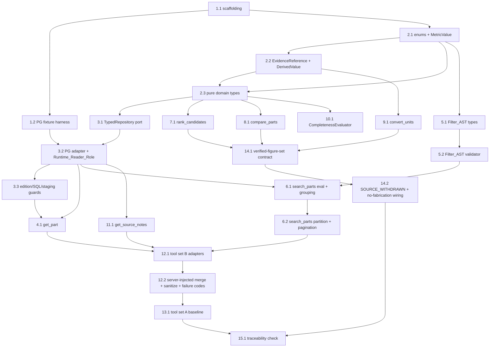

# Implementation Plan: Domain and Tools (Spec 2 of 6)

## Overview

This plan implements the **deterministic domain and tools layer** of the Series 76 Technical Assistant in **Python** (the design fixes Python via Hypothesis for property-based testing, Pydantic-style typed DTOs, Decimal arithmetic, and Testcontainers for PostgreSQL). It builds incrementally: scaffolding and a seeded PostgreSQL fixture first, then the pure domain types, then the read-only `TypedRepository`, then the three domain operations, the `Filter_AST` and search, the three deterministic services, the completeness evaluator, source notes, both tool assemblies (set B and set A), and finally the verified-figure-set contract and a traceability check.

Every task builds on prior tasks and wires into them — no orphaned code. Property-based tests use **Hypothesis** (minimum 100 iterations, each tagged `Feature: domain-and-tools, Property N: <text>`); one PBT per correctness property. DB integration tests run against a **real PostgreSQL container** seeded with a small fixture catalog (and the audited published edition from Spec 1 when available). This spec builds **both** tool sets A and B; it does **not** compare them or assert any benchmark result — the A/B comparison is Spec 6.

Scope boundaries: **no** HTTP/auth/jobs/crypto (Spec 3), **no** agent/LLM orchestration or response composition (Spec 4), **no** Android/presentation (Spec 5), **no** eval harness or benchmark execution (Spec 6).

## Task Dependency Graph



```json
{
  "waves": [
    { "id": 0, "tasks": ["1.1"] },
    { "id": 1, "tasks": ["1.2", "2.1"] },
    { "id": 2, "tasks": ["2.2", "5.1"] },
    { "id": 3, "tasks": ["2.3", "2.4", "5.2", "5.3"] },
    { "id": 4, "tasks": ["3.1", "7.1", "8.1", "9.1", "10.1"] },
    { "id": 5, "tasks": ["3.2", "7.2", "8.2", "9.2", "10.2"] },
    { "id": 6, "tasks": ["3.3", "6.1", "11.1"] },
    { "id": 7, "tasks": ["3.4", "4.1", "6.2", "11.2"] },
    { "id": 8, "tasks": ["4.2", "6.3", "12.1"] },
    { "id": 9, "tasks": ["12.2", "12.3"] },
    { "id": 10, "tasks": ["13.1", "13.2"] },
    { "id": 11, "tasks": ["14.1", "14.2"] },
    { "id": 12, "tasks": ["14.3", "15.1"] }
  ]
}
```

## Tasks

- [ ] 1. Project scaffolding and test harness
  - [ ] 1.1 Scaffold the `domain` package and test tooling
    - Create the Python package layout for the `domain` module (domain model, operations, services, repository port, completeness evaluator) and the `agent` tool-adapter portion, with `__init__` exports and typing config.
    - Configure the test runner (pytest) with Hypothesis installed and a shared settings profile that enforces a minimum of 100 examples per property test; add the `Feature: domain-and-tools, Property N` tag convention as a reusable marker/comment helper.
    - Add Decimal-based numeric configuration and a `Unit` type stub used across metrics and conversions.
    - Demo: `pytest` discovers and runs an empty suite; `import domain` succeeds; Hypothesis profile reporting ≥100 examples is active.
    - _Requirements: 10.1_

  - [ ] 1.2 Stand up the seeded PostgreSQL fixture catalog harness
    - Add a Testcontainers (or Docker) PostgreSQL fixture that boots a real engine for integration tests, creates the `catalog`/`provenance` read schemas and an `ingestion` staging schema matching Spec 1's published shape, and seeds a small fixture catalog (dual-unit torque, N/A and absent fields, multi-measurement 50/60 Hz parts, T03 unqualified rows, per-cell evidence, a withdrawn edition).
    - Provide a pytest fixture that yields a connection using a seeded data edition and, when the audited Spec 1 published edition artifact is present, loads it too.
    - Create the `Runtime_Reader_Role` with least privilege (SELECT on catalog/provenance; no UPDATE/DELETE; no access to `ingestion.*`) during fixture setup.
    - Demo: an integration test connects to the live container, selects a seeded part, and confirms the role exists; teardown drops the container.
    - _Requirements: 1.3, 1.8_

- [ ] 2. Core value types and pure domain model
  - [ ] 2.1 Implement core enums and `MetricValue`
    - Implement `DataStatus` (`AVAILABLE`, `NOT_APPLICABLE`, `NOT_DOCUMENTED`, `NOT_LISTED`, `UNVERIFIED`), `CoverageStatus`, `RequirementGroup`, and `SemanticFailureCode` enums.
    - Implement `MetricValue { value: Decimal|None, status: DataStatus, unit: Unit|None }` with the invariant `status == AVAILABLE ⇔ value is not None`, and a documented zero (`AVAILABLE`, `0`) kept distinct from `NOT_APPLICABLE` and `NOT_DOCUMENTED`; no coercion of N/A or absence to zero/default.
    - Demo: constructing a `MetricValue` with a mismatched value/status raises; zero, N/A, and absent instances are inequal and inspectable.
    - _Requirements: 1.7, 2.6, 2.7, 3.4_

  - [ ]* 2.2 Write property test for status distinguishability (part 1)
    - **Property 3 (status half): every fact carries exactly one DataStatus; documented-zero, N/A, and absent are pairwise distinguishable; NOT_DOCUMENTED never collapses into NOT_APPLICABLE.**
    - Hypothesis generator over `MetricValue` states (zero/positive/N/A/absent); min 100 iterations; tag `Feature: domain-and-tools, Property 3`.
    - Demo: the property test passes over generated metric states.
    - _Requirements: 1.7, 2.7_
    - Properties: 3

  - [ ] 2.3 Implement `EvidenceReference` and `DerivedValue`
    - Implement `EvidenceReference { cell_refs, row_refs, note_refs? }` requiring at least one cell or row reference (non-empty), resolving to published source cell/row identifiers from the fixture schema.
    - Implement `DerivedValue { value: Decimal, unit, formula: str, precision_decimals: int, input_evidence: [EvidenceReference] }`, labeled as derived and never interchangeable with a documented `MetricValue`.
    - Demo: an `EvidenceReference` with no refs is rejected; a `DerivedValue` reports its formula and precision and is a distinct type from `MetricValue`.
    - _Requirements: 10.2, 10.3, 6.1, 6.3_

  - [ ] 2.4 Implement the pure domain types and `Part` aggregate
    - Implement `PartNumber`, `Configuration`, `ServicePerformance`, `UnqualifiedPerformance`, `OperatingCondition`, `ElectricalMeasurement`, `Note`, and the `Part` aggregate, each fact carrying `DataStatus` + `EvidenceReference`, with the design invariants (distinct T04/T05 configurations never merged; one `ServicePerformance` per printed service type with independent dual torque; T03 `UnqualifiedPerformance` never split; `frequency_hz` present iff `EXPLICIT`; measurements never cross-bound across 50/60 Hz; `Note` literal text with covered rows).
    - Build these as in-memory types with no persistence/transport logic.
    - Demo: constructing a `Part` with facts across two editions is rejected; a 50 Hz and 60 Hz measurement on one part stay separately bound.
    - _Requirements: 1.7, 2.1_

- [ ] 3. Read-only TypedRepository port and PostgreSQL adapter
  - [ ] 3.1 Define the `TypedRepository` read-only port
    - Define the port interface: typed, parameterized query requests bound to exactly one `Pinned_Edition`, returning pure domain types carrying `DataStatus` + `EvidenceReference`; no method accepts a raw/model-generated SQL string.
    - Demo: the port exposes only typed query methods; there is no `execute(sql: str)` surface.
    - _Requirements: 1.1_

  - [ ] 3.2 Implement the PostgreSQL adapter using `Runtime_Reader_Role` with edition pinning
    - Implement the adapter against the live fixture engine: connect with `Runtime_Reader_Role`, author only parameterized typed SQL, map rows to domain types with evidence, and scope every read of an invocation to exactly one server-resolved `Pinned_Edition` (never from a model argument).
    - Demo: integration test retrieves a seeded part via the adapter, all facts pinned to one edition, each carrying evidence.
    - _Requirements: 1.1, 1.4_

  - [ ] 3.3 Implement SQL, edition, and staging guards
    - Reject any read carrying a non-parameterized or model-originated SQL string with a typed disallowed-SQL violation (catalog unchanged); reject an invocation without exactly one resolvable pinned edition, or referencing a withdrawn/non-published edition, with a typed unavailable/unresolved-edition error (no facts); reject any read that would combine facts from more than one edition; never read/write/expose `ingestion.*`.
    - Demo: integration tests confirm the reader role is denied UPDATE/DELETE on catalog and SELECT on `ingestion.*`; an edition-mixing read and an unresolved-edition read each return the typed guard error with zero facts.
    - _Requirements: 1.2, 1.5, 1.6, 1.8_

  - [ ]* 3.4 Write property tests for edition scoping, unavailable editions, and evidence resolution
    - **Property 1: edition scoping is server-authoritative and single (model-supplied edition ignored; no mixed set).**
    - **Property 2: unresolvable/withdrawn/non-published editions return a typed error and zero facts.**
    - **Property 3 (evidence half): every returned fact resolves to at least one published source cell with no unresolved reference.**
    - Hypothesis generators over model-supplied edition values, invalid/withdrawn edition refs, and seeded facts; min 100 iterations each; tags `Property 1/2/3`.
    - Demo: the three property tests pass against the seeded container.
    - _Requirements: 1.4, 1.5, 1.6, 1.8, 9.6, 10.2_
    - Properties: 1, 2, 3

- [ ] 4. Exact part lookup (`get_part`)
  - [ ] 4.1 Implement `get_part`
    - Implement `get_part(part_number, service?, frequency?, requested_fields?)` over the repository: return `PART_FOUND` with configurations, service/unqualified performance, condition-bound measurements, and notes (each with status + evidence); label facts bound to an explicit service/frequency; when none given and multiple measurements apply, return all labeled with no silent selection; return `INVALID_PN` for malformed PNs and `PART_NOT_LISTED` for well-formed-but-absent PNs with no substitution and no commercial-existence claim; surface field-level `NOT_APPLICABLE` / `NOT_DOCUMENTED`.
    - Demo: looking up a multi-measurement part with no frequency returns both 50/60 Hz labeled; a malformed PN returns `INVALID_PN`; an absent well-formed PN returns `PART_NOT_LISTED` with no suggestion.
    - _Requirements: 2.1, 2.2, 2.3, 2.4, 2.5, 2.6, 2.7_
    - Properties: 4, 5, 10

  - [ ]* 4.2 Write property tests for `get_part` substitution/classification and labeling
    - **Property 4: `get_part` never silently substitutes and classifies absence precisely (INVALID_PN / PART_NOT_LISTED / PART_FOUND).**
    - **Property 5: explicit service/frequency facts are the bound facts and labeled; multiple applicable measurements all returned labeled with none silently selected.**
    - **Property 10 (get_part slice): N/A and absent fields never coerced to zero and stay distinguishable in results.**
    - Hypothesis generators over malformed/absent/present PNs and multi-measurement parts; min 100 iterations each; tags `Property 4/5/10`.
    - Demo: property tests pass against the seeded container.
    - _Requirements: 2.1, 2.2, 2.3, 2.4, 2.5, 2.6_
    - Properties: 4, 5, 10

- [ ] 5. Filter_AST types and validator
  - [ ] 5.1 Implement the `Filter_AST` node types
    - Implement `And`, `Or`, `Not`, and `Predicate { field, operator, value, unit? }` with the field allowlist, typed operators (equality, ordered comparisons, range with inclusive/exclusive bounds, set membership), and typed values/units. Raw SQL is never a representable node.
    - Demo: a nested `A AND (B OR C)` AST and a `NOT` node construct and round-trip; there is no free-text/SQL node.
    - _Requirements: 3.1, 3.2_

  - [ ] 5.2 Implement the `Filter_AST` validator (`INVALID_FILTER`)
    - Validate structural well-formedness, field membership in the allowlist, and operator/unit compatibility with the referenced field; a structurally invalid, out-of-allowlist, or unit/operator-incompatible AST yields `INVALID_FILTER` identifying the offending predicate and is never executed.
    - Demo: an out-of-allowlist field, an incompatible unit, and a malformed node each return `INVALID_FILTER` with the offending predicate; a valid AST validates clean.
    - _Requirements: 3.8_

  - [ ]* 5.3 Write unit/example tests for AST validation
    - Cover structurally invalid, out-of-allowlist, and unit/operator-incompatible ASTs rejecting with `INVALID_FILTER`; a reference boolean evaluator stub (oracle for later search properties) is included.
    - Demo: validation example tests pass.
    - _Requirements: 3.8_

- [ ] 6. Filtered search (`search_parts`)
  - [ ] 6.1 Implement `search_parts` boolean evaluation, ranges, and units
    - Implement `search_parts(filter_ast, requested_fields?, sort_hint?, page/cursor?)` over the repository: evaluate `AND`/`OR`/`NOT` strictly by explicit grouping with no re-association; apply inclusive bounds satisfied at equality and exclusive bounds not satisfied at equality; match unit-qualified predicates only under convertible units and reject non-convertible comparisons rather than matching; treat N/A and absent fields as not satisfying any numeric predicate with no coercion, keeping N/A distinct from absent. `sort_hint` is accepted but non-authoritative.
    - Demo: a grouped AST returns exactly the grounded set; an exclusive bound excludes an equal value; an N/A field fails a numeric predicate.
    - _Requirements: 3.1, 3.2, 3.3, 3.4_
    - Properties: 6, 7, 8, 9, 10, 11

  - [ ] 6.2 Implement result partition, totals, pagination, and `NO_RESULTS`
    - Return an exact `total_matches`, a cursor/page-based transport that enumerates all matches to exhaustion (none omitted, none fabricated), a **verified set** (all verifiable hard constraints satisfied) disjoint from a **preliminary/indeterminate set** (missing/N/A/non-comparable relevant field), and `NO_RESULTS` as a success (`total_matches = 0`, applied filters reported) distinct from `INVALID_FILTER`. Expose the full matched set with no card limit (that rule is Spec 5).
    - Demo: iterating pages enumerates exactly `total_matches` PNs; an indeterminate candidate appears only in the preliminary set; a non-matching filter returns `NO_RESULTS` with totals zero.
    - _Requirements: 3.5, 3.6, 3.7, 3.9_
    - Properties: 12, 13, 14

  - [ ]* 6.3 Write property tests for search semantics
    - **Property 6: boolean AST evaluation equals its grounded grouping** (reference boolean evaluator as oracle).
    - **Property 7: adding an AND constraint never grows the matched set (monotonicity).**
    - **Property 8: reordering AND operands does not change the matched set or total.**
    - **Property 9: range inclusive/exclusive semantics exact at equality.**
    - **Property 11: unit-qualified matching only under convertible units.**
    - **Property 12: full enumeration via the transport equals `total_matches`.**
    - **Property 13: verified and indeterminate sets partition correctly (disjoint).**
    - **Property 14: empty match is `NO_RESULTS` success; invalid filter is `INVALID_FILTER` rejection with no totals.**
    - **Property 10 (search slice): N/A/absent never satisfy a numeric predicate and are never coerced.**
    - Hypothesis generators: random `Filter_AST`s, N/A/absent/zero states, unit-mixed fields; min 100 iterations each; tags `Property 6..14` and `10`.
    - Demo: all search property tests pass against the seeded container.
    - _Requirements: 3.1, 3.2, 3.3, 3.4, 3.5, 3.6, 3.7, 3.8_
    - Properties: 6, 7, 8, 9, 10, 11, 12, 13, 14

- [ ] 7. Deterministic ranking (`rank_candidates`)
  - [ ] 7.1 Implement `rank_candidates`
    - Implement a pure service over already-retrieved facts: lexicographic ordering by the explicit confirmed priorities and comparison directions, deterministic Base-PN ascending tiebreak, reproducible on identical inputs; exclude N/A/absent values from a priority's comparison and place such candidates after all comparable ones; never rank by a metric non-comparable across service/frequency/supply/unit context and instead return those in a distinct indeterminate group; top-1 mode returns only the winner plus eligible count and equals the head of the full ranking; ignore model `sort_hint`; return a non-exception precondition indication (input unmodified) for an empty eligible set or missing confirmed priority.
    - Demo: identical inputs produce identical order; a tie resolves by Base PN; top-1 winner equals the full-ranking head; an empty set returns the precondition indication.
    - _Requirements: 4.1, 4.2, 4.3, 4.4, 4.5, 4.6, 4.7, 4.8_
    - Properties: 10, 15, 16, 17, 18

  - [ ]* 7.2 Write property tests for ranking
    - **Property 15: lexicographic, reproducible, Base-PN tiebreak.**
    - **Property 16: no ranking by a non-comparable metric; affected candidates in a distinct indeterminate group.**
    - **Property 17: top-1 equals head of full ranking and returns only winner + count.**
    - **Property 18: ignores model `sort_hint`; requires confirmed priority; empty/no-priority leaves input unmodified.**
    - **Property 10 (ranking slice): N/A/absent excluded from comparison and never coerced.**
    - Hypothesis generators: candidate sets with ties, N/A/absent metrics, non-comparable contexts, priority orderings; min 100 iterations each; tags `Property 15..18` and `10`.
    - Demo: ranking property tests pass.
    - _Requirements: 4.1, 4.2, 4.3, 4.4, 4.5, 4.6, 4.7, 4.8_
    - Properties: 10, 15, 16, 17, 18

- [ ] 8. Deterministic comparison (`compare_parts`)
  - [ ] 8.1 Implement `compare_parts`
    - Implement a pure service over 2–3 distinct listed PNs of the same edition: return side-by-side documented facts with each fact's operating condition, service context, and unit exposed; flag each metric pair comparable only under compatible service/frequency/supply/unit context, else `NOT_COMPARABLE` with a condition-mismatch warning and no winner; present heterogeneous-supply FLA with each supply condition and no efficiency/lower-consumption claim; present N/A/absent fields with their explicit state, never as zero or a winner; reject >1 edition (edition-mismatch) and <2/>3/duplicate/unlisted PNs (typed failure, no partial set); identical results on repeat.
    - Demo: a compatible pair compares; an incompatible pair is `NOT_COMPARABLE` with a warning; a duplicate PN is rejected with no partial set; repeated calls match exactly.
    - _Requirements: 5.1, 5.2, 5.3, 5.4, 5.5, 5.6, 5.7, 5.8_
    - Properties: 10, 19, 20, 21

  - [ ]* 8.2 Write property tests for comparison
    - **Property 19: edition-isolated; incompatible pairs marked `NOT_COMPARABLE`; no winner on such pairs.**
    - **Property 20: heterogeneous-supply FLA carries no efficiency claim.**
    - **Property 21: rejects invalid arity (<2/>3/duplicate/unlisted) and is deterministic on repeat.**
    - **Property 10 (comparison slice): N/A/absent never zero and never a winner.**
    - Hypothesis generators: 2–3 PN sets, cross-edition sets, incompatible contexts, duplicates; min 100 iterations each; tags `Property 19/20/21` and `10`.
    - Demo: comparison property tests pass.
    - _Requirements: 5.1, 5.2, 5.3, 5.4, 5.5, 5.6, 5.7, 5.8_
    - Properties: 10, 19, 20, 21

- [ ] 9. Deterministic unit conversion (`convert_units`)
  - [ ] 9.1 Implement `convert_units`
    - Implement a pure service that converts a documented value between a compatible unit pair using Decimal arithmetic, returning a `DerivedValue` labeled with its conversion formula and fixed decimal precision; preserve both officially documented figures of a dual-unit value (never overwrite/round/replace one by converting the other); never substitute a `DerivedValue` for an official documented value; return an explicit conversion error (no value, source unchanged) for an incompatible pair or a missing/non-numeric/out-of-domain magnitude.
    - Demo: converting in-lbs↔Nm yields a labeled `DerivedValue`; both printed torque figures remain intact; an incompatible pair returns a conversion error with the source unchanged.
    - _Requirements: 6.1, 6.2, 6.3, 6.4_
    - Properties: 22, 23

  - [ ]* 9.2 Write property tests for conversion
    - **Property 22: labeled derivation that never overwrites an official figure; no `DerivedValue` substituted for an official value.**
    - **Property 23: invalid conversions error without altering the source.**
    - Hypothesis generators: compatible/incompatible unit pairs, dual-unit values, out-of-domain magnitudes; min 100 iterations each; tags `Property 22/23`.
    - Demo: conversion property tests pass.
    - _Requirements: 6.1, 6.2, 6.3, 6.4_
    - Properties: 22, 23

- [ ] 10. Completeness evaluator (four requirement groups)
  - [ ] 10.1 Implement `CompletenessEvaluator`
    - Implement an evaluator that reports exactly one `CoverageStatus` per each of the four `RequirementGroup`s (environment/enclosure, power/supply, service type, required torque); classify `verified` iff all four are `SPECIFIED` with a non-empty catalog-backed match, else `preliminary` reporting the exact unmet-group set (including any `CONFLICTING` group); evaluate each group independently; treat a `DELEGATED` group as a preference input and never synthesize a physical condition absent from the source. Emit deterministic primitives only; the recommendation decision is Spec 4.
    - Demo: all-`SPECIFIED` with matches yields `verified`; one `UNKNOWN` or `CONFLICTING` group yields `preliminary` with that group reported; a `DELEGATED` group synthesizes nothing.
    - _Requirements: 7.1, 7.2, 7.3, 7.4, 7.5, 7.6, 7.7_
    - Properties: 24, 25

  - [ ]* 10.2 Write property tests for completeness
    - **Property 24: verified iff all four groups `SPECIFIED` with a catalog-backed match; else preliminary with the exact unmet set; each group independent.**
    - **Property 25: a `DELEGATED` group never synthesizes a physical condition.**
    - Hypothesis generators over per-group coverage states and catalog-match presence; min 100 iterations each; tags `Property 24/25`.
    - Demo: completeness property tests pass.
    - _Requirements: 7.1, 7.2, 7.3, 7.4, 7.5, 7.6_
    - Properties: 24, 25

- [ ] 11. Source notes (`get_source_notes`)
  - [ ] 11.1 Implement `get_source_notes`
    - Implement the operation for a PN / configuration / fact / section: return each applicable note as a separate item with literal text unchanged, its `EvidenceReference`, and covered scope equal to exactly the covered source rows (no merge/summary/forward-fill/extension); return `NOT_DOCUMENTED` (distinct from `UNVERIFIED`) for a requested note that does not exist.
    - Demo: a target with two applicable notes returns two separate literal items with exact scopes; a missing note returns `NOT_DOCUMENTED`.
    - _Requirements: 8.1, 8.2, 8.3, 8.4_
    - Properties: 3, 26

  - [ ]* 11.2 Write property test for notes
    - **Property 26: notes returned literal, separate, scoped exactly to covered rows; `NOT_DOCUMENTED` distinct from `UNVERIFIED`.**
    - Hypothesis generators over single/multi-note targets and missing notes; min 100 iterations; tag `Property 26`.
    - Demo: notes property test passes against the seeded container.
    - _Requirements: 8.1, 8.2, 8.3, 8.4_
    - Properties: 26

- [ ] 12. Tool Set B adapters (specialized)
  - [ ] 12.1 Implement the Set B tool adapters over the domain operations
    - Implement `get_part_details`, `search_parts`, and a conditionally-exposed `get_source_notes` tool as thin adapters over the shared domain operations, with model-visible typed inputs (`part_number`/`service`/`frequency`/`requested_fields`; `filter_ast`/`requested_fields`/non-authoritative `sort_hint`/`page|cursor`; note target + type) and typed outputs carrying `DataStatus` + `EvidenceReference`.
    - Demo: each Set B tool is registered and routes a request through the repository to a typed fact result.
    - _Requirements: 9.1, 9.2, 9.10_

  - [ ] 12.2 Implement typed input validation, server-injected merge, and output sanitization
    - Validate every model-visible input against its declared typed schema **before** any catalog query, rejecting non-conforming input with a typed validation failure and no query; merge the server-injected inputs (`edition_id`, permission context, result limits, `trace_id`) server-side and ignore any model-supplied value for them; return sanitized typed facts only (no embedded executable instructions, no raw SQL dumps, no unsanitized free text); treat all tool output as untrusted content (no text executed/followed as an instruction).
    - Demo: a schema-violating input is rejected before querying; a model-supplied `edition_id` is ignored in favor of the server value; an instruction-like string embedded in a fact passes through inert as data.
    - _Requirements: 9.4, 9.5, 9.6, 9.7, 9.8_
    - Properties: 27, 28

  - [ ]* 12.3 Write property tests for tool validation, injection resistance, and failure codes
    - **Property 27: inputs schema-validated before execution; server-injected inputs are not overridable.**
    - **Property 28: tool output is sanitized typed facts with evidence and is never executed as instruction.**
    - **Property 29: exactly one `SemanticFailureCode` per defined non-success outcome.**
    - Hypothesis generators: non-conforming inputs, model-supplied server values, instruction-like strings in facts, each defined business-failure scenario; min 100 iterations each; tags `Property 27/28/29`.
    - Demo: Set B tool property tests pass with zero LLM cost (fakes/fixtures only).
    - _Requirements: 9.4, 9.5, 9.6, 9.7, 9.8, 9.9_
    - Properties: 27, 28, 29

- [ ] 13. Tool Set A baseline adapter (generic)
  - [ ] 13.1 Implement the generic `query_parts` baseline over the same operations
    - Implement Set A as a single `query_parts` tool with a discriminated `{ op: GET | SEARCH, ... }` payload that routes GET to the same `get_part` path and SEARCH to the same `search_parts` path used by Set B, sharing the identical repository, validation, server-injected merge, sanitization, and `SemanticFailureCode` behavior. Do not declare a winner; record in a code comment/ADR that the A/B comparison is Spec 6.
    - Demo: `query_parts` GET returns the same facts as `get_part_details`, and SEARCH the same as `search_parts`, for identical inputs.
    - _Requirements: 9.1, 9.2, 9.3_

  - [ ]* 13.2 Write example tests for A/B assembly parity (no winner)
    - Assert both assemblies exist with their specified shapes and that Set A and Set B return identical facts over identical inputs (parity of the shared core); assert no winner is asserted or benchmark executed in this spec.
    - Demo: parity example tests pass; no evaluation is run.
    - _Requirements: 9.2, 9.3_

- [ ] 14. Verified-figure-set contract and determinism wiring
  - [ ] 14.1 Expose the verified-figure-set contract surface for Spec 4
    - Surface the facts and `DerivedValue`s emitted by the domain operations and deterministic services as the single verified figure set: every returned number resolves to a source cell (direct) or derivation-input cells (derived), each carrying `DataStatus` + `EvidenceReference`, with derived values labeled by formula and fixed precision; provide the stable accessor Spec 4 will consume for both `answer` and structured blocks.
    - Demo: a figure retrieved for a part resolves to its source cell(s) and is identical whether read for the answer path or the block path.
    - _Requirements: 10.1, 10.2, 10.3_
    - Properties: 30, 31

  - [ ] 14.2 Wire determinism, no-fabrication, and `SOURCE_WITHDRAWN`
    - Guarantee repeated identical queries (same part/edition/service/frequency) return numerically equal figures (exactly equal for direct values, equal to attached precision for derived); return an explicit unavailable/not-documented state carrying no number when a fact has no supporting value and no derivation, never fabricating; return `SOURCE_WITHDRAWN` for a new recommendation request against a withdrawn edition while still permitting pinned reads of previously recorded facts for that edition.
    - Demo: the same query twice yields equal figures; a withdrawn-edition recommendation returns `SOURCE_WITHDRAWN` while a pinned historical read still succeeds; an unsupported fact returns an explicit no-number state.
    - _Requirements: 10.4, 10.5, 10.6_
    - Properties: 30, 31, 32

  - [ ]* 14.3 Write property tests for determinism and no fabrication
    - **Property 30: every number traces to the catalog or a deterministic derivation; unsupported facts return an explicit no-number state and nothing is fabricated.**
    - **Property 31: repeated identical queries return equal verified figures.**
    - **Property 32: a withdrawn edition blocks new recommendations (`SOURCE_WITHDRAWN`) but allows pinned reads.**
    - Hypothesis generators over repeated queries, unsupported facts, and withdrawn editions; min 100 iterations each; tags `Property 30/31/32`.
    - Demo: determinism property tests pass against the seeded container.
    - _Requirements: 10.1, 10.2, 10.4, 10.5, 10.6_
    - Properties: 30, 31, 32

- [ ] 15. Traceability checkpoint
  - [ ] 15.1 Verify full Requirement and Property coverage and ensure all tests pass
    - Add a coverage check (test or script) asserting every acceptance criterion of Requirements 1–10 maps to at least one implementation task/test and every Correctness Property 1–32 maps to exactly one Hypothesis property test tagged `Feature: domain-and-tools, Property N`. Run the full suite (unit, property, and PostgreSQL integration/smoke) and confirm green.
    - Ensure all tests pass, ask the user if questions arise.
    - Demo: the coverage check reports 100% Requirement and Property mapping; the full suite is green.
    - _Requirements: 1.1, 2.1, 3.1, 4.1, 5.1, 6.1, 7.1, 8.1, 9.1, 10.1_
    - Properties: 1, 2, 3, 4, 5, 6, 7, 8, 9, 10, 11, 12, 13, 14, 15, 16, 17, 18, 19, 20, 21, 22, 23, 24, 25, 26, 27, 28, 29, 30, 31, 32

## Notes

- Tasks marked with `*` are optional test sub-tasks and can be skipped for a faster MVP; all non-`*` sub-tasks must be implemented.
- Implementation language is **Python** (Hypothesis, Decimal, Testcontainers), per the design's testing strategy.
- Each property test is a **single** Hypothesis test, minimum 100 iterations, tagged `Feature: domain-and-tools, Property N: <text>`. Property 10 is split across several task slices because it spans filtering, ranking, and comparison; the single authoritative Property 10 test lives with search (task 6.3), and the other slices are focused assertions within their component tests.
- DB integration/smoke tests run against a **real PostgreSQL container** seeded with the fixture catalog (and the audited Spec 1 edition when present); they are not mocked.
- This spec builds **both** Tool_Set_A and Tool_Set_B. It declares **no winner**; the A/B comparison is an experiment owned by `evaluation-and-reproducibility` (Spec 6).
- Boundaries excluded here: HTTP/auth/jobs/crypto (Spec 3), agent/LLM orchestration and response composition (Spec 4), Android/presentation and the "max 3 cards" rule (Spec 5), eval harness and benchmark execution (Spec 6).
