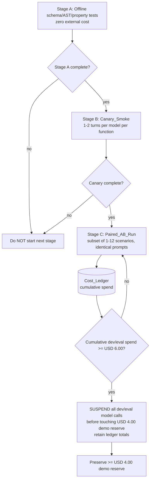
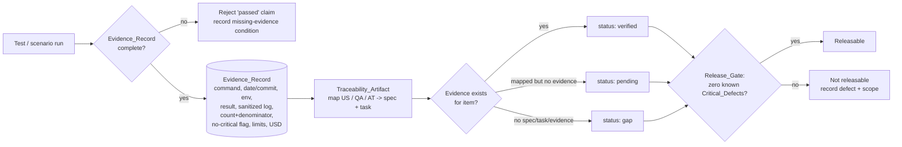

# Design Document

## Overview

This design defines the **Evaluation, Quality-Gate, and Reproducibility layer** (Spec 6 of 6) of the *Series 76 Technical Assistant*. It is the layer where **real execution happens**: it exercises and measures the artifacts produced by Specs 1–5 and resolves the empirical questions those specs left open (model selection, tool-set A/B winner, cost measurement, accuracy against the golden set, cold-start reproducibility). It is an **integration and judgment boundary**; it does **not** reimplement any data, domain, backend, agent, or Android behavior.

The design realizes Requirements 1–10:

- **R1 Test Taxonomy and Levels** → the `Evaluation_Harness` organized into exactly twelve `Test_Level`s.
- **R2 Golden Dataset Oracle + Domain Property Matrix** → `GoldenOracle` and `DomainPropertyMatrix`.
- **R3 Cost-Gated Model/Tool A/B** → `ModelToolABHarness`, `CostLedger`, `BudgetGate`.
- **R4 Security/Persistence Adversarial Suite** → `SecurityAdversarialSuite`.
- **R5 Android QA + Accessibility** → `AndroidQASuite`.
- **R6 End-to-End Demo Flows** → `E2EFlowRunner`.
- **R7 Reproducibility, README, Delivery** → `ReproducibilityChecker`.
- **R8 Evidence and Honesty Policy** → `EvidenceRecorder` + `HonestyPolicy`.
- **R9 Traceability Closure** → `TraceabilityCloser` (this spec owns the integral cross-spec artifact).
- **R10 Committed Configuration Artifact** → `ConfigArtifactChecker`.

### Central honesty discipline (design-level invariant)

This document is a **design**. Nothing here asserts that any run, benchmark, A/B comparison, model evaluation, cost measurement, latency measurement, security probe, emulator session, or cold-start reproduction has **already been executed**. No model winner, no tool-set winner, no accuracy number, no cost figure, and no "passed" verdict is claimed as a historical fact.

The discipline is enforced structurally by three rules baked into every component:

1. **Evidence-Record-or-pending.** A result exists only once its `Evidence_Record` (command, date/commit, environment, result, sanitized log, case count + denominator, no-critical-defects flag, known limits, cumulative USD cost) is captured. Until then the result is a **pending obligation**, never a claim.
2. **No fabrication.** No component may synthesize a benchmark, test, measurement, or number. Expected values come only from the **Golden_Dataset** (Spec 1), the single numeric oracle derived solely from `series_76_electric_data.pdf` and bound by a SHA-256 manifest. No expected value is authored by a language model, inferred from a part-number substring, taken from the summary PDF, or reconstructed from generated prose.
3. **No winner declared.** The A/B harness resolves selection **empirically at run time**; this design declares no winner and encodes selection *rules*, not *outcomes*.

### Budget rule (central constraint)

All live-model execution respects a **USD 10.00 hard cap**: at most **USD 6.00** consumable for development/evaluations and at least **USD 4.00** reserved for the final demo. The `CostLedger` records **cumulative** spend across the whole evaluation (never per-model). The `BudgetGate` **suspends** all development/evaluation model calls before any spend touches the USD 4.00 reserve, retaining the ledger totals recorded up to suspension.

## Architecture

The `Evaluation_Harness` is a measurement and reporting system layered on top of the five product specs. It never opens a product transaction, never encrypts product data, never draws product UI, and never authors agent logic — it **drives** those seams and records what they do.

### Twelve Test Levels and where each runs

| # | Test_Level | Execution environment | Exercises (Spec) | External LLM cost |
|---|---|---|---|---|
| 1 | Documental verification | Offline Python; per-cell diff vs SHA-256 manifest | Spec 1 published catalog + golden set | Zero |
| 2 | Unit / domain | Offline Python; Hypothesis property engine; no FastAPI/DB/LLM import | Spec 2 pure domain | Zero |
| 3 | ETL integration | Deterministic fixtures; fresh-extraction path separated from replay | Spec 1 ingestion/replay | Zero (replay) |
| 4 | DB integration | **Real PostgreSQL** in a container (no SQLite/in-memory/mock) | Spec 3 persistence | Zero |
| 5 | Backend contract | FastAPI `TestClient` / `httpx` async vs versioned contract snapshot | Spec 3 HTTP contracts | Zero |
| 6 | Agent with mock tools | Deterministic CI; mocked tools, controlled model responses, fake clock | Spec 4 harness seams | Zero |
| 7 | Agent evals with real API | **Cost-gated** live OpenRouter; ~36 blind scenarios | Spec 4 candidates | Gated ≤ USD 6 |
| 8 | Concurrency / failure | PostgreSQL + API + worker with injected interruptions | Spec 3 jobs/leases/idempotency | Zero |
| 9 | Security adversarial | Automated adversarial + focused manual review | Specs 3–5 protections | Zero |
| 10 | Android unit / UI | JVM/Kotlin unit + Compose semantic UI tests | Spec 5 ViewModel/UiState | Zero |
| 11 | Android instrumented / emulator | Emulator ↔ Compose ↔ FastAPI instrumented tests | Spec 5 end-to-end UI | Zero |
| 12 | Reproducibility cold-start | Clean clone + Docker Compose on documented prerequisites only | All specs (delivery) | Zero |

Each level is present and non-empty (R1.1). Code coverage and scenario coverage are reported as **two distinct, separately labeled measures** (R1.8); data guarantees are reported only as facts verified against the golden dataset.

### Cost-gated staging for live model evaluation (R3.4, R3.5, R3.6)



The staging is strictly ordered: Stage A (offline, zero cost) must complete before Stage B (canary), which must complete before Stage C (paired A/B). Every candidate model is verified for identifier, live availability, tool-calling support, JSON-output support, and current live price **before any benchmark call**; an unverifiable model is excluded with a recorded reason and no benchmark call (R3.7).

### Evidence and traceability pipeline (R8, R9)



The pipeline **consumes** the Spec 1 golden dataset as its oracle, **exercises** the Spec 2/3/4 seams through the level runners, and **drives** Spec 5 through the emulator. `pending` and `gap` are mutually exclusive states (R9.5). The `Release_Gate` requires zero known Critical_Defects in numeric integrity, authorization, isolation, mandatory encryption, persistence/no-resurrection, and the mandatory `POST /api/conversation` contract (R8.4).

## Data Models

Shapes are described as contracts. The **exact serialized report file format, CI runner flags, and fixture directory layout are [DELEGATED]** — Kiro finalizes them while preserving these shapes and invariants.

### Evidence_Record (R8.1)

The atomic unit backing every "passed" claim. A claim without a complete, persisted `Evidence_Record` is not "passed" (R8.8).

```
Evidence_Record {
  command:            string            # exact command executed
  date:               ISO-8601 datetime
  commit:             string            # git commit SHA
  environment:        string            # OS/runtime/container identity
  result:             enum{passed, failed}
  sanitized_log:      string            # secrets/credentials redacted
  case_count:         int               # numerator
  denominator:        int               # explicit denominator
  no_critical_defects:bool              # true only if none known in scope
  known_limits:       string
  cumulative_cost_usd:decimal           # real cumulative OpenRouter spend
}
```

### Scenario (R3.2, R3.3)

```
Scenario {
  id:               string                 # stable identifier
  family:           Scenario_Family
  language:         enum{es, en}
  input:            string                 # bilingual user turn(s)
  expected_output:  GoldenAnchoredValue    # provenance = Golden_Dataset ONLY
  critical:         bool                   # drives Promotion_Gate critical-case count
}
```

The eight `Scenario_Family` values (each represented by ≥1 scenario; suite size 34–38; ES 40–60% and EN 40–60%):

1. exact PN
2. torque dual service + 50/60 Hz
3. T03 N/A and unattributed
4. 24V AC/DC vs DC
5. boolean + range filters
6. follow-ups / corrections
7. ranking / abstention
8. prompt-injection / IDOR

### Cost_Ledger entry (R3.5)

```
CostLedgerEntry {
  provider:        string
  model:           string
  function:        Model_Function          # interpretation | tool-calling | explanation
  tokens:          int
  usd:             decimal                  # cost of this call
  cumulative_usd:  decimal                  # running total across whole evaluation
  reserve_guard:   bool                     # true if this entry was blocked to protect >= USD 4 reserve
}
```

### Promotion_Gate result (R3.8)

```
PromotionGateResult {
  candidate:                   Model_Candidate
  numeric_discrepancies:       int     # must be 0
  authorization_leaks:         int     # must be 0
  tool_param_validation_pct:   decimal # must be 100
  missing_mandatory_scenarios: int     # must be 0
  promotable:                  bool    # true iff all four conditions hold
}
```

### Model_Candidate / Model_Function (reference from Spec 4 / F2 §9)

```
Model_Function  = enum{ interpretation, tool_calling, explanation }
Model_Candidate {
  model_id:        string               # verified live before benchmark
  function:        Model_Function
  tool_count:      int                  # complexity tiebreak input
  step_count:      int                  # complexity tiebreak input
  tool_calling:    bool                 # verified
  json_output:     bool                 # verified
  live_price_usd:  decimal              # verified before any benchmark call
}
```

At least two `Model_Candidate`s exist per evaluated `Model_Function` (R3.1). Candidate assignment references the Spec 4 / F2 §9 plan; this layer does not author it.

### Traceability_Artifact row (R9)

```
TraceabilityRow {
  item_id:          string          # US-xxx | QA-xx | AT-xx | F-phase-id
  implementing_spec:string          # one of the six specs
  implementing_task:string
  evidence_ref:     string | null   # Evidence_Record reference, or null
  status:           enum{verified, pending, gap}   # pending XOR gap
}
```

### Release_Gate record (R8.4, R8.5)

```
ReleaseGateRecord {
  numeric_integrity:         enum{clear, defect}
  authorization:             enum{clear, defect}
  isolation:                 enum{clear, defect}
  mandatory_encryption:      enum{clear, defect}
  persistence_no_resurrection:enum{clear, defect}
  conversation_contract:     enum{clear, defect}   # POST /api/conversation
  releasable:                bool                  # true iff all categories clear
  recorded_defects:          [ {category, scope} ]
}
```

### Config_Artifact descriptor (R10)

```
ConfigArtifact {
  path:            ".kiro/"
  committed:       bool            # present in fresh clone of default branch
  documented:      bool            # README references it by name + purpose
  secret_findings: [ {field, kind} ]  # must be empty; placeholders only
}
```

## Components and Interfaces

Each component declares an input/output contract and the Spec 1–5 seam it exercises. Components **measure** seams; they never reimplement them.

### TestLevelRunner(s) (R1)

- **Contract:** `run(level) -> LevelResult{ present: bool, nonEmpty: bool, evidence: Evidence_Record }`. One runner per `Test_Level`.
- **Seams:** Level 2 imports only Spec 2 pure domain (no FastAPI/DB/LLM). Level 4 provisions a **real PostgreSQL** container. Level 5 drives FastAPI via `TestClient`/`httpx` against a versioned contract snapshot. Level 6 runs deterministically with mocked tools + fake clock (zero LLM cost, reproducible per seed). Level 7 is gated by `BudgetGate`. Level 12 executes only documented commands on a clean clone; any implicit/undocumented prerequisite → level recorded **failed** (R1.7).

### GoldenOracle (R2.1–R2.3)

- **Contract:** `verify(publishedCatalog, goldenDataset, manifestSha256) -> { fieldCoveragePct, mismatches: [ {cell, expected, observed} ] }`.
- **Behavior:** cell-by-cell diff across all 7 tables, 68 rows, every one of the 4 N/A cells, and every note, at the exact recorded decimal precision (no rounding/truncation/normalization). `Field_Coverage` must equal 100% of published fields. Any mismatch → run fails, per-cell report emitted, Golden_Dataset left unmodified.
- **Seam:** consumes Spec 1 published catalog + golden dataset; authors no value.

### DomainPropertyMatrix (R2.4–R2.11)

- **Contract:** `runProperties() -> [PropertyResult]`, each property over ≥100 generated inputs (Hypothesis), failing if any input violates the assertion.
- **Properties exercised (Spec 2 pure domain):** AND-constraint monotonicity (set size non-increasing); N/A never satisfies a numeric filter; reordered-AND equality; inverse unit conversion within tolerance **for Derived_Value only** (never substitutes an official Published_Value); stable lexicographic ranking (byte-for-byte); comparison declares a winner only under compatible service/frequency/supply/unit; edition-withdrawal blocks new recommendations while prior messages remain retrievable unchanged.

### ModelToolABHarness (R3.1–R3.4, R3.8–R3.10)

- **Contract:** `evaluate(candidates, toolSetA, toolSetB, scenarioSuite) -> ABReport`. Compares Tool_Set_A vs Tool_Set_B on **identical** scenario ids/inputs/expected outputs. Runs strict staging: offline → canary → paired A/B subset (1–12). Applies `Promotion_Gate` per candidate. Selection rule: higher count of successful **critical** cases wins even at higher cost; on a tie, the **simpler** candidate (fewer tools + steps) wins.
- **Invariant:** asserts **no** winner/result as already executed; reports a result only when its `Evidence_Record` exists (R3.10).
- **Seam:** drives Spec 4 candidates + Spec 2 tool sets; expected outputs sourced only from Golden_Dataset.

### CostLedger + BudgetGate (R3.5–R3.7)

- **Contract:** `charge(entry) -> {allowed: bool, cumulative_usd}`; `verifyModel(candidate) -> {usable: bool, reason}`.
- **Behavior:** records cumulative (not per-model) spend; enforces USD 10 cap / ≤ USD 6 dev-eval / ≥ USD 4 reserve; **suspends** all dev/eval calls before the reserve is touched and retains totals at suspension. Before any benchmark call, verifies model id, live availability, tool-calling, JSON output, and live price; unverifiable → excluded with recorded reason, no call.
- **Seam:** wraps Spec 4 OpenRouter usage; authors no agent logic.

### SecurityAdversarialSuite (R4)

- **Contract:** `probe() -> [SecurityFinding]` against the running Spec 3 backend, worker, and Spec 5 client.
- **Probes:** cross-owner IDOR (404/403 within 2000 ms, no B metadata, latency/size indistinguishable within 50 ms); developer-A-vs-developer-B trace denial byte-identical to the IDOR denial; forced `role=developer` registration → effective `user` or rejection, never persisted developer; refresh-token reuse → family revoked same request; logged-out token rejected; DB dump without key material → all sensitive fields AES-256-GCM ciphertext, zero known-plaintext matches; ciphertext/tag tamper → decryption fails closed, no partial/substituted plaintext; no secret/token/password/key/prompt/raw-SQL/stack-trace in any log, Debug trace, or `answer`; prompt-injection/role-escalation leaves tenant/edition/scope byte-identical, runs only parameterized queries, leaks no internals; delete-during-job → late worker write does not resurrect; duplicate/worker-kill → exactly one persisted turn effect; Android cache purge on logout/switch; offline remote-delete not restored, reconciles on reconnect.
- **Seam:** exercises Spec 3 auth/ownership/jobs/crypto and Spec 5 cache; never establishes trust or encrypts itself.

### AndroidQASuite (R5, F5-OFF-01..07)

- **Contract:** `run() -> AndroidQAReport` on an emulator.
- **Checks:** Compose semantics + non-empty TalkBack labels for all interactive elements; 200% text scaling without truncation; dark + light themes complete; comparison tables scroll horizontally to reveal all columns; each chart has a textual alternative with unit + condition. All 13 UiStates reachable and rendering documented content (loading, empty, queued, running, error, offline-cache, no-matches, N/A, plan-awaiting-confirmation, stale-plan, session-expired, catalog-withdrawn, deletion-pending). Routes Conversations/Chat/Developer-Debug/Login/Register navigable. Direct Debug navigation without `developer` role → no trace content though UI present. No ANR (network/DB/crypto off main thread; polling stops on stopped lifecycle). Offline: no-connection notice + Send disabled + only authorized history; restored draft unchanged until explicit new send; `503` with network present → service-unavailable, not no-connection.
- **Seam:** drives Spec 5 UI; draws nothing.

### E2EFlowRunner (R6)

- **Contract:** `runFlows() -> [FlowEvidence]` with recorded emulator evidence for all twelve flows (registration/role; exact PN figures + evidence note; filter count ≤ 3 cards; incomplete-criteria correction + ranking; two-model compare + conditional bar chart; 50 Hz follow-up + restart + history order preserved; Developer Debug own-session visible, user-role denied; backend-outage cache recovery + draft retained + reconnect; two-turn order after app reopen; delete-with-job-in-progress no reappearance; Verified_Replay zero Gemini calls + optional Fresh_Extraction with evaluator key; full cold-start Docker Compose + emulator covering all twelve).
- **Seam:** drives Specs 1–5 together through the client; reimplements none.

### ReproducibilityChecker (R7)

- **Contract:** `checkColdStart(cleanClone) -> ReproResult`; `checkArtifactIntegrity() -> IntegrityResult`.
- **Behavior:** single repository with backend, worker, Android app, ingestion pipeline, architecture + AI-assisted-dev docs; `docker-compose.yml` defining exactly `db`, `api`, `worker`; `.env.example` with only non-functional placeholders; versioned migrations; documented ETL; Verified_Replay manifests (no Gemini key required); optional Fresh_Extraction (only with evaluator `GEMINI_API_KEY`); README documenting each required topic in a locatable section. Cold-start executes only README commands in documented order; any undocumented/absent step → recorded **failure**. SHA-256 digest of source PDF and manifest compared to trusted references; mismatch → reject + surface + no publish/ingest.
- **Seam:** exercises Spec 1 replay + delivery packaging; publishes/ingests nothing itself.

### EvidenceRecorder + HonestyPolicy (R8)

- **Contract:** `record(claim) -> Evidence_Record`; `assertHonest(claim) -> {accepted: bool, reason}`.
- **Behavior:** before any "passed" emission, record a complete `Evidence_Record`; reject a "passed" claim with no persisted record (missing-evidence condition logged). Never claim 100% semantic coverage from 68 rows or 36 scenarios; every coverage figure is numerator-over-explicit-denominator. Never fabricate a benchmark/test/measurement/number. Never present code-line coverage as verified-data evidence. Record non-critical defects with scope + justification. Enforce Release_Gate zero-critical.
- **Seam:** governs all other components.

### TraceabilityCloser (R9)

- **Contract:** `buildArtifact() -> Traceability_Artifact` spanning all six specs.
- **Behavior:** maps each of the 35 active user stories (US-001..US-034, US-036; US-035 recorded as cross-cutting delete-race), the 15 QA scenarios (QA-01..QA-15), and every phase acceptance test (F1 §6/§11, F3-AT01..12, F4-AT01..19, F5-OFF-01..07, AT-01..18) to ≥1 implementing spec + ≥1 implementing task. Associates each with its verifying `Evidence_Record` or marks `pending`; flags any item lacking spec/task/evidence as `gap` (pending XOR gap). Presents the integral cross-spec map over Specs 1–6.
- **Seam:** reads all specs' tasks + this layer's evidence; owns the integral artifact.

### ConfigArtifactChecker (R10)

- **Contract:** `check() -> ConfigArtifactResult`.
- **Behavior:** confirms `.kiro/` is committed and present in a fresh clone of the default branch; confirms the README references it by name and states its purpose; scans for real secrets/tokens/credentials → any finding fails the no-secrets criterion with the offending field identified and the artifact not accepted until replaced with a placeholder.
- **Seam:** inspects the delivery repository.

## Error Handling

- **Failed level or gate.** When a `TestLevelRunner`, `GoldenOracle`, `DomainPropertyMatrix`, `Promotion_Gate`, or `SecurityAdversarialSuite` fails, the harness records a **defect** and leaves the underlying guarantee untouched. A test that would require relaxing an approved guarantee to pass is out of scope; the correct outcome is a recorded defect, not a weakened guarantee. The Golden_Dataset is never modified to make a run pass.
- **OpenRouter failure / budget exhausted.** If OpenRouter fails, returns no usable response, or cumulative dev/eval spend reaches USD 6.00, the system returns an explicit **service-unavailable** response indicating the cause, preserves the user's draft and history, does **not** spend the USD 4.00 demo reserve, and does **not** invent data to fill the gap.
- **Backend `503` with network present (Android).** The client shows a **service-unavailable** message, not a no-connection message.
- **Artifact hash mismatch.** A computed SHA-256 digest that does not match its trusted reference → reject the artifact, surface an indication identifying the mismatched artifact, and neither publish nor ingest it.
- **Missing Evidence_Record.** A "passed" status claimed without a persisted `Evidence_Record` is rejected; the result is not presented as passed and the missing-evidence condition is recorded.
- **Critical defect present.** The solution is **not** declared releasable; the defect is recorded with its scope.

## Correctness Properties

*A property is a characteristic or behavior that should hold true across all valid executions of a system — essentially, a formal statement about what the system should do. Properties serve as the bridge between human-readable specifications and machine-verifiable correctness guarantees.*

The properties below are the universally-quantified assertions this layer exercises. They were derived from the acceptance criteria through the prework analysis and consolidated to remove redundancy. Each is validated with a single property-based test (minimum 100 iterations). The live-model properties (e.g. ledger, candidate verification) are exercised against mocks for the pure accounting/selection logic and under the `BudgetGate` for any real call; **no property result is asserted as already executed here.**

### Property 1: Golden dataset is the sole oracle

*For any* expected value used by any test or scenario, its provenance SHALL be the Golden_Dataset (bound to `series_76_electric_data.pdf` by a recorded SHA-256 manifest); an expected value whose provenance is a language model, a part-number substring, the summary PDF, or generated prose SHALL be rejected.

**Validates: Requirements 2.1, 3.3**

### Property 2: 100% cell-by-cell field coverage against the manifest

*For any* published catalog field across all 7 tables, 68 rows, the 4 N/A cells, and every note, its value, unit, row, cell position, and N/A status SHALL equal its Golden_Dataset source at the exact recorded decimal precision (no rounding/truncation/normalization), such that Field_Coverage equals 100% of published fields.

**Validates: Requirements 1.9, 2.2**

### Property 3: Any documental mismatch fails closed and preserves the oracle

*For any* introduced divergence in a cell's value, unit, row, cell position, N/A status, or note, the documental verification run SHALL fail, emit a per-cell report naming the cell with its expected and observed content, and leave the Golden_Dataset unmodified.

**Validates: Requirements 2.3**

### Property 4: AND-constraint monotonicity

*For any* candidate set and filter, applying an additional `AND` constraint SHALL produce an eligible set whose size is less than or equal to the set before the constraint was applied.

**Validates: Requirements 2.5**

### Property 5: N/A never satisfies a numeric predicate

*For any* numeric filter predicate, an N/A value SHALL NOT satisfy it.

**Validates: Requirements 2.6**

### Property 6: Reordered AND operands yield an equal set

*For any* set of `AND` operands, reordering the operands SHALL yield an eligible set equal to the original.

**Validates: Requirements 2.7**

### Property 7: Inverse conversion round-trips derived values only

*For any* Derived_Value, an inverse unit conversion SHALL return the original value within the tolerance recorded for that conversion, AND the conversion tolerance SHALL NOT be applied to substitute an official Published_Value with a converted value.

**Validates: Requirements 2.8**

### Property 8: Lexicographic ranking is stable

*For any* candidate set with identical accepted priorities, repeated ranking evaluations SHALL produce byte-for-byte identical ordering.

**Validates: Requirements 2.9**

### Property 9: Comparison declares a winner only under compatible conditions

*For any* pair of compared candidates, a winner SHALL be declared only when service, frequency, supply, and unit conditions are all compatible, and never across any incompatible condition.

**Validates: Requirements 2.10**

### Property 10: Edition withdrawal blocks new recommendations and preserves history

*For any* withdrawn catalog edition, a new recommendation request against that edition SHALL be rejected without producing a recommendation, while every prior conversation message for that edition SHALL remain retrievable with its original content unchanged.

**Validates: Requirements 2.11**

### Property 11: At least two candidates per function on identical A/B scenarios

*For any* evaluated Model_Function, at least two Model_Candidates SHALL be configured, and Tool_Set_A and Tool_Set_B SHALL receive the same scenario identifiers, inputs, and expected outputs.

**Validates: Requirements 3.1**

### Property 12: Scenario suite composition is well-formed

*For any* constructed Scenario_Suite, its size SHALL be between 34 and 38, each of the eight Scenario_Families SHALL be represented by at least one scenario, Spanish scenarios SHALL be 40–60% of the suite, and English scenarios SHALL be 40–60% of the suite.

**Validates: Requirements 3.2**

### Property 13: Strict staging order is enforced

*For any* evaluation execution trace, a later stage (canary after offline, paired A/B after canary) SHALL NOT begin until the prior stage has completed.

**Validates: Requirements 3.4**

### Property 14: Cumulative ledger preserves the demo reserve

*For any* sequence of model-call charges, the Cost_Ledger SHALL track cumulative (not per-model) spend, cumulative development/evaluation spend SHALL not exceed USD 6.00, and when it reaches USD 6.00 all further development/evaluation calls SHALL be suspended before any spend is charged against the USD 4.00 demo reserve, with ledger totals retained at the point of suspension.

**Validates: Requirements 1.6, 3.5, 3.6**

### Property 15: Unverifiable models are excluded before any benchmark call

*For any* candidate whose identifier, live availability, tool-calling support, JSON-output support, or live price cannot be verified, the harness SHALL exclude it, record the reason, and make zero benchmark calls for it.

**Validates: Requirements 3.7**

### Property 16: Promotion gate is the conjunction of all four conditions

*For any* candidate, it SHALL be marked promotable if and only if it has zero numeric discrepancies in verified cases, zero authorization leaks, 100% tool-parameter validation, and no missing mandatory scenario; failing any one element SHALL mark it not promotable.

**Validates: Requirements 3.8**

### Property 17: Selection prefers critical-case success, then simplicity

*For any* pair of compared candidates, the harness SHALL select the one with the higher count of successful critical cases even at higher recorded cost, and on an equal critical-case count SHALL select the candidate with fewer configured tools and steps.

**Validates: Requirements 3.9**

### Property 18: No result without an Evidence_Record; no fabrication

*For any* reported model winner, tool-set winner, benchmark, test, measurement, or number, the harness SHALL present it only when a persisted Evidence_Record for that specific result exists, and SHALL NOT assert any result as already executed nor fabricate one.

**Validates: Requirements 3.10, 8.3**

### Property 19: Cross-owner and cross-developer access is denied indistinguishably

*For any* request by one owner (or developer) for another owner's (or developer's) conversation, job, message, or trace, the backend SHALL return `404` or `403` within 2000 ms with no field value, metadata, timestamp, identifier, or count of the other's resource, with response size and latency differing by no more than 50 ms from a non-existent resource, and the denial for a developer-vs-developer trace SHALL be byte-identical with zero trace bytes.

**Validates: Requirements 4.1, 4.2**

### Property 20: Client-forced privilege never yields a developer account

*For any* registration attempt supplying `role=developer` or any client-supplied privilege field, the backend SHALL either create an account whose effective role is exactly `user` or reject the request, and SHALL NOT persist an account whose role is `developer`.

**Validates: Requirements 4.3**

### Property 21: Refresh-token reuse revokes the family

*For any* refresh token reused after it has already been exchanged, the backend SHALL detect the reuse and revoke the entire refresh-token family within the same request, returning an error indicating the session is no longer valid.

**Validates: Requirements 4.4**

### Property 22: Logged-out tokens perform no authorized action

*For any* access or refresh token belonging to a logged-out session, a request using it SHALL be rejected as unauthorized and SHALL perform no authorized action.

**Validates: Requirements 4.5**

### Property 23: Stored sensitive fields reveal no plaintext

*For any* stored title, message, sensitive trace, or checkpoint field in a raw PostgreSQL dump inspected without key material, the field SHALL be AES-256-GCM ciphertext, and scanning the dump for any known plaintext sample SHALL return zero matches.

**Validates: Requirements 4.6**

### Property 24: Ciphertext tampering fails closed

*For any* single-byte modification of stored ciphertext or its authentication tag, decryption SHALL fail closed with an integrity-verification error and SHALL return no corrupted, partial, or substituted plaintext.

**Validates: Requirements 4.7**

### Property 25: No secrets leak into logs, traces, or answers

*For any* log entry, Debug trace, or `answer` field, scanning for injected known-secret samples (access/refresh tokens, passwords, key material, model prompts, raw SQL, stack traces) SHALL return zero matches.

**Validates: Requirements 4.8**

### Property 26: Prompt injection changes no tenant, edition, or scope

*For any* prompt-injection or role-escalation payload, the authenticated tenant, edition, and scope SHALL remain byte-identical to their pre-request values, only the parameterized queries required by the requested operation SHALL execute, and no system internals (schema names, file paths, configuration values, stack traces) SHALL appear in the response.

**Validates: Requirements 4.9**

### Property 27: Delete-during-job never resurrects data

*For any* interleaving in which a conversation is deleted while a referencing job is in progress, a late worker write after deletion SHALL NOT restore the conversation, its messages, its traces, or its key material, and a subsequent read of each SHALL return the same not-found denial.

**Validates: Requirements 4.10**

### Property 28: Duplicate or retried turns produce exactly one effect

*For any* submission of duplicate jobs with the same idempotency key, or a worker killed mid-turn and retried, exactly one persisted turn effect SHALL exist, no two persisted results SHALL conflict, and the count of persisted effects for that key SHALL be exactly 1.

**Validates: Requirements 4.11**

### Property 29: Android logout/switch purges prior cache

*For any* logout or account switch, the previous user's cached content SHALL be purged from on-device storage, SHALL NOT be retrievable through any client query, and SHALL NOT be exposed through UI recomposition after the event completes.

**Validates: Requirements 4.12**

### Property 30: Offline remote-delete is not restored

*For any* conversation cached offline and deleted remotely, the client SHALL NOT restore or re-display the server-deleted data, and upon reconnection SHALL reconcile to the server state with the deleted data absent.

**Validates: Requirements 4.13**

### Property 31: Accessibility holds across elements and themes

*For any* interactive element, Compose semantics SHALL be exposed and TalkBack SHALL announce a non-empty label; all text SHALL render without truncation or clipping at up to 200% scaling; both dark and light themes SHALL render all elements readably; comparison tables SHALL scroll horizontally to reveal all off-screen columns; and each chart SHALL provide a textual alternative including its unit and condition context.

**Validates: Requirements 5.1**

### Property 32: Every documented UiState is reachable and complete

*For any* of the thirteen UiStates (loading, empty, queued, running, error, offline-cache, no-matches, N/A, plan-awaiting-confirmation, stale-plan, session-expired, catalog-withdrawn, deletion-pending), the state SHALL be reachable and SHALL render its documented content with no missing or placeholder-only elements.

**Validates: Requirements 5.2**

### Property 33: Developer Debug grants no trace content without the role

*For any* session lacking the `developer` role, direct navigation to the Developer Debug route SHALL obtain no trace content even though the destination UI is present in the build.

**Validates: Requirements 5.4**

### Property 34: Heavy work stays off the main thread

*For any* network, database, or cryptography operation, the main thread SHALL NOT be blocked for 5 seconds or longer and no ANR SHALL trigger, and any active polling SHALL stop issuing further requests when the owning screen enters the stopped lifecycle state.

**Validates: Requirements 5.5**

### Property 35: Offline draft is preserved and not auto-sent

*For any* draft composed offline, upon restored connectivity the draft content SHALL remain unchanged from what the user composed and SHALL NOT be transmitted until the user performs an explicit new send action.

**Validates: Requirements 5.7**

### Property 36: Artifact hash mismatch rejects the artifact

*For any* source PDF or manifest whose computed SHA-256 digest does not match its trusted reference value, the delivery SHALL reject the artifact, surface an indication identifying the mismatched artifact, and SHALL NOT publish or ingest it.

**Validates: Requirements 7.7, 7.8**

### Property 37: Every passed claim carries a complete Evidence_Record

*For any* test or scenario declared "passed", before the status is emitted an Evidence_Record SHALL be recorded containing the command, date and commit, environment, result, a sanitized log with secrets redacted, the case count and its denominator, the absence of Critical_Defects, the known limits, and the real cumulative cost in USD.

**Validates: Requirements 8.1**

### Property 38: Coverage is always a numerator over an explicit denominator

*For any* reported coverage figure, it SHALL be stated as a numerator over its explicit denominator, and 100% semantic coverage SHALL NOT be claimed on the basis of the 68 audited golden rows or the 36 evaluation scenarios, nor SHALL code-line coverage be presented as verified-data evidence.

**Validates: Requirements 8.2, 8.7**

### Property 39: Release gate requires zero known critical defects

*For any* Release_Gate evaluation, the solution SHALL be declared releasable if and only if zero known Critical_Defects exist in numeric integrity, authorization, isolation, mandatory encryption, persistence/no-resurrection, and the mandatory `POST /api/conversation` contract; otherwise it SHALL be not releasable with each defect recorded with its scope.

**Validates: Requirements 8.4, 8.5**

### Property 40: Model failure or budget exhaustion fails safe

*For any* OpenRouter failure, unusable response, or budget exhaustion, the system SHALL return an explicit service-unavailable response indicating the cause, preserve the user's draft and history, SHALL NOT spend the demo reserve, and SHALL NOT invent data to fill the gap.

**Validates: Requirements 8.6**

### Property 41: Evidence-less passed claims are rejected

*For any* "passed" status claimed for a test or scenario with no persisted Evidence_Record, the harness SHALL reject the claim, SHALL NOT present it as passed, and SHALL record the missing-evidence condition.

**Validates: Requirements 8.8**

### Property 42: Every obligation is mapped across all six specs

*For any* item in the union of the 35 active user stories, the 15 QA scenarios, and the phase acceptance tests (F1 §6/§11, F3-AT01..12, F4-AT01..19, F5-OFF-01..07, AT-01..18), the Traceability_Artifact SHALL map it to at least one implementing spec and at least one implementing task spanning Specs 1–6, with no item absent.

**Validates: Requirements 9.1, 9.2, 9.3, 9.6**

### Property 43: Mapped items are pending or gap, never both

*For any* mapped item, the artifact SHALL associate it with the Evidence_Record that verifies it or mark it `pending`; and *for any* item lacking an implementing spec, task, or verifying evidence it SHALL be flagged `gap`, where `pending` and `gap` are mutually exclusive.

**Validates: Requirements 9.4, 9.5**

### Property 44: Config artifact contains no real secrets

*For any* configuration field in the committed `.kiro/` Config_Artifact, the value SHALL be a non-functional placeholder; if a scan detects a real secret, token, or credential, the delivery SHALL fail the no-secrets criterion with the offending field identified and the artifact SHALL NOT be accepted until the value is replaced.

**Validates: Requirements 10.3, 10.4**

## Testing Strategy

This spec **is** the testing strategy for the whole *Series 76 Technical Assistant*. The strategy here is therefore a **meta-strategy**: how the `Evaluation_Harness` itself is built, validated, and kept honest while it measures Specs 1–5. No result below is asserted as already executed; each is an obligation whose `Evidence_Record` is captured when it runs.

**Dual approach.** Unit/example tests cover concrete scenarios, routes, and error mappings (e.g. R5.3, R5.6, R5.8, R7 structural checks, R10.1–10.2, the twelve e2e flows). Property-based tests cover the universal properties above.

**Validating the harness itself.** The harness components are tested against fixtures so the measuring instrument is trustworthy:
- `GoldenOracle` comparator is tested with a known-good catalog (expects 100% coverage) and with deliberately injected cell mismatches (expects per-cell failure, golden unmodified).
- `CostLedger` + `BudgetGate` accounting is tested with generated charge sequences (cumulative math, USD 6 suspension, USD 4 reserve preserved, totals retained) — Property 14, using mocks and a fake clock at zero external cost.
- `TraceabilityCloser` gap/pending detector is tested with fixtures containing known gaps and known pending items (expects correct `gap`/`pending` classification, never both) — Properties 42–43.
- `EvidenceRecorder`/`HonestyPolicy` is tested with evidence-less claims (expects rejection + missing-evidence record) and incomplete records (expects rejection) — Properties 37, 41.

**Property-based testing (Hypothesis).** The domain property matrix and the harness-logic properties use Hypothesis with a **minimum of 100 iterations** per property. Each property test is tagged with a comment referencing its design property, in the format:

```
# Feature: evaluation-and-reproducibility, Property N: <property text>
```

Properties over pure domain objects (Properties 4–10) import only Spec 2 domain code — no FastAPI, DB driver, or LLM client (R1.2).

**Integration and instrumented levels.** DB integration runs against a **real PostgreSQL** container (never SQLite/in-memory/mock, R1.3). Backend contract runs against FastAPI via `TestClient`/`httpx` against a versioned contract snapshot (R1.4). Android unit/UI runs on the JVM with Compose semantic tests; instrumented/emulator and the twelve e2e flows run on an emulator with recorded evidence (R5, R6). Concurrency/failure injects interruption schedules against PostgreSQL + API + worker (R1.10, Property 28).

**Cost-gated live evaluation.** The agent-evals-with-real-API level runs **only** under the `BudgetGate` staging (offline → canary → paired A/B subset), with cumulative spend capped at USD 6 and the USD 4 demo reserve protected (R1.6, R3). Pure accounting/selection logic (Properties 14–17) is exercised with mocks at zero cost; any real call is gated. **This design asserts no execution and declares no winner.**

**Evidence capture.** Every "passed" claim — unit, property, integration, instrumented, or live — is backed by a complete `Evidence_Record` before the status is emitted (Property 37). Code coverage and scenario coverage are reported separately; data guarantees are reported only as facts verified against the golden dataset (R1.8, Property 38).

See the **Correctness Properties** section for the 44 universally-quantified properties this strategy implements.

## Design Decisions and Trade-offs

**ADR-E1 — Offline-first, cost-gated staging.** The evaluation runs zero-cost offline schema/AST/property tests first, then a cheap canary (1–2 turns per model per function), then a small paired A/B subset (1–12 scenarios). *Trade-off:* the paired A/B set is deliberately small to protect the USD 4 demo reserve, trading breadth of live comparison for budget safety and reproducibility. Rationale: most defects (numeric integrity, parameter validation, provenance) are catchable offline; live calls are reserved for what only a live model can reveal. (F5 §4, §10; R3.4–3.6.)

**ADR-E2 — Golden dataset as the sole numeric oracle (no LLM-as-judge for numbers).** Every expected technical value comes from the Spec 1 golden dataset, never from a language model. *Trade-off:* writing and maintaining the golden set is more work than letting a model grade outputs, but LLM-as-judge for numbers would risk fabricated or drifting expected values. Rationale: numeric integrity is a release gate; the oracle must be deterministic and source-bound. (F5 §3; R2.1, R8.3.)

**ADR-E3 — Evidence-Record-or-pending honesty discipline.** No claim is "passed" without a persisted `Evidence_Record`; otherwise it is `pending`. *Trade-off:* more bookkeeping per test and no optimistic reporting, in exchange for a trustworthy, auditable verdict. Rationale: the assessment demands honest evidence and forbids fabrication. (F5 §1, §9, §10; R8.)

**ADR-E4 — No winner declared; selection resolved empirically.** This design encodes selection *rules* (critical-case success, then simplicity) but no *outcome*. *Trade-off:* the winning model/tool-set is unknown until the gated run executes, which this design cannot assert. Rationale: declaring a winner here would be fabrication. (F2 §9, F5 §4; R3.9, R3.10.)

**ADR-E5 — Verified_Replay is the Gemini-free default.** Reproduction uses committed manifests with no Gemini API call; Fresh_Extraction is optional and only runs with an evaluator-supplied key. *Trade-off:* replay cannot discover new extraction defects, but it guarantees one-week clean-clone reproducibility without a mandatory external key. Rationale: the assessment requires reproduction without implicit prerequisites. (F5 §8; R7.4, R6.11.)

**ADR-E6 — Code coverage and scenario coverage are distinct, separately labeled measures.** *Trade-off:* reporting two numbers is less tidy than one headline figure, but conflating them would overclaim data guarantees. Rationale: data guarantees are measured by facts verified against the golden set, not executed lines. (F5 §2; R1.8, R8.2, R8.7.)

**ADR-E7 — Release gate: zero known critical defects.** The solution is releasable only with zero known Critical_Defects in numeric integrity, authorization, isolation, mandatory encryption, persistence/no-resurrection, and the mandatory `POST /api/conversation` contract. *Trade-off:* a single critical defect blocks release regardless of other polish. Rationale: these are the assessment's non-negotiable guarantees. (F5 §1, §9; R8.4, R8.5.)

**Delegated details ([DELEGATED], Kiro to finalize):** the exact serialized report/evidence file format, CI runner flags and wiring, the fixture directory layout, and the precise emulator-to-host networking configuration. These are concretized without altering any shape or invariant above.

## Traceability

| Requirement | Primary component(s) | Correctness Properties | Traces (US / QA / AT / F5) |
|---|---|---|---|
| R1 Test Taxonomy & Levels | TestLevelRunner(s), GoldenOracle, DomainPropertyMatrix | P2, P14 (and per-level evidence) | QA-01..QA-12, F5 §2 |
| R2 Golden Oracle & Domain Matrix | GoldenOracle, DomainPropertyMatrix | P1, P2, P3, P4, P5, P6, P7, P8, P9, P10 | US-016, QA-01, QA-14, AT-01/02/04/06/07/12, F5 §3 |
| R3 Cost-Gated Model/Tool A/B | ModelToolABHarness, CostLedger, BudgetGate | P1, P11, P12, P13, P14, P15, P16, P17, P18 | US-016, QA-02, QA-03, QA-13, F5 §4, F2 §9 |
| R4 Security/Persistence Adversarial | SecurityAdversarialSuite | P19, P20, P21, P22, P23, P24, P25, P26, P27, P28, P29, P30 | US-030, QA-06/07/08, AT-10/13/14/16, F5 §5 |
| R5 Android QA & Accessibility | AndroidQASuite | P31, P32, P33, P34, P35 | QA-05, QA-09, F5 §6, F5-OFF-01..07, F4-AT01..19 |
| R6 End-to-End Demo Flows | E2EFlowRunner | (INTEGRATION; evidence-backed) | US-016/030/031/032, QA-01..12, AT-01..18, F5 §7 |
| R7 Reproducibility, README, Delivery | ReproducibilityChecker | P36 | US-031, US-032, QA-12/14/15, F5 §8 |
| R8 Evidence & Honesty Policy | EvidenceRecorder, HonestyPolicy | P18, P37, P38, P39, P40, P41 | US-031, US-032, QA-11/13, F5 §1/§9/§10 |
| R9 Traceability Closure | TraceabilityCloser | P42, P43 | US-031, US-032, QA-11/12, F5 §9 |
| R10 Committed Config Artifact | ConfigArtifactChecker | P44 | US-032, QA-12, assessment p.6 |

**Note on Requirement 9.** This spec not only traces its own requirements above; it **owns** the integral cross-spec `Traceability_Artifact` (Requirement 9) that maps all **35 active user stories** (US-001..US-034, US-036; US-035 as the cross-cutting delete-race scenario), all **15 QA scenarios** (QA-01..QA-15), and every **phase acceptance test** (F1 §6/§11, F3-AT01..12, F4-AT01..19, F5-OFF-01..07, AT-01..18) to its implementing spec, implementing task, and verifying `Evidence_Record` — across all six specs — flagging each unmapped or unverified item as `pending` or `gap` (never both).
