# Implementation Plan: Evaluation, Quality-Gate, and Reproducibility (Spec 6 of 6)

## Overview

This plan converts the Evaluation & Reproducibility design into incremental, code-first tasks that build the `Evaluation_Harness`: a measurement, quality-gate, and reproducibility layer over Specs 1–5. The harness is **Python**-based (Hypothesis for property tests, FastAPI `TestClient`/`httpx` for contract tests, a real PostgreSQL container for DB/concurrency levels), and it **drives** the Kotlin/Compose Android app on an emulator for the Android sub-suite. It authors no product behavior.

Two disciplines are baked into every task and are non-negotiable:

1. **Honesty discipline.** Nothing is asserted as already executed. No model winner, tool-set winner, accuracy number, cost figure, or "passed" verdict is a historical fact. A result exists only once a complete `Evidence_Record` is persisted; until then it is a `pending` obligation. Tasks build the machinery and the obligations — they do not fabricate outcomes.
2. **Budget discipline.** USD 10.00 hard cap: ≤ USD 6.00 for development/evaluation, ≥ USD 4.00 reserved for the demo. Cumulative (never per-model) ledger. Cost-gated staging: offline fakes → canary → small paired A/B. The `BudgetGate` suspends all dev/eval calls before the reserve is touched. All harness-logic property tests run against mocks/fakes at zero external cost; only explicitly gated live tasks may incur spend.

Property tests use Hypothesis with a **minimum of 100 iterations** and are tagged:
`# Feature: evaluation-and-reproducibility, Property N: <property text>`

Tasks marked with `*` are optional (test-related) sub-tasks and are not auto-implemented.

## Task Dependency Graph

```mermaid
graph TD
    subgraph Wave0["Wave 0 — Scaffolding & Fixtures"]
        T1_1["1.1 Harness package + CI layout"]
        T1_2["1.2 Evidence_Record + data-model contracts"]
        T1_3["1.3 Fixture & fake-provider infrastructure"]
    end
    subgraph Wave1["Wave 1 — Honesty & Golden Oracle Core"]
        T2_1["2.1 EvidenceRecorder + HonestyPolicy"]
        T3_1["3.1 GoldenOracle comparator"]
    end
    subgraph Wave2["Wave 2 — Oracle audit & Domain matrix"]
        T2_2["2.2* HonestyPolicy properties"]
        T3_2["3.2 PDF cell-by-cell audit + manifest"]
        T3_3["3.3* GoldenOracle properties"]
        T4_1["4.1 DomainPropertyMatrix harness"]
    end
    subgraph Wave3["Wave 3 — Domain props & Ledger"]
        T4_2["4.2* Domain properties 4-10"]
        T5_1["5.1 CostLedger + BudgetGate"]
        T6_1["6.1 TestLevelRunner framework"]
    end
    subgraph Wave4["Wave 4 — A/B harness & level runners"]
        T5_2["5.2 ModelToolABHarness + staging"]
        T5_3["5.3* Ledger/candidate/gate/selection props"]
        T6_2["6.2 Offline level runners (1-6)"]
    end
    subgraph Wave5["Wave 5 — Live-gated, DB, concurrency, security"]
        T5_4["5.4 Cost-gated live eval level (7)"]
        T6_3["6.3 DB + backend-contract runners (4,5)"]
        T7_1["7.1 SecurityAdversarialSuite backend/crypto"]
        T7_2["7.2 Concurrency/failure level (8)"]
    end
    subgraph Wave6["Wave 6 — Security props & Android"]
        T7_3["7.3* Security properties 19-28"]
        T8_1["8.1 AndroidQASuite unit/UI"]
        T8_2["8.2 Android instrumented/emulator"]
    end
    subgraph Wave7["Wave 7 — Android props, E2E, Repro"]
        T8_3["8.3* Android properties 29-35"]
        T9_1["9.1 E2EFlowRunner (12 flows)"]
        T10_1["10.1 ReproducibilityChecker + hash integrity"]
        T11_1["11.1 ConfigArtifactChecker"]
    end
    subgraph Wave8["Wave 8 — Repro/config props & Traceability"]
        T10_2["10.2* Repro/hash properties 36"]
        T11_2["11.2* Config-artifact property 44"]
        T12_1["12.1 TraceabilityCloser + Release_Gate"]
    end
    subgraph Wave9["Wave 9 — Closure"]
        T12_2["12.2* Traceability/release props 39,42,43"]
        T13_1["13.1 Final traceability closure + evidence index"]
    end

    Wave0 --> Wave1 --> Wave2 --> Wave3 --> Wave4 --> Wave5 --> Wave6 --> Wave7 --> Wave8 --> Wave9
```



```json
{
  "waves": [
    { "id": 0, "tasks": ["1.1", "1.2", "1.3"] },
    { "id": 1, "tasks": ["2.1", "3.1"] },
    { "id": 2, "tasks": ["2.2", "3.2", "3.3", "4.1"] },
    { "id": 3, "tasks": ["4.2", "5.1", "6.1"] },
    { "id": 4, "tasks": ["5.2", "5.3", "6.2"] },
    { "id": 5, "tasks": ["5.4", "6.3", "7.1", "7.2"] },
    { "id": 6, "tasks": ["7.3", "8.1", "8.2"] },
    { "id": 7, "tasks": ["8.3", "9.1", "10.1", "11.1"] },
    { "id": 8, "tasks": ["10.2", "11.2", "12.1"] },
    { "id": 9, "tasks": ["12.2", "13.1"] }
  ]
}
```

## Tasks

- [ ] 1. Harness scaffolding, data-model contracts, and fixtures
  - [ ] 1.1 Create the evaluation-harness package and CI layout
    - Create the Python package for the harness (e.g. `evaluation/` with `levels/`, `oracle/`, `ab/`, `security/`, `android/`, `e2e/`, `repro/`, `evidence/`, `traceability/`, `fixtures/`), isolated so the unit/domain level imports only Spec 2 domain code (no FastAPI, DB driver, or LLM client).
    - Wire the test runners (pytest + Hypothesis, JVM/Kotlin runner invocation for the Android sub-suite) and a zero-cost CI entrypoint that runs only offline levels by default; live level 7 is opt-in and gated.
    - Add a report/evidence output directory convention (format [DELEGATED], shapes fixed by 1.2).
    - Demo: `pytest evaluation` collects and runs offline levels green with zero external calls.
    - _Requirements: 1.1, 1.2_
    - _Properties: (scaffolding; enables all)_
  - [ ] 1.2 Implement core data-model contracts
    - Implement `Evidence_Record`, `Scenario`/`Scenario_Family`, `CostLedgerEntry`, `PromotionGateResult`, `Model_Candidate`/`Model_Function`, `TraceabilityRow`, `ReleaseGateRecord`, and `ConfigArtifact` as typed structures matching the design "Data Models" shapes exactly (fields and invariants), serialization format [DELEGATED].
    - Enforce at the type level: `Evidence_Record` requires command, date, commit, environment, result, sanitized_log, case_count, denominator, no_critical_defects, known_limits, cumulative_cost_usd; `TraceabilityRow.status` is `verified | pending | gap`.
    - Demo: constructing an incomplete `Evidence_Record` is rejected at construction/validation time.
    - _Requirements: 8.1, 9.4, 10.3_
    - _Properties: 37 (shape prerequisite)_
  - [ ] 1.3 Build fixture and fake-provider infrastructure
    - Create deterministic fixtures: a known-good published-catalog fixture, fixtures with deliberately injected cell mismatches, a fake OpenRouter provider (controlled responses, fake clock, zero cost), generated charge-sequence generators, and traceability fixtures with known `gap`/`pending` items.
    - Provide a real-PostgreSQL container harness fixture (never SQLite/in-memory/mock) usable by DB and concurrency levels.
    - Demo: fixtures load and the fake provider returns deterministic responses with recorded zero cost.
    - _Requirements: 1.3, 1.5_
    - _Properties: (enables 14, 16, 17, 42, 43 fixtures)_

- [ ] 2. Evidence and honesty policy engine
  - [ ] 2.1 Implement EvidenceRecorder and HonestyPolicy
    - Implement `record(claim) -> Evidence_Record` and `assertHonest(claim) -> {accepted, reason}`. Reject any "passed" claim lacking a complete persisted `Evidence_Record`, logging the missing-evidence condition.
    - Enforce: coverage always reported as numerator over explicit denominator; reject 100%-semantic-coverage claims derived from the 68 golden rows or 36 scenarios; never present code-line coverage as verified-data evidence; record non-critical defects with scope + justification; redact secrets from logs.
    - Demo: a "passed" emission with no record is blocked and a missing-evidence condition is recorded.
    - _Requirements: 8.1, 8.2, 8.3, 8.7, 8.8_
    - _Properties: 37, 38, 41_
  - [ ]* 2.2 Write property tests for the honesty policy
    - **Property 37: Every passed claim carries a complete Evidence_Record** (min 100 iterations).
    - **Property 38: Coverage is always a numerator over an explicit denominator** (min 100 iterations).
    - **Property 41: Evidence-less passed claims are rejected** (min 100 iterations).
    - Tag each with `# Feature: evaluation-and-reproducibility, Property N`.
    - _Requirements: 8.1, 8.2, 8.7, 8.8_
    - _Properties: 37, 38, 41_

- [ ] 3. Golden dataset oracle and documental verification
  - [ ] 3.1 Implement the GoldenOracle comparator
    - Implement `verify(publishedCatalog, goldenDataset, manifestSha256) -> {fieldCoveragePct, mismatches}`, performing a cell-by-cell diff at the exact recorded decimal precision (no rounding/truncation/normalization). On any mismatch: fail the run, emit a per-cell report (cell, expected, observed), and leave the Golden_Dataset unmodified.
    - Enforce provenance: expected values originate only from the Golden_Dataset (bound to `series_76_electric_data.pdf` by SHA-256 manifest); reject values sourced from a language model, a part-number substring, the summary PDF, or generated prose.
    - Demo: known-good fixture reports 100% coverage; an injected-mismatch fixture fails with a per-cell report and leaves the oracle untouched.
    - _Requirements: 2.1, 2.2, 2.3_
    - _Properties: 1, 2, 3_
  - [ ] 3.2 Perform the PDF cell-by-cell audit and record the SHA-256 manifest ([EXPERIMENT])
    - Extract/transcribe the Golden_Dataset from `series_76_electric_data.pdf`, covering all 7 tables, all 68 rows, each of the 4 N/A cells, and every note at stored precision; compute and commit the SHA-256 manifest binding the dataset to the source PDF.
    - Run the documental verification level (Test_Level 1) against the published catalog; capture the resulting `Evidence_Record` (command, commit, environment, 100%-coverage numerator/denominator, zero mismatches or the per-cell failure report). Assert nothing passed until the record exists.
    - Demo: `evaluation documental-verify` emits a run result backed by a persisted `Evidence_Record`; mismatches (if any) are reported per-cell.
    - _Requirements: 1.9, 2.1, 2.2, 2.3, 8.1_
    - _Properties: 1, 2, 3, 37_
  - [ ]* 3.3 Write property tests for the GoldenOracle
    - **Property 1: Golden dataset is the sole oracle** (min 100 iterations).
    - **Property 2: 100% cell-by-cell field coverage against the manifest** (min 100 iterations).
    - **Property 3: Any documental mismatch fails closed and preserves the oracle** (min 100 iterations).
    - Tag each with `# Feature: evaluation-and-reproducibility, Property N`.
    - _Requirements: 1.9, 2.1, 2.2, 2.3_
    - _Properties: 1, 2, 3_

- [ ] 4. Domain property matrix (unit/domain level)
  - [ ] 4.1 Implement the DomainPropertyMatrix harness
    - Implement `runProperties() -> [PropertyResult]` running Hypothesis properties over Spec 2 pure domain objects only — no FastAPI, DB driver, or LLM client import (Test_Level 2). Each property runs ≥ 100 generated inputs and fails if any input violates the assertion.
    - Wire each property result into an `Evidence_Record`.
    - Demo: `evaluation domain-matrix` runs against pure domain imports only and records evidence per property.
    - _Requirements: 1.2, 2.4_
    - _Properties: 4, 5, 6, 7, 8, 9, 10_
  - [ ]* 4.2 Write the seven domain properties
    - **Property 4: AND-constraint monotonicity** (set size non-increasing, min 100 iterations).
    - **Property 5: N/A never satisfies a numeric predicate** (min 100 iterations).
    - **Property 6: Reordered AND operands yield an equal set** (min 100 iterations).
    - **Property 7: Inverse conversion round-trips derived values only** (Derived_Value only; never substitutes a Published_Value, min 100 iterations).
    - **Property 8: Lexicographic ranking is stable** (byte-for-byte, min 100 iterations).
    - **Property 9: Comparison declares a winner only under compatible conditions** (service/frequency/supply/unit, min 100 iterations).
    - **Property 10: Edition withdrawal blocks new recommendations and preserves history** (min 100 iterations).
    - Tag each with `# Feature: evaluation-and-reproducibility, Property N`.
    - _Requirements: 2.5, 2.6, 2.7, 2.8, 2.9, 2.10, 2.11_
    - _Properties: 4, 5, 6, 7, 8, 9, 10_

- [ ] 5. Cost-gated model/tool A/B evaluation
  - [ ] 5.1 Implement CostLedger and BudgetGate
    - Implement `charge(entry) -> {allowed, cumulative_usd}` and `verifyModel(candidate) -> {usable, reason}`. Track cumulative (never per-model) spend; enforce the USD 10 cap / ≤ USD 6 dev-eval / ≥ USD 4 reserve; suspend all dev/eval calls before the reserve is touched and retain ledger totals at suspension.
    - Before any benchmark call, verify model id, live availability, tool-calling, JSON output, and live price; exclude unverifiable models with a recorded reason and zero benchmark calls.
    - Demo: generated charge sequences stop at USD 6 with the USD 4 reserve intact; an unverifiable candidate is excluded with a reason and no call (all via fakes, zero cost).
    - _Requirements: 3.5, 3.6, 3.7, 1.6_
    - _Properties: 14, 15_
  - [ ] 5.2 Implement ModelToolABHarness with strict staging
    - Implement `evaluate(candidates, toolSetA, toolSetB, scenarioSuite) -> ABReport`: ≥ 2 candidates per Model_Function; Tool_Set_A vs Tool_Set_B on identical scenario ids/inputs/expected outputs; expected outputs sourced only from the Golden_Dataset.
    - Enforce strict staging (offline → canary → paired A/B subset of 1–12) with no stage starting before the prior completes. Apply the `Promotion_Gate` (zero numeric discrepancies, zero authorization leaks, 100% tool-param validation, no missing mandatory scenario). Selection rule: higher successful-critical-case count wins even at higher cost; tie → fewer tools + steps. Assert no winner/result as executed; emit a result only when its `Evidence_Record` exists.
    - Build the Scenario_Suite constructor (size 34–38, all eight families ≥ 1, ES 40–60%, EN 40–60%).
    - Demo: staging runs end-to-end against the fake provider with zero spend; an incomplete stage blocks the next; a result with no record is not emitted.
    - _Requirements: 3.1, 3.2, 3.3, 3.4, 3.8, 3.9, 3.10_
    - _Properties: 1, 11, 12, 13, 16, 17, 18_
  - [ ]* 5.3 Write ledger, candidate, staging, gate, and selection properties
    - **Property 11: At least two candidates per function on identical A/B scenarios** (min 100 iterations).
    - **Property 12: Scenario suite composition is well-formed** (size 34–38, eight families, ES/EN 40–60%, min 100 iterations).
    - **Property 13: Strict staging order is enforced** (min 100 iterations).
    - **Property 14: Cumulative ledger preserves the demo reserve** (USD 6 suspension, USD 4 reserve, totals retained, min 100 iterations).
    - **Property 15: Unverifiable models are excluded before any benchmark call** (min 100 iterations).
    - **Property 16: Promotion gate is the conjunction of all four conditions** (min 100 iterations).
    - **Property 17: Selection prefers critical-case success, then simplicity** (min 100 iterations).
    - **Property 18: No result without an Evidence_Record; no fabrication** (min 100 iterations).
    - **Property 40: Model failure or budget exhaustion fails safe** (service-unavailable, draft/history preserved, no reserve spend, no invented data, min 100 iterations, exercised against mocks).
    - All run against mocks/fakes at zero external cost. Tag each with `# Feature: evaluation-and-reproducibility, Property N`.
    - _Requirements: 3.1, 3.2, 3.4, 3.5, 3.6, 3.7, 3.8, 3.9, 3.10, 8.3, 8.6, 1.6_
    - _Properties: 11, 12, 13, 14, 15, 16, 17, 18, 40_
  - [ ] 5.4 Wire the cost-gated live-eval level (Test_Level 7) ([EXPERIMENT])
    - Connect the A/B harness to live OpenRouter strictly under the `BudgetGate` staging (offline → canary → paired A/B subset), capping dev/eval spend at USD 6 and protecting the ≥ USD 4 demo reserve. Record each call in the cumulative `CostLedger`; capture an `Evidence_Record` (including cumulative USD) for every emitted result.
    - On OpenRouter failure, unusable response, or budget exhaustion, return an explicit service-unavailable result indicating the cause, preserve draft/history, spend no reserve, and invent no data. Assert no winner here; selection is resolved empirically only if and when the run executes.
    - Demo: the live level refuses to start if offline/canary stages are incomplete; with the gate armed, it halts at USD 6 and leaves the reserve untouched.
    - _Requirements: 1.6, 3.4, 3.5, 3.6, 3.7, 3.10, 8.6_
    - _Properties: 13, 14, 15, 18, 40_

- [ ] 6. Test-level runner framework and level coverage
  - [ ] 6.1 Implement the TestLevelRunner framework
    - Implement `run(level) -> LevelResult{present, nonEmpty, evidence}` with one runner per `Test_Level`, and the registry asserting all twelve levels are present and non-empty (Test_Level 1 wired in task 3.2).
    - Report code coverage and scenario coverage as two distinct, separately labeled measures; never present code-line coverage as scenario coverage or verified-data evidence.
    - Demo: the level registry lists twelve non-empty levels; coverage output shows two separately labeled measures.
    - _Requirements: 1.1, 1.8_
    - _Properties: 38_
  - [ ] 6.2 Implement offline level runners (levels 2, 3, 6) and level-1 wiring
    - Wire level 2 to the DomainPropertyMatrix (task 4), level 3 (ETL integration) with deterministic fixtures separating fresh-extraction from replay, and level 6 (agent-with-mock-tools) deterministically with mocked tools + controlled model responses + fake clock (zero LLM cost, identical results per seed).
    - Capture an `Evidence_Record` per level run.
    - Demo: levels 2, 3, 6 run deterministically in CI with zero external cost and reproducible results per seed.
    - _Requirements: 1.1, 1.2, 1.5_
    - _Properties: 4, 5, 6, 7, 8, 9, 10, 18_
  - [ ] 6.3 Implement DB-integration and backend-contract runners (levels 4, 5)
    - Implement level 4 against a real PostgreSQL container (never SQLite/in-memory/mock). Implement level 5 against the FastAPI app via `TestClient`/`httpx` asserting every typed request/response contract against a versioned contract snapshot (including the mandatory `POST /api/conversation`).
    - Capture an `Evidence_Record` per level run.
    - Demo: level 4 runs against a live PostgreSQL container; level 5 asserts the contract snapshot green.
    - _Requirements: 1.3, 1.4_
    - _Properties: (level evidence; feeds 39 contract check)_

- [ ] 7. Security and persistence adversarial suite
  - [ ] 7.1 Implement SecurityAdversarialSuite (backend/crypto probes)
    - Implement `probe() -> [SecurityFinding]` against the running Spec 3 backend/worker: cross-owner IDOR (404/403 ≤ 2000 ms, no B metadata, latency/size within 50 ms), developer-vs-developer trace denial byte-identical with zero trace bytes, forced `role=developer` → effective `user` or rejection (never persisted developer), refresh-token reuse → family revoked same request, logged-out token rejected, AES-256-GCM dump reveals no plaintext (zero known-plaintext matches), ciphertext/tag tamper fails closed, no secrets in logs/trace/`answer`, prompt-injection leaves tenant/edition/scope byte-identical with only parameterized queries and no internals leaked.
    - Capture an `Evidence_Record` per probe family; record any finding as a defect without weakening the guarantee.
    - Demo: the suite drives the backend and records findings; no guarantee is relaxed to pass.
    - _Requirements: 4.1, 4.2, 4.3, 4.4, 4.5, 4.6, 4.7, 4.8, 4.9_
    - _Properties: 19, 20, 21, 22, 23, 24, 25, 26_
  - [ ] 7.2 Implement the concurrency/failure level (Test_Level 8)
    - Drive PostgreSQL + API + worker with injected interruptions covering idempotency, per-session serialization, lease expiry, worker restart, and delete-during-job. Assert: delete-during-job never resurrects data (same not-found denial on re-read), and duplicate/retried turns produce exactly one persisted effect (count == 1, no conflicting results).
    - Capture an `Evidence_Record` per injection schedule.
    - Demo: injected interruptions show no duplicated, resurrected, or silently lost work.
    - _Requirements: 1.10, 4.10, 4.11_
    - _Properties: 27, 28_
  - [ ]* 7.3 Write the security and persistence properties
    - **Property 19: Cross-owner and cross-developer access is denied indistinguishably** (min 100 iterations).
    - **Property 20: Client-forced privilege never yields a developer account** (min 100 iterations).
    - **Property 21: Refresh-token reuse revokes the family** (min 100 iterations).
    - **Property 22: Logged-out tokens perform no authorized action** (min 100 iterations).
    - **Property 23: Stored sensitive fields reveal no plaintext** (min 100 iterations).
    - **Property 24: Ciphertext tampering fails closed** (min 100 iterations).
    - **Property 25: No secrets leak into logs, traces, or answers** (min 100 iterations).
    - **Property 26: Prompt injection changes no tenant, edition, or scope** (min 100 iterations).
    - **Property 27: Delete-during-job never resurrects data** (min 100 iterations).
    - **Property 28: Duplicate or retried turns produce exactly one effect** (min 100 iterations).
    - Tag each with `# Feature: evaluation-and-reproducibility, Property N`.
    - _Requirements: 4.1, 4.2, 4.3, 4.4, 4.5, 4.6, 4.7, 4.8, 4.9, 4.10, 4.11_
    - _Properties: 19, 20, 21, 22, 23, 24, 25, 26, 27, 28_

- [ ] 8. Android QA and accessibility suite
  - [ ] 8.1 Implement AndroidQASuite unit/UI checks (Test_Level 10)
    - Implement JVM/Kotlin unit + Compose semantic UI tests: non-empty TalkBack labels for all interactive elements; 200% text scaling without truncation; dark + light themes complete; comparison tables scroll horizontally; each chart has a textual alternative with unit + condition. Verify all 13 UiStates reachable and rendering documented content; routes navigable; direct Debug navigation without `developer` role shows no trace content though UI present.
    - Capture an `Evidence_Record` per check group.
    - Demo: Compose semantic tests pass on the JVM and record evidence; Debug route without role yields no trace content.
    - _Requirements: 5.1, 5.2, 5.3, 5.4_
    - _Properties: 31, 32, 33_
  - [ ] 8.2 Implement Android instrumented/emulator checks (Test_Level 11)
    - Drive emulator ↔ Compose ↔ FastAPI instrumented tests: no ANR (network/DB/crypto off main thread; polling stops on stopped lifecycle); offline shows no-connection notice + Send disabled + only authorized history; restored offline draft unchanged until explicit new send; `503` with network present → service-unavailable, not no-connection; logout/switch purges prior cache; offline remote-delete not restored and reconciles on reconnect.
    - Capture an `Evidence_Record` per instrumented check.
    - Demo: emulator run records evidence for responsiveness, offline, cache-purge, and reconciliation behaviors.
    - _Requirements: 5.5, 5.6, 5.7, 5.8, 4.12, 4.13_
    - _Properties: 29, 30, 34, 35_
  - [ ]* 8.3 Write the Android behavior properties
    - **Property 29: Android logout/switch purges prior cache** (min 100 iterations).
    - **Property 30: Offline remote-delete is not restored** (min 100 iterations).
    - **Property 31: Accessibility holds across elements and themes** (min 100 iterations).
    - **Property 32: Every documented UiState is reachable and complete** (min 100 iterations).
    - **Property 33: Developer Debug grants no trace content without the role** (min 100 iterations).
    - **Property 34: Heavy work stays off the main thread** (min 100 iterations).
    - **Property 35: Offline draft is preserved and not auto-sent** (min 100 iterations).
    - Tag each with `# Feature: evaluation-and-reproducibility, Property N`.
    - _Requirements: 4.12, 4.13, 5.1, 5.2, 5.4, 5.5, 5.7_
    - _Properties: 29, 30, 31, 32, 33, 34, 35_

- [ ] 9. End-to-end demo flows
  - [ ] 9.1 Implement the E2EFlowRunner for all twelve flows ([EXPERIMENT])
    - Implement `runFlows() -> [FlowEvidence]` recording emulator evidence for all twelve flows: (1) registration/role=user + relogin; (2) exact PN On/Off + Modulating figures match verified references with non-empty evidence note; (3) filter count == listed PNs and ≤ 3 cards; (4) incomplete-criteria correction + plan revision + non-empty ranking; (5) two-model compare with conditional bar chart only when comparable; (6) 50 Hz follow-up on prior PN + backend restart + history order preserved; (7) Developer Debug own-session visible, user-role denied with no args/results; (8) backend-outage cache recovery + draft retained + reconnect; (9) two-turn order preserved after app reopen; (10) delete-with-job-in-progress no reappearance; (11) Verified_Replay zero Gemini calls + optional Fresh_Extraction with evaluator key completes; (12) full cold-start Docker Compose + emulator covering all twelve.
    - Capture a `FlowEvidence`/`Evidence_Record` per flow; assert nothing passed without its record.
    - Demo: each flow runs on the emulator against the running system and records evidence.
    - _Requirements: 6.1, 6.2, 6.3, 6.4, 6.5, 6.6, 6.7, 6.8, 6.9, 6.10, 6.11, 6.12_
    - _Properties: 18, 37 (evidence-backed integration)_

- [ ] 10. Reproducibility and artifact integrity
  - [ ] 10.1 Implement ReproducibilityChecker and hash integrity ([EXPERIMENT])
    - Implement `checkColdStart(cleanClone) -> ReproResult` and `checkArtifactIntegrity() -> IntegrityResult`. Verify single repo contains backend, worker, Android app, ingestion pipeline, and architecture + AI-assisted-dev docs; `docker-compose.yml` defines exactly `db`, `api`, `worker`; `.env.example` has only non-functional placeholders; versioned migrations; documented ETL; Verified_Replay manifests (no Gemini key); optional Fresh_Extraction only with evaluator `GEMINI_API_KEY`; README documents every required topic in a locatable section.
    - Cold-start (Test_Level 12) executes only README commands in documented order; any undocumented/absent step → recorded failure. Compute SHA-256 of source PDF and manifest vs trusted references; mismatch → reject, surface the mismatched artifact, and neither publish nor ingest.
    - Capture an `Evidence_Record` for cold-start and integrity runs.
    - Demo: cold-start from a clean clone reaches a testable state using only README commands, or records a failure with the missing step; a tampered hash is rejected.
    - _Requirements: 1.7, 7.1, 7.2, 7.3, 7.4, 7.5, 7.6, 7.7, 7.8_
    - _Properties: 36_
  - [ ]* 10.2 Write the artifact-integrity property
    - **Property 36: Artifact hash mismatch rejects the artifact** (reject + surface + no publish/ingest, min 100 iterations).
    - Tag with `# Feature: evaluation-and-reproducibility, Property 36`.
    - _Requirements: 7.7, 7.8_
    - _Properties: 36_

- [ ] 11. Committed configuration artifact
  - [ ] 11.1 Implement ConfigArtifactChecker
    - Implement `check() -> ConfigArtifactResult`: confirm `.kiro/` is committed and present in a fresh clone of the default branch; confirm the README references it by name and states its purpose; scan for real secrets/tokens/credentials and fail the no-secrets criterion with the offending field identified, not accepting the artifact until replaced with a placeholder.
    - Capture an `Evidence_Record` for the config check.
    - Demo: a planted secret fails the scan with the field identified; placeholders-only passes.
    - _Requirements: 10.1, 10.2, 10.3, 10.4_
    - _Properties: 44_
  - [ ]* 11.2 Write the config-artifact property
    - **Property 44: Config artifact contains no real secrets** (placeholders only; detected secret fails with offending field, min 100 iterations).
    - Tag with `# Feature: evaluation-and-reproducibility, Property 44`.
    - _Requirements: 10.3, 10.4_
    - _Properties: 44_

- [ ] 12. Traceability closure and release gate
  - [ ] 12.1 Implement TraceabilityCloser and Release_Gate
    - Implement `buildArtifact() -> Traceability_Artifact` mapping each of the 35 active user stories (US-001..US-034, US-036; US-035 as the cross-cutting delete-race scenario), the 15 QA scenarios (QA-01..QA-15), and every phase acceptance test (F1 §6/§11, F3-AT01..12, F4-AT01..19, F5-OFF-01..07, AT-01..18) to ≥ 1 implementing spec and ≥ 1 implementing task across Specs 1–6. Associate each with its verifying `Evidence_Record` or mark `pending`; flag any item lacking spec/task/evidence as `gap` (pending XOR gap).
    - Implement the `Release_Gate`: releasable iff zero known Critical_Defects in numeric integrity, authorization, isolation, mandatory encryption, persistence/no-resurrection, and the mandatory `POST /api/conversation` contract; otherwise not releasable with each defect recorded with its scope.
    - Demo: a fixture with a known gap is flagged `gap`; a mapped-but-unverified item is `pending`; a planted critical defect makes the gate non-releasable with scope recorded.
    - _Requirements: 8.4, 8.5, 9.1, 9.2, 9.3, 9.4, 9.5, 9.6_
    - _Properties: 39, 42, 43_
  - [ ]* 12.2 Write the traceability and release-gate properties
    - **Property 39: Release gate requires zero known critical defects** (min 100 iterations).
    - **Property 42: Every obligation is mapped across all six specs** (min 100 iterations).
    - **Property 43: Mapped items are pending or gap, never both** (min 100 iterations).
    - Tag each with `# Feature: evaluation-and-reproducibility, Property N`.
    - _Requirements: 8.4, 8.5, 9.1, 9.2, 9.3, 9.4, 9.5, 9.6_
    - _Properties: 39, 42, 43_

- [ ] 13. Final closure
  - [ ] 13.1 Produce the integral cross-spec traceability closure and evidence index
    - Run the `TraceabilityCloser` across the completed suites and generate the committed integral cross-spec map spanning Specs 1–6, each item resolved to `verified` (with its `Evidence_Record`), `pending`, or `gap`. Build an evidence index listing every captured `Evidence_Record` with its command, commit, environment, case count/denominator, and cumulative USD.
    - Run the `Release_Gate` over all recorded defects and emit the `ReleaseGateRecord`. Assert nothing as executed beyond what has a persisted `Evidence_Record`; report coverage as numerator/denominator only.
    - Demo: the closure artifact and evidence index are generated with no item omitted and pending/gap mutually exclusive; the release verdict reflects only recorded evidence.
    - _Requirements: 8.1, 8.4, 8.5, 9.1, 9.2, 9.3, 9.4, 9.5, 9.6_
    - _Properties: 37, 38, 39, 42, 43_

## Notes

- Tasks marked with `*` are optional test sub-tasks and are not auto-implemented; they are still included in the dependency graph.
- `[EXPERIMENT]` tasks (3.2, 5.4, 9.1, 10.1) require real execution and are satisfied only once their `Evidence_Record` is captured. No outcome, winner, number, or "passed" verdict is asserted by this plan.
- Every live-model path runs strictly under the `BudgetGate`: cumulative ≤ USD 6 dev/eval, ≥ USD 4 demo reserve preserved, suspended before the reserve is touched. All harness-logic property tests run against mocks/fakes at zero external cost.
- DB and concurrency levels use a real PostgreSQL container (never SQLite/in-memory/mock). Backend and agent are faked/mocked in CI for zero spend except in the explicitly gated live level 7.
- Property tests use Hypothesis with a minimum of 100 iterations and the `# Feature: evaluation-and-reproducibility, Property N` tag.
- The Golden_Dataset (derived solely from `series_76_electric_data.pdf`, SHA-256-bound) is the single numeric oracle; no expected value is authored by a language model or taken from the summary PDF.
```
